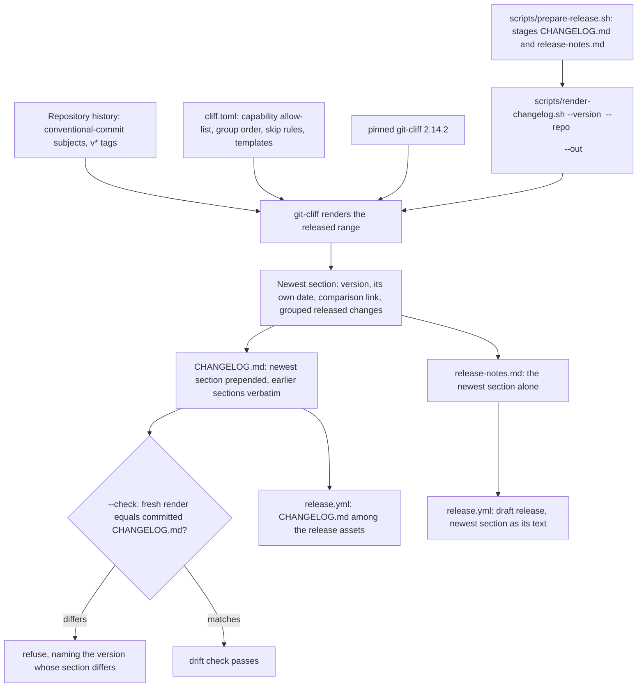

# Design: generate-release-notes

## Scope

Technical design for the change that makes a released version state the changes a user can see: [publish a public release](specs/publish-public-release/usecase.md). The observable WHAT is fixed by the proposal and the spec delta; this document is the HOW — the one generator and its configuration, the change log it renders, the drift and visibility checks that guard it, the wiring of both into the release preparation, and the back-fill of the already-published `0.1.0` section.

Two boundaries shape everything below:

- **What runs on this machine.** The project's own suite drives the generator and the drift check as real subprocesses: `scripts/render-changelog.sh`, invoked with real arguments against a throwaway repository the steps build. It needs no network, no credentials and no GitHub; that is what the delta's seven scenarios exercise.
- **What runs on the pipeline.** The published release page carries the newest section as its release text, and the generated `CHANGELOG.md` is published among the release's assets. That is GitHub's interface, exercised by the project's own release automation and recorded as this change's evidence, not invented here as a second interaction.

This change adds no product code: no crate, no module, no port, and no scenario of `export-duty-plan-calendar` changes. What changes is what a release states and what the repository keeps about it.

## Technology decisions

Every version below was resolved from the live source on 2026-10-13, not from memory. `git-cliff` was resolved on both sides the environment carries: `https://crates.io/api/v1/crates/git-cliff` reports `max_version`/`newest_version` **2.14.2** (published 2026-09-18), and `nix-shell -p git-cliff --run 'git-cliff --version'` reports **git-cliff 2.14.2** — nixpkgs offers the same version, so there is no lag to reconcile here.

| Area | Decision | Rationale / source |
|---|---|---|
| Generator | `git-cliff` 2.14.2 — a single pinned release, recorded in the repository beside its configuration. | The project's history is conventional-commit subjects, which a commit-grouping generator consumes directly; writing a bespoke renderer would re-implement grouping, templating and tag handling. The gate compares generated text, and the tool's output shape changes between versions (the `cargo-about` 0.9.0→0.9.2 duplication cost a round trip), so the version is part of the contract. Resolved: crates.io API (`max_version` 2.14.2, 2026-09-18) and `nix-shell -p git-cliff` (2.14.2), both checked 2026-10-13. |
| CI installation | `taiki-e/install-action@v2` with `tool: git-cliff@2.14.2`, exactly the `notices` job's pinning pattern. | The version the CI gate runs must be the version the committed file was produced with, or the byte comparison is meaningless; `install-action` fetches the pinned release binary instead of resolving a version at run time. `@v2` is the action major the repository already carries in `ci.yml`. |
| Configuration | `cliff.toml` at the repository root, committed; the renderer always passes it with `--config`. | One configuration the project owns decides which subjects count, how they group and what the section looks like. Passing it explicitly also stops `git-cliff` from discovering a developer's global `~/.config/git-cliff/cliff.toml`, which would make a local render differ from CI. |
| Generated artefact | `CHANGELOG.md` at the repository root, committed and generated. | A reader of the source sees what changed between versions without visiting the release page, and there is a file for the drift check to compare against the released revision. Rejected: keeping the notes only on the release page (no history for a reader of the source) and a hand-maintained file (drifts from the history it claims to summarise). |
| Renderer | `scripts/render-changelog.sh` — POSIX shell with `set -euo pipefail`, Linux-only, run by `prepare-release.sh`, by the suite's steps, and by the CI `changelog` job. | The project already owns its tooling as scripts (`run-tests.sh`, `coverage/*.sh`, `scripts/*`); rendering is build tooling, not product behaviour, so it stays out of the crates and off the coverage denominator. |
| Release text | The released version's notes are the **newest section** of the change log, not a flat list of revision subjects. | The page and the repository cannot disagree about what a version contains, because the page is a slice of the same generated file. |
| Capability allow-list | A released change is a revision whose conventional-commit scope is a **capability**: the use-case ids present as directories under `givn/specs/` (`export-duty-plan-calendar`, `publish-public-release`), materialised in `cliff.toml`'s scope pattern and checked against the corpus by the renderer. | A revision whose subject names a capability is a released change; a revision that names a tool, a workflow, a check, a test, a document or the machinery of building, packaging and publishing is not. Rejected: treating every kebab-case scope as a capability — `fix(ci)` is shaped exactly like `fix(publish-public-release)`, so shape cannot decide, which is the very confusion the flat release text exhibited. |
| Group order and skip rules | Groups, in this order, with the group a reader looks for first at the top: **Breaking changes**, then **New capabilities**, then **Fixes**, then **Performance**, then **Reversals**. Skipped entirely: housekeeping (`chore`, `docs`, `style`), `test`, `build`, `ci`, and any scope outside the allow-list — the machinery of building, packaging and publishing among them. Entries state the release-note words the revision carries, never a rewritten summary. | A reader separates a new capability from a build fix; internal work typed `fix(...)` no longer reads like a fix a user cares about. Rejected: revision order or one flat sequence, which is what a reader could not scan. |
| Comparison links | Each section links the comparison against the immediately preceding version, of the form `compare/<previous>...<this>` where each side is the version's `v*` tag; the first version states no comparison. | A downloader sees what is new since the version they already have. Rejected: linking every version to the latest release, which tells a downloader nothing about the step they are taking. |
| Range | `<previous v* tag>..<released revision>`; for the first release, every revision reachable from the released revision. | The section summarises exactly the revisions the version released. Rejected: rendering only the released revision's own subject, which would announce a version with one line while it carries many changes. |
| CI gate | A `changelog` job in `ci.yml` (pushes and pull requests) installs the pinned tool and runs `scripts/render-changelog.sh --version <newest v* tag> --check`. | The same shape the third-party notices already use: the committed file is compared against a fresh render of the released revision, and a committed file that differs is refused by name. |
| Release pipeline | `prepare-release.sh` stages `CHANGELOG.md` and derives `release-notes.md` from the same render; `release.yml`'s draft carries the change log among its assets. | The released version's section becomes the release text and the change log becomes a published file, so a downloader reads it without visiting the repository. The draft asset set is verified against the staged set, so the change log joins that comparison explicitly. |

## Architecture impact

Nothing in the product changes. The change adds a render path around the existing history, driven by the same history the release already stamps.



New or changed files:

| Path | Kind | Purpose |
|---|---|---|
| `cliff.toml` | new | The one configuration: capability allow-list, group order, skip rules, and the templates that render the section. |
| `CHANGELOG.md` | new, generated | The change log itself; its newest section is the version being released, earlier sections stay as they were, and the first section back-fills `0.1.0`. |
| `scripts/render-changelog.sh` | new | Renders one version's section and the change log (`--check` mode checks drift), the release text, and the refusals. |
| `scripts/prepare-release.sh` | changed | Stops building the release text from the flat subject list; stages `CHANGELOG.md` and derives `release-notes.md` from the rendered newest section. |
| `.github/workflows/ci.yml` | changed | One added job: `changelog`, installing `git-cliff@2.14.2` with `taiki-e/install-action@v2` and running the drift check. Every existing job keeps its name and steps. |
| `.github/workflows/release.yml` | changed only so the draft carries the change log among its assets: `staged/CHANGELOG.md` joins the `gh release create` asset list (the release text is unchanged in shape — it is now the newest section). |
| `apps/cli/tests/steps/publish_public_release.rs` | extended | The new non-`@e2e` step definitions for this capability, in the existing file — one file per capability, not a new one. |
| `apps/cli/tests/steps/e2e/publish_public_release.rs` | extended | The new `@e2e` step definitions, in the existing e2e file. |

`apps/cli/tests/steps/mod.rs` and `apps/cli/tests/steps/e2e/mod.rs` already declare these modules and do not change.

## The renderer

```
scripts/render-changelog.sh --version <version> --repo <dir> --out <path> [--release-text <path>] [--check]
```

- `<version>` is the bare version whose section is rendered (a leading `v` is refused, as the preparation command already refuses one, so the section, the tag and the archive names cannot disagree).
- `<repo>` is the checkout whose history supplies the section; `<out>` is the change log file (`CHANGELOG.md` by default), written with the new section prepended and every earlier section kept verbatim.
- `--release-text <path>` additionally writes the newest section alone, which is what `prepare-release.sh` stages as `release-notes.md`. Because both outputs come from one render, the release page and the repository cannot disagree.
- `--check` renders in memory and compares the whole file against the committed change log, refusing and naming the version whose section differs. It writes nothing.

It refuses, leaving its output untouched:

- a version with a leading `v`, or a version for which no `v*` tag exists — the section's date must be the released revision's own date, and a version with no tag has no released revision to take it from;
- a `git-cliff` whose version differs from the pinned version recorded beside `cliff.toml`;
- a capability allow-list that differs from the use-case ids present under `givn/specs/` — the corpus is the source of truth for what a capability is;
- a render that names no change a user can see — the version is not releasable, so nothing is written and the message states that;
- in `--check`, a committed change log that differs from a fresh render.

**Determinism.** The generator must render the same history to the same bytes on any machine at any time, or the byte-comparing drift check has no meaning. Three inputs are fixed:

- **Ordering** — `git-cliff` is invoked with `--sort oldest` and the released range, so commits are ordered by history rather than by the order a checkout happened to expose.
- **Time** — the section's date is the released revision's own committer date, taken from the tagged revision, never the clock. `git-cliff`'s release timestamp falls back to "now" for a revision that carries no tag (observed directly: an untagged commit rendered today's date), which is why the version-with-no-tag refusal above exists — a render the check compares can only ever be a tagged revision's.
- **Host paths** — neither the section nor the change log embeds a working-directory path, a user name or a runner name; the comparison link is built from the repository's public remote (`kressnerd/duty2cal`) and the two `v*` tags.

## Decisions

This change has no proposal `D<n>`: the proposal's Open Questions section states that none remain open and records two decisions without numbering them. Those two are carried here with the alternatives they rejected, followed by the design-level decisions from the technology table.

The proposal's two decisions:

- **The release trigger** — a pushed `v*` tag stays the only entry point: a transient failure is repaired by re-running the workflow, a faulty revision by fixing forward to the next version. Rejected: a manual trigger that names a version and tags the revision it runs on, which would remove the hand-pushed tag and the tag move the first release needed but adds an entry point the operator did not want (operator's decision of 2026-10-13). Realized in `release.yml`'s `on: push: tags: ["v*"]`, unchanged by this change.
- **Where the change log lives** — one file in the repository (`CHANGELOG.md`), generated and drift-checked, and published with the release. Rejected: notes only on the release page, which leaves a reader of the source with no history and nothing to compare a version against; and a hand-maintained file, which drifts from the history it claims to summarise. Realized in `CHANGELOG.md`, the `changelog` CI job, and the release asset.

Design decisions beyond those, each with the alternative it rejected:

- **The generator is `git-cliff` 2.14.2, pinned in the repository and installed in CI at that version** (rejected: an unpinned or run-time-resolved tool — the gate compares generated text, so a tool whose output shape moves between versions makes the comparison meaningless, the failure the `cargo-about` pin already demonstrated).
- **Installed with `taiki-e/install-action@v2`** (rejected: `cargo install git-cliff`, which compiles from source on every run and still needs a version pinned by hand; and rejected: relying on a `git-cliff` the runner happens to carry, which is exactly the unpinned case).
- **The capability allow-list is the use-case ids under `givn/specs/`, checked against the corpus** (rejected: every kebab-case scope is a capability — `fix(ci)` is shaped exactly like `fix(publish-public-release)`).
- **Group order: breaking changes, new capabilities, fixes, performance, reversals; skip housekeeping, documentation, tests, CI, tooling, and the machinery of building, packaging and publishing** (rejected: revision order, which is the flat list a reader cannot scan).
- **Comparison links of the form `compare/<previous>...<this>`, none for the first version** (rejected: no link at all, which leaves a downloader unable to tell what is new since their version; and rejected: linking every section to the latest release).
- **Range `<previous v* tag>..<released revision>`, whole history for the first release** (rejected: the released revision's subject alone, which under-announces what a version carries).
- **The release text is the newest section** (rejected: keeping the flat subject list beside the rendered section, which would let the page and the repository state different things).
- **The rendering seam is a script, not a crate** (rejected: an `xtask` binary — rendering is build tooling and would drag a workspace member, its licences and its coverage into the product's story).
- **The generator's configuration is `cliff.toml` passed explicitly** (rejected: relying on `git-cliff`'s config discovery, which would pick up a developer's global configuration and make a local render differ from CI's).

## Use-case traceability

Every rule, precondition and extension the delta adds, mapped to the decision that realises it and the scenario that evidences it.

| Use-case element (added by this change) | Technical decision | Scenario |
|---|---|---|
| Precondition: the change log committed in the repository is current for the revision being released | The `changelog` CI job's drift check over the newest `v*` tag | "A change log that does not match the released revision is refused" |
| Main flow 1: the release text is the newest section of the change log, not a flat list of subjects | Release text = newest section; `prepare-release.sh` stages `CHANGELOG.md` and derives `release-notes.md` from one render | "@e2e" Maintainer generates the change log for a version and reads its newest section |
| Main flow 7: the release states what changed, grouped by kind | Group order and skip rules in `cliff.toml` | "A version's notes group the changes a reader can see" |
| Rule: notes name the changes a user can see, grouped by kind, the first group at the top | Group order (breaking, new capabilities, fixes, performance, reversals) | "A version's notes group the changes a reader can see" |
| Rule: a revision whose subject names a capability is released; one naming a tool, workflow, check, test, document or build/packaging/publishing machinery is not | Capability allow-list checked against `givn/specs/`; skip rules | "A version's notes group the changes a reader can see" |
| Rule: each entry states the release-note words the revision carries, and never claims work the released revision does not contain | `git-cliff` renders the released range with the entry body taken verbatim from the subject | "A version's notes group the changes a reader can see"; "@e2e" Maintainer generates the change log for a version and reads its newest section |
| Rule: a version whose notes name no visible change is refused rather than published | The renderer's empty-section refusal | "A version that changes nothing a user can see is refused" |
| Rule: the notes are the newest section of the change log, every earlier version unchanged beside it | `CHANGELOG.md` written with the new section prepended and earlier sections verbatim | "The change log keeps the earlier versions beside the new one" |
| Rule: each section states its own date and, where an earlier version exists, the comparison against the immediately preceding version | Section date from the released revision's own date; `compare/<previous>...<this>` link, none for the first version | "Each version's section is dated and compared with the one before it" |
| Rule: the section is rendered by the project's own generator, whose version is recorded beside its configuration; a committed change log differing from a fresh render is refused | Pinned `git-cliff` 2.14.2 recorded beside `cliff.toml`; `--check` byte comparison | "A change log that does not match the released revision is refused" |
| Extension 1: a version whose notes would name no visible change → preparation fails, nothing published | The renderer's empty-section refusal surfacing through `prepare-release.sh` | "A version that changes nothing a user can see is refused" |
| Extension 1: the committed change log does not match the released revision → preparation fails, naming the version whose section differs | `--check` in the preparation and the `changelog` job | "A change log that does not match the released revision is refused" |
| Example: the first version of all — no change log yet, one section, no comparison | Range = whole history, no comparison link for the first version | "The first released version is recorded from the history" |
| Capability ownership | `publish-public-release` only | Interaction Coverage Matrix |

Actors in Gherkin are domain roles (the maintainer); Personas are review lenses, not Actors.

## Persona impact

User-visible surface: a terminal interface (the renderer's and the preparation command's output) plus the release page and the repository text this change authors (the newest section as the release text, `CHANGELOG.md` as a published asset). The host's pages are rendered by GitHub, not by this project.

- **`crew-member--personal-calendar-owner`** — the reader. The change gives them a release whose notes name the changes they can see, grouped so the new capabilities come first, with a link to compare against the version they already have, and the same text in the repository so they can read the history without visiting the release page. They judge it by whether they can tell, from the notes alone, whether the new version contains something they would want.
- **`project-maintainer--release-owner`** — the author. The change gives them one configuration that decides what is released, a generator whose version is pinned so the same history renders the same file, a drift check that refuses a stale committed change log before publication, and a refusal when a version would state nothing a user can see. They judge it by whether a release can be prepared and published without hand-editing any text, and whether the page and the repository can ever disagree.

## Visual Design Contract

- Interface: terminal
- Viewports: n/a (no rendered screen; the release page and the repository text are GitHub's rendering, not this project's)
- Design system: none
- Evidence kind: captured transcript per `@e2e` scenario at `givn/changes/generate-release-notes/evidence/visual/<scenario-slug>/transcript.txt`.
- Baseline: the transcript shows the renderer command and its reported newest section, names the version and the changes a user can see, has the run-specific directory replaced by a placeholder, and contains no host path, user name or clock value.
- Motion: n/a.

## E2E smoke test infrastructure

- **E2E runner command:** `./run-tests.sh --e2e` (the assembled root with `--tags "@e2e"`), distinct from `verify.command` (`./run-tests.sh`).
- **E2E step location:** `apps/cli/tests/steps/e2e/publish_public_release.rs`, one file per capability, separate from the in-process steps — extended, not replaced.
- **Real interface:** `scripts/render-changelog.sh`, invoked as a subprocess with real arguments. The assertion is on the change log the command wrote and on the newest section it reports.
- **Local infrastructure:** a throwaway git repository the steps build (`git init`, commits with fixed commit dates and conventional subjects, and `v*` tags), plus a temporary `--out` path. No network, no credentials, no container.
- **Framework:** cucumber-rs with `std::process::Command`, as the existing E2E steps use; the same harness that drives `export-duty-plan-calendar` and the release preparation.
- **Strict-mode proof:** `.fail_on_skipped()` on the `Cucumber` builder in `apps/cli/tests/features_runner.rs`; a step left unimplemented or skipped makes the run non-zero. A new step body is written as a stub that panics with its own name, so an undefined step exits non-zero rather than passing.
- **Single-scenario run command:** `./run-tests.sh --name "<title>"`, used by every RED/GREEN check.
- **Transcript evidence:** committed by the scenario's final step with the run-specific directory replaced by a placeholder, as the existing `@e2e` transcript does.

## Interaction Coverage Matrix

| Inventory entry | @e2e scenario title | Real interface | Driving mechanism |
|---|---|---|---|
| prepare the release for a version | Maintainer prepares a release and runs the archived executable | CLI (terminal) | `std::process::Command` runs `scripts/prepare-release.sh --version 0.1.0 --binaries <dir> --out <dir>`; asserts the reported archive and checksum for this machine's platform, the staged change log, and the version named in the release text; then extracts and runs this machine's executable |
| generate the change log for a version | Maintainer generates the change log for a version and reads its newest section | CLI (terminal) | `std::process::Command` runs `scripts/render-changelog.sh --version 0.1.0 --repo <fixture repo> --out <path>`; asserts the written change log holds a section for version 0.1.0 naming the released change a user can see, and commits the transcript as evidence |

## Local runnability & digital twins

- **Local run:** `scripts/render-changelog.sh --version 0.1.0 --repo . --out CHANGELOG.md` renders the committed change log from the local history; `scripts/render-changelog.sh --version 0.1.0 --repo . --out CHANGELOG.md --check` checks it for drift. The full local path is `./run-tests.sh --e2e`, which builds the fixture repository and drives the renderer as a subprocess.
- **Isolated network:** not applicable — the renderer touches only the filesystem, the pinned `git-cliff` binary and the local git history. The suite stays offline.
- **Digital twins:** none, and deliberately so. The only external service this change concerns is GitHub, and the only thing that talks to it is GitHub's own automation, running on GitHub's infrastructure with that repository's token. There is no local client of the release API, so no twin is required and no scenario may depend on a live third-party service.
- **Interface obstacles and their fixes:**
  - *The fixture repository needs a `v*` tag history, or the renderer's version-with-no-tag refusal fires before anything is rendered.* Fix: the steps build the history themselves — `git init`, commits made with fixed `GIT_COMMITTER_DATE`/`--date` values and conventional subjects, then `git tag v<version>` — so the released revision and its date are deterministic and no real repository or clock is involved.
  - *`git-cliff` must not read the developer's global configuration.* Fix: the renderer always passes `--config cliff.toml` explicitly and never relies on discovery; the step asserts the rendered section against the section the fixture's own history states, so a stray global config shows up as a failing assertion rather than a silently different render.
  - *The pinned tool must be the one CI runs, or a local render and the gate disagree.* Fix: the version is recorded beside `cliff.toml` and the renderer refuses a `git-cliff` whose `--version` differs; CI installs `git-cliff@2.14.2` with `taiki-e/install-action@v2` and the local environment gets the same version from `nix-shell -p git-cliff` (2.14.2 as of 2026-10-13).

## Coverage process boundaries

| Process | Started by | Instrumented artifact | Profile output | Merge step | Non-zero production probe |
|---|---|---|---|---|---|
| features_runner (unit/integration) | `./measure-coverage.sh` (`--tags "not @e2e"`) | `cargo llvm-cov --workspace --test features_runner` | `coverage/non-e2e-cobertura.xml` | `./merge-coverages.sh` | `crates/duty2cal-core/src/domain/timing.rs` |
| E2E runner + spawned CLI | `./measure-coverage.sh` (`--tags "@e2e"`) | `cargo llvm-cov --workspace --test features_runner` with the CLI built under instrumentation | `coverage/e2e-cobertura.xml` | `./merge-coverages.sh` | `apps/cli/src/fs.rs` |

Unchanged by this change: the new step definitions are part of `features_runner` and are instrumented with it. `scripts/render-changelog.sh` — like `scripts/prepare-release.sh` and the coverage scripts already there — is not Rust and is therefore outside the coverage denominator; its observable contract is covered by the delta's scenarios instead.

## Risks and follow-ups recorded here

- **The pinned tool's output shape can move between versions.** `git-cliff`'s templates and grouping changed across releases, and the drift check compares bytes, so a version bump can change the committed file without any history change. The pin and the renderer's version refusal make a mismatch loud rather than silent; a bump is a deliberate change that re-renders the file, never an automatic one.
- **The capability allow-list can drift from the corpus.** A new capability added under `givn/specs/` without a matching entry in `cliff.toml` would leave its changes out of every release. The renderer compares the list against the use-case ids under `givn/specs/` and refuses on any difference, so the two cannot diverge quietly.
- **The back-filled `0.1.0` section differs from what the published page says.** The page's list was generated by the older rule; the back-filled section is generated from the same history under the new rules. The change records the difference rather than editing the release, because a published release is immutable — the divergence is the change's deliberate record, not an unnoticed drift.
- **The notes inherit their quality from the revision subjects.** A revision whose scope names no capability, or whose release-note words are unhelpful, produces an unclear entry or none at all. The visibility refusal catches a version that would say nothing; it cannot make a badly worded subject good. The maintainer's discipline in the commit message remains the upstream input.

## Black-Box-First policy

The delta's scenarios drive the generator and the checks as real subprocesses; six of them assert invariants a render can observe (grouping, the visibility refusal, section ordering and immutability, the drift refusal, the date and comparison link, the first version) and the `@e2e` scenario additionally reads the newest section out of the written change log. No internal test is retained alongside them: the only Rust added by this change is step definitions.

- **The `changelog` CI job's drift check** covers the case the `@e2e` scenario does not: a *committed* `CHANGELOG.md` that differs from a fresh render of the real repository's newest `v*` tag. The `@e2e` scenario proves the renderer writes a correct newest section from a fixture history; it never compares against a committed file in the real checkout, which is exactly what the gate must refuse.
- **The renderer's version and allow-list refusals** cover the case the `@e2e` scenario does not: a host whose `git-cliff` is not the pinned version, and a configuration whose capability allow-list no longer matches `givn/specs/`. The `@e2e` scenario runs against the pinned tool and the committed configuration, so it cannot observe either drift; the shell-level refusals are where those cases are exercised, and the local steps drive them through the same subprocess.
