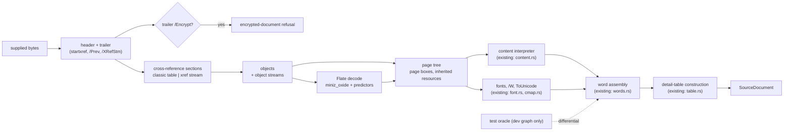

# Design: own-the-pdf-file-structure

## Scope

The HOW for [the delta](specs/own-the-duty-plan-extraction/own-the-duty-plan-extraction.feature): the
project reads the supported duty plan's file structure itself, the third-party
PDF object and cross-reference library leaves the Windows executable's and the
browser bundle's dependency graphs, only a pure-Rust Flate decompressor remains
in the reading path, and the previously accepted reading is proved equivalent
against the test oracle before anything lands.

Unchanged by this design: every conversion rule, the detail-table construction,
the positioned-word boundary, the closed refusal vocabulary, the report formats,
the publication and privacy rules, the budget, the build profile, the oracle's
role and the browser page.

## Measured evidence at this revision

Host attribution, `cargo bloat --release -p duty2cal --crates` at this revision
(host `.text`; **not** shipped evidence):

| Attribution | Value | Note |
|---|---:|---|
| `.text` total | 577.6 KiB | host |
| the removed library | 140.4 KiB | largest third-party crate after `std` |
| `sha2` / `aes` / `weezl` / `stringprep` / `hashbrown` / `rand` `/` `md5` | 30.2 / 13.1 / 8.3 / 3.5 / 3.2 / 2.8 / 2.4 KiB | reached only through that library |
| `duty2cal-pdf` (the project's own extraction) | 62.9 KiB | grows by the new file-structure code |
| `miniz_oxide` (would remain) | 20.4 KiB | Flate |
| `std` | 229.5 KiB | unchanged |

Recorded for ADR-0008 on the host at `30bbcb9`: the third-party extractor came
out at 1,938,024 B (86.8%) and the object layer at 483,456 B over the no-PDF
floor, 779,016 B against 2,233,584 B; the fully self-owned cut was estimated
[INFERENCE] ≈400–450 KB total (~380 KB below) with **no measured prototype**.

Shipped facts, none measured by this design:

- The Windows GNU executable at the landing of `replace-pdf-extraction-backend`
  was 841,728 B; the unchanged budget is 2,097,152 B (`QS-041`,
  `windows-gnu-build` job).
- Commit `67f4a2e` reverted a library bump that grew that executable from
  841,728 B to 1,038,336 B (+196,608 B, +23.4%) because a Brotli decompressor
  had become non-optional — evidence that the removed dependency moves the
  shipped size without any conversion change.
- `target/x86_64-pc-windows-gnu/release/duty2cal.exe` in this worktree is stale
  (2,013,696 B, 2026-10-27) and is never cited as current. The local host
  release binary of 2026-10-28 (926,104 B) is indicative only.

The landed saving is **not** known at design time. It is produced by
[Gate B](#prototype-and-measurement-gates) on the shipped artifacts.

## Technology decisions

| Area | Decision | Rationale / source |
|---|---|---|
| Language | Rust stable, edition 2021, pinned `1.99.1` by `rust-toolchain.toml`; no `unsafe` | Unchanged project pin, read from the repository this session |
| Decompressor | `miniz_oxide = { version = "=0.9.1", default-features = false, features = ["with-alloc"] }` as a direct dependency of `duty2cal-pdf` | Already in the tree (fixtures crate pins `=0.9.1`; the removed library reached it through `flate2`). `default = ["with-alloc"]`, `simd` optional, only `adler2` under `default-features = false` — read from the crate's `Cargo.toml` in this session's registry copy. API used: `miniz_oxide::inflate::stream::{inflate, InflateState}` with the 64 MiB bound and the raw-deflate retry |
| Object model | Project types in `reader/structure/`: `Object`, `Dict`, `Stream`, `ObjId`; `Stream` holds a byte range into the supplied buffer | The interpretation modules keep their logic; only the object vocabulary changes. A stream body is never copied |
| Load strategy | Whole document parsed eagerly: cross-reference sections first, then every object the sections name, object streams decoded and their entries inserted; stream bodies are sliced in a second pass after every object is known, so a forward-pointing indirect `/Length` resolves | Matches the previous reader's shape, keeps every failure deterministic, avoids interior mutability and an `Rc`/`RefCell` cache |
| Reference depth | One level (`Object::Reference` resolved once), exactly as today's `resolve` helpers do | Preserves the interpretation code's expectations; a chain of references is not a supported construct and resolves to a non-object where a dict is required → unreadable |
| Error handling | The `structure` layer returns `SourceError` directly: a named refusal for a construct outside the subset (`EncryptedDocument`, `StreamFilter`), `Unreadable(detail)` for a structural failure — no second error type, no mapping table | `SourceError` is already the crate's vocabulary and the detail clause is where the removed library's message used to be. The `Source PDF:`/`Reason:` report shape, the numbered report and the page suffix are untouched |
| Repair | None. A cross-reference pointer outside the file, an unparsable section, a missing `/Root`, a page-tree cycle or a stream length outside the file is the unreadable refusal | Decision D2; matches the previous reader, which follows `startxref` then `/Prev` with no reconstruction fallback (read in the library's own reader source this session) |
| Predictors | `/DecodeParms /Predictor`: 10–15 (PNG) applied with `/Columns`, `/Colors` and `/BitsPerComponent`; every other value, including 2 (TIFF), is passed through unchanged | Decision D2 and the differences table: the previous reader and the comparison oracle share `lopdf` 0.44.0, which applies only 10–15 and passes every other value through. Mirroring it keeps a predictor-bearing stream's output identical to the oracle and adds no refusal name |
| Decompression bound | 64 MiB per decoded stream; exceeding it is unreadable | The browser already refuses a plan above 20 MiB and the CLI has no source bound; a decoded stream above 64 MiB is not a roster. Replaces an unbounded decode |
| Encryption | `/Encrypt` in any trailer dictionary → the encrypted-document refusal; when the structure fails before a trailer is read, the existing byte scan for `/Encrypt` keeps the named refusal | Preserves the current two paths in `document.rs:14-31` |
| Page tree | Depth-first from `/Root` → `/Pages` → `/Kids`; `/Resources` is read as the previous reader does — the page's direct dictionary plus any `/Resources` reference on the parent chain — while `/MediaBox`, `/CropBox` and `/Rotate` are read from the page dictionary, exactly as `document.rs` does today; a repeated or cyclic kid is unreadable; page order is kid order | Preserves the page order and resource inheritance `get_pages` and `get_page_resources` provided, and the page-dictionary box and rotation reads the previous reader performs |
| Refusal vocabulary | The fifteen existing `Construct` names, unchanged; structural failures stay `Unreadable` | Decision D3; R-077 makes renaming or adding a name an ADR change with evidence |
| Oracle | Unchanged: `pdfplumber = "=0.4.1"` in `[dev-dependencies]`, its own `lopdf` copy stays in the dev graph | Decision D4 |
| Dependency check | `scripts/check-extraction-dependency.sh` keeps its two modes; normal mode refuses `pdfplumber` **and** `lopdf` in the named target's graph, dev mode still requires the oracle | Decision D4; one check, two facts |
| Measurement | Reuse `scripts/measure_extraction_backend.py` and `scripts/measure_browser_bundle.py`; only their base-manifest predicate (now the removed library) and their wording change | Decision D5; both already restore the base `crates/duty2cal-pdf/` and `Cargo.lock`, refuse a difference outside those paths and require a positive delta |
| Gherkin runner | cucumber-rs `0.23` (workspace pin in `apps/cli/Cargo.toml`), strict by `.fail_on_skipped()` | Unchanged |
| Browser bundle tool | `wasm-pack 0.15.0`, pinned in `web/.wasm-pack-version` | Unchanged; `miniz_oxide` is `no_std`-friendly and wasm-safe |

### Version freshness

No version in this design comes from memory. `rust-toolchain.toml`,
`apps/cli/Cargo.toml`, `web/.wasm-pack-version` and the pinned crate versions
were read from this repository in this session; `miniz_oxide`'s features,
mandatory dependencies and inflate API were read from its resolved 0.9.1 source
in this session's registry copy. The removed library's own reader behaviour
(`startxref` search window, `/Prev`, `/XRefStm`, predictor range, unbounded
decompression by default) was read from `lopdf-0.44.0`'s source the same way.
No new crate is introduced beyond the decompressor already in the tree. The comparison oracle reaches the same decoder: `pdfplumber-parse 0.4.1` depends on `lopdf 0.44`, so its predictor, checksum and decompression behaviour is the comparison target, not just the previous owned reader's.

## Architecture impact

### Files

| Path | Change | Role |
|---|---|---|
| `crates/duty2cal-pdf/Cargo.toml` | changed | remove `lopdf` from `[dependencies]`; add `miniz_oxide` with `default-features = false, features = ["with-alloc"]`; keep the oracle in `[dev-dependencies]`; replace the "file-structure layer only" comment |
| `crates/duty2cal-pdf/src/reader/structure/mod.rs` | new | module surface: `Document`, `Object`, `Dict`, `Stream`, `ObjId`, `load` |
| `crates/duty2cal-pdf/src/reader/structure/object.rs` | new | object model, `Dict` lookup, accessors (`as_dict`, `as_array`, `as_name`, `as_stream`, `as_i64`, `as_f64`, `as_reference`), one-level `resolve` |
| `crates/duty2cal-pdf/src/reader/structure/parser.rs` | new | tokenizer and object parser over `&[u8]`: numbers, names with `#xx`, literal and hex strings, arrays, dictionaries, references, booleans, null, comments, stream bodies with `/Length` direct or indirect |
| `crates/duty2cal-pdf/src/reader/structure/xref.rs` | new | the last `%%EOF` in the last 512 bytes and `startxref` within the 25 bytes before it, classic sections, xref streams (at least three non-negative `/W` widths of 0–8 bytes, the first three used, a zero width meaning an absent field whose type defaults to 1; `/Index`; `/Prev`), hybrid `/XRefStm`, cross-reference types 0/1/2, object-stream entries |
| `crates/duty2cal-pdf/src/reader/structure/filter.rs` | new | `FlateDecode`/`Fl` through `miniz_oxide` with the 64 MiB bound; PNG predictors 10–15 applied and every other predictor value passed through unchanged; on a zlib decode failure with empty output, the previous reader's raw-deflate retry from byte 2 (partial output kept); the `StreamFilter` refusal for every other name |
| `crates/duty2cal-pdf/src/reader/document.rs` | rewritten | orchestration that the previous version delegated to the library: header, encryption, page-tree walk with resource inheritance, `/Contents` concatenation, `/Resources` and `/Font` lookup, then `content::interpret` and `words::extract_words` unchanged |
| `crates/duty2cal-pdf/src/reader/font.rs` | imports and signatures only | `lopdf::{Dictionary, Document, Object}` and `decompress_stream` from `document.rs` become the project types from `structure`; `/W`, `/DW`, `/Descent`, `ToUnicode` logic unchanged |
| `crates/duty2cal-pdf/src/reader/content.rs` | imports and signatures only | same swap of object vocabulary; tokenizer, state, operator subset and refusals unchanged |
| `crates/duty2cal-pdf/src/reader/mod.rs` | one line | registers the new `structure` module beside `cmap`, `content`, `document`, `font` and `words` |
| `crates/duty2cal-pdf/src/reader/{cmap,words}.rs` | unchanged | no object vocabulary is exposed |
| `crates/duty2cal-pdf/src/differential_tests.rs` | changed | adds one comparison case per new fixture — the predicted xref stream, the incremental update, the indirect length, the inherited resources, the corrupt checksum, the leading-junk header, the hybrid `/XRefStm`, the compact `/W`/`/Index` stream, the non-PNG predictor, the Sub and Paeth PNG filters, and the raw-deflate retry — each through the existing `compare_with_oracle` |
| `crates/duty2cal-pdf-fixtures/src/lib.rs` | changed | `Encoding` gains predicted-xref-stream, incremental-update, hybrid-xref-stream and compact-xref-stream variants; the indirect stream length, inherited resources, non-PNG predictor, PNG row filter and raw-deflate-prefix spellings become builder options; `build_leading_junk_plan()`, `build_corrupt_checksum_plan()` and `build_bad_startxref_plan()` emit the remaining sources. Generated bytes only, never a committed PDF |
| `apps/cli/tests/steps/own_the_duty_plan_extraction.rs` | changed | the four new steps (see [Step Definitions](#step-definitions)) with the exhaustive spelling mapping, and the extracted `content_apart_from_identity` helper |
| `apps/cli/tests/steps/support.rs` | changed | gains `pub(crate) fn accepted_calendar() -> String` (reads `tests/fixtures/expected/2026-06.ics`) and `pub(crate) fn normalise(&str) -> String`, moved from `steps/e2e/own_the_duty_plan_extraction.rs` so the regular and e2e steps share one predicate; no phrase changes |
| `apps/cli/tests/steps/e2e/export_duty_plan_calendar.rs` | changed | the scenario slug rule becomes visible to the extraction transcript; no behaviour change |
| `apps/cli/tests/steps/e2e/own_the_duty_plan_extraction.rs` | changed | `write_transcript` resolves `DUTY2CAL_EVIDENCE_DIR` + the scenario slug instead of the hardcoded archived change directory, and prints the exit status and the comparison outcome recorded by the preceding steps instead of literals; the scenario, phrases and assertions are unchanged |
| `run-tests.sh` | changed | exports `DUTY2CAL_EVIDENCE_DIR` when exactly one active change holds a `specs/` directory; leaves it unset otherwise |
| `apps/cli/tests/features_runner.rs` | changed | `DutyWorld` gains the recorded calendar-comparison outcome the transcript prints |
| `apps/cli/tests/steps/e2e/mod.rs` | unchanged | registration already covers the capability |
| `scripts/check-extraction-dependency.sh` | changed | normal mode refuses the library as well as the extractor; dev mode keeps the oracle requirement; messages name the crate |
| `scripts/measure_extraction_backend.py`, `scripts/measure_browser_bundle.py` | changed | base-manifest predicate and wording; the restore paths, one-shot status and delta rule stay |
| `.github/workflows/ci.yml` | wording only | step names say "no third-party PDF library"; the commands are unchanged |
| `Cargo.lock` | changed | `miniz_oxide` becomes a direct dependency; `lopdf` stays, reached only from the dev graph through the oracle |
| `THIRD-PARTY-NOTICES.md` | unchanged | the library stays in the resolve graph through the oracle, so `cargo about generate` output does not move; regenerate only if the drift check reports a difference |
| `docs/arc42/**`, `docs/arc42/adr/ADR-0008*` | not this artifact | owned by the `arc42-docs` step |

The public surface does not move: `PdfRosterSource::read`, `RosterSource`,
`SourceDocument`, `SourceError`, `Construct` and the positioned-word payload are
unchanged, so `apps/cli` and `ffi/wasm` need no edit.

## Decisions

**Decides D1: depend on `miniz_oxide` directly; no other third-party piece joins
the reading path — realized in `crates/duty2cal-pdf/Cargo.toml` and
`src/reader/structure/filter.rs`.**

- `default-features = false` plus `with-alloc` leaves `adler2` as the only
  dependency and drops the `simd-adler32`, `serde` and `std` features; the
  fixture crate already pins the same version, so the lock gains a direct edge,
  not a new crate.
- Rejected: keeping `flate2` (adds `crc32fast` and the gzip/raw wrappers for a
  zlib-only need); own inflate (a second parser with no measured saving, and
  ADR-0008's estimate already assumed a decompressor crate).
- Consequence stated, not hidden: the reading path still carries one
  third-party crate; the change's claim is "no third-party PDF library", not
  "no third-party code".

**Decides D2: no repair; the accepted file-structure spellings are enumerated,
everything else is the unreadable refusal — realized in
`src/reader/structure/xref.rs` and `src/reader/document.rs`.**

Accepted, because the previous reading accepted them and the corpus may carry
them:

- a `%PDF-` header at its first occurrence in the buffer, the buffer sliced at
  that offset, followed by version digits and dots, any further bytes on that
  line and a line ending — the previous reader's lenient rule, so tolerated
  trailing bytes stay tolerated and only a missing header line is unreadable;
- the last `%%EOF` within the last 512 bytes, and a `startxref` keyword starting
  within the 25 bytes before it — the previous reader's rule, not a wider
  window;
- classic cross-reference table sections and cross-reference streams with at
  least three non-negative `/W` widths (the first three used), `/Index`, and any
  number of `/Prev` sections (newest section wins for a given object number);
- a hybrid body: a classic section with trailer `/XRefStm`, whose stream is
  read as the older section beside the classic one;
- cross-reference types 0 (free), 1 (offset), 2 (object stream id + index);
- object streams (`/Type /ObjStm`, `/N`, `/First`) decoded through the filter
  layer; `/Extends` is **not** followed, matching the previous reading;
- a stream `/Length` as a non-negative integer or a one-level reference that
  fits the file — the previous reader requires exactly this and refuses the same
  case (a missing or over-long length is unreadable in both);
- an unfiltered stream or `FlateDecode`/`Fl` with PNG predictors 10–15 applied and every other predictor value passed through unchanged (including 2, TIFF).

Refused as unreadable, because the previous reading refused the same files: a
missing or out-of-file `startxref`, an unparsable section or trailer, a missing
`/Root`, a page without `/MediaBox`, an object number the sections do not define,
a stream length that is missing or runs past the end, and a decode failure
(including over the 64 MiB bound). A `/Kids` cycle or a repeated kid
is also refused; see the differences table.

Rejected: bounded reconstruction and full repair (D2 option 2 and 3) — they would
convert documents the current reader refuses and make the equivalence claim
unprovable.

**These are spellings, not a subset change.** Every item above is a concrete
spelling of a file-structure construct the previous reader already accepted —
classic table, cross-reference stream, object stream, Flate, page tree,
encryption detection — and the previous reader's acceptance is the reference for
each one. None widens the **Frozen supported subset**, which is about fonts and
content. A widening would be a new font subtype or encoding, a new stream
filter, a new content-stream operator or a new text-positioning operator; none
is added, so no `Construct` name, no refusal wording and no refusal scenario
changes.

### Differences from the previous reader

Every difference found by reading the previous reader's source, with the reason
it cannot change a supported plan's calendar or refusal:

| Difference | Direction | Why a supported plan cannot change |
|---|---|---|
| A decoded stream above 64 MiB is refused | stricter | The browser already refuses a source above 20 MiB and a roster's streams are kilobytes; the previous reader had no bound and would exhaust memory instead. Only a decompression bomb is affected, and its failure stays visible as the unreadable refusal |
| A `/Kids` cycle or repeated kid is refused | stricter | A cycle cannot describe a page order; the previous reader's behaviour on one is not a supported input, and the document is malformed either way |
| zlib decoding runs through `miniz_oxide` rather than `flate2` | equal | Both decode the zlib streams the corpus uses; the differential compares every word of every generated variant against the oracle |
| A zlib stream whose checksum is corrupt, or that is raw deflate behind a zlib header, is recovered by retrying raw deflate from byte 2 when zlib produced no bytes; partial output is kept | equal | `lopdf` 0.44.0 does exactly this in `decompress_zlib`, and the oracle shares that decoder; without the retry the owned reader would refuse a stream the oracle reads. A corrupt-checksum fixture in the differential suite pins the parity |
| The `Unreadable(detail)` text changes from the library's message to the parser's | wording only | `SourceError::Unreadable` carries a detail string that was never part of the contract; the refusal class, the two-line `Source PDF:` / `Reason:` form, the numbered report and the page suffix are unchanged |
| Header rule, `startxref` window, `/Prev`, `/XRefStm`, `/W`, `/Index`, `/Length`, object streams, page order and resource inheritance, encryption detection, one-level reference resolution | equal | Implemented to the previous reader's rules, each stated in the accepted list above and read from its source |

**Decides D3: the closed refusal vocabulary stays; nothing is renamed or added —
realized in `crates/duty2cal-core/src/application/mod.rs` (unchanged) and the
mapping below.**

| `Construct` | Decided where after the change | Observable wording |
|---|---|---|
| `EncryptedDocument` | `document.rs`: `/Encrypt` in a trailer, or the byte-scan fallback when the structure cannot be read | unchanged, no page |
| `PageRotation` | `document.rs`: the page's `/Rotate` ≠ 0 | unchanged, with page |
| `PageBox` | `document.rs`: a `/CropBox` that differs from `/MediaBox` | unchanged, with page |
| `StreamFilter(name)` | `filter.rs`, for every name other than `FlateDecode`/`Fl` | unchanged, with page when the stream belongs to a page |
| `Type3Font`, `NonIdentityEncoding`, `MissingToUnicode`, `MissingDescent`, `UnmappedGlyph` | `font.rs`, unchanged | unchanged, with page |
| `TextRotation`, `HorizontalScaling`, `InlineImage`, `FormXObject`, `TextOperator`, `UnknownOperator` | `content.rs`, unchanged | unchanged, with page |

A stream-parameter value such as `/Predictor 2` is not a construct and is not named: the parser applies PNG predictors 10–15 and passes every other value through unchanged, exactly as the previous reader did.

**Decides D4: the oracle keeps its own copy of the library in the test graph —
realized in `crates/duty2cal-pdf/Cargo.toml` and
`scripts/check-extraction-dependency.sh`.**

- `cargo tree -e normal` for `x86_64-pc-windows-gnu` and
  `wasm32-unknown-unknown` must name neither `pdfplumber` nor `lopdf`.
  `cargo tree -e dev -p duty2cal-pdf` must still name `pdfplumber`; `lopdf`
  then appears under it and that is expected.
- `Cargo.lock` therefore keeps `lopdf 0.44.0`, and `THIRD-PARTY-NOTICES.md`
  keeps its entry. The glossary's **Test oracle** row gains the sentence that
  the oracle's own PDF library stays in the test graph; that is an
  `arc42-docs` edit, not this artifact.
- Rejected: vendoring a fork (ADR-0008 measured it at −26.5% of a stack this
  change removes entirely) and dropping the oracle (removes the only
  equivalence evidence this change has).

**Decides D5: both existing same-revision measurement commands are reused with
their base-manifest predicate switched — realized in
`scripts/measure_extraction_backend.py`, `scripts/measure_browser_bundle.py` and
the two existing CI jobs.**

- Both scripts restore `crates/duty2cal-pdf/` and `Cargo.lock` from the resolved
  base revision into a detached worktree of the landed revision and refuse any
  other difference. That is exactly the base this change needs: the base's
  `crates/duty2cal-pdf/Cargo.toml` still names the library in
  `[dependencies]`.
- `names_extractor` becomes `names_previous_layer`, matching
  `lopdf` in the `[dependencies]` section. The `status: not applicable` path,
  the `allowed paths` guard, the landed-must-be-smaller rule, the
  `saved_bytes`/`saved_percent` fields and the WASM-module rule are unchanged.
- Script file names and `--out` directories stay (`extraction-backend/`,
  `browser-bundle/`); renaming them would churn CI wiring and the archived
  reports for no behavioural gain. Their docstrings say "the previous
  file-structure layer".
- Rejected: a third script (a third copy of the worktree logic); host
  measurement (not evidence, and the use case forbids it).

**Decides D6 (mechanism): the ADR-0008/TD-030 reopen condition becomes an entry
gate that runs on the host, before the replacement is built, and can stop the
change — realized in Gate A below.**

- The gate is a design fixture: prototype → host release build → file size and
  `cargo bloat` attribution → six-plan differential, in that order, as the first
  implementable step of the change.
- Its owner is named: `project-maintainer--release-owner` makes the ruling, and
  the gate's report is the input to that ruling. A refusal before the ruling is
  the gate's own stop rule, not a decision by the implementer.

**Carried D6 (outcome): whether the bound is met, and therefore whether
ADR-0008 is amended and TD-030 closed, is not decided by this design — owner
`project-maintainer--release-owner`, decided in the `arc42-docs` artifact from
Gate A's recorded report.** This design states the bound, the arithmetic beside
it and the stop rule; it does not predict the result, and the proposal records
the same question as carried.

**Decides D7: the owning use case's inventory is untouched and the delta adds no
`@e2e` scenario — realized in
`givn/changes/own-the-pdf-file-structure/specs/own-the-duty-plan-extraction/own-the-duty-plan-extraction.feature`.**

The delta's scenarios are variants and failure edges of the one declared action
("convert the supported duty plan through the built executable and read the
calendar it publishes"), whose `@e2e` scenario stays the permanent one. The
dependency split and the size measurement are build claims, and the project's
convention keeps them in scripts, CI jobs and the ADR's confirmation list — a
Gherkin scenario that drives a graph query would invent a consumer action no
consumer performs.

## Use-case traceability

| Use case | Contract element | Design decision | Evidence |
|---|---|---|---|
| `own-the-duty-plan-extraction` | Goal: the crew member receives the accepted calendar from a download that carries no third-party PDF extractor | now reads the file structure too (D1, D2) | the permanent `@e2e` scenario plus Gate B's measured artifacts |
| | Main flow 2: a supported plan converts with the accepted calendar, warnings and diagnostics | D2, D3, differential unchanged | the delta outline and the existing conversion scenarios; `differential_tests.rs` |
| | Main flow 3: a construct outside the subset is refused by name | D3 | the existing refusal outline, the privacy scenario and the new bad-pointer scenario |
| | Rule: the supported subset is frozen by ADR-0008 | D2 enumerates the accepted spellings; no construct is added | the enumeration above; the `arc42-docs` amendment |
| | Rule: every construct outside the subset is refused by name | D3 | the mapping table; the existing outline |
| | Rule: the refusal contract is observable | D3 | the Type3/privacy scenario; the bad-pointer scenario |
| | Rule: equivalence is judged against the previously accepted extractor | differential unchanged (same tolerance, same table comparison) | `crates/duty2cal-pdf/src/differential_tests.rs`, extended corpus variants |
| | Rule: the dependency split is mechanical | D4 | `check-extraction-dependency.sh` in both CI jobs |
| | Rule: measurement is on the shipped artifacts | D5, Gate B | `extraction-backend.md`, `browser-bundle.md` |
| | Rule: the same-revision measurement is one-shot | D5 | the scripts' `not applicable` status |
| | Rule: delivery constraints (stable Rust, single self-contained executable, Windows GNU cross-build, browser route, no native dependency, support statement) | unchanged | CI `windows-gnu-build` (build, DLL import check, budget) and the browser job |
| | Rule: privacy — no real plan or plan-derived fixture committed | unchanged | generated fixtures only; the opt-in local corpus |
| | Precondition: the extractor is available to the test graph as the oracle | D4 | `check-extraction-dependency.sh --dev` |
| | Main flow 4 / Extensions: reviewer reviews, maintainer accepts, a non-reproducible replacement is refused | D6, Gate A/B | the recorded reports and the ADR amendment |
| | Capability ownership | Routing table: `EXTEND own-the-duty-plan-extraction` | the delta file is the same capability |
| | Personas | see [Persona impact](#persona-impact) | — |

## Prototype and measurement gates

### Gate A — entry gate (ADR-0008 / TD-030 reopen condition), host, stop-able

Precondition of this design, **not met at design time**: no prototype existed
then; the outcome recorded at the end of this section states what was measured.

1. Implement the file-structure reading for the frozen subset behind the
   existing `reader::extract` entry point.
2. Build the host release executable: `cargo build --release -p duty2cal`.
3. Record its file size and, for attribution, `cargo bloat --release -p
   duty2cal --crates`.
4. **Accept only at or below the ADR's [INFERENCE] ≈450 KB upper bound.**
   Above it, the change stops here: the measurement is recorded and the ADR
   amendment concludes "not reopened". A stop also reverts the `arc42-docs`
   edits that describe the amendment; at design time every chapter marked the
   amendment "proposed, pending Gate A", so the revert would have been the
   amendment block, the affected chapter statements and the glossary
   refinements, not the accepted boundary.
5. Run the six-plan differential: `./scripts/validate-local-corpus.sh
   --differential`. It must be green; a difference refuses the replacement.

The upper bound is the ADR's estimate, not a measurement; the gate exists to
test that estimate before the change spends the rest of its work. The ruling on
whether the bound is met, and the ADR amendment itself, belong to the release
maintainer in the `arc42-docs` artifact.

**Arithmetic the ruling will use — an estimate, not a measurement.** The local
host release executable of 2026-10-28 is 926,104 B (indicative only). ADR-0008
recorded the removed library's host cost as 483,456 B over the no-PDF floor at
revision `30bbcb9`. If that file-size cost still holds, removing the library
lands at roughly **442,648 B** (926,104 − 483,456), which is only about 7 KB
below a 450,000-byte bound or about 18 KB below a 460,800-byte one — before the
new parser's own bytes are added. The bound's unit is itself the ADR's "≈450 KB",
so the headroom is between roughly 7 and 18 KB, and the `cargo bloat` `.text`
attribution is not a file-size delta (it attributes 140.4 KiB to the library and
about 211 KiB to the library and its dependent crates together).

Read plainly at design time: **Gate A could stop this change.** The estimate
left almost no room for the code that replaces the library, and the ADR's own
condition was what would decide whether the replacement was worth building —
not this design, and not an optimistic reading of an [INFERENCE] figure.

**Outcome — recorded 2026-10-29.** Gate A was measured on the host release
executable: **548,432 B** (548,424 B stripped) against the same host's
**926,104 B** at the accepted baseline, a saving of **377,672 B (40.8%)**. The
≈450 KB bound was missed by roughly 98 KB: that estimate predates 147 KB of
program growth since revision `30bbcb9` and overstates the removed library's
file-size cost by about 106 KB (377,672 B measured against 483,456 B assumed).
The parser itself is 111.4 KiB of `.text` — the whole `duty2cal-pdf` crate,
48.5 KiB above the previous extraction. The generated differential suite (10
cases) and all six private plans are green, and the Windows and WASM normal
graphs name neither `lopdf` nor `pdfplumber`. On that evidence the release
owner accepted the replacement on 2026-10-29, replacing the estimate above as
the decision input: ADR-0008 records the measured result, TD-030 closes, and
Gate B still measures the shipped Windows and browser artifacts — the host
figure is gate evidence, not shipped evidence.

### Gate B — landing gate, shipped artifacts only

| Artifact | Job | Command | Acceptance |
|---|---|---|---|
| Windows GNU executable | `windows-gnu-build` | `cargo build --release --target x86_64-pc-windows-gnu`, then `scripts/check-extraction-dependency.sh --normal --target x86_64-pc-windows-gnu`, then `python3 scripts/measure_extraction_backend.py --repo . --base <merge-base> --landed target/x86_64-pc-windows-gnu/release/duty2cal.exe --out extraction-backend` | `status: measured` and `saved_bytes > 0`; the report names the landed and base revisions, both sizes, the lock digests and the rustc version |
| Browser bundle | `browser` | `scripts/build-web.sh`, then `python3 scripts/measure_browser_bundle.py --repo . --base <merge-base> --out browser-bundle` | `status: measured`, `web/pkg/duty2cal_wasm_bg.wasm` strictly smaller, both artifacts' landed and base sizes reported |
| One-shot rule | both | the scripts' own status | a base whose `[dependencies]` no longer names the library records `status: not applicable` with the landed size; it never invents a delta |
| Standing bound | `windows-gnu-build` | existing budget check | 2,097,152 B, unchanged; the measured delta is the evidence for this change, the budget is the permanent bound (R-079's accepted limit) |

A host number, the published binary, the archive's compressed size or a stale
local executable is never substituted for either measurement.

## Differential and corpus

- The comparison is unchanged: per differential fixture the owned words match
  the oracle's word text exactly and `x0`/`top` within 0.5 point after sorting
  by `(top, x0, text)`, then `table::build(owned) == table::build(oracle)` and
  equality of the resulting `SourceDocument`. No tolerance is loosened.
- The corpus grows in `crates/duty2cal-pdf-fixtures` (generated at test time,
  never a committed PDF): an xref stream carrying the PNG predictor, an
  incremental update with `/Prev`, an indirect stream `/Length`, a page tree
  whose `/Resources` are inherited from `/Pages`, a content stream whose zlib
  checksum is corrupted, a leading-junk header whose offsets are relative to
  the sliced view, a classic table with a hybrid `/XRefStm`, a compact
  `/W [0 4 2]` stream with an explicit `/Index`, a non-PNG predictor passed
  through, PNG row filters 1 (Sub) and 4 (Paeth), and a raw-deflate stream
  behind an invalid zlib header that only the retry recovers, each in the
  differential suite; and one bad-pointer plan that is refused, which has no
  oracle counterpart because the refusal is the observable.
- The existing variants (classic table, xref stream, object streams, multipage,
  the refusal set) stay and keep their differential status, so the new layer is
  judged on every construct the previous one read.
- The real corpus stays opt-in and local:
  `./scripts/validate-local-corpus.sh --differential` over `private/*.pdf`
  (six plans). CI never reads `private/`; the residual is R-078, unchanged.

## Test runner, strict mode, single-scenario command

- `verify.command`: `./run-tests.sh`. It assembles `givn/specs/**` and
  `givn/changes/*/specs/**` with `scripts/assemble-features.sh`, then runs
  `cargo test -p duty2cal-core -p duty2cal-pdf`, `cargo test -p duty2cal --test
  golden` and `cargo test -p duty2cal --test features_runner`.
- `verify.e2e_command`: `./run-tests.sh --e2e` (selects `@e2e and not
  @browser`).
- Single scenario: `./run-tests.sh --name "<title>"`. The script refuses a name
  that selects zero or more than one scenario; a Scenario Outline shares one
  name, so the outline runs with `--tags @own-the-duty-plan-extraction` (which
  selects both delta scenarios, because the tag is on the Feature line) or in
  the full suite.
- Strict mode: `apps/cli/tests/features_runner.rs` calls
  `.fail_on_skipped()` on the cucumber-rs 0.23 builder, so an undefined or
  pending step fails the run. Proof in the setup task: add one deliberately
  undefined step to the delta's step file, run the outline with
  `./run-tests.sh --tags @own-the-duty-plan-extraction`, record the non-zero
  exit and the undefined-step report, remove it, re-run and record the pass.
- This change's delta is **not** `@documentation`: its scenarios execute. They
  are `@wip` until the steps and fixtures exist, and they are the
  characterisation harness for the swap — implemented against the current
  reader they must pass, and they must still pass after the reader is replaced.
  The RED state is structural (missing steps and missing fixture variants), not
  behavioural, because the change promises that no observable behaviour moves.

## Step Definitions

| Capability | Step definition file | Role | Permanent merge target |
|---|---|---|---|
| `own-the-duty-plan-extraction` | `apps/cli/tests/steps/own_the_duty_plan_extraction.rs` | four new steps: `a supported duty plan whose file structure uses "<spelling>"`, `a supported duty plan whose cross-reference pointer lies outside the file`, `the published calendar matches the accepted calendar apart from its source-snapshot identity`, `the executable reports success for the conversion`; in-process fixture generation, then `env!("CARGO_BIN_EXE_duty2cal")` | same file (durable project source; archive copies no step file) |
| `own-the-duty-plan-extraction` | `apps/cli/tests/steps/own_the_duty_plan_extraction.rs` | one extracted helper, no phrase change: `both published calendars are identical apart from their source-snapshot identities` keeps its text and assertion, and its UID-stripping predicate moves into a shared `content_apart_from_identity(&str) -> Vec<String>` | same file |
| `own-the-duty-plan-extraction` | `apps/cli/tests/features_runner.rs` | `DutyWorld` gains the recorded calendar-comparison outcome the transcript prints | same file |
| — | `apps/cli/tests/steps/e2e/own_the_duty_plan_extraction.rs` | changed for the evidence path and the derived transcript (exit status and comparison outcome from the scenario state); the delta adds no `@e2e` scenario and no e2e step | same file |

The regular steps build the named variant through
`duty2cal_pdf_fixtures::build_*` — the accepted equivalence plan re-encoded, not
a different plan — write it as `roster.pdf`, record the committed accepted
calendar in `w.accepted_calendar` exactly as the `@e2e` Given does, run the
binary in the scenario directory, and read `roster.ics`. Every phrase the delta
binds has its permanent binding in the existing capability file, so archive's
pre-mutation binding check finds a home for all four.

**The spelling maps exhaustively.** The Given matches the four Examples strings against an exhaustive enum — an xref stream with the PNG predictor, an incremental update, an indirect stream length, resources inherited from the page tree — and a fifth string fails the step, naming the spelling. It never falls back to a default builder, so a typo cannot pass as an accepted spelling. The fixture crate exposes `Encoding::PredictedXrefStream` and `Encoding::IncrementalUpdate` plus the indirect-length and inherited-resources builder options; `build_bad_startxref_plan()` emits the refusal source.

**Stub pattern for RED.** Each of the four new phrases is registered first with a body of `unimplemented!("<phrase>")`; the RED run is `./run-tests.sh --tags @own-the-duty-plan-extraction`, which selects both delta scenarios because the tag is on the Feature line. Its non-zero exit and the reported failure are recorded, then the body is written. No step body is left empty, and no step is deleted to make a run green.

**Why the new Then is a new binding, and why it excludes the identity.** The
four spellings change the source bytes, and the calendar's `UID` carries the
source-snapshot identity, so an exact comparison with
`apps/cli/tests/fixtures/expected/2026-06.ics` — whose `UID` lines are at
`2026-06.ics:6` and `:14` — would fail for three of the four examples even
against the current reader. The new step therefore compares the published
calendar with the recorded accepted calendar after `normalise`, with every
`UID:` line dropped from both sides, using the same predicate the existing
apart-from-identities step already implements. That step keeps its phrase and
its two-calendar assertion; only its predicate is extracted into the shared
helper, so no existing scenario changes. This is what makes the outline a valid
characterisation harness today.

**Why the success step is not the e2e step.** `the executable reports success
through its process exit status` reads `w.exit_status` **and writes the committed
evidence transcript**, and it belongs to the one `@e2e` scenario. Reusing it in a
four-example outline would run the evidence writer four times over the same
directory for an action that is not the e2e action, and would let a regular
scenario claim e2e evidence. The new phrase reads the same field, writes nothing,
and exists beside `the executable reports success for both conversions` (which
asserts two statuses and belongs to the two-encoding scenario). One writer, two
readers with distinct arity and scope.

## E2E smoke test infrastructure

- E2E runner: `./run-tests.sh --e2e`.
- E2E step location: `apps/cli/tests/steps/e2e/own_the_duty_plan_extraction.rs`
  (changed: the transcript path and the derived exit status and comparison
  outcome).
- Real interface: CLI (terminal). `std::process::Command` runs the built
  `duty2cal` binary on a generated supported plan in a temporary directory and
  reads the published calendar and the exit status.
- Local test infrastructure: the Rust toolchain, the fixture generator, a
  temporary directory. No server, port, database, container, network, browser or
  credential.
- Framework: cucumber-rs 0.23 over `DutyWorld`, the project's existing runner; no
  parallel hand-maintained test file exists.
- E2E strict proof: `.fail_on_skipped()`, with the setup-task proof above; an
  undefined e2e step fails `./run-tests.sh --e2e`.
- No new `@e2e` scenario: the existing
  `Release maintainer converts the supported plan through the executable and
  receives the accepted calendar` is the capability's one end-to-end action and
  is re-run for this change with its transcript committed under the active
  change's evidence path (mechanism below).
- Single scenario: `./run-tests.sh --name "Release maintainer converts the
  supported plan through the executable and receives the accepted calendar"`.

### Evidence path mechanism (replaces the hardcoded change directory)

`write_transcript` currently hardcodes
`givn/changes/replace-pdf-extraction-backend/evidence/visual/<slug>/transcript.txt`.
That change is archived, its `givn/changes/` directory no longer exists, and the
step recreates it on every `--e2e` run — a stale path that would make this
change's evidence appear under an archived change. The fix:

1. `run-tests.sh` resolves the active change before it runs cucumber: if exactly
   one directory under `givn/changes/` holds a `specs/` directory, it exports
   `DUTY2CAL_EVIDENCE_DIR=<repo>/givn/changes/<change-id>/evidence/visual`.
   With zero or more than one candidate it exports nothing — it never guesses
   which change owns the evidence.
2. `write_transcript` computes the base as `DUTY2CAL_EVIDENCE_DIR` when set, and
   otherwise `<temp_dir>/duty2cal-evidence`; it appends
   `<scenario-slug>/transcript.txt`, where the slug is derived from the recorded
   scenario title (`w.scenario`, kebab-cased by the same rule that produced the
   current slug) so a renamed scenario cannot write into a stale directory.
3. It never writes under `givn/archive/` and never fails: when the variable is
   unset (the permanent suite after archive, or two changes in flight) it writes
   into the temporary directory and prints the path to stderr.
4. `./run-tests.sh --e2e` therefore writes
   `givn/changes/own-the-pdf-file-structure/evidence/visual/release-maintainer-converts-the-supported-plan-through-the-executable-and-receives-the-accepted-calendar/transcript.txt`
   while this change is the only active one, and writes nothing into the
   repository once it is archived.

## Interaction Coverage Matrix

| Inventory entry | @e2e scenario title | Real interface | Driving mechanism |
|---|---|---|---|
| `own-the-duty-plan-extraction`: convert the supported duty plan through the built executable and read the calendar it publishes | Release maintainer converts the supported plan through the executable and receives the accepted calendar | CLI (terminal) | `std::process::Command` runs `env!("CARGO_BIN_EXE_duty2cal")` on the generated Identity-H plan in the scenario directory, reads the published `.ics`, compares it with `apps/cli/tests/fixtures/expected/2026-06.ics` after the agreed normalisation, and records the exit status in the committed transcript |

The inventory has one entry and it has one row; the delta adds variants and
failure edges of that action, not a second action (D7).

## Persona impact

- `project-maintainer--release-owner` — decides the gate and answers for the
  frozen subset; ruled Gate A on the measured host result (548,432 B against
  926,104 B, −40.8%, accepted 2026-10-29), reads the differential result, and
  reads Gate B's `extraction-backend.md`/`browser-bundle.md`, which name both
  revisions, both sizes and the saved bytes.
- `crew-member--personal-calendar-owner` — receives the same calendar, the same
  warning and failure reports and the same refusals, from a smaller Windows
  download; no printed plan content appears in a refusal. Evidence: the
  committed e2e transcript and the refusal scenarios.
- `contributor--web-reviewer` — sees that the browser route still converts
  through the same table construction and that the WASM module shrank. Evidence:
  `browser-bundle.md` plus the browser job's existing scenarios.

## Visual Design Contract

- Interface: terminal
- Viewports: n/a — no rendered screen
- Design system: none (plain CLI text)
- Screens covered: none; this change introduces no screen and changes no page
- Why this is not a Web UI, considered in the opposite direction: no markup, no
  copy and no page interaction changes; the browser renders the unchanged
  `diagnostic_text` and the unchanged ready states, and the existing browser
  scenarios already cover that rendering. The one browser-side claim this change
  makes — a smaller WASM module on the same conversion path — is proved by
  `browser-bundle.md` and the existing browser scenarios, not by a screen.
- Evidence kind: one transcript per `@e2e` scenario, at
  `<DUTY2CAL_EVIDENCE_DIR>/<scenario-slug>/transcript.txt`. While this change is
  the only active one, `./run-tests.sh --e2e` resolves that to
  `givn/changes/own-the-pdf-file-structure/evidence/visual/release-maintainer-converts-the-supported-plan-through-the-executable-and-receives-the-accepted-calendar/transcript.txt`
  (and the whole change directory, evidence included, moves to
  `givn/archive/own-the-pdf-file-structure/` on archive). With no active change
  the transcript goes to `<temp_dir>/duty2cal-evidence/<slug>/` and the step
  prints the path, so `./run-tests.sh --e2e` never writes into an archived
  change directory and never fails for want of one. It holds the command line,
  the `Written:` path, the exit status and the calendar's normalised comparison
  outcome, with `<scenario-dir>` substitution; the exit status and the
  comparison outcome are read from the scenario state, never printed as
  literals. No host path, user name or clock value survives.
- Motion: none; `prefers-reduced-motion` is not applicable to CLI text.

## Local runnability & digital twins

- Full suite: `./run-tests.sh` on a Linux host with the pinned Rust toolchain.
- E2E alone: `./run-tests.sh --e2e`; one scenario: `./run-tests.sh --name
  "<title>"`; the delta's outline: `./run-tests.sh --tags
  @own-the-duty-plan-extraction`.
- The converter locally: `cargo run --release -p duty2cal -- <duty-plan.pdf>`.
- The browser locally: `scripts/run-web.sh` after `scripts/build-web.sh`.
- The private corpus, opt-in and local only: `./scripts/validate-local-corpus.sh`
  and `./scripts/validate-local-corpus.sh --differential`. The script reads
  `private/*.pdf` in place, writes only into a temporary directory, and prints
  "nothing to validate" when the corpus is absent.
- No server, port, database, queue, container or credential. There is no
  external or third-party service at conversion time, so there is no digital twin
  to run.
- Anticipated interface obstacle: CI cannot read the private corpus. The named fix
  is Gate A's recorded local differential before implementation is accepted plus
  the generated corpus on every push; CI never depends on `private/`.

## Coverage process boundaries

Coverage is enabled. This change adds no new production process; it replaces code
inside an existing production crate and adds two Gherkin scenarios.

| Process | Started by | Instrumented artifact | Profile output | Merge step | Non-zero production probe |
|---|---|---|---|---|---|
| `features_runner` | `cargo llvm-cov --test features_runner` from `./measure-coverage.sh` | the instrumented test binary | cargo-llvm-cov's per-process profile | `./measure-coverage.sh` writes `coverage/non-e2e-cobertura.xml`; `./merge-coverages.sh` merges | `crates/duty2cal-pdf/src/reader/structure/xref.rs` (a cross-reference section parse) |
| `duty2cal` CLI child | the `@e2e` and conversion step definitions via `env!("CARGO_BIN_EXE_duty2cal")` | the cargo-built, instrumented CLI binary | `LLVM_PROFILE_FILE` inherited from the runner; flushed on exit | the same `measure-coverage.sh` run folds it into the matching scope | `crates/duty2cal-pdf/src/reader/structure/filter.rs` (a Flate decode) |

The differential tests run inside `cargo test -p duty2cal-pdf`, not under the
Gherkin coverage scopes; they are evidence, not a coverage scope. The browser
bundle stays excluded, as `measure-coverage.sh` already documents.

## Black-Box-First policy

Every new scenario drives the real CLI and asserts the published calendar or the
failure report; the new steps build their own source bytes and observe only the
process exit status and the files it wrote. The differential is retained for a
case the E2E cannot cover: the E2E observes one calendar for one plan, while the
differential observes every positioned word of every page against the oracle — it
is the only evidence that localizes a difference to reading rather than to the
table construction. The golden test stays as the fast product signal outside the
Gherkin assembler.

## Risks

| ID | Risk | Disposition | Owner |
|---|---|---|---|
| R-1 | A real plan's file structure uses a spelling the owned reading does not implement, so a supported plan stops converting | Resolved by Gate A's six-plan differential before acceptance (green on 2026-10-29); a construct found there is implemented or refused by name, never repaired or skipped silently (R-077) | release maintainer |
| R-2 | A predictor, `/Prev` chain or indirect length is decoded differently from the previous reader on a real file | Resolved by the differential over the generated variants plus the opt-in real corpus; a difference refuses the replacement, never loosens the tolerance | implementer |
| R-3 | A damaged structure reports differently than before (a document the previous reader accepted, or one it refused) | Resolved in D2: the accepted spellings are enumerated from the previous reader's behaviour and every structural failure keeps the unreadable refusal; the local corpus is the standing check | implementer |
| R-4 | Ownership of the parser introduces a panic path where the library had none | Resolved by discipline and by the refusal scenarios: every parse step returns `Result`, no `unwrap` on parsed data, no indexing without a bounds check, and the bad-pointer scenario pins the failure path | implementer |
| R-5 | The prototype misses the ADR's ≈450 KB bound | Realised, and resolved by the 2026-10-29 ruling: the host executable measured 548,432 B, ~98 KB above the bound, and the release owner accepted the replacement on the measured evidence, so ADR-0008 records the measurement rather than the estimate (see Gate A outcome) | release maintainer |
| R-6 | After landing, nothing watches for re-growth (the measurement is one-shot, as R-079 records) | Carried: the unchanged 2,097,152-byte budget is the only standing bound; no new gate is invented because R-079's accepted limit forbids it | release maintainer |
| R-7 | The library creeps back into a normal graph, or the oracle silently disappears from the dev graph | Resolved by the check's two modes in all three CI jobs (Windows, WASM, test) | implementer |
| R-8 | The WASM build fails on the decompressor's features or a `std`-only API | Resolved by `default-features = false` plus `with-alloc`, and by the browser job building the bundle before its scenarios | implementer |

## Glossary impact (applied by `arc42-docs`, not here)

- New term **File structure**: "a File structure is the part of a PDF document
  that locates its objects and pages — the cross-reference table or stream, the
  object streams and the trailer". Contrast: "File structure, not content
  stream — the content stream is the drawing and text instructions the
  interpretation reads". Concrete: "The supported plan's file structure is a
  classic table or a cross-reference stream with object streams." Code symbol:
  `crates/duty2cal-pdf/src/reader/structure/`. Anti-terms: "object layer"
  (a vague layer name), "PDF backend" (names the whole reading).
- New term **File-structure spelling**: "a File-structure spelling is one concrete encoding of a file-structure construct that the owned reading accepts without widening the frozen subset". Contrast: "File-structure spelling, not construct — a construct is a PDF feature the frozen subset names; a spelling is how the file encodes a construct the reader already accepts". Concrete: "an incremental update is an accepted spelling of the cross-reference table". Code symbol: `crates/duty2cal-pdf/src/reader/structure/`. Anti-terms: "variant" (also names font and encoding variations), "format".
- Refine **Owned extraction**: its contract use loses "`lopdf` objects/pages/
  decoded content" and names the project's own file-structure reading plus the
  one decompressor crate.
- Refine **Frozen supported subset**: add the accepted spellings enumerated in D2 (PNG predictors 10–15 applied with every other value passed through, `/Prev` updates, hybrid `/XRefStm`, direct or indirect stream length) without adding a construct.
- Refine **Test oracle**: record that the oracle's own PDF library stays in the
  test graph and is refused in the normal graphs.
- Refine **Size lever / Saved bytes** only if the measurement wording needs it;
  no new size term is introduced.
