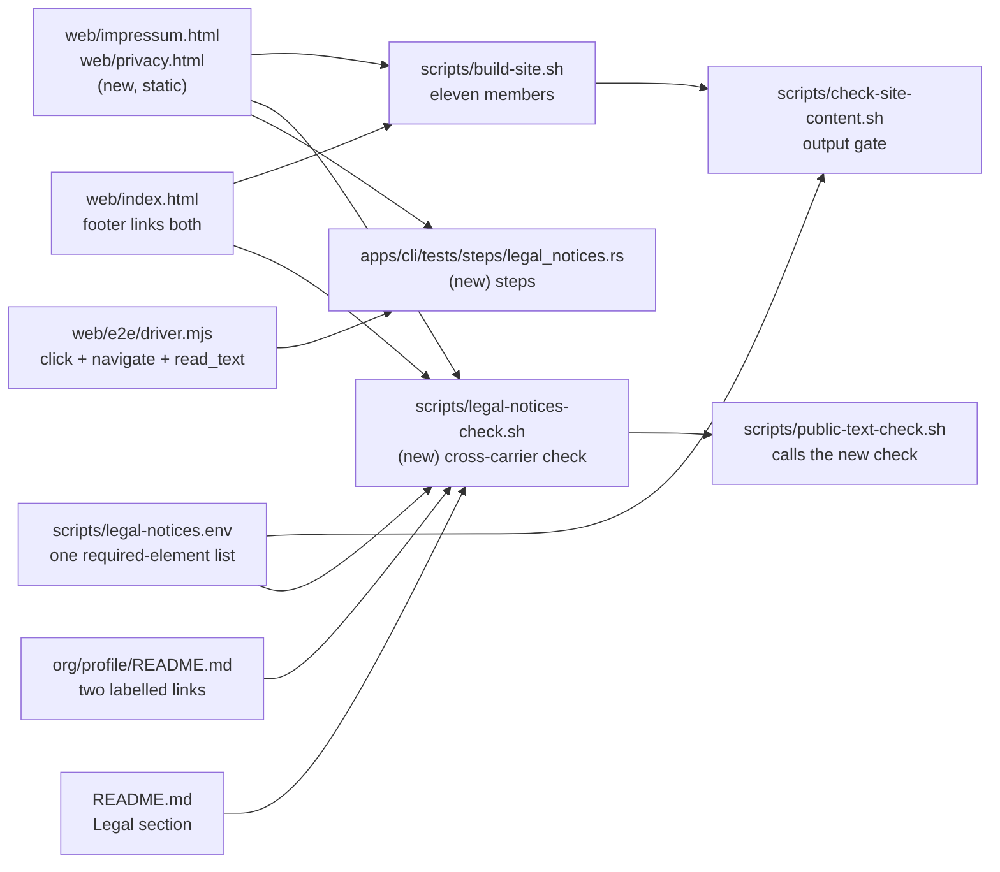

# Design: publish-legal-notices

## Scope

Two static pages join the Site output, the three page footers link them, and
three checks refuse an incomplete set. Nothing else changes: the host, the publication
mechanism, the Built revision rule, the content security policy's shape, the
conversion and the site's input set stay as they are.

The change touches these components:

## Technology decisions

- **Plain HTML, no script on the notices.** Both pages are authored HTML with a
  stricter policy than the converter page: `default-src 'self'; script-src
  'none'; style-src 'self'; img-src 'self' data:; connect-src 'none';
  object-src 'none'; base-uri 'none'; form-action 'none'`. A notice page that
  ever needs a script is a defect: nothing on it is interactive. The stricter
  policy is also the machine proof that a notice page cannot fetch, post or run
  anything.
- **The existing stylesheet.** Both pages link `./styles.css` and use the
  existing page shell classes (`page-header`, `panel`, `page-footer`). One new
  rule group is added for the notice body: a narrower measure and the address
  block. No new stylesheet, no font, no image beyond the existing `icon.svg`.
- **No build stamping on the notices.** The footer's Built revision stays on the
  converter page; the Datenschutzerklärung carries a written standing date
  instead, and the Impressum carries none. The assembler therefore stamps only
  `index.html`, and the notice pages are byte-identical between builds — which
  is what a datenschutz text should be.
- **Two pages, two file names**: `impressum.html` and `privacy.html` (the page's
  own title is "Datenschutzerklärung"). Both sit at the output root, so
  `https://duty2cal.github.io/impressum` and
  `https://duty2cal.github.io/privacy` are the addresses the profile and the
  README link. GitHub Pages serves `/impressum` without the extension.
- **The output gate stays one script.** `scripts/check-site-content.sh` already
  reads the assembled output and names what is missing; the exact member set,
  the two pages, their mutual links, the converter footer's links, the notices'
  required elements, each notice's exact content security policy, the absence of
  a `<script` element or an `on*=` handler attribute, the resolution of every
  relative `href` and a foreign-asset refusal are added there, not in a second
  output check. It scans every `*.html` member, not only `index.html`, and reads
  the output, never the source.
- **One named required-element list.** `scripts/legal-notices.env` holds the
  exact strings both checks assert, in the shape of
  `scripts/support-statement.env`; `scripts/check-site-content.sh` and
  `scripts/legal-notices-check.sh` source it, so a wording revision edits one
  file and the two checks fail together. Operator-supplied facts — the postal
  address, the mail address, the forwarding provider's name — stay literals in
  the pages.
- **A second, source-level check for the carriers.**
  `scripts/legal-notices-check.sh --root DIR` reads the source tree (the three
  pages, the profile, the README) and refuses a carrier that copies the postal
  address, that does not link the notices, or that carries a withdrawn element.
  It exists because the profile and the README are not members of the Site
  output, so the output gate cannot see them; it reads the same page-level
  required elements from `scripts/legal-notices.env`, so the Gherkin refusals
  can drive it against a page set with no build. The profile and the README each
  carry two labelled links — "Impressum" and "Datenschutz" — to
  `https://duty2cal.github.io/impressum` and `https://duty2cal.github.io/privacy`,
  and the README's links sit in a short Legal section.
  `scripts/public-text-check.sh` calls it with the repository root, so the
  `public-text` CI job runs it and refuses a README that loses the section.
- **Driver protocol grows three actions.** `navigate` takes a path relative to
  the served site root; `click` activates a link or button by its visible text;
  `read_text` returns the rendered document's visible text. All three are
  additions to the existing one-command-per-line protocol in
  `web/e2e/driver.mjs`; `apps/cli/tests/steps/browser.rs` gains the matching
  methods and extends its `ACTIONS` allow-list. The notice steps navigate to the
  site root, `click` the footer link and `read_text` the rendered document,
  because the notice must be proven reachable through the link a reader
  activates; the loopback server resolves an extensionless path to
  `<path>.html`, so the published addresses `https://duty2cal.github.io/impressum`
  and `…/privacy` are exercised with their real shape. The converter footer's
  link and the other notice's link are the same two actions.
- **Step file per capability**: `apps/cli/tests/steps/legal_notices.rs`,
  registered in `apps/cli/tests/steps/mod.rs`. It holds the check steps and the
  two browser steps; it reuses `BrowserDriver` from `browser.rs` rather than
  opening a second client. Each browser scenario observes the rendered state
  twice — the site root's `h1` before activation, the notice's `h1` after — so
  the assertion proves a state change, not only the destination's content.
- **One shared visual-baseline helper**: `assert_visual_baseline` moves out of
  `apps/cli/tests/steps/e2e/export_duty_plan_calendar.rs` into
  `apps/cli/tests/steps/e2e/visual_baseline.rs`, gains a document-language
  parameter (`en` for the converter, `de` for the notices), and keeps counting a
  labelled link as a labelled control — the notices' only controls are links, so
  a helper that ignored them would report no control at all.
- **Version freshness**: this change adds no language, runtime, framework,
  database or browser version. Node and Playwright stay pinned by
  `web/e2e/.nvmrc` and `web/e2e/package-lock.json`; no version is restated here.

## Data model

None. The notices are prose; the operator's name, postal address and mail
address are literals in `web/impressum.html`, and the standing date is a
literal in `web/privacy.html`.

## The two pages

`web/impressum.html` carries, in this order: an `h1` "Impressum"; the operator's
name, postal address and mail address in an `<address>` element, with the mail
address as a `mailto:` link; the sentence that the employer address is a service
address for this private project and not the employer's offering; the
non-affiliation and trademark sentence; the source repository link and the
MPL-2.0 licence sentence with the as-is sentence; the German text followed by a
short English summary that states the German version is the binding one; and a
footer linking the converter page and the Datenschutzerklärung. It carries no
standing date.

`web/privacy.html` carries: an `h1` "Datenschutzerklärung"; the controller and
its contact block, the same one as the Impressum; the hosting section naming
GitHub, Inc., the logged IP address and its security purpose, the further data
GitHub processes — the time of the request, the page, the referrer, and the
browser and device information — that no fixed retention period is published and
that the operator has no access to those logs; the legal basis; the
third-country transfer and its basis; the sub-processors delivering the pages; a
mail-handling section naming the forwarding provider, its role, its location and
the legal basis of the forwarding, or stating that there is no forwarding
provider; the browser-local conversion with no upload, no storage and no request
after load; the absence of cookies and third-party content; the reader's rights
and the right to complain; the standing date; the English summary with the
binding sentence; and a footer linking the converter page and the Impressum.

Both pages carry the same contact block. It appears in the two notices and
nowhere else the checks read; a second occurrence in the profile or the README is
refused by the cross-carrier check.

The required elements the checks assert are one named list in
`scripts/legal-notices.env`, so a revision cannot silently drop one and the two
checks cannot disagree:

| Page | Required elements (from `scripts/legal-notices.env`) |
|---|---|
| `web/impressum.html` | `<address>` with a five-digit postal code and a city; a `mailto:` link; `IMPRESSUM_SERVICE_ADDRESS`; `IMPRESSUM_NON_AFFILIATION`; `IMPRESSUM_LICENCE`; `IMPRESSUM_AS_IS`; `IMPRESSUM_EN_SUMMARY`; `IMPRESSUM_BINDING_SENTENCE` |
| `web/privacy.html` | `PRIVACY_CONTROLLER` with the contact block; `PRIVACY_HOST`; `PRIVACY_IP_ADDRESS`; `PRIVACY_PURPOSE`; `PRIVACY_FURTHER_DATA`; `PRIVACY_LEGAL_BASIS`; `PRIVACY_THIRD_COUNTRY`; `PRIVACY_SUBPROCESSORS`; `PRIVACY_RETENTION`; `PRIVACY_MAIL_HANDLING` with `PRIVACY_MAIL_ROLE`, `PRIVACY_MAIL_LOCATION` and `PRIVACY_MAIL_BASIS`; `PRIVACY_LOCAL_CONVERSION`; `PRIVACY_NO_COOKIES`; `PRIVACY_RIGHTS`; `PRIVACY_COMPLAINT`; `PRIVACY_STANDING_DATE` with a date; `PRIVACY_EN_SUMMARY`; `PRIVACY_BINDING_SENTENCE` |
| both notices | the exact `NOTICE_CSP` policy in their meta element; no `<script` element and no `on*=` handler attribute |
| neither | `TODO`, `Mustermann`, `example.org`, `ec.europa.eu/consumers/odr`, a `http://` asset reference |

## The checks

Two checks stand behind the notices, divided by what they can see:
`scripts/check-site-content.sh` reads the assembled output and is the gate a
Site publication runs; `scripts/legal-notices-check.sh --root DIR` reads the
source tree and is the cross-carrier check `scripts/public-text-check.sh` runs.
Both source `scripts/legal-notices.env`, so the required strings cannot drift
between them.

The Gherkin refusal scenarios exercise the source check against a page set: no
build and no WASM is involved. The assembled-output gate's executable evidence
is `scripts/tests/legal-notices.bats`, which runs `check-site-content.sh`
against a fixture output directory holding the three pages, `LICENSE.txt`, both
icons and placeholders for the remaining bundled members, so the exact member
assertion is exercised without a build and without WASM. `scripts/build-site.sh`'s copying of the two pages is proven twice:
by the two browser scenarios, which serve the built output and reach the notices
through the footer links, and by the bats fixture, which gates an output whose
members are the copies.

`scripts/check-site-content.sh` gains, after the existing assertions:

1. The output holds exactly the eleven named members — `index.html`, `app.js`,
   `capability.js`, `styles.css`, `icon.svg`, `icon.png`, `impressum.html`,
   `privacy.html`, `pkg/duty2cal_wasm.js`, `pkg/wasm-inline.js` and
   `LICENSE.txt` — and nothing else; a missing member and an unexpected one are
   both refused.
2. Every `*.html` member is read, not only `index.html`. `impressum.html` and
   `privacy.html` exist, are non-empty and carry an `h1`.
3. `index.html`'s footer links `./impressum.html` and `./privacy.html`; each
   notice links the other and the converter page; each notice's link text
   carries "Impressum" or "Datenschutz".
4. The Impressum's `<address>` carries a five-digit postal code and a city, the
   page carries a `mailto:` link, and it carries `IMPRESSUM_SERVICE_ADDRESS`,
   `IMPRESSUM_NON_AFFILIATION`, `IMPRESSUM_LICENCE`, `IMPRESSUM_AS_IS`,
   `IMPRESSUM_EN_SUMMARY` and `IMPRESSUM_BINDING_SENTENCE`.
5. The Datenschutzerklärung carries `PRIVACY_CONTROLLER`, `PRIVACY_HOST`,
   `PRIVACY_IP_ADDRESS`, `PRIVACY_PURPOSE`, `PRIVACY_FURTHER_DATA`,
   `PRIVACY_LEGAL_BASIS`, `PRIVACY_THIRD_COUNTRY`, `PRIVACY_SUBPROCESSORS`,
   `PRIVACY_RETENTION`, `PRIVACY_MAIL_HANDLING` with its role, location and
   basis, `PRIVACY_LOCAL_CONVERSION`, `PRIVACY_NO_COOKIES`, `PRIVACY_RIGHTS`,
   `PRIVACY_COMPLAINT`, `PRIVACY_STANDING_DATE` with a date, `PRIVACY_EN_SUMMARY`
   and `PRIVACY_BINDING_SENTENCE`.
6. Each notice's meta element carries exactly `NOTICE_CSP`, and neither carries a
   `<script` element or an `on*=` handler attribute.
7. No `*.html` member carries a placeholder marker, the discontinued
   dispute-resolution address, a `http://` asset reference or an asset from
   another origin.
8. Every relative `href` in every `*.html` member resolves to a file that exists
   in the output; a link to a missing file is refused.

`scripts/legal-notices-check.sh --root DIR` checks the carriers:

1. All three pages exist under `web/`, and the converter page's footer links
   both notices.
2. Each notice links the other and the converter page, and each carries its
   required elements from `scripts/legal-notices.env` — including the
   Impressum's service-address sentence and the Datenschutzerklärung's
   mail-handling disclosure, English summary and standing date — plus the
   language pair and the binding sentence.
3. The forbidden list above is empty for all three pages, including a foreign
   asset, a `<script` element and an `on*=` handler attribute.
4. `org/profile/README.md` and `README.md` each carry two labelled absolute
   links: "Impressum" to `https://duty2cal.github.io/impressum` and
   "Datenschutz" to `https://duty2cal.github.io/privacy`; the README's pair sits
   in a short Legal section. Neither carries a postal address pattern (a
   five-digit postal code followed by a city) and neither carries a `mailto:`
   link.
5. The notices are the only place the contact block appears: a second occurrence
   in the profile or the README is refused and the carrier is named.

Every refusal prints one line naming the page or carrier and the missing or
forbidden element, in the shape the existing checks use
(`check-site-content: …` / `legal-notices-check: …`), so the step assertion
reads the named element rather than only the exit status.

## Step Definitions

| Step definition file | Capability | Permanent merge target |
|---|---|---|
| `apps/cli/tests/steps/legal_notices.rs` | `state-the-legal-notices` | same path (durable project source) |
| `apps/cli/tests/steps/browser.rs` | unchanged file, new `click`/`navigate`/`read_text` methods on `BrowserDriver` and the extended `ACTIONS` allow-list | same path |
| `web/e2e/driver.mjs` | unchanged file, `click`, `navigate` and `read_text` actions, and the loopback server's extensionless-path resolution | same path |
| `apps/cli/tests/steps/e2e/visual_baseline.rs` | new shared module, declared in `apps/cli/tests/steps/e2e/mod.rs`, holding the moved `assert_visual_baseline`, parameterized by document language and counting a labelled link as a labelled control | same path |

The `assert_visual_baseline` move is the one edit to an existing step file: both
the converter scenario and the two notice scenarios call it, the converter passes
`en`, the notices pass `de`, and the link rule is what lets a notice page — whose
only controls are links — satisfy the `controls` observation.

## Test runner, strict mode, and single-scenario command

- `verify.command` = `./run-tests.sh`; `verify.e2e_command` =
  `./run-tests.sh --e2e`.
- The two `@e2e @browser` scenarios run in the browser mode:
  `./run-tests.sh --browser` builds the Site output, then the runner drives the
  driver's loopback server. `--e2e` deliberately excludes `@browser`, exactly as
  it does for the conversion's browser scenario.
- Single scenario:
  `./run-tests.sh --browser --name "Reader opens the Impressum from the site footer and reads who publishes the site"`.
- Where the browser evidence runs: the `browser` job in
  `.github/workflows/ci.yml` runs three `--name` steps — the conversion
  scenario that is already there and the two notice scenarios beside it, each
  its own step so a failing notice names itself. `scripts/site-evidence.sh` is
  unchanged.
- Strict mode: `features_runner` keeps `.fail_on_skipped()`. The proof is a RED
  run per new scenario before its steps exist: `Step doesn't match any function`
  and a non-zero exit. The tasks' setup task records it.

## Interaction Coverage Matrix

| Inventory entry | @e2e scenario title | Real interface | Driving mechanism |
|---|---|---|---|
| follow the footer's "Impressum" link on the site | Reader opens the Impressum from the site footer and reads who publishes the site | Web UI | Playwright: navigate to the served site root, activate the footer's `Impressum` link, read the rendered Impressum's text; assert the site root's `h1` before activation and the Impressum's `h1` after it; screenshot both viewports |
| follow the footer's "Datenschutz" link on the site | Reader opens the Datenschutzerklärung from the footer and reads what a page request processes | Web UI | Playwright: navigate to the served site root, activate the footer's `Datenschutz` link, read the rendered Datenschutzerklärung's text; assert the site root's `h1` before activation and the notice's `h1` after it; screenshot both viewports |

## Visual Design Contract

- Interface: web
- Viewports: mobile (360x780), desktop (1920x1080)
- Design system: `docs/design/design-system.md` (extended by this change with the notice screen, its per-document language rule and the second rendered reference)

- **Design tokens**: the page's existing tokens, unchanged — colour roles,
  spacing scale, typography stack, 4/8 px radii, no elevation on the notices.
- **Component primitives**: page shell (`header`, `main`, `footer`), notice
  heading (`h1`), section heading (`h2`), address block (`<address>`), prose
  list, link. States: default, hover, focus-visible for links only; the notices
  have no other interactive state and no disabled, loading or error state.
- **Breakpoints**: the page's existing mobile-first breakpoints; the notice text
  is a single column with a 720 px maximum measure, so line length stays readable
  at 1920 px.
- **Accessibility**: `lang="de"` on the document with `lang="en"` on the English
  summary; one `h1` and section `h2`s; landmarks; visible focus on links;
  contrast from the existing tokens (body ≥ 7:1); `<address>` for the contact
  block; verified by the `axe` action at both viewports and by the browser
  baseline assertions.
- **Screens covered**: Impressum, Datenschutzerklärung.
- **Approval**: the operator chose the inherited-shell direction on 2026-10-27
  (design review) over a standalone document without the project mark; the
  design system records the amendment, and the standalone variant's reference
  file was deleted with the decision.
- **Rendered reference**: `docs/design/reference/notice-reference.html`, the
  approved static design-only reference for both notice screens, committed with
  this change; `docs/design/design-system.md` gains the notice primitive, the
  per-document language rule, the notice footer rule and the captures below.
- **Capture mechanism and evidence path**: `givn/changes/publish-legal-notices/evidence/visual/<scenario-slug>/mobile.png`
  and `desktop.png`, captured after the final assertion with animations
  disabled, fonts and network settled, per the driver's existing capture flow.
- **Motion**: none on either page — no transition, no animation; the capture
  emulates `prefers-reduced-motion: reduce` and the scenario asserts the
  rendered document carries no animated element.

## E2E smoke test infrastructure

- **Runner**: `./run-tests.sh --browser` (the `browser` CI job's command, with
  `--name` for a single scenario).
- **Step definitions**: `apps/cli/tests/steps/legal_notices.rs`, separate from the
  conversion's browser steps but sharing the `BrowserDriver` client.
- **Local infrastructure**: the driver's own loopback HTTP server serves the
  built Site output; no application server, database or container. The browser
  is Playwright's Chromium, pinned by `web/e2e/package-lock.json`.
- **Framework and justification**: Playwright is the project's existing driver
  and the only one that renders the page a reader sees; a text assertion on the
  served HTML would not prove the link is activatable.
- **What each notice scenario asserts**: the notice is reached by activating the
  footer link (`click`), never by navigating to its address directly; the
  rendered `h1` differs from the site root's `h1` observed before activation;
  `document.cookie` is empty and `localStorage` and `sessionStorage` hold no key;
  no request left the origin; and the shared visual baseline passes at both
  viewports with the document language `de`.
- **Strict-mode proof**: `.fail_on_skipped()` in `features_runner`; each new
  scenario is run RED before its steps exist and the transcript is recorded in
  `tasks.md`.

## Local runnability & digital twins

`./run-tests.sh --browser` builds the Site output and runs everything locally in
one step. The only external service the notices describe is GitHub's hosting;
the pages never contact it, and no test depends on it. There is no digital twin
to model and no isolated network to provide: the driver's loopback server is the
only peer.

## Coverage process boundaries

| Process | Started by | Instrumented artifact | Profile output | Merge step | Non-zero production probe |
|---|---|---|---|---|---|
| `features_runner` (non-e2e) | `./measure-coverage.sh` | `cargo llvm-cov` build of the workspace | `coverage/non-e2e-*.profraw` | `merge-coverages.sh` | the new step file's check-invocation path |

No production process is added: the notice pages are static HTML with no
script, and the check scripts are shell outside the instrumented tree. The
change therefore adds test-only instrumented code, and the gate's existing
reports cover it. `./measure-coverage.sh` excludes `@browser`, so the two notice
browser scenarios and the bats fixture are outside the coverage measurement; the
accepted gap is that the browser step's activation path is evidenced by the
`browser` CI job and the bats file, not by the coverage report.

## Use-case traceability

| Use-case rule or guarantee | Technical decision | Evidence |
|---|---|---|
| Two pages, one operator; same origin; no run-time generation | Static `impressum.html` and `privacy.html`, stricter CSP, no script | the bats fixture's member, CSP and foreign-asset refusals; browser e2e's no-foreign-request assertion |
| The Impressum names what a reader can use | `<address>` with postal code and city, `mailto:`, the service-address sentence | content check and source check; browser e2e |
| The employer address is a service address, not the employer's offering | `IMPRESSUM_SERVICE_ADDRESS` in the required-element list | source check; browser e2e |
| The mail route is disclosed | the Datenschutzerklärung's mail-handling section with provider, role, location and basis | source check; browser e2e |
| Nothing withdrawn | placeholder and ODR refusals in both checks | the refusal scenarios |
| The Datenschutzerklärung describes the actual processing | the hosting, named further data, basis, transfer, sub-processor, retention, mail-handling and rights sections | content check's required strings; browser e2e |
| One reachability rule | converter footer links both, each notice footer links the other and the converter; profile and README each carry two labelled links | output gate; cross-carrier check; the modified site-publication and profile scenarios |
| German binding, English summary | `lang="de"` with `lang="en"` summary and the binding sentence | language scenario, its missing-summary refusal; browser e2e |
| No consent banner | no script, no `on*=` handler, no cookie, no third-party content | CSP directive; the gate's script and handler refusals; the browser scenarios' empty cookie jar and storage |
| Owner of the carriers | site pages in `publish-public-website`; profile in the apply; README in the release text | the extended capabilities' deltas |

## Decisions

- **Decides D1: the Impressum carries a c/o service address at the operator's
  employer (an IT consultancy, not an airline or a duty-plan provider), and the
  literal block, the employer's written consent and the mail alias are
  operator-supplied before the first publication.** Realized in
  `web/impressum.html`'s `<address>` and the sentence that the employer address
  is a service address for this private project and not the employer's offering;
  the placeholder refusal keeps the page from shipping with a stand-in. The
  written consent is not a repository artifact and is not claimed by this
  design.
- **Decides D2: the electronic mail address is an alias that forwards to the
  operator's mailbox.** Realized in the Impressum's `mailto:` link and in the
  Datenschutzerklärung's mail-handling section, which names the forwarding
  provider (or states that there is none), its role, its location and the legal
  basis; the alias is one literal, so a rotation is one revision.
- **Decides D3: the German Datenschutzerklärung is written for this site, not
  generated.** Realized in `web/privacy.html`; `REUSE.toml` overrides exactly
  `web/impressum.html` and `web/privacy.html` to CC0-1.0, while
  `web/index.html` stays under the aggregate MPL-2.0 annotation. The generated
  text's attribution condition is the reason the override exists.
- **Decides D4: reachability is the converter page's footer links to both
  notices, each notice's footer links to the other notice and the converter
  page, and two labelled links each in the profile and the README, with no
  copied address.** Realized in `web/index.html`'s footer, the two notice
  footers, `org/profile/README.md`, `README.md` and
  `scripts/legal-notices-check.sh`'s copy refusal.
- **Design decision (beyond the proposal's questions): the notices carry no
  script and a stricter policy than the converter page.** Rejected: reusing the
  converter's policy, which would allow a script on a page that needs none and
  would make "nothing runs here" unprovable.
- **Design decision: the output gate and the source check stay separate.**
  Rejected: one script reading both trees, because the output gate must read
  only what was assembled (a page correct in the source but lost in the
  assembly is the defect it exists to catch), while the profile and the README
  exist only in the source.
- **Design decision: the driver gains `click`, `navigate` and `read_text`
  instead of a second browser harness.** Rejected: asserting on fetched HTML,
  which would prove the bytes and not the link a reader activates.
- **Design decision: the required strings live in one file.** Rejected: each
  check carrying its own literals, because the output gate and the source check
  would then refuse different pages for the same revision.

The new use case links its Personas as `../../../../personas/<id>.md`; the
lint's persona advisory is an artifact of the change directory's depth and
resolves after the archive moves the document to
`givn/specs/<usecase-id>/`.
