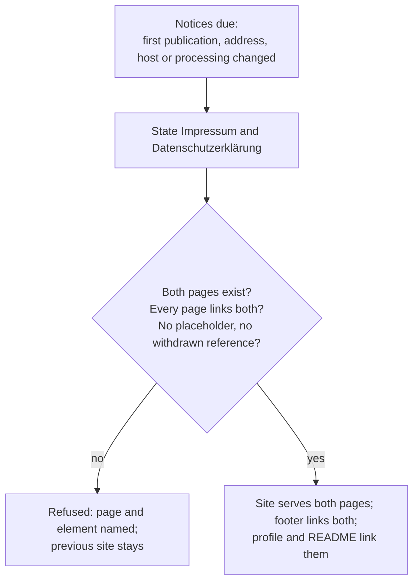

# Use case: state-the-public-legal-notices

## Level

!

## Actors

- Operator — primary Actor; is the person who publishes the site, and answers for who is reachable and what a page request processes. In this repository the Operator is the Release owner, who owns the site's publication and its copy.
- Supporting: Reader — the visitor who must be able to find the operator and the data-processing statement without hunting. Not an independent actor goal; the reader's goal is served by the operator's act.
- Supporting: Web reviewer — checks that both notices are static, same-origin pages under the same content security policy. Not an independent actor goal.

## Goal

Let a reader of every public carrier find who publishes it, at which address that person can be served, and what a page request processes.

## Trigger

The Operator publishes or revises the legal notices: on the first publication that needs them, when the operator's address or mail address changes, when the hosting or the processing changes, or when a carrier that links them is added or rewritten.

## Preconditions

- The site is served from a hosting provider the operator does not control and which processes the visitor's request; the notices describe that provider, not a processing the project performs.
- The operator's postal address is one at which service is possible, and the operator's employer consent to a c/o address, if one is used, is in writing.
- The operator has an electronic mail address that accepts mail; an address that only answers automatically and refers elsewhere is not one.

## Main flow

1. Actor decides the notices are due: the first publication, a changed address, a changed host or a changed processing.
2. Actor states the Impressum: name, postal address at which service is possible, and electronic mail address; the sentence that the employer address is a service address for this private project and not the employer's offering; the non-affiliation and trademark sentence; the source repository and the licence; the as-is sentence.
3. Actor states the Datenschutzerklärung: the controller and how to reach it; the host and the data it processes on a page request — the time of the request, the page, the referrer, the browser and device information, the IP address and its security purpose; the legal basis; the third-country transfer and its basis; that the host uses sub-processors to deliver the pages; the retention the host publishes, or that it publishes none; that the operator has no access to those logs; the mail handling, naming the forwarding provider, its role, its location and the legal basis of the forwarding; that the conversion runs in the browser with no upload, no storage and no request after the page loads; that no cookie is set and no third-party content is loaded; the reader's rights and the right to complain; a standing date; and the English summary with the binding sentence.
4. System checks the notices before publication: both pages exist, the converter page's footer links both, each notice links the other and the converter page, neither carries a placeholder or an unresolved marker, the Impressum carries a postal and an electronic mail address and its service-address sentence, the Datenschutzerklärung carries its standing date, its hosting disclosure, its mail-handling disclosure and its English summary, and no page carries the discontinued dispute-resolution reference, a script, an inline event handler or an asset from another origin.
5. Actor publishes the notices as pages of the Site output and carries two labelled links — "Impressum" and "Datenschutz", to `https://duty2cal.github.io/impressum` and `https://duty2cal.github.io/privacy` — in every other public carrier, the organization profile and the repository README, without copying the postal address.
6. Actor can stop; a reader of any carrier reaches the notices, and the published notices name the operator and the processing.

## Extensions

- 4: a notice page is missing from the output → publication is refused and the missing page is named; the previously published site stays.
- 4: a page does not link both notices → refused, naming the page and the missing link.
- 4: a notice carries a placeholder or an unresolved marker → refused, naming the page and the marker. Protects the reader from reading a template as a statement.
- 4: the Impressum carries no postal address or no electronic mail address → refused, naming the missing element. Protects the reader's route to the operator.
- 4: the Datenschutzerklärung carries no standing date → refused, naming the missing date. Protects the reader from reading a stale statement as current.
- 4: the Datenschutzerklärung carries no English summary → refused, naming the missing summary. Protects the reader who cannot read the German text from reading no statement at all.
- 4: a page carries the discontinued EU dispute-resolution reference → refused, naming the page and the reference. That reference is a warning risk once the platform is discontinued.
- 4: a page loads an asset from another origin, carries a script or carries an inline event handler → refused, naming the page and the element. A notice that fetches or runs something contradicts the processing it describes.
- 5: the profile's link is not applied → the reviewed source carries the link and the apply publishes it; the published profile lags until the operator applies.
- 5: a carrier copies the postal address instead of linking → refused, naming the carrier. A copy drifts on every change, and a stale address is worse than no link.

## Rules

- **Two pages, one operator**: the notices are pages of the Site output, on the site's own origin, under the page set's content security policy. No notice is fetched, embedded or generated at run time.
- **The Impressum names what a reader can use**: name, a postal address at which service is possible, and an electronic mail address. A c/o address is the operator's address only with the employer's written consent; the page states that the employer address is a service address for this private project and not the employer's offering, it is not a claim of affiliation, and the non-affiliation sentence travels with it.
- **The mail route is disclosed**: the Impressum's `mailto:` is the forwarding alias, and the Datenschutzerklärung names the forwarding provider or states that there is none, its role, its location and the legal basis of the forwarding, so a reader who writes to the operator knows who else handles the message.
- **Nothing withdrawn**: no reference to the discontinued EU online dispute-resolution platform, no voluntary dispute-resolution statement the project does not carry, no data-protection officer the project does not have.
- **The Datenschutzerklärung describes the actual processing**: the host and what it logs on a page request, the legal basis, the third-country transfer and its basis, the sub-processors that deliver the pages, a retention statement the host actually publishes, that the operator cannot read the logs, that the conversion is local, and that the site sets no cookie and loads nothing from another origin. The site's own statements about local processing keep their scope: they describe the conversion.
- **One reachability rule**: the converter page's footer links both notices, labelled "Impressum" and "Datenschutz"; each notice's footer links the other notice and the converter page. Either notice is therefore one step from the converter page, from the other notice and from the site root; the profile and the README each carry two labelled links — "Impressum" and "Datenschutz", to `https://duty2cal.github.io/impressum` and `https://duty2cal.github.io/privacy` — and copy no postal address.
- **German binding, English summary**: both notices are written in German, because their addressees are German authorities and courts, with a short English summary below and the sentence that the German version is binding.
- **No consent banner**: the page set sets no cookie and loads no third-party content, so a consent banner would ask for a consent that is not owed. The output gate refuses a `<script` element and any `on*=` handler attribute, and each notice's browser scenario observes an empty `document.cookie` and no key in `localStorage` or `sessionStorage`; a banner is a defect, not a feature.
- **Owner of the carriers**: the site's pages, their footer and their publication belong to the use case to publish the public website; the profile text is published by the configuration apply; the README is the release capability's public text. This case owns the notices' content, the reachability rule and the check across those carriers.
- **The texts are prose, not advice**: the notices state what this project does and who answers for it. Neither legal sufficiency nor advice is claimed, and a new processing activity is a deliberate revision, never an inherited sentence.

## Examples

- First publication with one notice missing → the publication is refused, names the missing page, and the previously published site stays.
- A notice page whose address line still reads "TODO" → refused, and the page and marker are named.
- The converter page's footer links both notices and each notice's footer links the other notice and the converter page → from any page, either notice is one step away.
- The Datenschutzerklärung names GitHub, Inc. as host, states that the visitor's IP address is logged for security purposes and that no fixed retention period is published → a reader learns what a page request does without writing to the operator.
- The organization profile ends with two labelled links, "Impressum" and "Datenschutz", and carries no postal address → the address is edited in one place.
- The README's Legal section links both notices → a reader arriving from a release or an issue reaches them in one click.
- The Impressum carries the employer's address with the sentence that it is a service address for this private project and not the employer's offering → a reader does not read the employer as the site's operator.
- The Datenschutzerklärung names the mail-forwarding provider, its role, its location and the legal basis → a reader who writes to the operator knows the message passes through a third party.
- A cookie banner appears on the site → the page set already refused cookies and third-party content before this change; the banner is a defect, not a feature.

## Minimal guarantee

True whatever the outcome: no carrier states a placeholder, an unresolved marker or a withdrawn reference; a refused publication leaves the previously published notices in place; no processing is added that the notices would have to describe, and no cookie or third-party content is introduced.

## Success guarantee

The Site output serves an Impressum and a Datenschutzerklärung, either reachable in one step from every page of the site; the Impressum names the operator, a postal address at which service is possible, an electronic mail address and the sentence that the employer address is a service address for this private project, with the non-affiliation, licence and as-is sentences; the Datenschutzerklärung states the host and the data it processes on a page request including the time, the page, the referrer and the browser and device information, the legal basis, the third-country transfer, the sub-processors, the retention statement, the mail handling with its provider, role, location and legal basis, the local conversion, the absence of cookies and third-party content, the reader's rights, a standing date and an English summary with the binding sentence; the organization profile and the README link the notices under two labelled links without copying the postal address; and no page carries a placeholder, an unresolved marker, the discontinued dispute-resolution reference, a script, an inline event handler or an asset from another origin.

## Personas

- [Organization owner](../../../../personas/project-maintainer--organization-owner.md) (project-maintainer--organization-owner) — answers for the profile carrier and its apply.
- [Visitor](../../../../personas/visitor--project-reader.md) (visitor--project-reader) — primary lens; judges whether the notices are findable and readable.
- [Release owner](../../../../personas/project-maintainer--release-owner.md) (project-maintainer--release-owner) — answers for the notices and for the publication that refuses an incomplete one.
- [Web reviewer](../../../../personas/contributor--web-reviewer.md) (contributor--web-reviewer) — judges that both pages are static, same-origin and outside any third-party request.

## Capabilities

- state-the-legal-notices

## Interactions

| Capability | Consumer action | E2E scenario |
|---|---|---|
| state-the-legal-notices | follow the footer's "Impressum" link on the site | Reader opens the Impressum from the site footer and reads who publishes the site |
| state-the-legal-notices | follow the footer's "Datenschutz" link on the site | Reader opens the Datenschutzerklärung from the footer and reads what a page request processes |

The same two inventory actions cover the other footer links: activating the other notice's labelled footer link from either notice, and activating the converter page's footer link from either notice, are variants of the same two actions — activate a labelled footer link, then read the rendered document — so no further inventory row is added. Their reachability is asserted by the notice-link checks, not by a third browser scenario; each browser scenario itself observes the rendered state twice, the site root's heading before activation and the notice's heading after it.

## Includes

- none

## Extends

- none

## Out of scope

- Legal advice, or any claim that the notices are sufficient: the operator answers for the wording, and a later legal question is its own change.
- The employer's written consent, the concrete postal address and the concrete mail address: operator-supplied facts, not repository behaviour.
- Changing the host, the hosting target, the publication mechanism, the content security policy or the site's input set.
- Any analytics, consent management, cookie, third-party asset, custom domain or server-side processing.
- The conversion's behaviour, its refusals and its own statements about local processing.
- A data-protection officer, a voluntary code of conduct, a dispute-resolution statement and an English binding version of either notice.
- Rewriting Persona files or the ideation record.

## Diagram

