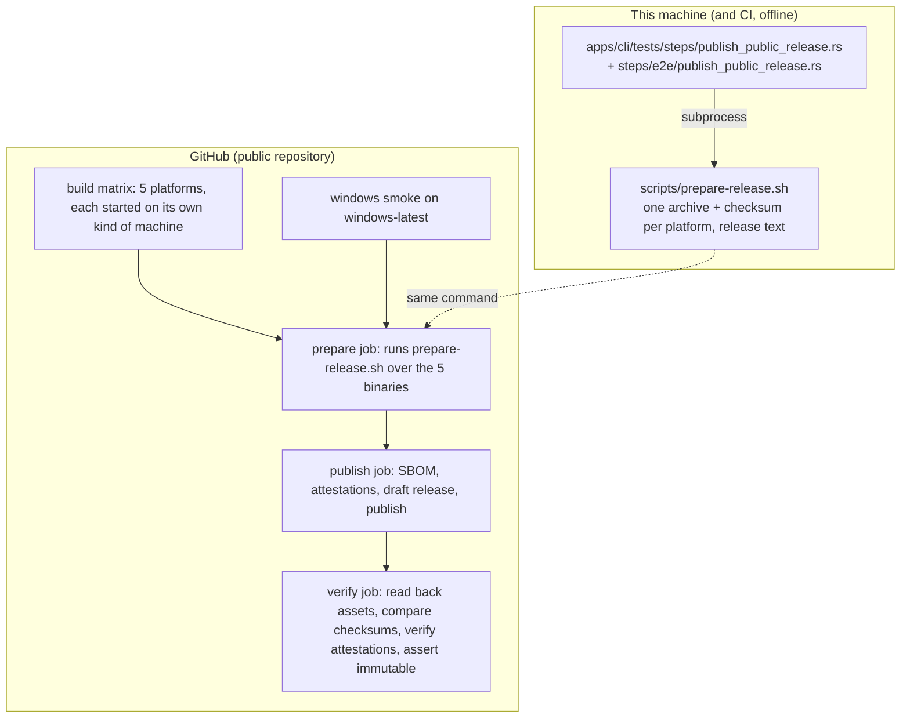

# Design: publish-public-release

## Scope

Technical design for the change that publishes the tool: [publish a public release](specs/publish-public-release/usecase.md). The observable WHAT is fixed by the proposal and the spec delta; this document is the HOW — the release-preparation command the maintainer runs, the automation that publishes it on the host, the repository settings only the owner can apply, and the checks that stand behind each promise.

Two boundaries shape everything below:

- **What runs on this machine.** The project's own suite drives one real interface: the release-preparation command as a subprocess. It needs no network, no credentials and no repository; that is what the delta's nine scenarios exercise.
- **What runs on the host.** Building for five machines, attaching provenance, publishing an immutable release and reading it back are done by GitHub-hosted automation, because only there do the platform machines, the OIDC identity for attestations and the release API exist. Those promises are exercised by the pipeline and recorded as this change's evidence, with the owner-applied settings confirmed by the operator (see "The public home's owner-applied settings").

## Technology decisions

Every version below was resolved from the live source on 2026-10-13, not from memory.

| Area | Decision | Rationale / source |
|---|---|---|
| Preparation tool | `scripts/prepare-release.sh` — POSIX-shell with `set -euo pipefail`, Linux-only, run by the packaging job and by the suite's steps. | The project already owns its tooling as scripts (`run-tests.sh`, `coverage/*.sh`, `scripts/*`); packaging is build tooling, not product behaviour, so it stays out of the crates and off the coverage denominator. |
| Archive format | `.tar.gz` for every platform, including Windows. | Windows 10+ ships `bsdtar` as `tar`, so one documented extraction path serves all five platforms and the packaging job needs no zip tooling. gzip is invoked as `gzip -n` so no name or timestamp is embedded. |
| Archive determinism | `tar --sort=name --mtime=@0 --owner=0 --group=0 --numeric-owner` piped into `gzip -n`; checksum with `sha256sum`. | Same inputs must produce byte-identical archives, so a third party can reproduce a release and the checksum is meaningful. Ownership, ordering and time are the three nondeterministic inputs of `tar`. |
| Release text | `git log` over `<previous v* tag>..HEAD`, conventional-commit subjects, release-note types `feat`, `fix`, `perf`, `refactor`, `revert`; housekeeping types (`chore`, `docs`, `test`, `build`, `ci`, `style`) omitted; identical subjects collapsed to one occurrence; text after `<type>(<scope>): `. With no earlier `v*` tag — the case of this change's first release — the range is every revision reachable from the tagged revision, so nothing is silently released unannounced. A subject that matches no release-note type and carries no housekeeping type either is omitted, never a failure of the preparation; the preparation never fails because of a commit message. | The project already stamps the release note as the commit subject (AGENTS.md), and one scenario revision produces several revisions carrying the same subject, which is one released change, not several. Omitting an unrecognised subject is the only rule that cannot block a release on a typo in a message the release does not control. |
| Linux targets | `x86_64-unknown-linux-musl` and `aarch64-unknown-linux-musl`, statically linked. | "No runtime installation" is the promise; musl links statically by default, so neither glibc version nor distro matters. The release build graph is pure Rust — `cargo tree --workspace -e no-dev` (86 entries) holds no `-sys` crate, no `cc`, no `pkg-config` and no OpenSSL — so musl is reachable; `Cargo.lock` itself does contain `windows-sys` and `linux-raw-sys`, which are bindings-only and outside the release graph. |
| macOS targets | `aarch64-apple-darwin` (runner `macos-latest`) and `x86_64-apple-darwin` (runner `macos-15-intel`), built natively. | The only way to build and start a macOS binary is a macOS machine. Runner labels verified on 2026-10-13 in [GitHub-hosted runners reference](https://docs.github.com/en/actions/reference/runners/github-hosted-runners). |
| Windows target | Unchanged: `x86_64-pc-windows-gnu` cross-built on `ubuntu-latest` with `mingw-w64`, `.cargo/config.toml` static flags, and the existing non-system-DLL assertion; started on `windows-latest`. | The supplied distribution constraint (static CRT, no companion DLL) is kept; the release path reuses the assertion the CI job already carries. |
| Runners | `ubuntu-latest` (linux x64 and the Windows cross-build), `ubuntu-24.04-arm` (linux arm64), `macos-latest` (macOS arm64), `macos-15-intel` (macOS x64), `windows-latest` (Windows smoke). Standard runners are free and unlimited on public repositories (verified 2026-10-13 in [Actions billing](https://docs.github.com/en/billing/concepts/product-billing/github-actions)). | One runner per platform kind, all documented labels. |
| Toolchain action | `dtolnay/rust-toolchain@stable` (rolling branch, as the existing workflows use) plus the target triple as an input. | The project follows the `stable` channel through `rust-toolchain.toml`; pinning a Rust version in the workflow would fork the toolchain story. |
| Action pinning | One convention: every action in both workflows is pinned by major tag at the version verified on 2026-10-13 through the GitHub releases API — `actions/checkout@v7` (v7.0.1), `actions/upload-artifact@v7` (v7.0.2), `actions/download-artifact@v8` (v8.0.2), `actions/attest@v4` (v4.2.2), `anchore/sbom-action@v0` (v0.24.3), `dtolnay/rust-toolchain@stable` (a rolling branch, as the existing workflows use), and the CI-only `rhysd/actionlint:1.7.12` image. `ci.yml`'s existing action uses move to `v7`/`v7`/`v8` in the same revision, so the repository carries one convention rather than two. Dependabot's `github-actions` ecosystem owns the bumps. | One convention is worth more than a mixture: the release path needed current majors, and leaving CI on `v4` while the release used `v7`/`v8` would have produced exactly the two-convention state this row's alternative was rejected for. The three CI action uses take the same inputs at the new majors, and `actionlint` validates the result before the push. Commit-SHA pinning is the stronger reference and stays recorded as R-011 with a named follow-up rather than half-adopted here. |
| Release publishing | The `gh` CLI (`gh release create --draft`, `gh release upload`, `gh release edit --draft=false`) with the workflow's `GITHUB_TOKEN`. No third-party release action. | `gh` is preinstalled on runners and first-party; the draft-then-publish order the immutability decision requires is three explicit commands instead of an action's option set. |
| Provenance and bill of materials | `actions/attest@v4` with `subject-path` for each archive, plus an SBOM generated by `anchore/sbom-action@v0` (syft reads `Cargo.lock`) attested through the same action's `sbom-path`. | GitHub's documented route for artifact attestations; on the Free plan attestations are available for public repositories (verified 2026-10-13 in [GitHub security features](https://docs.github.com/en/code-security/getting-started/github-security-features)). |
| Workflow validation | `rhysd/actionlint:1.7.12` (image tag verified 2026-10-13 on Docker Hub; release v1.7.12 published 2026-03-30) run as a CI job over `.github/workflows/`. | The release path only fails on the host, so a schema-level check before the push is worth one job; actionlint also validates inputs of well-known actions and the expression syntax. |
| Sign-off enforcement | A CI job (`pull_request` only) running the in-repo check `scripts/dco-check.sh` over the pull request's commit range. | The README already requires DCO sign-off; enforcing it in-repo avoids granting a third-party app repository access, and limiting it to pull requests keeps the existing un-signed history and the maintainer's own commits out of the check. |
| Corpus format | The permanent use case document is normalised to the bullet form `givn lint` parses (bare capability identifiers, bullet rules and examples, no `###` inside `## Rules`, table only inside `## Interactions`). | `givn lint` reported a blocking `UCDOC` finding on the pre-existing document; the tool's contract, and givn's own corpus, use the bullet form. Landed as its own revision before this one. |

## Architecture impact

Nothing in the product changes: no crate, no module, no port, no scenario of `export-duty-plan-calendar`. The change adds a release channel around the existing executable.



New or changed files:

| Path | Kind | Purpose |
|---|---|---|
| `scripts/prepare-release.sh` | new | The preparation contract: platform completeness, archive layout, checksums, release text, refusals. |
| `scripts/dco-check.sh` | new | Sign-off check over a commit range. |
| `.github/workflows/release.yml` | rewritten | Build matrix, Windows smoke, prepare, publish, verify. |
| `.github/workflows/ci.yml` | changed | Three additions and one bump: the `actionlint` job, the `dco` job (pull requests only), and the existing action uses move to `actions/checkout@v7`, `actions/upload-artifact@v7` and `actions/download-artifact@v8`. Every existing job keeps its name and its steps; the `pii-guard` job's script is the one rewritten below. |
| `scripts/public-text-check.sh` | new | The gate for the text a reader lands on: the README's clone address, the archive name for every supported platform, the checksum and the provenance verification commands, the licence statement with a link to its text, and the third-party Unicode data file's licence. |
| `apps/cli/tests/steps/publish_public_release.rs` | new | Non-e2e step definitions for this capability. |
| `apps/cli/tests/steps/e2e/publish_public_release.rs` | new | E2E step definitions (real subprocess, transcript evidence). |
| `apps/cli/tests/steps/mod.rs`, `apps/cli/tests/steps/e2e/mod.rs` | changed | Each declares its new module; without that declaration the new step files are never compiled. |
| `.github/ISSUE_TEMPLATE/bug.yml`, `.github/ISSUE_TEMPLATE/proposal.yml`, `.github/ISSUE_TEMPLATE/config.yml`, `.github/pull_request_template.md`, `.github/SECURITY.md` | new | The contributor routes, asking for the export family and a stripped sample, never a real plan. |
| `CONTRIBUTING.md`, `CODE_OF_CONDUCT.md`, `SECURITY.md` | new | Contribution route, conduct, and the confidentiality route at the repository root, where GitHub's community profile reads them. |
| `README.md` | changed | Clone address, per-platform download and verification instructions, badges, sign-off enforcement. |
| `docs/arc42/adr/ADR-0003-release-channel-and-platforms.md`, `docs/arc42/adr/ADR-0004-immutable-draft-first-publication.md` | new | Two records rather than one: the release channel with its platform set, and the immutable draft-first publication decision. |
| `givn/changes/publish-public-release/evidence/history-rewrite.md` | new | Why the local history was rewritten before the first push, the proof of the leak, the command, the verification, and the mapping for the archived citations whose revisions changed id. |
| `docs/arc42/*` | changed | Twelve-chapter impact assessment in `arc42.md` plus the affected chapters. |
| `givn/specs/export-duty-plan-calendar/usecase.md` | changed | Corpus format normalisation (own revision) and the platform-set pointer. |

## The preparation command

```
scripts/prepare-release.sh --version <version> --binaries <dir> --out <dir> [--repo <dir>]
```

- `<dir>/<platform>/duty2cal` (or `duty2cal.exe` for Windows) is the input for each of the five supported platforms.
- The command writes, into `<out>`, `duty2cal-<version>-<platform>.tar.gz` and `duty2cal-<version>-<platform>.tar.gz.sha256` for every supported platform, plus `release-notes.md`.
- It refuses — leaving `<out>` untouched — when a supported platform's executable is missing, when the binaries directory contains a platform outside the supported set, when an executable cannot be read, when `<out>` already holds a prepared archive for that version, or when the version is not a bare version (a leading `v` is refused so the archive name, the release text and the tag cannot disagree).
- It prints one line per staged archive and one line for the release text; that transcript is the `@e2e` evidence, and what it reports is exactly the five archives with their five checksum files and the release text, with no other archive in the set.
- `--repo` names the checkout whose history supplies the release text (default: the repository containing the script).

The script owns the canonical platform set. The workflow's matrix is written by hand, and the two can disagree only loudly: a platform missing from the matrix fails the completeness refusal, and a platform outside the set fails the whitelist refusal.

## The release pipeline

`release.yml` triggers on `push` of a `v*` tag and runs five jobs:

| Job | Runner | What it does |
|---|---|---|
| `build` (matrix of 5) | one per platform kind | Installs the toolchain and the platform's linker, builds `--release` for the platform's target, starts the binary (usage output, non-zero exit) except for Windows, and uploads `binary-<platform>`. |
| `smoke-windows` | `windows-latest` | Downloads `binary-windows-x86_64` and starts it: the "started on a machine of that kind" evidence for the cross-built executable, and the non-system-DLL assertion is repeated here. |
| `prepare` | `ubuntu-latest` | Downloads every `binary-*` artifact, runs `scripts/prepare-release.sh`, uploads the staged set as `release-<version>`, and prints the transcript into the job summary. |
| `publish` | `ubuntu-latest` | Asserts first that every check run on the tagged revision concluded successfully — the tag is pushed from a revision whose checks must already be green, and the job fails otherwise — then downloads the staged set, generates the SBOM, attests every archive (provenance and SBOM), creates a **draft** release with the notes and all archives, verifies the draft's asset set against the staged set, and publishes it. |
| `verify` | `ubuntu-latest` | Reads the published release back: downloads its assets, compares each checksum with the staged set, runs `gh attestation verify` on every archive, and asserts the release reports `immutable: true` through the releases API. Any miss fails the run loudly, because publication cannot be undone. |

Permissions are per job and minimal: `contents: read` for build/prepare/verify, and `contents: write`, `id-token: write`, `attestations: write` for publish, which is what attestations require.

The verification job is what makes the host-side promises machine-checked rather than asserted: it runs on every release, against the real published release, with the pipeline's own token.

## The public home's owner-applied settings

These cannot be applied by this change (no credentials in the development environment, and the repository is the only place they exist). The tasks artifact carries them as operator steps; each is confirmed by the operator and the confirmation is recorded as evidence.

| Setting | Where | Why |
|---|---|---|
| Visibility **public** | Settings → General → Danger zone | Free unlimited standard runners, attestations on the Free plan, automatic secret scanning, and the point of the change. |
| **Enable release immutability** | Settings → Releases | Makes the published asset set unchangeable and issues the release attestation. |
| **Secret scanning** and **Push protection** enabled | Settings → Code security | Blocks a leaked credential before it enters the history. |
| **Dependabot alerts** and **Dependabot security updates** enabled | Settings → Code security | Vulnerability alerts become reviewable updates; version updates are already configured in `.github/dependabot.yml`. |
| **Code scanning: default setup** | Settings → Code security | CodeQL for Rust and for the workflows themselves. |
| **Private vulnerability reporting** enabled | Settings → Code security | The confidential route the security policy names. |
| Branch ruleset on `main`: require every check that reports on a pushed revision — `fmt`, `clippy`, `test`, `deny`, `reuse`, `license-headers`, `pii-guard`, `notices`, `coverage`, `actionlint`, `windows-gnu-build`, `windows-smoke` — block force pushes and deletion, maintainer as bypass actor | Settings → Rules → Rulesets | The gate on landing stops being a habit for anyone else, and the bypass keeps an urgent correction possible. The `dco` job is deliberately *not* required: it runs only on pull requests, and a required check that never reports on a push would make every direct push depend on the bypass. Because the owner is the bypass actor, the owner's own direct pushes still land through the bypass while the checks run on the pushed revision and stay visible; the enforced path today is the pull-request path, and the revision a release is cut from is verified green by the release workflow's own check-run assertion. Moving the owner's own work behind pull requests is a follow-up workflow decision, not a silent change here. |
| Description, and topics `rust`, `icalendar`, `roster`, `duty-plan`, `pdf`, `cli` | Settings → General | How the project is found. |
| Default workflow permissions read-only, "allow Actions to create pull requests" off | Settings → Actions → General | Least privilege; the release job elevates only what it needs, in the workflow file. |

## Decisions

Resolves the proposal's open questions; seed references are not applicable (this change has no ideation seed).

- **Decides D1:** the public repository is `kressnerd/duty2cal` — the operator's address, matching the product, the crate and the documentation; the local working copy's directory name (`duty2ical`) is not part of any published address. Realized in `README.md`'s clone command, the badges' links, `run:` references and the release links.
- **Decides D2:** carried — owner: the operator; decided in this change's `tasks.md` before `SECURITY.md` and `CODE_OF_CONDUCT.md` are written. The confidentiality route itself is settled (the repository's private vulnerability reporting); what the operator must supply is the conduct contact address.
- **Decides D3:** published releases are immutable and are published draft-first — assets attached and checked while still a draft, then published; the setting is applied by the operator. Realized in `release.yml` (`gh release create --draft`, then `gh release edit --draft=false`) and in the `verify` job's immutability assertion.
- **Decides D4:** the macOS archives are published unsigned and the one-time download approval is documented instead of buying an Apple Developer account. Realized in `README.md`'s download section and in the macOS archives' presence in the release.
- **Decides D5:** the host-side promises — the gate on landing, secret scanning with push protection, the dependency alerts, code scanning, the provenance and the bill of materials, immutability, and the published release itself — are exercised by the project's own publication automation on the host and confirmed by the operator who applied the settings, because the publication interface belongs to GitHub and the development environment holds no credential for it. Only the release preparation is this project's interface, and that is what the delta's nine scenarios drive. The operator recorded this boundary on 2026-10-13, answering the design review's second question, choosing it over adding a rehearsal entry point to the workflow or a local fake of the release API. Realized in the pipeline's `verify` job, the owner-applied settings table, and the use case's "Where this interface ends" rules.

Design decisions beyond the proposal's questions, each with the alternative it rejected:

- **Packaging happens once, on Linux, over five already-built binaries** (rejected: packaging inside each matrix job, which needs three platform variants of the same script and makes the "exactly five archives" invariant unverifiable in one place).
- **The archival seam is a script, not a crate** (rejected: an `xtask` binary — the packaging logic is build tooling and would drag a new workspace member, its licences and its coverage into the product's story).
- **Release text collapses repeated subjects** (rejected: listing every revision, which would repeat one release note once per scenario revision).
- **`gh` CLI instead of a release action** (rejected: `softprops/action-gh-release@v3`, one more third-party action in the trusted path for functionality the first-party CLI already has).
- **One pinning convention: every action by major tag, with `ci.yml`'s existing uses bumped to the same majors** (rejected: commit-SHA pins, recorded as R-011 — it is the stronger reference, but adopting it in this change would leave two pinning conventions in one repository and a noisier Dependabot stream, so it belongs in a change of its own. Also rejected: leaving `ci.yml` on `v4`, which would have produced the two-convention state in the other direction, and `actionlint` plus the same action inputs at both majors make the bump safe to verify before the push).
- **The public text is gated by the project's own machinery** — `scripts/public-text-check.sh`, run as a CI job — rather than by a Gherkin scenario: the interface a reader meets is a document, and asserting prose through step definitions would put step mechanics in the middle of a check whose subject is wording. Rejected: no check at all (the review's finding: the change's most visible promises were asserted nowhere), and rejected: a scenario asserting README strings.
- **The local history was rewritten before the first push** to drop the first draft's leaked real-plan fixture, as the operator decided on 2026-10-13; see `evidence/history-rewrite.md` for the leak's proof, the command, the verification and the revision mapping. Rejected: publishing a history-free repository (it loses the complete history the change promises and leaves the first release's text with nothing to quote), publishing the exposure, and keeping the repository private while publishing assets only.
- **`.tar.gz` everywhere** (rejected: `.zip` for Windows, which would add a second packaging path and a second documented extraction route).
- **musl-static for Linux** (rejected: glibc targets, which make the "no runtime installation" promise depend on the user's distribution version).

## Use-case traceability

| Use-case element | Technical decision | Evidence |
|---|---|---|
| Success guarantee: an archive per supported platform whose executable runs without installation and whose build can be traced to the released revision | Platform set and targets, the preparation command, the build matrix, attestations | Scenario "A prepared release offers one archive for every supported platform"; `@e2e` "Maintainer prepares a release and runs the archived executable"; the pipeline's `verify` job |
| Rule: exactly one archive per supported platform; no platform promised without one | `prepare-release.sh` completeness refusal; the matrix | Scenarios "A prepared release offers one archive for every supported platform", "A platform whose executable was not built stops the release" |
| Rule: no platform outside the set | `prepare-release.sh` platform whitelist | Scenario "An executable for an unrecognised platform is refused" |
| Rule: each archive holds its platform's executable and nothing else | Deterministic `tar` payload | Scenario "A prepared release offers one archive for every supported platform" |
| Rule: an archive's checksum covers that archive and names it | `sha256sum` output beside each archive | Scenario "Each archive's checksum covers that archive"; the `verify` job |
| Rule: a version whose release was already prepared is not replaced | Refusal on an occupied staged set | Scenario "An already prepared version is not replaced" |
| Minimal guarantee: an incomplete preparation publishes nothing | Refusal before any write; job ordering (`prepare` gates `publish`) | Scenarios "A platform whose executable was not built stops the release", "An unreadable executable stops the preparation" |
| Rule: byte-identical repeated preparation | Fixed tar ownership, ordering and time; `gzip -n` | Scenario "Preparing the same release twice produces the same archives" |
| Rule: the release text states the released revisions' release notes and omits housekeeping | Conventional-subject extraction, subject collapsing | Scenario "The release text states the released revisions' release notes" |
| Rules: draft-then-publish, immutability, no hand-attached asset, tag not reusable | `gh release` draft flow; the operator's immutability setting; the `verify` job | The pipeline's `publish`/`verify` jobs and the operator's confirmation |
| Rules: provenance, bill of materials, release attestation, stable latest address | `actions/attest` over every archive; SBOM from `anchore/sbom-action`; immutability's release attestation | The `verify` job's `gh attestation verify` per archive |
| Rules: the gate on landing, secret scanning, dependency alerts, code scanning, confidential reporting, contributor routes | `ci.yml` plus the operator's settings; the community files | The first CI run on the published revision; the operator's settings confirmation |
| Rule: the public text states the clone address, the per-platform archives and the two verification commands, and keeps the licence and the Unicode attribution | `scripts/public-text-check.sh` as a CI job | That job's report on the published revision; the host-rendered parts stay operator-confirmed |
| Rule: no private value enters the public history | The private-data guard over the tree and over every revision of the published tip, plus secret scanning with push protection | The guard's clean run — before the rewrite it named the leaked fixture in five revisions; `evidence/history-rewrite.md`; the operator's settings confirmation |
| Rule: the checks are green on the revision a release is cut from | The publish job's check-run assertion on the tagged revision | The first tagged run's `publish` job |
| Minimal guarantee: nothing is published from an incomplete or uninspected set | The preparation's refusals, the job ordering (`prepare` gates `publish`), and the draft-then-publish order | The delta's refusal scenarios and the pipeline's `prepare`/`publish` jobs |
| Capability ownership | `publish-public-release` only | Interaction Coverage Matrix |

Actors in Gherkin are domain roles (the maintainer, the crew member as recipient); Personas are review lenses, not Actors.

## Persona impact

User-visible surface: a terminal interface (the preparation command's output) plus a browser surface the project does not implement — the host's own repository and release pages, whose text this change authors (README, release text, community files).

- **`project-maintainer--release-owner`** — release-evidence lens: the platform claims are backed by builds started on their own machines; the published asset set is complete and unchangeable; the provenance can be checked by anyone.
- **`crew-member--personal-calendar-owner`** — receives the archive for their own machine, with an extraction route per platform, a documented one-time approval on macOS, and a verification command; no account, no installer, and no private material in anything published.

## Visual Design Contract

- Interface: terminal
- Viewports: n/a (no rendered screen; the host's pages are not built by this project)
- Design system: none
- Evidence kind: captured transcript per `@e2e` scenario at `givn/changes/publish-public-release/evidence/visual/<scenario-slug>/transcript.txt`.
- Baseline: the transcript names every staged archive and its checksum and the release text, the run-specific directory appears as a placeholder, and no internal identifier (temporary path, runner name, local user) appears in it.
- Motion: n/a.

## E2E smoke test infrastructure

- **E2E runner command:** `./run-tests.sh --e2e` (the assembled root with `--tags "@e2e"`), distinct from `verify.command`.
- **E2E step location:** `apps/cli/tests/steps/e2e/publish_public_release.rs`, separate from the in-process steps.
- **Real interface:** `scripts/prepare-release.sh`, invoked as a subprocess with real arguments; the scenario then extracts the produced archive with `tar` and runs the executable taken out of it. The assertion is on what the command printed and on what the extracted executable printed.
- **Local infrastructure:** a temporary directory holding one executable per platform (the real built binary for this machine's platform, stand-in files for the others), a temporary `--out` directory, and for the release-text scenario a temporary git repository built by the steps. No network, no credentials, no container.
- **Framework:** cucumber-rs with `std::process::Command`, as the existing E2E steps use.
- **Strict-mode proof:** `.fail_on_skipped()` in `apps/cli/tests/features_runner.rs`; a step left unimplemented fails the run. Proven the same way as the existing capability: an undefined step exits non-zero rather than passing.
- **Transcript evidence:** committed by the scenario's final step with the run-specific directory replaced by a placeholder, as `export-duty-plan-calendar`'s `@e2e` transcript already does.

## Interaction Coverage Matrix

| Inventory entry | @e2e scenario title | Real interface | Driving mechanism |
|---|---|---|---|
| prepare the release for a version | Maintainer prepares a release and runs the archived executable | CLI (terminal) | `std::process::Command` runs `scripts/prepare-release.sh --version 0.1.0 --binaries <dir> --out <dir>`; asserts the reported archive and checksum for this machine's platform and the version named in the release text; then `tar -xzf` the archive for this machine and run the extracted `duty2cal` with no arguments, asserting the printed `usage: duty2cal <duty-plan.pdf>` and a failure exit status |

## Local runnability & digital twins

- **Local run:** `scripts/prepare-release.sh --version 0.1.0 --binaries <dir> --out <dir>` prepares a release from anywhere; the product itself still needs nothing but `cargo run --release -p duty2cal -- <plan.pdf>`.
- **Isolated network:** not applicable to the local system — the preparation command touches only the filesystem and the local git history. The suite stays offline.
- **Digital twins:** none, and deliberately so. The one external service this change concerns is GitHub itself, and the only thing that talks to it is GitHub's own automation, running on GitHub's infrastructure with that repository's token. There is no local client of the release API, so no twin is required and no scenario may depend on a live third-party service.
- **Interface obstacles and their fixes:**
  - *The suite must not need a repository or a token.* Fix: the seam is the preparation command; the host is reached only from the release workflow, which the suite never invokes.
  - *`sha256sum`, `tar` and `git` must exist wherever the suite runs.* Fix: the E2E scenario needs `tar` only (it verifies the checksum by recomputing a digest with the same tool the script used through `sha256sum --check`), and both are present on the Linux CI runners and on this machine; the Windows and macOS runners never run the suite's E2E scenarios against packaging (packaging runs in one Linux job).
  - *A musl build needs a linker the runner does not have by default.* Fix: the `linux-*` matrix jobs install `musl-tools` and pass the target's linker; the failure mode is a build error in that job, never a silently missing archive, because the preparation job refuses an incomplete set.
  - *A cross-built Windows executable cannot be started on the Linux job that builds it.* Fix: a separate `smoke-windows` job on `windows-latest`, which is also where the DLL-import assertion is repeated.
  - *The first published release is the only place the release path can be exercised end to end.* Fix: the `verify` job reads the published release back and fails loudly; the change records its first run as evidence rather than claiming it.

## Coverage process boundaries

| Process | Started by | Instrumented artifact | Profile output | Merge step | Non-zero production probe |
|---|---|---|---|---|---|
| features_runner (unit/integration) | `./measure-coverage.sh` (`--tags "not @e2e"`) | `cargo llvm-cov --workspace --test features_runner` | `coverage/non-e2e-cobertura.xml` | `./merge-coverages.sh` | `crates/duty2cal-core/src/domain/timing.rs` |
| E2E runner + spawned CLI | `./measure-coverage.sh` (`--tags "@e2e"`) | `cargo llvm-cov --workspace --test features_runner` with the CLI built under instrumentation | `coverage/e2e-cobertura.xml` | `./merge-coverages.sh` | `apps/cli/src/fs.rs` |

Unchanged by this change: the new step definitions are part of `features_runner` and are instrumented with it. `scripts/prepare-release.sh` and the workflow files are not Rust and are therefore outside the coverage denominator — by design, as `run-tests.sh` and the coverage scripts already are; their observable contract is covered by the delta's scenarios instead.

## Risks and follow-ups recorded here

- **R-011 — actions pinned by mutable tags.** A moved major tag could inject code into the build of a release. The third-party actions in the path are `dtolnay/rust-toolchain@stable` (a rolling branch, used by every build job and the most privileged of them), `anchore/sbom-action@v0`, and — on the CI side only — the `rhysd/actionlint` image pinned by tag; the `actions/*` actions are GitHub's own. There is no detection control to claim: an attestation produced *after* a substituted step ran attests the substituted artefact, so immutability and provenance say nothing about it. The residual risk is accepted deliberately for this change, and commit-SHA pinning is the named follow-up, with Dependabot able to update pins.
- **The private-data guard read only the working tree, and could not describe a roster.** The design review found that the first draft's committed fixture was the conversion of the operator's own real plan: the guard scanned the tree (not history) and its identifier pattern catches phone- and staff-shaped tokens, which a converted roster does not contain. The guard now scans every revision of the published tip and fails on any calendar date-time outside the project's fictional 2098/2099 convention, and the history was rewritten as the operator decided (see `evidence/history-rewrite.md`). Mitigation for the future: the guard runs in the gate, so a reintroduced leak fails the gate rather than relying on a later review to notice it.
- **The release workflow's correctness is only provable on the host.** `actionlint` covers schema, expressions and known action inputs; the rest is proven by the first tagged run. The change records that run as evidence and names the failure mode explicitly (a failed `build` job leaves no release at all).
- **The corpus format repair lands in this change.** The `givn lint` blocking finding was pre-existing, on the conversion use case's document; it is repaired here because this change makes the project public and adds a sibling use case. It changes no rule's meaning.
- **Pinned `pdfplumber` on musl/macOS.** The exact pin was proven on Linux/glibc only; the matrix now proves musl, Linux arm64 and both macOS targets, and the preparation job refuses an incomplete set, so an unbuildable platform blocks the release rather than shipping quietly.

## Black-Box-First policy

The delta's nine scenarios drive the preparation command as a real subprocess; eight of them assert invariants that a preparation run can observe (completeness, refusal, atomicity, checksum coverage, determinism, no-clobber, release text), and the `@e2e` scenario additionally runs the executable taken out of the produced archive. No internal test is retained alongside them: the only Rust added by this change is step definitions. Host-side promises are not re-tested more weakly; they are exercised by the pipeline that owns them and recorded as evidence.
