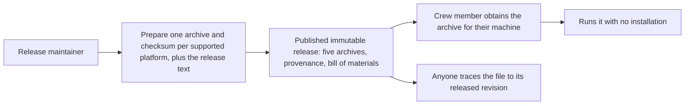

# Use case: publish-public-release

## Level

!

## Actors

- Release maintainer — primary Actor; decides that a version is ready, prepares and publishes its release, and answers for the evidence behind the promises made about it.
- Supporting: none inside this flow. The Crew member is the recipient of the published archive — their machines bound the platform set below — but obtaining a file from the public host is the host's concern, and running the tool is the conversion use case (`export-duty-plan-calendar`), not a step here.

## Goal

Publish one version of the tool as a public release that a crew member can obtain for their own machine and trace to the revision and the automation that built it.

## Trigger

The maintainer decides a version is ready and prepares its release.

## Preconditions

- A version number is decided, and the revision it names is the revision being released.
- The executable has been built for every supported platform by the project's own automation.
- The public home exists and its owner-applied settings are in place: the gate on landing, secret scanning with push protection, the dependency alerts, code scanning, and release immutability.

## Main flow

1. Maintainer decides the version; System prepares, for every supported platform, one archive holding that platform's executable together with a checksum covering that archive, and the release text for the version.
2. Maintainer inspects what was prepared before anything is public; System stages the complete set and publishes nothing from an incomplete preparation.
3. Maintainer publishes the version; System makes the release public with every archive of the version attached at once, and the release cannot change from that moment.
4. Crew member obtains the archive for their machine; System offers each platform's archive at a stable address, each named for the platform it serves.
5. Crew member extracts and runs the executable; System's published executable runs on that platform with no runtime installation and no companion library beyond the platform's own.
6. Crew member, or anyone else, checks what they received; System publishes each archive's checksum, its build provenance and the bill of materials for it, so the file in hand can be traced to the revision and automation that produced it.
7. Maintainer's release states what changed; System's release text carries the release-note subjects of the issued revisions.

## Extensions

- 1: a supported platform has no executable built → preparation fails and nothing is staged; an archive set missing a platform would promise a download that does not exist.
- 1: an executable is supplied for a platform outside the supported set → preparation fails and nothing is staged; no invented platform is published.
- 1: a version's release was already prepared → preparation refuses rather than replacing the prepared set.
- 1: an executable cannot be read → preparation fails and nothing is staged.
- 1–2: the prepared set is incomplete or was not inspected → nothing is published.
- 3: the version being published was already published → refuse; a published release's tag can never be reused, so a correction is a new version.
- 5: an executable does not start on a machine of its platform's kind → that platform's archive is not published for that version.

## Rules

- **The supported platform set**
  - The supported platforms are Windows x86_64, Linux x86_64, Linux arm64, macOS arm64 and macOS x86_64. Nothing else is offered for download.
  - A release of a version offers exactly one archive for each supported platform, and never offers a promising platform that has no archive.
  - Each archive's name states the tool, the version and the platform it serves, so a downloader selects by machine rather than by trial.
  - Each archive holds its platform's executable under the name that platform uses — `duty2cal`, or `duty2cal.exe` on Windows — and holds nothing else.
  - Every platform's archive uses the same archive format, so one documented extraction path serves all of them.
- **What a published archive guarantees**
  - The executable in a published archive runs on its platform with no runtime installation and no companion library beyond that platform's own.
  - Each archive is published with a checksum covering that archive, so a downloader verifies what they received before extracting it, and the checksum names the file it covers.
  - A platform's archive is published only after its executable was built and started on a machine of that platform's kind.
  - Each archive carries build provenance and a bill of materials naming what went into the build, and a published release carries a release attestation, so the file in hand can be traced to the revision and the automation that produced it.
  - A version's release stays reachable after later versions are published, so a link to the latest release does not rot as versions change.
- **Publication**
  - A release is prepared as a draft, inspected, and only then published; every archive of the version is attached before the release becomes public, and no asset is attached by hand.
  - A published release is immutable: its archives cannot be replaced or deleted and its version tag cannot be moved, so a correction is the next version rather than a repair in place.
  - A version tag that has been published cannot be reused, not even after the release is deleted.
  - The release text states the release-note subjects carried by the revisions being released, in release order, and omits housekeeping revisions. It never claims work that the released revision does not contain.
  - Publishing a version states the version once, in the archive names, the release text and the tag, so no two places disagree about what was released.
- **The public home and its gate**
  - A change reaches the default branch only after the project's checks pass: formatting, lint, tests, dependency licences, per-file licence headers, third-party notices drift, the private-data guard, coverage and the Windows cross-build. The result is visible on the revision a reader is looking at.
  - A leaked credential cannot be pushed into the public history, and any secret that still lands raises an alert.
  - A dependency that becomes known-vulnerable or malicious raises an alert, and dependency updates arrive as reviewable proposals; the deliberately pinned extraction and architecture-test crates are excluded from automatic bumps, and nothing is merged automatically.
  - Someone who finds a defect that could expose private plan data has a confidential reporting route, and the project states that route publicly.
  - A contributor finds the contribution route, the behaviour-before-implementation rule, the sign-off requirement, a code of conduct, an issue form that asks for the export family and a stripped sample rather than a real plan, and a pull-request template that asks for the same.
  - The project's code and its own automation are scanned for vulnerabilities on the way in, and findings appear as reviewable alerts.
- **Privacy and evidence**
  - Private duty plans and real identifying values never enter the public history or a public asset; committed examples and fixtures are generated or anonymised.
  - No platform, gate or provenance promise is made before the evidence for it exists; the owner-applied settings are confirmed by the operator who applied them, and the remaining promises are exercised by the project's automation and recorded as the change's evidence.
- **Where this interface ends**
  - This capability's own interface is the release preparation the maintainer runs, which the `@e2e` scenario drives through the real command and observes through its terminal output.
  - Obtaining a file from the public host is the host's interface, and running the published tool is the interface of the use case to export a duty-plan calendar; neither is invented here as a second interaction.
  - The host-side promises above are exercised by the project's own publication automation and recorded as this change's evidence, and the settings only the repository owner can apply are confirmed by the operator who applied them.

## Examples

- Complete preparation: executables for all five supported platforms and version 0.1.0 produce five archives, one per platform, each with its checksum and the release text; nothing is published until the maintainer publishes.
- Missing platform build: executables for four platforms and no Linux arm64 make the preparation fail naming Linux arm64 and stage nothing.
- Unrecognised platform: an executable labelled `freebsd-x86_64` makes the preparation fail naming `freebsd-x86_64`, with no archive for it and nothing staged.
- Checksum: a prepared Linux x86_64 archive is accompanied by a checksum that matches that archive and names it.
- Same release prepared twice: the same executables and version produce archives that are byte-for-byte identical, so a third party can reproduce them.
- Version already prepared: preparing version 0.1.0 where it is already staged refuses, and the existing archives stay untouched.
- Unreadable executable: an executable path that cannot be read stages nothing, and the failure names the cause.
- Release text: revisions carrying two `feat(…): <release note>` subjects plus `chore(…)` and `docs(…)` revisions produce a text that names the version and lists the two release notes in release order, omitting the housekeeping revisions.
- Published release: a version published from an inspected set cannot have its archives or tag changed, so a correction appears as the next version.
- Downloading for a machine: a Mac on Apple Silicon selects the macOS arm64 archive, the one whose name matches that machine.
- Missing platform archive on the page: a Windows executable that failed to build stops the version from being published at all, rather than publishing it without Windows.

## Minimal guarantee

Nothing is published that the evidence does not support: an incomplete preparation publishes nothing and never replaces an existing prepared set, and a credential or private value is blocked before it can enter the public history. A published release cannot be altered afterwards.

## Success guarantee

A crew member obtains, for their own machine, an archive whose executable runs without installation and whose build can be traced to the released revision; the maintainer can state what the version changed; and nothing published contradicts the evidence recorded for it.

This is a changing use case: it issues a release, rather than observing one.

## Personas

- project-maintainer--release-owner
- crew-member--personal-calendar-owner

## Capabilities

- publish-public-release

## Interactions

| Capability | Consumer action | E2E scenario |
|---|---|---|
| publish-public-release | prepare the release for a version | Maintainer prepares a release and runs the archived executable |

## Includes

- none

## Extends

- none

## Out of scope

- Changing the converter: no conversion rule, support boundary or diagnostic changes here.
- Publishing packages: no container image, no registry publication, and no other package channel beyond the release archives.
- Signing or notarising the macOS archives; the one-time download approval is documented instead.
- Platforms beyond the five above: Windows on ARM, 32-bit Windows, other Unixes and further Linux architectures build from source.
- Hosted documentation, discussions, a wiki, a development container, funding metadata and AI code review.
- Repairing a published release in place.
- Merging dependency updates automatically, and bumping the deliberately pinned crates automatically.
- The parked ideation questions (source-derived publication rights, FZ provenance, descriptive-fragment conflicts).

## Diagram

The flow this use case delivers:

