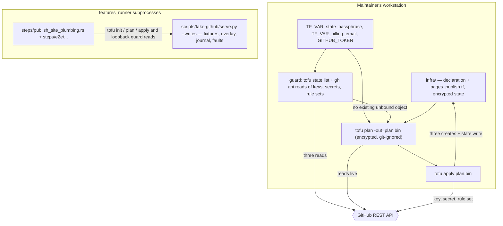

# Design: publish-site-plumbing

## Scope

Technical design for the change that creates the pages repository's publishing
credential and its protection rule set through one reviewed configuration
revision: [apply a configuration change](specs/apply-configuration-change/usecase.md),
capability `publish-site-plumbing`.

The observable WHAT is fixed by the proposal and the spec delta; this document
is the HOW: the declaration additions, the key-pair generation and its storage,
the create-aware preview/apply procedure with its guard and partial-failure
handling, and the seam that lets the delta's scenarios drive the real `tofu`
binary against a local fake GitHub API.

Four boundaries shape what follows:

- **What is declared.** `infra/` gains an Ed25519 key pair, a write-enabled
  deploy key on `duty2cal/duty2cal.github.io`, the matching
  `PAGES_DEPLOY_KEY` secret on `duty2cal/duty2cal`, and the pages repository's
  protection rule set with the deploy-key actor type as an always-bypass
  actor.
- **What the declared revision changes live.** Exactly three creates and no
  update or delete in the declared revision. The stock Jekyll site, its source,
  its Pages configuration, both repositories' settings and every other
  declared object stay as they are. The one live organization setting changed
  outside the declaration is the manual deploy-key policy in the next bullet.
- **What is a manual prerequisite.** The organization's
  `deploy_keys_enabled_for_repositories` policy must be `true` before the
  deploy-key create. The pinned provider 6.13.0 cannot declare this
  organization setting, so it is not part of the declaration or the apply's
  create set. A false policy fails the deploy-key create with 422 after the
  TLS key and rule set have landed; chapter 7 records the operator step and
  chapter 11 R-056 records the gap.
- **What the state now holds.** The private half of a live credential. The
  state was already reserved for this (ADR-0006, the decision that keeps the
  applied state local, passphrase-encrypted and committed, amended by this
  change); the
  private key cannot be read back from GitHub, so the state is the only copy of
  the material behind the live deploy key.
- **What the suite can prove.** Every scenario drives the real `tofu` binary
  (`init`, targeted `plan -out`, `show -json`, the refresh-only report,
  `apply <plan>`) as a subprocess against the fake API on loopback. The fake
  gains the deploy-key, Actions-secret and rule-set endpoints, an in-memory
  write overlay, and one fault-injection condition. No scenario reaches
  `api.github.com`.

## Technology decisions

No product technology is added. Every version below is read from the
repository's own pins or looked up on 2026-10-19; nothing is written from
memory.

| Area | Decision | Rationale / source |
|---|---|---|
| Declaration mechanism | OpenTofu with the `integrations/github` provider under `infra/`, unchanged (ADR-0005, the decision to declare the public home's configuration with OpenTofu and the GitHub provider). | The existing declaration. |
| OpenTofu version | `1.13.1`, read from `infra/.opentofu-version` (checked 2026-10-19); the declaration keeps `required_version = ">= 1.7"`. | The pinned tool the suite and CI install and refuse to substitute. |
| GitHub provider version | `6.13.0`, read from `infra/.terraform.lock.hcl`; constraint `~> 6.0`. The resource behaviour below was verified against the provider's `v6.13.0` source on 2026-10-19 (`github/resource_github_actions_secret.go`, `resource_github_repository_deploy_key.go`, `resource_github_repository_ruleset.go`, `util_rules.go`), not assumed. | `infra/.terraform.lock.hcl`; the `docs/` pages of the same tag. |
| Key-pair generation | `tls_private_key.pages_publish` from `hashicorp/tls`, algorithm `ED25519`, no passphrase on the key itself. The provider's ephemeral `tls_private_key` is rejected: it keeps the key out of state, but the GitHub provider's `github_actions_secret.value` is an SDKv2 optional/sensitive input with no write-only attribute in `6.13.0`, so the secret's plaintext still reaches the state; the ephemeral resource moves the copy, it does not remove it. | A declaration-owned key pair keeps the create inside the reviewed plan; ED25519 is the smallest modern key GitHub accepts, and the provider marshals it to the OpenSSH private-key format (`ssh.MarshalPrivateKey`) that the secret must carry. |
| TLS provider version | `hashicorp/tls` **4.4.1** — latest stable, looked up on `registry.terraform.io/v1/providers/hashicorp/tls/versions` on 2026-10-19; constraint `~> 4.0`; the source at tag `v4.4.1` was read to confirm `ED25519` is supported and that `private_key_openssh` is populated for it. | A version number with a lookup note; the concrete version is pinned in the lock file at setup. |
| Deploy key | `github_repository_deploy_key.pages_publish`: `repository = github_repository.pages.name`, `title = "duty2cal.github.io publish"`, `key = trimspace(tls_private_key.pages_publish.public_key_openssh)`, `read_only = false`. | The schema (`key` required, `read_only` defaults to `true`, every attribute `ForceNew`) was read from the pinned provider's schema dump; the default is why `read_only = false` is stated explicitly. |
| Secret | `github_actions_secret.pages_publish`: `repository = github_repository.mono.name`, `secret_name = "PAGES_DEPLOY_KEY"`, `value = tls_private_key.pages_publish.private_key_openssh`, `depends_on = [github_repository_deploy_key.pages_publish]`. | The provider encrypts the value with the repository's public key using NaCl sealed boxes (`box.SealAnonymous`) and sends only `key_id` and `encrypted_value`; the fake therefore needs no libsodium. |
| Rule set | `github_repository_ruleset.pages_publish`: `name = "pages protection"`, `target = "branch"`, `enforcement = "active"`, `conditions.ref_name.include = ["~DEFAULT_BRANCH"]`, `rules { deletion = true, non_fast_forward = true, required_linear_history = true }`, `bypass_actors { actor_type = "DeployKey", bypass_mode = "always" }` with no `actor_id`. | Proposal D1 (seed Q2 — may the pages repository's protection rule set bypass its publish deploy key? — answered as option 1). The pinned provider's schema states that `actor_id` must not be set for `DeployKey` and that `bypass_mode` accepts `always`. |
| Test runner | Unchanged: `./run-tests.sh` → `cargo test -p duty2cal --test features_runner` over an assembled feature root. | `run-tests.sh`; `givn/commands.yaml`. |
| Gherkin library | Unchanged: the workspace's `cucumber-rs`, strict via `.fail_on_skipped()`. | `Cargo.lock`; `apps/cli/tests/features_runner.rs`. |
| Fake GitHub API | `scripts/fake-github/serve.py`, Python standard library only; extended with the endpoints and write shapes below. No container, no network. | The existing twin; this design. |
| Guard transport | The preview guard uses `gh api` and `jq`, the same read transport `scripts/await-green-checks.sh` already uses; no new HTTP client and no second write path. | Chapter 5 already names `gh` as the API read client; `jq` is already a setup prerequisite. |

**Provider facts this design relies on** (all verified against the pinned
version on 2026-10-19):

| Fact | Evidence |
|---|---|
| The secret's plaintext is encrypted by the provider, not by the API or the user | `resource_github_actions_secret.go` (`encryptPlaintext` → `box.SealAnonymous`), `docs/resources/actions_secret.md` ("encrypted using the Go '/crypto/box' module … interoperable with libsodium") |
| Secret create reads the repository, then the repository public key, then writes; after the write it makes one timestamp read and ignores that read's failure. The provider framework performs no second read after create. | `resource_github_actions_secret.go` lines 141 (repositories get), 152 (`getPublicKeyDetails`), 174 (`CreateOrUpdateRepoSecret`), 191-208 (the timestamp read, whose error is ignored); SDKv2's create path returns the create result without a read |
| Secret read removes the resource from state on 404 | `resource_github_actions_secret.go` line 219 |
| Deploy-key create returns the key id and immediately reads the key back with `GET /repos/{owner}/{repo}/keys/{id}` | `resource_github_repository_deploy_key.go` lines 71, 105 |
| Deploy-key read sends `If-None-Match` only when a stored etag is non-empty and treats 304 as no change | `resource_github_repository_deploy_key.go` line 101; `github/transport.go` (`etagTransport`) |
| Rule-set create reads the repository (archived check) then creates; read fetches by id | `resource_github_repository_ruleset.go` lines 697, 705, 742 |
| `DeployKey` bypass actors carry no id, and `bypass_actors` must be an array even when empty | `util_rules.go` (`expandBypassActors`), the pinned schema's attribute description |
| The private key's OpenSSH format is produced for ED25519 | `hashicorp/tls` `v4.4.1` `resource_private_key.go` (`ssh.MarshalPrivateKey`) and `prvKeySupportsOpenSSHMarshalling` |
| The organization deploy-key policy is outside the declaration | `github_organization_settings` in provider `v6.13.0` has no `deploy_keys_enabled_for_repositories` attribute (verified against the provider source); the live organization field is read and patched manually, and a disabled policy fails the deploy-key create with 422 |

## Architecture impact

The product is untouched: no crate, port or conversion scenario changes. The
change adds three resources and one generated key to the declaration, a
create-guard step to the operator routine, and test-only endpoints and step
modules.



New or changed files:

| Path | Kind | Purpose |
|---|---|---|
| `infra/pages_publish.tf` | new | `tls_private_key.pages_publish`, `github_repository_deploy_key.pages_publish`, `github_actions_secret.pages_publish` and `github_repository_ruleset.pages_publish`. |
| `infra/versions.tf` | changed | `required_providers` gains `tls = { source = "hashicorp/tls", version = "~> 4.0" }`. |
| `infra/.terraform.lock.hcl` | changed | Resolved `hashicorp/tls` 4.4.1 checksums, beside the unchanged `integrations/github` 6.13.0 entry. |
| `infra/terraform.tfstate`, `infra/terraform.tfstate.backup` | changed after the apply | The encrypted state records the generated key, the three bindings and the secret's sealed value. |
| `infra/terraform.tfstate.stale` | transient, already git-ignored | Written after an apply that fails after its first live write, or after a post-apply read-back failure; it refuses the preview and the apply until the operator removes it. |
| `scripts/setup-infra-tests.sh` | changed | Mirrors `hashicorp/tls` beside the GitHub provider and points `TF_CLI_CONFIG_FILE` at both; strips `pages_publish.tf` from the base proof workspaces; extends the fixture proof to the secret and rule-set reads. |
| `scripts/fake-github/serve.py` | changed | Deploy-key, Actions-secret and rule-set endpoints; in-memory overlay for the three created objects; `--writes` allow-list entries; `after_requests` fault condition; journal fields for the key, the sealed secret and the rule set. |
| `scripts/fake-github/fixtures/security-applied/**` | changed | The empty deploy-key, secret-list and rule-set lists, and the fixed repository public key. |
| `apps/cli/tests/steps/publish_site_plumbing.rs` | new | Non-e2e step definitions for this capability. |
| `apps/cli/tests/steps/e2e/publish_site_plumbing.rs` | new | E2E step definitions (real subprocesses, fake API, transcript evidence). |
| `apps/cli/tests/steps/mod.rs`, `apps/cli/tests/steps/e2e/mod.rs` | changed | Declare the two new modules. |
| `apps/cli/tests/steps/enable_repository_security.rs`, `apps/cli/tests/steps/publish_organization_profile.rs` | changed | Their inherited-base priming also removes `pages_publish.tf`, so their base apply stays the declaration they were written against. |
| `givn/changes/publish-site-plumbing/evidence/visual/<scenario-slug>/transcript.txt` | new | One scrubbed transcript per `@e2e` scenario. |
| `givn/changes/publish-site-plumbing/evidence/real-apply/transcript.txt` | new after GREEN | The scrubbed transcript of the required operator apply. |
| `docs/arc42/*`, `docs/arc42/adr/ADR-0006-encrypted-local-applied-state.md` | changed | The 12-chapter assessment, the affected chapters, the glossary rows and the ADR amendment. |
| `cliff.toml` | unchanged | `apply-configuration-change` is already the allow-list entry; see "Archive-time obligation". |
| `apps/cli/tests/features_runner.rs` | unchanged | The reused `DutyWorld` fields (`declaration`, `batch`, `state`, `fake`, `fake_port`, `journal`, `journal_offset`, `plan_path`, `preview_transcript`, `apply_transcript`, `source_tree`) suffice. |

## The declaration

### Declared objects and values

| Resource address | Live counterpart | Declared values |
|---|---|---|
| `tls_private_key.pages_publish` | none; the key pair exists only in the applied state | `algorithm = "ED25519"` |
| `github_repository_deploy_key.pages_publish` | no deploy key exists on `duty2cal/duty2cal.github.io` (read 2026-10-19) | `title = "duty2cal.github.io publish"`; `key = trimspace(tls_private_key.pages_publish.public_key_openssh)`; `read_only = false` |
| `github_actions_secret.pages_publish` | no `PAGES_DEPLOY_KEY` exists on `duty2cal/duty2cal` (read 2026-10-19) | `secret_name = "PAGES_DEPLOY_KEY"`; `value = tls_private_key.pages_publish.private_key_openssh`; `depends_on = [github_repository_deploy_key.pages_publish]` |
| `github_repository_ruleset.pages_publish` | the repository's rule-set list is empty (read 2026-10-19) | `name = "pages protection"`; `target = "branch"`; `enforcement = "active"`; condition `~DEFAULT_BRANCH`; `deletion`, `non_fast_forward`, `required_linear_history`; bypass actor `{ actor_type = "DeployKey", bypass_mode = "always" }` |

```hcl
resource "tls_private_key" "pages_publish" {
  algorithm = "ED25519"
}

resource "github_repository_deploy_key" "pages_publish" {
  repository = github_repository.pages.name
  title      = "duty2cal.github.io publish"
  key        = trimspace(tls_private_key.pages_publish.public_key_openssh)
  read_only  = false
}

resource "github_actions_secret" "pages_publish" {
  repository  = github_repository.mono.name
  secret_name = "PAGES_DEPLOY_KEY"
  value       = tls_private_key.pages_publish.private_key_openssh

  # One credential pair: the key is registered before its private half is
  # stored, so a partial outcome always names the half that exists.
  depends_on = [github_repository_deploy_key.pages_publish]
}

resource "github_repository_ruleset" "pages_publish" {
  name        = "pages protection"
  repository  = github_repository.pages.name
  target      = "branch"
  enforcement = "active"

  conditions {
    ref_name {
      include = ["~DEFAULT_BRANCH"]
      exclude = []
    }
  }

  rules {
    deletion                = true
    non_fast_forward        = true
    required_linear_history = true
  }

  bypass_actors {
    actor_type  = "DeployKey"
    bypass_mode = "always"
  }
}
```

The `depends_on` is a project ordering choice, not a GitHub requirement: the
two halves are one credential, and stating the order makes the partial-failure
report deterministic. Rejected: relying on the graph walker's order.

`read_only = false` is stated because the provider's default is `true`; an
omitted attribute would register a read-only key and every publish would fail.

### The rule set's bypass is by actor type

The `DeployKey` bypass actor carries no id — the pinned provider's schema says
not to set one, and GitHub ignores it — so it does not name *this* key:
GitHub's semantics grant the bypass to a write-enabled deploy key on the
repository. Consequences, recorded rather than hidden:

- A second write-enabled deploy key added later would also bypass the rules.
  The declaration keeps exactly one, and the guard refuses an unbound second
  key with the same title.
- The key's own pushes are unreviewed by definition; that is the accepted cost
  of the user's option A (proposal D1) and no scenario claims otherwise.
- Whether GitHub's API accepts the actor and applies it to a push is proven
  only by the operator's real apply; the credential has no consumer until the
  website topic, so no publish is exercised by this change.

### The key pair and what the state now holds

`tls_private_key` has no remote object: its attributes exist only in the state.
The private half therefore appears twice inside `infra/terraform.tfstate` —
once as `tls_private_key.pages_publish.private_key_openssh` and once as
`github_actions_secret.pages_publish.value` — and both copies are inside the
same passphrase-encrypted, committed file (ADR-0006, amended). The plan file
that carries the secret value is encrypted by the declaration's `plan` block and
is deleted after the apply.

The durable consequences, which the proposal does not take but the design must
state:

- **The state is the only copy of the private key.** GitHub never returns a
  deploy key's private material, so losing the passphrase loses the key behind
  the live deploy key. Rebuilding the state then means generating a new pair
  and replacing the live deploy key and secret — a credential rotation, which
  Q11 leaves out of scope.
- **Rotation is an apply.** Replacing the pair replaces the deploy key (every
  attribute is `ForceNew`) and updates the secret; the rule set is unaffected.
- **Removing `pages_publish.tf` deletes the live key and secret.** The rule set
  would be deleted as well. Q11 leaves removal out of scope, so no change here
  does it; the declaration's no-removal rule already forbids it.

The `github_actions_secret` schema marks `value` sensitive, but the provider's
own documentation is explicit that this does not hide it from the state; the
design relies on the state encryption, not on the attribute flag.

## The apply procedure

The operator's routine, run after GREEN. It is the declaration's own commands
plus read-only checks (the decrypted state, the creation guard and the
refresh-only report); no second apply command and no wrapper around
`tofu apply` is introduced; the routine also reads the applied state and the
three live objects back before it reports success. Run from `infra/` with
`TF_VAR_state_passphrase` (at least 16 characters, from the password manager),
`TF_VAR_billing_email` and `GITHUB_TOKEN` set, and `gh`, `jq` and `tofu` on
`PATH`.

```sh
cd infra
set -euo pipefail

command -v tofu >/dev/null || { echo "refused: tofu is required" >&2; exit 2; }
command -v gh   >/dev/null || { echo "refused: gh is required" >&2; exit 2; }
command -v jq   >/dev/null || { echo "refused: jq is required" >&2; exit 2; }

declared_addresses="github_repository_deploy_key.pages_publish
github_actions_secret.pages_publish
github_repository_ruleset.pages_publish
tls_private_key.pages_publish"
live_declared="github_repository_deploy_key.pages_publish
github_actions_secret.pages_publish
github_repository_ruleset.pages_publish"

# 0. A stale applied state refuses the preview and the apply.
test ! -e terraform.tfstate.stale ||
  { echo "refused: the applied state is stale" >&2; exit 2; }

# 1. Initialise first: the local backend's state must decrypt, and the guard
#    below reads it.
tofu init -input=false
bound=$(tofu state list) ||
  { echo "refused: the applied state could not be read" >&2; exit 2; }

# The declared addresses that exist live, or "unreadable" on a read failure.
live_addresses() {
  local keys secrets rulesets
  keys=$(mktemp); secrets=$(mktemp); rulesets=$(mktemp)
  if ! gh api --paginate --slurp repos/duty2cal/duty2cal.github.io/keys >"$keys" ||
     ! gh api repos/duty2cal/duty2cal/actions/secrets >"$secrets" ||
     ! gh api --paginate --slurp repos/duty2cal/duty2cal.github.io/rulesets >"$rulesets"; then
    rm -f "$keys" "$secrets" "$rulesets"
    echo unreadable
    return 0
  fi
  if jq -e --arg title "duty2cal.github.io publish" \
       'any(.[][]?; .title == $title)' "$keys" >/dev/null; then
    echo github_repository_deploy_key.pages_publish
  fi
  if jq -e --arg name "PAGES_DEPLOY_KEY" \
       'any(.secrets[]?; .name == $name)' "$secrets" >/dev/null; then
    echo github_actions_secret.pages_publish
  fi
  if jq -e --arg name "pages protection" \
       'any(.[][]?; .name == $name)' "$rulesets" >/dev/null; then
    echo github_repository_ruleset.pages_publish
  fi
  rm -f "$keys" "$secrets" "$rulesets"
}

# The creation guard: prints a live declared address only when the applied
# state does not bind it; a live object the state already binds is not a
# finding.
guard_live() {
  local live address
  live=$(live_addresses)
  case "$live" in *unreadable*) echo unreadable; return 0 ;; esac
  for address in $live; do
    if ! printf '%s\n' "$bound" | grep -qxF "$address"; then
      printf '%s\n' "$address"
    fi
  done
}

refuse_unless_clear() {  # $1 is the guard's output
  case "$1" in
    *unreadable*)
      echo "refused: the live objects could not be read; nothing was written" >&2
      exit 2 ;;
    "") ;;
    *)
      printf 'refused: the live object exists and is unbound:\n%s\n' "$1" >&2
      exit 2 ;;
  esac
}

# 2. Creation guard, before the preview.
refuse_unless_clear "$(guard_live)"

# 3. The expected change set: the declared addresses the state does not bind.
expected=""
for address in $declared_addresses; do
  if ! printf '%s\n' "$bound" | grep -qxF "$address"; then
    expected="$expected $address"
  fi
done
expected=$(printf '%s\n' $expected | sed '/^$/d' | LC_ALL=C sort | paste -sd' ' -)

# 4. The preview: the targeted saved plan, and its report.
tofu plan -input=false -no-color \
  -target=github_repository_deploy_key.pages_publish \
  -target=github_actions_secret.pages_publish \
  -target=github_repository_ruleset.pages_publish \
  -out=plan.bin
tofu show -json plan.bin >preview.json
bad_actions=$(jq -r '
  [ .resource_changes[]?
    | select(((.change.actions // []) - ["create", "no-op", "read"]) | length > 0)
    | .address ] | join(" ")
' preview.json)
[ -z "$bad_actions" ] ||
  { echo "refused: the preview would update, delete or replace an object: $bad_actions" >&2; exit 2; }
creates=$(jq -r '
  [ .resource_changes[]? | select((.change.actions // []) == ["create"]) | .address ]
  | sort | join(" ")
' preview.json)
[ "$creates" = "$expected" ] ||
  { printf 'refused: the preview is not the missing creations\nexpected: %s\nactual:   %s\n' \
      "$expected" "$creates" >&2; exit 2; }
if [ -z "$expected" ]; then
  echo "the revision is already applied; nothing to create"
  rm -f plan.bin preview.json
  exit 0
fi

# 5. The read-only report over the previewed addresses. For an address the
#    state binds, a live edit appears as drift and refuses; for an unbound
#    address there is nothing to compare, which is step 6's job.
#    The JSON report, not the exit status, is the verdict: with
#    -detailed-exitcode OpenTofu exits 2 when changes are present, and 1.13.1
#    can return 2 even for a no-op. Capture the status so `set -e` does not
#    abort before the refusal below can name the report.
preflight_status=0
tofu plan -refresh-only -detailed-exitcode -json -input=false \
  -target=github_repository_deploy_key.pages_publish \
  -target=github_actions_secret.pages_publish \
  -target=github_repository_ruleset.pages_publish >preflight.json ||
  preflight_status=$?
preflight_verdict=$(jq -sr '
  if (map(select(.type == "change_summary")) | length) == 0 then "incomplete"
  else
    [ .[] | select(.type == "planned_change" or .type == "resource_drift")
      | .change as $c
      | (($c.actions // []) + (if $c.action then [$c.action] else [] end))
      | select(any(.[]; . != "no-op"))
      | ($c.resource.addr // empty) ]
    | if length == 0 then "ok" else join(" ") end
  end
' preflight.json) || preflight_verdict=incomplete
[ "$preflight_verdict" = ok ] ||
  { echo "refused: the applied state could not be verified: $preflight_verdict (plan exit $preflight_status)" >&2; exit 2; }

# 6. The create-time preflight: the guard again, immediately before the write.
#    This is where "live changed after the preview" is detected for creates.
refuse_unless_clear "$(guard_live)"

# 7. The applied revision.
state_before=$(mktemp); cp terraform.tfstate "$state_before"
apply_log=$(mktemp)
if tofu apply -input=false plan.bin 2>&1 | tee "$apply_log"; then
  # 8. Post-apply read-back: the applied state and the three live objects must
  #    be readable before the revision is reported applied. A read error keeps
  #    the applied state, writes the stale marker and exits non-zero.
  readback_err=$(mktemp)
  readback_failed=""; readback_reason=""
  bound_after=$(tofu state list 2>"$readback_err") ||
    { readback_failed="the applied state"; readback_reason=$(head -n1 "$readback_err"); }
  if [ -z "$readback_failed" ]; then
    keys_after=$(gh api --paginate --slurp repos/duty2cal/duty2cal.github.io/keys 2>"$readback_err") ||
      { readback_failed="github_repository_deploy_key.pages_publish"; readback_reason=$(head -n1 "$readback_err"); }
  fi
  if [ -z "$readback_failed" ] &&
     ! printf '%s' "$keys_after" | jq -e --arg title "duty2cal.github.io publish" \
       'any(.[][]?; .title == $title)' >/dev/null; then
    readback_failed="github_repository_deploy_key.pages_publish"
    readback_reason="absent live after the apply"
  fi
  if [ -z "$readback_failed" ]; then
    gh api repos/duty2cal/duty2cal/actions/secrets/PAGES_DEPLOY_KEY \
      >/dev/null 2>"$readback_err" ||
      { readback_failed="github_actions_secret.pages_publish (PAGES_DEPLOY_KEY)"; readback_reason=$(head -n1 "$readback_err"); }
  fi
  if [ -z "$readback_failed" ]; then
    rulesets_after=$(gh api --paginate --slurp repos/duty2cal/duty2cal.github.io/rulesets 2>"$readback_err") ||
      { readback_failed="github_repository_ruleset.pages_publish"; readback_reason=$(head -n1 "$readback_err"); }
  fi
  if [ -z "$readback_failed" ] &&
     ! printf '%s' "$rulesets_after" | jq -e --arg name "pages protection" \
       'any(.[][]?; .name == $name)' >/dev/null; then
    readback_failed="github_repository_ruleset.pages_publish"
    readback_reason="absent live after the apply"
  fi
  if [ -z "$readback_failed" ]; then
    for address in $live_declared; do
      if ! printf '%s\n' "$bound_after" | grep -qxF "$address"; then
        readback_failed="$address"
        readback_reason="absent from the applied state"
        break
      fi
    done
  fi
  if [ -n "$readback_failed" ]; then
    { date -u +%FT%TZ; printf '%s\n' $live_declared; } >terraform.tfstate.stale
    printf 'applied: these live objects were created: %s\n' \
      "$(printf '%s' "$live_declared" | tr '\n' ' ')" >&2
    printf 'failed read-back: %s %s\n' "$readback_failed" "$readback_reason" >&2
    rm -f plan.bin preview.json preflight.json "$state_before" "$apply_log" "$readback_err"
    exit 1
  fi
  rm -f plan.bin preview.json preflight.json "$state_before" "$apply_log" "$readback_err"
  exit 0
fi
```

The failure path follows the `if` block, with `set -euo pipefail` still in
force:

```sh
failed_state=$(mktemp); cp terraform.tfstate "$failed_state"
failed_bound=$(tofu state list) || failed_bound=unreadable
live_now=$(live_addresses)
cp "$state_before" terraform.tfstate

if [ "$failed_bound" = unreadable ] || [ "$live_now" = unreadable ]; then
  cp "$failed_state" terraform.tfstate
  printf '%s unverified\n' "$(date -u +%FT%TZ)" >terraform.tfstate.stale
  printf 'failed: the failed state or live could not be read; inspect the state and the live objects before any retry\n' >&2
  rm -f plan.bin preview.json preflight.json "$state_before" "$failed_state" "$apply_log"
  exit 1
fi

landed=""; failed=""; gaps=""
reason=$(grep -m1 -E '403|Forbidden' "$apply_log" || true)
reason=$(printf '%s' "$reason" | sed -e 's/^[[:space:]]*//')
[ -n "$reason" ] || reason="see the apply error above"
for address in $live_declared; do
  in_pre=no; in_failed=no; in_live=no
  if printf '%s\n' "$bound" | grep -qxF "$address"; then in_pre=yes; fi
  if printf '%s\n' "$failed_bound" | grep -qxF "$address"; then in_failed=yes; fi
  if printf '%s\n' "$live_now" | grep -qxF "$address"; then in_live=yes; fi
  if [ "$in_pre" = no ] && [ "$in_live" = yes ]; then
    landed="$landed $address"
    [ "$in_failed" = yes ] ||
      gaps="$gaps $address(live, not recorded by the failed state)"
  fi
  if [ "$in_pre" = no ] && [ "$in_live" = no ]; then
    failed="$failed $address"
  fi
done
landed=$(printf '%s\n' $landed | sed '/^$/d' | tr '\n' ' ')
failed=$(printf '%s\n' $failed | sed '/^$/d' | tr '\n' ' ')
gaps=$(printf '%s\n' $gaps | sed '/^$/d' | tr '\n' ' ')
cleanup_err=$(mktemp)

if [ -z "$landed" ]; then
  # Only the live read decides that a create landed. The failed state may
  # record planned values for creates that never did, so it is not evidence.
  printf 'refused: no live object was created; the applied state is unchanged\n' >&2
  printf 'failed: these live objects were not created: %s\n' "$failed" >&2
  printf 'reason: %s\n' "$reason" >&2
else
  cp "$failed_state" terraform.tfstate
  # The failed state may record planned values for creates that did not land.
  # Remove them so the applied state records only landed objects; the objects
  # are not live, so the removal has no live effect.
  cleanup_failed=""
  for address in $failed; do
    if printf '%s\n' "$failed_bound" | grep -qxF "$address"; then
      if ! tofu state rm "$address" >/dev/null 2>"$cleanup_err"; then
        cleanup_failed="$address"
        break
      fi
    fi
  done
  if [ -n "$cleanup_failed" ]; then
    { date -u +%FT%TZ; printf '%s\n' $landed
      printf '%s unverified: cleanup failed\n' "$cleanup_failed"; } >terraform.tfstate.stale
    printf 'partial: these live objects were created: %s\n' "$landed" >&2
    printf 'failed: these live objects were not created: %s\n' "$failed" >&2
    printf 'reason: %s\n' "$reason" >&2
    if [ -n "$gaps" ]; then
      printf 'unverified: these landed objects are not recorded by the failed state:%s\n' "$gaps" >&2
    fi
    printf 'unverified: %s could not be removed from the applied state (%s); inspect it before any retry\n' \
      "$cleanup_failed" "$(head -n1 "$cleanup_err")" >&2
    rm -f plan.bin preview.json preflight.json "$state_before" "$failed_state" "$apply_log" "$cleanup_err"
    exit 1
  fi
  { date -u +%FT%TZ; printf '%s\n' $landed; } >terraform.tfstate.stale
  printf 'partial: these live objects were created: %s\n' "$landed" >&2
  printf 'failed: these live objects were not created: %s\n' "$failed" >&2
  printf 'reason: %s\n' "$reason" >&2
  if [ -n "$gaps" ]; then
    printf 'unverified: these landed objects are not recorded by the failed state:%s\n' "$gaps" >&2
  fi
  printf 'the stale marker refuses a blind retry; read the report and remove it deliberately to recover\n' >&2
fi
rm -f plan.bin preview.json preflight.json "$state_before" "$failed_state" "$apply_log" "$cleanup_err"
exit 1
```

- **Why the failing state is not trusted.** SDKv2 persists planned values for a
  failed create and OpenTofu persists a refreshed envelope; the bytes cannot
  distinguish a refusal from a write (measured for the security change on
  2026-10-18). The routine therefore saves the failed state, restores the
  pre-apply state and asks live again. Only the live read decides whether a
  create landed: an address absent from the pre-apply state and present live.
  The failed state is used only to reinstall the landed records and to report
  whether they are recorded; it is never evidence that a write happened. Before
  the marker is written, the routine removes every address that did not land
  from the reinstalled state, so a planned value for a failed create cannot
  survive as if the object were applied. If `tofu state rm` fails, the state is
  kept, the marker and report say `unverified`, and the address that could not
  be removed is named.
- **The refusal verdict is an empty live set.** A failed create may appear in
  the failed state as a planned value; the live object is absent, so nothing
  landed. The restored state is kept, no stale marker is written, the failure
  report names the objects that did not land and the reason from `tofu apply`'s
  error, and a later preview names the same creations. This is the use case's
  minimal guarantee for a refusal before the first live write.
- **The partial verdict needs a landed live object.** A non-empty landed set
  reinstalls the failed apply's state, removes each address in `$failed` that
  the state records (a `tofu state rm` per address; the objects are not live),
  and only then writes `terraform.tfstate.stale` with the landed addresses. The
  applied state therefore records the landed objects and not a planned create
  that did not happen. Where the failed state does not record a landed object,
  the report adds an `unverified` line naming the gap; where a removal fails,
  the marker names the address as `unverified` and the report says it could not
  be removed. The marker refuses a blind retry until the operator acts.
- **A read-back failure after a green apply is reported, not hidden.** The
  routine reads the applied state and the three live objects back before it
  reports the revision applied. If one read fails, it keeps the applied state
  (the writes did land), writes `terraform.tfstate.stale` with the three
  addresses, prints `applied: ...` and `failed read-back: <object> <reason>`,
  and exits non-zero. The next preview refuses until the operator reads the
  report and removes the marker; a new apply then completes the revision.
- **The recovery is an explicit operator step.** The preview and the apply
  refuse while the marker exists; the operator removes it after reading the
  report, and the next green apply completes the revision, through this
  sequence:
  1. the operator reads the partial report and the marker's addresses and
     confirms the created objects are the intended ones;
  2. the operator deliberately removes `infra/terraform.tfstate.stale`
     (`rm terraform.tfstate.stale`) — a decision, not an automatic step; the
     marker must not be removed before the report is read;
  3. the next preview's state-aware guard sees those objects live and bound
     (the reinstalled state records them) and clears; the expected set is the
     declared addresses minus the state-bound ones, so the targeted plan
     contains only the missing creates;
  4. the apply completes the revision, and the marker is already gone; a
     follow-up targeted plan reports no differences.
  The first preview of the change asserts the exact four-address set in its
  `@e2e` scenario; a recovery preview asserts only the missing set, which is
  what `expected` computes.
- **A landed object missing from the failed state is reported, not hidden.**
  The live read proves the object exists, so the outcome is partial; the failed
  state does not record it, so the marker's report says `unverified` and names
  it. The next preview refuses it as unbound until the operator resolves it
  (state import or removal — Q11 territory, not this change); no duplicate is
  attempted.
- **A live object without a state record is refused, not adopted.** The guard
  names it as unbound, so the preview refuses; the marker keeps the retry
  blocked until the operator resolves the object. This change offers no
  adoption for these objects.
- **The unreadable verdict fails closed.** Without a state or live read the
  routine cannot establish what landed, so it keeps the failed state, marks it
  stale and unverified, and names what must be inspected.
- **The preflight's verdict is the JSON report, not the exit status.** With
  `-detailed-exitcode` exit 2 can mean changes are present, and OpenTofu 1.13.1
  can return 2 even for a no-op. The routine captures the status so `set -e`
  cannot abort before the refusal, and `preflight_verdict` decides: `ok`,
  a named address, or `incomplete`.
- **The preview is targeted.** The full declaration still names the pre-existing
  organization billing drift; a targeted plan keeps this revision's preview to
  its own objects, as the security and profile changes do. The plan file is
  encrypted, git-ignored and deleted after the apply.
- **No write happens before the guard passes.** The guard is read-only; the
  preview writes only the local encrypted plan file.

## Test seam: the fake GitHub API

The suite never reaches `api.github.com`. The provider's base URL points at
`scripts/fake-github/serve.py` on loopback, and the scenarios run the same
`tofu` binary the operator runs.

### Endpoints

| Method and path | Served by | Shape |
|---|---|---|
| `GET /repos/{owner}/{repo}/keys` | fixture/overlay | array of `{id, key, title, read_only, verified, created_at}`; the guard's read and the fake's proof of existence |
| `POST /repos/{owner}/{repo}/keys` | overlay (`--writes`) | 201 with the created key; 422 for a duplicate key value; journals `applied_write` with `title`, `read_only` and `key_type` |
| `GET /repos/{owner}/{repo}/keys/{id}` | overlay | the created key by id; 404 when absent (the provider removes it from state) |
| `GET /repos/{owner}/{repo}/actions/secrets` | fixture/overlay | `{"total_count": N, "secrets": [{name, created_at, updated_at}]}`; the guard's read |
| `GET /repos/{owner}/{repo}/actions/secrets/public-key` | fixture | `{"key_id": "568250167242205012", "key": "<fixed base64 32-byte value>"}` |
| `PUT /repos/{owner}/{repo}/actions/secrets/{name}` | overlay (`--writes`) | 204; stores `key_id`, the sealed `encrypted_value` and a deterministic `created_at`/`updated_at`; journals `applied_write` with `secret_name`, `key_id`, `ciphertext_bytes` and `contains_pem_header` |
| `GET /repos/{owner}/{repo}/actions/secrets/{name}` | overlay | `{"name", "created_at", "updated_at"}`; 404 before the write |
| `GET /repos/{owner}/{repo}/rulesets` | fixture/overlay | array of `{id, name, target, source_type, source, enforcement}`; the guard's read |
| `POST /repos/{owner}/{repo}/rulesets` | overlay (`--writes`) | 201 with the full rule-set body; journals `applied_write` with `ruleset_name`, `bypass_actors` and `rules` |
| `GET /repos/{owner}/{repo}/rulesets/{id}` | overlay | the created rule set by id |

The fixed public key is generated once from 32 random bytes; because the
provider performs the sealed-box encryption and the fake never decrypts, the
matching private half is irrelevant and is not kept. The `key_id` is a constant
so the scenario can assert that the provider used the fetched key.

`contains_pem_header` is computed on the decoded ciphertext and must be false;
the ciphertext length must exceed the 48-byte sealed-box overhead. Together
with `key_id`, that proves the provider encrypted the value rather than sending
it in plaintext, without the fake needing libsodium.

### Fixtures

The base tree `fixtures/security-applied/` gains four files:

- `repos/duty2cal/duty2cal.github.io/keys.json` — `[]`
- `repos/duty2cal/duty2cal/actions/secrets.json` — `{"total_count": 0, "secrets": []}`
- `repos/duty2cal/duty2cal/actions/secrets/public-key.json` — the fixed key
- `repos/duty2cal/duty2cal.github.io/rulesets.json` — `[]`

Created objects are served from the overlay, so no per-id fixture is needed.
The scenario that seeds live objects copies the base tree and rewrites those
three list files; the preview guard then reads the seeded entries. The
second-guard scenario saves the preview first, then writes the deploy key into
the overlay, so the guard's second read sees an object that appeared after the
preview.

### Write sandbox

With `--writes`, the fake accepts exactly three additional write shapes (the
deploy key, the secret and the rule set above). Every other write, and every
method on an unknown path, is still refused with 405 and journaled, so an
unexpected write cannot hide. Reads consult the overlay before the fixture
file. The overlay is guarded by the existing `FakeState.lock`.

### Fault injection

`faults.json` gains one optional condition: `after_requests: N`, so a fault
fires only after the server has served N requests on the matching method and
path (the counter is per path, incremented once per request). The scenarios
need:

| Scenario | Fault |
|---|---|
| unreadable pages repository | status 403 for `GET` on the exact path `repos/duty2cal/duty2cal.github.io` (not a regex, so the guard's subpath reads still succeed); the plan's repository read fails and names the repository |
| existing unbound objects | seeded list fixtures, no fault |
| clean refusal | status 403 for `POST` on `repos/duty2cal/duty2cal.github.io/keys` and `POST` on `repos/duty2cal/duty2cal.github.io/rulesets` (exact paths); the authority cannot create any live object, the generated key is state-only and no live object is created. For the "planned deploy key in its state" Given, the state is primed by a raw apply outside the routine — the routine itself restores the pre-apply state on a clean refusal — so the primed state records SDKv2's planned value and live has no key |
| partial failure | status 403 for `PUT` on `repos/duty2cal/duty2cal/actions/secrets/PAGES_DEPLOY_KEY` and for `POST` on `repos/duty2cal/duty2cal.github.io/rulesets`; blocking both writes keeps the rule set from landing in parallel, so only the deploy key is created and the partial report is deterministic |
| read-back failure | status 403 for `GET` on `repos/duty2cal/duty2cal/actions/secrets/PAGES_DEPLOY_KEY`, `after_requests: 1`, `once: true` — the secret create's own timestamp read is request one and succeeds; the routine's post-apply read-back is request two and fails |

A 500 is not usable for the read-back: the provider's HTTP client retries 5xx,
so the fault is consumed by the retry. A 403 is not retried.

## Test runner, strict mode, and single-scenario command

- **Runner command (`verify.command`):** `./run-tests.sh` — unchanged. It
  assembles `givn/specs/**` and `givn/changes/*/specs/**` into one feature root
  and runs `cargo test -p duty2cal --test features_runner` over it.
- **E2E command (`verify.e2e_command`):** `./run-tests.sh --e2e` — unchanged;
  the same runner with the `@e2e` filter.
- **Strict mode:** `DutyWorld::cucumber().fail_on_skipped()` in
  `apps/cli/tests/features_runner.rs`. An undefined, pending or skipped step
  fails the run, so the ten `@wip` scenarios are red until their definitions
  exist. The proof is an implementation task: temporarily rename one step in a
  throwaway copy of the feature, observe a non-zero exit and an "undefined
  step" report, then restore. The fake's unknown-path 599 marker and its
  refused-write journal are the second net.
- **Single-scenario command:**
  `./run-tests.sh --name "Organization owner previews the pages plumbing and only the three live creations are named"`.
  `run-tests.sh` forwards `--name` to cucumber-rs unchanged.

## Step definitions

One file per capability:

| File | Contents |
|---|---|
| `apps/cli/tests/steps/publish_site_plumbing.rs` | Non-e2e steps: copy `org/` beside a temporary declaration copy (the inherited declaration minus `pages_publish.tf`), adopt both existing batches, apply the inherited declaration against a copy of `fixtures/security-applied` in `--writes` mode, restore `pages_publish.tf`, take the journal offset, seed the guard's list fixtures; run `tofu init -input=false`, then `tofu state list` for the bound addresses, then the guard's unbound verdict from the fake's live lists, then the expected set (declared minus bound); drive the targeted plan, `tofu show -json`, the refresh-only report and `tofu apply`; finally read the fake's overlay (the created key, secret and rule set), the journal and the state. |
| `apps/cli/tests/steps/e2e/publish_site_plumbing.rs` | The same real subprocesses, plus the committed transcript and the sealed-secret and rule-set assertions on the journal and the live reads. |

Both modules are declared in `apps/cli/tests/steps/mod.rs` and
`apps/cli/tests/steps/e2e/mod.rs`. The priming reuses the profile module's
`org/` copy helper and the security module's `tofu`/`jq` helpers (made
`pub(crate)` or moved to `support.rs`); no state is fabricated — every binding
was written by the real adoption command, and the profile objects by the
inherited declaration's real apply.

The recovery scenario's partial state is primed through the routine, not
invented: its step runs the partial scenario's faulted apply (the deploy key
lands, the secret and the rule set fail, the routine removes their planned
values from the state, and `terraform.tfstate.stale` is written), reads the
marker, then removes it exactly as the operator would and runs the preview and
apply without the faults. The state therefore binds the deploy key and the
generated key only, and the recovery preview's expected set is the secret and
the rule set. The second-guard scenario takes its
saved preview, then writes the deploy key into the fake's overlay so the
pre-apply guard sees a live object created after the preview.

The guard reads are performed at the fake's REST paths (the same helper the
profile module uses for its live-object read) and the verdict is computed with
the design's own `jq` filters, because `gh api` cannot be pointed at a loopback
server. The transport is GitHub's client; the artifact under test is the
response shape and the verdict, which the fake serves.

## Decisions

Resolves the proposal's open questions; seed IDs are recorded beside the ledger
IDs so the link is readable here and in the proposal.

- **Decides D1 (seed Q2):** the pages repository's rule set carries deletion,
  non-fast-forward and linear-history rules and names the `DeployKey` actor
  type as a bypass actor with `bypass_mode = "always"` and no `actor_id`,
  because the provider says not to set an id for that actor type and GitHub
  ignores one. The user confirmed option 1 again on 2026-10-19 after the
  actor-type consequence was disclosed. Rejected: protection without a bypass
  (a future pull-request or required-check rule would break publishing) and no
  rule set (an unprotected default branch). The bypass is by actor type, not by
  key identity, so every write-enabled deploy key on the pages repository may
  push; the consequence is recorded in the declaration section and chapter 11.
  Realized in `infra/pages_publish.tf` and asserted by the rule-set scenario.
- **Out of scope D2 (seed Q10 — does a review gate the apply?):** whether a
  review gates an apply. Owner: the user. This change is reviewed by the givn
  workflow and applied by the owner after GREEN; no runtime gate is built. Kept
  open in the topic log.
- **Out of scope D3 (seed Q11 — what may an apply delete, and how are
  credentials rotated?):** what an apply may delete and how a credential is
  rotated. Owner: the user. This change creates and removes nothing; the
  state-recovery consequence (the key cannot be re-read from GitHub) makes a
  rotation a separate decision, recorded in the ADR amendment and chapter 11.
  Kept open in the topic log.

Design decisions beyond the proposal's questions, each with the alternative it
rejected:

- **The key pair is generated by `tls_private_key` in the declaration**
  (rejected: the provider's ephemeral `tls_private_key`, which would keep the
  key resource out of state but not remove the state copy — the secret's
  `value` is an SDKv2 optional/sensitive input with no write-only attribute in
  provider `6.13.0`, so the plaintext still reaches `terraform.tfstate`; the
  owner generating a pair by hand and passing two sensitive variables — an
  unrecorded step outside the plan, and the plan would still carry the private
  value; and an external generation script — a second tool and a second place
  the material exists).
- **ED25519 rather than RSA** (rejected: RSA 4096 is larger for no benefit on
  an SSH deploy key and gives a much larger state value; ED25519 is accepted by
  GitHub deploy keys and marshalled to the OpenSSH format the secret needs).
- **The create guard reads the decrypted state and three live lists, with `jq`
  verdicts, not a plan-JSON check** (rejected: the plan JSON cannot see an
  unmanaged live object, because a `create` resource is never read during plan;
  a full guard plan would show the same `create` and prove nothing). A live
  object is a finding only when the applied state does not bind its address, so
  a bound object never refuses its own preview.
- **The guard runs before the preview and again immediately before the apply**
  (rejected: a single run before the apply, which would let the operator read a
  preview for an object that already exists, and a single run before the
  preview, which leaves the create-time window unguarded). The residual window
  is between the second guard and the write, recorded as a risk.
- **Partial failure is classified by live reads, not by the failed state**
  (rejected: trusting SDKv2's persisted values, which record a failed create
  identically to a completed one; and comparing state bytes, which the
  refreshed envelope defeats).
- **A stale marker rather than a commit rule alone** (rejected: relying on the
  operator's memory, which leaves a partial state indistinguishable from an
  applied one).
- **The secret depends on the deploy key** (rejected: relying on the graph
  walker's order; the ordering is a project statement about one credential
  pair and makes the partial report deterministic).
- **The rule set is created without any dependency on the key** (rejected: a
  `depends_on` — the rule set does not reference the key, and the bypass is by
  actor type; adding one would imply a relationship the API does not have).
- **The suite's guard verdicts run against the fake, not a stub `gh`**
  (rejected: a canned stub proves the filter against invented JSON; the fake
  serves the shapes the provider and the guard actually consume).
- **No new base fixture tree** (rejected: a fourth tree duplicating the
  post-profile live state; priming reproduces that state with the real
  adoption command and the inherited declaration's real apply, as the profile
  scenarios already do).
- **The commit scope is the use-case id, `apply-configuration-change`**
  (rejected: this change's id, which is not a capability the changelog
  allow-list names; `infra/` is not a user-receiving path, so the change is
  intentionally absent from `CHANGELOG.md`).

## Use-case traceability

| Use-case element | Technical decision | Evidence |
|---|---|---|
| Goal: the live configuration matches the applied revision | Three declared objects applied as the saved targeted plan | `@e2e` "Organization owner applies the previewed revision and the pages publishing credential is created" |
| Main flow 2: the preview names every difference among the previewed objects | Targeted plan over the three objects and their generated key; the changed set is asserted as the declared addresses the state does not bind (four on the first preview, the missing set on a recovery preview) | `@e2e` "Organization owner previews the pages plumbing and only the three live creations are named" |
| Rule: an existing live object is adopted before it is updated; a preview that would add one refuses and names it | The state-aware creation guard before the preview: a live object is refused only when the applied state does not bind its address | "The preview refuses each live object the revision would create and names it" |
| Rule: readability; an object the declaration names must be readable | The state must decrypt (`tofu state list`) and the pages repository read must succeed; either failure refuses and names it | "An unreadable pages repository refuses the preview and names it" |
| Rule: preflight; a live change since the preview refuses the apply | The guard's second run immediately before the apply is the create-time equivalent; the refresh-only report catches a live edit of a bound address | "A live object created after the preview refuses the apply and names it" (second guard) and the apply scenario's successful preflight |
| Rule: refusal and partial outcomes; a refused apply makes no live change, and a failure after the first write names the applied object, the failed object and the reason and marks the state stale | The failure path's pre-apply-versus-live comparison, the reinstalled failed state with failed planned values removed by `tofu state rm`, `terraform.tfstate.stale`, and the `partial:`/`failed:`/`reason:` report lines | "An apply refused before the first live write leaves the state unchanged and writes no stale marker"; "A partial failure after the deploy key is created names the applied and failed objects and marks the state stale" |
| Rule: a live write succeeds and a later read-back fails; report the applied objects, the unreadable object and the reason, and mark the state stale | The routine's post-apply read of the applied state and the three live objects; a failed read keeps the applied state, writes the marker, and prints `failed read-back: <object> <reason>` | "A failed read-back after the publishing secret is stored is reported and the state is marked stale" |
| Rule: recorded revision and stale state; the preview and the apply refuse while the marker exists, and the operator removes it after reading the report so the next green apply completes the revision | Step 0 refuses a blind retry; the operator deliberately removes the marker after reading the report; the state-aware guard clears the bound objects, the plan carries only the missing creates, and the apply completes | "A green apply after a partial failure creates only the objects the state does not bind and completes the revision" |
| Rule: no removal (Q11 — what an apply may delete, and how credentials are rotated) | The revision only creates; the guard and the scenarios assert no deletion or update | "Applying the pages plumbing leaves the published site and its source untouched"; the journal's applied-write set |
| Success guarantee for this revision's objects | The first apply creates all three objects and the generated key; the state records them; a later targeted preview reports no differences | `@e2e` apply scenario's final assertions |
| Persona impact: organization owner | Runs the guard, reads the preview, applies, and answers for a refusal or partial outcome | `@e2e` transcripts |
| Persona impact: contributor reviewer | Reads the declaration, the rule set and the state as ciphertext; holds no token, no passphrase | Design-level; the reviewed revision |
| Persona impact: crew member | The stock site keeps serving; the release channel is untouched; no publish is claimed | "Applying the pages plumbing leaves the published site and its source untouched" |

Actors in Gherkin are the organization owner; Personas are review lenses, not
Actors.

## Persona impact

User-visible surface: a terminal interface (the guard's and the apply's output)
and the repository's files (the declaration and the encrypted state).

- **`project-maintainer--organization-owner`** — runs the guard, previews the
  three live creations, applies them, and reads the deployed key, secret and rule
  set; holds the token and the passphrase, and now also the only recoverable
  copy of the publishing private key.
- **`contributor--infrastructure-reviewer`** — reads the declaration, the
  guard's documented verdicts and the state as ciphertext in the same history
  as the code; holds no token, no passphrase, and cannot apply.
- **`crew-member--personal-calendar-owner`** — no change: the stock site keeps
  serving, the release channel is untouched, and no download or published page
  differs.

## Visual Design Contract

- Interface: terminal
- Viewports: n/a (no rendered screen)
- Design system: none
- Screens covered: none
- rendered reference: n/a
- Capture mechanism and evidence path: one transcript per `@e2e` scenario under
  `givn/changes/publish-site-plumbing/evidence/visual/<scenario-slug>/transcript.txt`,
  captured by the scenario's final step with the temporary directory, the
  fake's port, the token and the passphrase replaced by placeholders.
- Baseline: the transcript carries the guard's verdict or the plan's summary
  and the changed object names, or the apply's outcome; no token, passphrase,
  private key, temporary path or live credential appears in it.
- Baseline adaptation: no controls, headings or page are rendered; the
  Terraform object addresses are the operator's domain names and are expected
  in visible text; no secret, token, passphrase, temporary path or plaintext
  key appears; no output line is duplicated; an error state names the failing
  object and the next action.
- Motion: n/a.

## E2E smoke test infrastructure

- **E2E runner command:** `./run-tests.sh --e2e`, distinct from
  `verify.command`; it filters `@e2e`.
- **E2E step location:** `apps/cli/tests/steps/e2e/publish_site_plumbing.rs`,
  separate from the non-e2e steps because it starts the fake and commits the
  transcript.
- **Real interface:** the `tofu` CLI — `init`, the targeted `plan -out`,
  `show -json`, the refresh-only report and `apply <plan>` — invoked as real
  subprocesses with the real provider, against the local fake GitHub API over
  loopback.
- **Local test infrastructure:** the fake server on an ephemeral loopback port
  in `--writes` mode, a temporary declaration copy primed by the real adoption
  command and the inherited declaration's real apply, the provider mirror
  prepared by `scripts/setup-infra-tests.sh` (now two providers), a fixed
  16-plus-character test passphrase and a dummy billing email, and the
  `security-applied` tree. No container, no network, no credentials.
- **Framework:** cucumber-rs with `std::process::Command` and `std::net` to
  discover the fake's port, as the existing infrastructure steps do.
- **E2E strict-mode proof:** the same `fail_on_skipped()`, plus the fake's
  unknown-path 599 marker and refused-write journal; the rename-a-step check is
  an implementation task in `tasks.md`.

## Interaction Coverage Matrix

| Inventory entry | @e2e scenario title | Real interface | Driving mechanism |
|---|---|---|---|
| preview the declared configuration and read the named differences | Organization owner previews the security settings and only the declared differences are named | CLI (terminal) | `std::process::Command` runs `tofu init`, `tofu plan -out=<tmp>/plan.bin` and `tofu show -json` in the primed declaration copy against the fake API; the full-declaration guard and the plan's named differences are asserted (inherited scenario, unchanged) |
| apply the previewed revision and read the outcome | Organization owner applies the previewed revision and the security settings are enabled | CLI (terminal) | `std::process::Command` runs `tofu apply <tmp>/plan.bin` against the fake in `--writes` mode, then a targeted follow-up plan; the journal's applied write and the state's bindings are asserted (inherited scenario, unchanged) |
| preview the declared configuration and read the named differences | Organization owner previews the profile declaration and only the three creations are named | CLI (terminal) | `std::process::Command` runs the targeted `tofu plan -out` and `tofu show -json` for the profile repository and its two files against the fake API; the three creates and no unrelated difference are asserted (inherited scenario, unchanged) |
| apply the previewed revision and read the outcome | Organization owner applies the previewed revision and the organization profile is published | CLI (terminal) | `std::process::Command` runs `tofu apply <tmp>/plan.bin` against the fake in `--writes` mode, then a targeted follow-up plan; the repository, the two file contents and the state's three bindings are asserted (inherited scenario, unchanged) |
| preview the declared configuration and read the named differences | Organization owner previews the pages plumbing and only the three live creations are named | CLI (terminal) | `std::process::Command` runs `tofu init -input=false` and `tofu state list` in the primed declaration copy (decrypting the applied state with `TF_VAR_state_passphrase`), then the guard's live reads against the fake's `repos/.../keys`, `repos/.../actions/secrets` and `repos/.../rulesets` (an address is refused only when live and not bound), then the three-target `tofu plan -input=false -no-color -out=<tmp>/plan.bin`, `tofu show -json`, and the refresh-only report, with `TF_VAR_billing_email`, `GITHUB_TOKEN=test-token`, `GITHUB_BASE_URL=http://127.0.0.1:<port>` and `TF_CLI_CONFIG_FILE` set; asserts the changed set equals the declared addresses minus the bound ones — the four addresses on this first preview — and no other change |
| apply the previewed revision and read the outcome | Organization owner applies the previewed revision and the pages publishing credential is created | CLI (terminal) | `std::process::Command` runs the guard again, `tofu apply -input=false <tmp>/plan.bin`, then a targeted follow-up `tofu plan`; asserts the apply's outcome lines, the fake's deploy key (`read_only: false`, title), the journal's secret `PUT` (`key_id`, ciphertext length, no PEM header), the ruleset read (bypass actor `DeployKey`/`always`, three rule types), the state's four addresses (the three bindings and the generated key), and an empty follow-up plan |

## Black-Box-First policy

All ten scenarios drive the real `tofu` binary as subprocesses; the two
`@e2e` scenarios drive the same binary end to end and assert its output, the
guard's verdict, the request journal and the recorded state. No internal test
is retained: the only Rust added is step definitions, and the conversion crates
gain no line. The GitHub API is never mocked inside the tooling — it is
replaced at the HTTP boundary by a local server, which is the boundary the
provider actually talks to.

## Local runnability & digital twins

- **Setup, once:** `./scripts/setup-infra-tests.sh` — checks `tofu` against
  `infra/.opentofu-version`, `python3` and `jq`; mirrors both locked providers
  (`integrations/github` and `hashicorp/tls`) into
  `~/.cache/duty2cal/terraform-provider-mirror`; writes the `terraformrc` with
  both in the `include` list; and proves the fixture set, with the base
  workspaces removing `pages_publish.tf` so the inherited declaration is the
  one they exercise.
- **Run the suite:** `./run-tests.sh` (or `./run-tests.sh --name "<scenario>"`).
  The scenarios start the fake themselves; no service has to be running.
- **Manual walkthrough:** run `./scripts/setup-infra-tests.sh` once (it prints
  the `TF_CLI_CONFIG_FILE` it wrote), start
  `scripts/fake-github/serve.py --fixtures scripts/fake-github/fixtures/security-applied --port 8099 --journal /tmp/journal --writes`,
  copy the declaration and `org/` to a temporary directory, prime the state
  with both adoption batches and the inherited declaration's apply, restore
  `pages_publish.tf`, then run the routine with `GITHUB_BASE_URL`,
  `GITHUB_TOKEN=test-token`, `TF_CLI_CONFIG_FILE`, `TF_VAR_state_passphrase`
  and `TF_VAR_billing_email` exported. For a fake-backed walkthrough the
  state read (`tofu state list`, after `tofu init`) and the guard's three live
  reads are issued against the same paths with any HTTP client (the fake has no
  `gh` host entry); against the real organization the routine runs as written,
  because `gh api` is the production read transport. The verdict filters are
  identical in both cases.
- **Isolated network:** every dependency is on loopback; the fake binds an
  ephemeral port and the steps pass its URL explicitly. No shared dev service,
  no assumption that anything is already running.
- **Digital twin:** GitHub's REST API is the only external service this
  change's tooling talks to, and `scripts/fake-github/serve.py` is its twin —
  deterministic fixtures, an in-memory write overlay, a request journal and
  fault injection. No scenario reaches `api.github.com`.
- **Interface obstacles and their named fixes:**
  - *`tofu init` now needs a second provider.* Fix: the mirror's `include`
    list names both `registry.opentofu.org/integrations/github` and
    `registry.opentofu.org/hashicorp/tls`, and `direct` excludes both, so the
    suite stays offline.
  - *The provider's secret create reads the repository and the public key
    before writing.* Fix: the base tree serves the repository body and the
    fixed `public-key.json`; a missing read is a 599 unknown path, not a
    silent default.
  - *The provider reads the deploy key back by id.* Fix: the write sandbox
    keeps created keys in the overlay and serves `keys/{id}` from it.
  - *The deploy-key read may send `If-None-Match`.* Fix: the fake returns no
    `ETag` header, so the provider stores an empty etag and the transport adds
    no conditional header; the proof is a second plan that reports no change.
  - *The rule-set create reads the repository for an archived check.* Fix: the
    pages repository body carries `"archived": false`.
  - *A failed create persists planned values.* Fix: the failure path restores
    the pre-apply state and classifies with live reads.
  - *The read-back fault must not fail the secret's create.* Fix: it is
    `once` and fires on the second `GET` of the secret path — the create's
    timestamp read is first and the routine's post-apply read is second — so
    the next preview's list read and the overlay are unaffected.
  - *The guard could be satisfied by a fixture's absence.* Fix: the guard's
    list fixtures exist as empty arrays, so an unserved path is a 599 and a
    refusal scenario asserts no unknown-path entry.
  - *The provider may fall back to `gh auth token` when no token is set.* Fix:
    every child invocation exports `GITHUB_TOKEN` and `GITHUB_BASE_URL`.

## Coverage process boundaries

| Process | Started by | Instrumented artifact | Profile output | Merge step | Non-zero production probe |
|---|---|---|---|---|---|
| features_runner (non-e2e) | `./measure-coverage.sh` (no `--tags`; it produces both reports) | `cargo llvm-cov --workspace --test features_runner` | `coverage/non-e2e-cobertura.xml` | `./merge-coverages.sh` | `crates/duty2cal-core/src/domain/timing.rs` |
| features_runner (`@e2e`) + spawned `tofu`/fake | `./measure-coverage.sh` (no `--tags`; it produces both reports) | `cargo llvm-cov --workspace --test features_runner` | `coverage/e2e-cobertura.xml` | `./merge-coverages.sh` | `apps/cli/src/fs.rs` |

The HCL, the `tls` and `github` providers, the fake and the `tofu` CLI are not
Rust and stay outside the coverage denominator; their observable contract is
covered by the delta's scenarios. The only Rust added is step definitions.

## Risks and follow-ups recorded here

- **The private key sits in live configuration, not only in a plan.** See the
  ADR-0006 amendment and chapter 11 (R-051): the state is the only copy of the
  material behind the live deploy key, and losing it means replacing the
  credential.
- **The bypass is by actor type.** Any write-enabled deploy key on the pages
  repository bypasses the rule set (R-052). The declaration keeps one and the
  guard refuses a second with the declared title.
- **The credential is dormant.** No consumer exists until the website topic; a
  dormant write credential can be forgotten (R-053). It is declared and
  drift-checked, and the website topic consumes it.
- **A create can land without a state record.** The failure path compares the
  pre-apply state and live per address; the live read decides whether a write
  landed, and a failed state that records a create which live lacks is a
  planned value, not evidence — a clean refusal writes no marker. A landed
  object the failed state does not record adds an `unverified` line to the
  marker's report and stops automatic recovery; the operator reads the report
  and resolves it. A recorded partial state is recovered only by the operator
  deliberately removing the marker; the state-aware guard then clears the bound
  objects and the plan carries only the missing creates. A blind retry is never
  automatic (R-054).
- **A post-apply read-back can fail after every write.** The objects land but
  the routine cannot read one of them or the applied state; it keeps the
  applied state, writes the marker, names the unreadable object and exits
  non-zero (R-054). The operator reads the report and removes the marker; the
  next apply completes the revision.
- **The guard has a time-of-check window.** A live object created between the
  second guard and the write is not seen (R-054); it is then reported as
  unbound by the next preview rather than silently duplicated. The window is
  seconds.
- **The fake proves shapes, not GitHub's acceptance.** ED25519 deploy keys,
  the `DeployKey` bypass actor and the secret encryption are proven only by
  the operator's real apply after GREEN (R-055).
- **The organization deploy-key policy is outside the declaration.** The
  pinned provider cannot express `deploy_keys_enabled_for_repositories`; if the
  organization disables deploy keys, the deploy-key create fails with 422 after
  the TLS key and rule set have landed (R-056). The operator confirms the policy
  before the apply and recovers a partial outcome through the stale marker.

## Post-GREEN operator apply (required)

The suite proves the preview, the guard's verdicts and the apply against the
fake; it cannot prove that GitHub accepts an ED25519 deploy key, stores the
sealed secret, or applies the rule set's bypass. The change is therefore not
done when the suite is GREEN. The maintainer:

0. confirms the organization's deploy-key policy is enabled:
   `gh api orgs/duty2cal --jq .deploy_keys_enabled_for_repositories` returns
   `true`. The pinned provider 6.13.0 has no attribute for this organization
   setting, so it is a manual prerequisite; if it is false, the deploy-key
   create returns `422 Deploy keys are disabled for this repository` after the
   TLS key and rule set have landed. The operator enables it with
   `gh api -X PATCH orgs/duty2cal -F deploy_keys_enabled_for_repositories=true`
   (or Organization settings → Repository policies → Deploy keys), recovers
   the partial outcome through the stale marker and `tofu state rm`, and
   re-runs the preview;
1. runs `tofu init` and `tofu state list` with the real passphrase and then the
   guard with the real token: three `gh api` reads, and only an address the
   state does not bind is named;
2. runs the targeted preview and, on the first apply, reads `Plan: 4 to add, 0
   to change, 0 to destroy.` with exactly the four addresses; a recovery preview
   carries only the addresses the state does not bind;
3. runs the refresh-only report, requires a completed report with no non-no-op
   change, and re-runs the guard immediately before the apply;
4. applies the saved plan; on success, reads the applied state and the three
   live objects back (the routine does this before it exits green), runs a
   targeted follow-up plan that reports no changes and confirms
   `terraform.tfstate.stale` is absent;
5. records the scrubbed transcript under
   `givn/changes/publish-site-plumbing/evidence/real-apply/transcript.txt`;
6. commits the declaration, the lock file and the encrypted
   `infra/terraform.tfstate` plus its backup in one revision scoped
   `apply-configuration-change` — for example
   `feat(apply-configuration-change): create the pages publishing credential
   and its rule set` — and removes `plan.bin`.

A refusal is the expected safe outcome and is reported before anything is
called done; a partial failure is reported with the applied and failed objects
named, `terraform.tfstate.stale` is written, the partial state is not committed,
and the change is not done. A read-back failure after the writes is reported
the same way, with the unreadable object and the reason named and the applied
state kept; the change is not done until the operator reads the report, removes
the marker and the next apply completes the revision. The stock site is then
checked once by opening
`https://duty2cal.github.io/`: it still serves the stock page.

## Archive-time obligation: the capability allow-list

`scripts/render-changelog.sh` compares the marked capability allow-list in
`cliff.toml` with the directories under `givn/specs/` only. This change adds a
`.feature` file under the existing `givn/specs/apply-configuration-change/`
leaf; it creates no use-case directory and mints no new capability scope.

The archive therefore owes **no `cliff.toml` edit**: `apply-configuration-change`
is already on the marked allow-list line. It owes one verification instead —
that the line still names `apply-configuration-change` after the archive's
merge. `tasks.md` must carry that check as its archive step.

Observed while designing (not fixed here, because `cliff.toml` is outside this
change and the work touches no user-receiving path): the per-type parser rows
name only three of the four allow-listed ids and omit `apply-configuration-change`.
A user-receiving revision scoped to the use case would fall to the catch-all
skip. The effect is latent while `infra/` stays outside the user-receiving
paths; it is recorded as TD-021 for the change that owns the change log.
