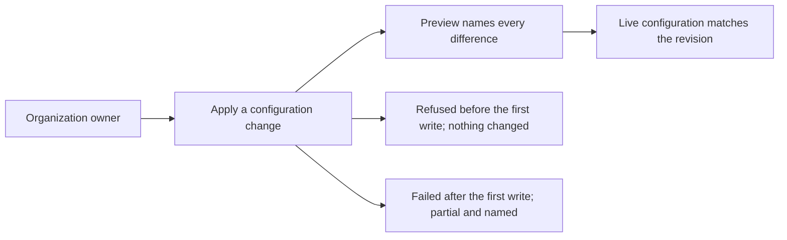

# Use case: apply-configuration-change

## Level

!

## Actors

- Organization owner — primary Actor; records the declared configuration revision, previews it, applies it and answers for the outcome.

## Goal

Make the live configuration match the declared configuration revision the
apply accepts.

## Trigger

The owner begins a configuration change by recording a revision of the
declared configuration.

## Preconditions

- The organization and the repositories the revision retains exist.
- The owner can request the configuration change.
- The applied state is not marked stale.

## Main flow

1. Actor records the intended values as a revision of the declared configuration; System keeps that revision as the candidate for preview and apply.
2. Actor asks for a preview; System reads the applied state, the live configuration and the revision, and names every difference among the previewed objects by object and field; an object the declaration names that cannot be read, or a revision that would add an object which already exists live and is unbound, is refused and named.
3. Actor asks to apply; System checks that the saved plan is the previewed revision and that the previewed objects still match what the preview saw (a read-only refresh-only plan for those objects reports no change), then applies the saved plan - the applied revision - object by object.
4. Actor wants the outcome; System reports every object it changed and records the applied revision in the applied state.
5. Actor can stop; the live configuration matches the revision.

## Extensions

- 2: the live configuration cannot be read → refuse the preview and name the object; protects the success guarantee.
- 2: the preview would add an object that already exists live and is not bound → refuse the preview and name the object; the owner adopts it first; protects the minimal guarantee (P1).
- 2: the applied state is marked stale → refuse the preview and the apply and name the stale state while the marker exists; the operator removes the marker after reading the report, and the next green apply completes the revision; protects the minimal guarantee.
- 3: the live configuration changed since the preview (a manual edit) → the read-only refresh-only preflight for the previewed objects names the changed object and refuses the apply; the saved plan is not applied; protects the success guarantee and the no-silent-overwrite rule.
- 3: a live object the revision declares appears after the preview → the second creation guard immediately before the write refuses the apply and names the object; nothing is written and the applied state is unchanged and not stale; protects the minimal guarantee (P1).
- 3: the owner's authority does not cover the first object → refuse before any write and name the object; nothing changes; protects the minimal guarantee.
- 3: the live write succeeds and a later read-back fails → report the applied objects, the object that cannot be read and the reason; mark the applied state stale; a new preview refuses and names the stale applied state; protects the truthful-reporting rule (P6).
- 3: the first live change succeeds and a later object fails → report the applied objects, the failed object and the reason; write the stale marker beside the applied state and do not record the failed object; protects the minimal guarantee and the truthful-reporting rule (P6).

## Rules

- **The applied revision is the previewed revision**: the saved plan is the applied revision.
- **Preview scope**: the previewed objects are the objects the revision adds or changes; the preview names every difference among them and no unrelated difference.
- **No removal**: a revision this use case applies adds or changes declared objects; removing a declared object remains out of scope (Q11).
- **Readability**: an object the declaration names must be readable, or the preview refuses it and names the object.
- **Adoption before update**: an object or setting that already exists live must be adopted before it is updated; a preview that would add it instead is refused and names it.
- **Preflight**: immediately before applying the saved plan, the System compares the applied state with the live configuration in a read-only refresh-only plan for the previewed objects; a non-no-op change is refused and names the address that changed.
- **Refusal and partial outcomes**: a refused apply makes no live change; a failure after the first write is reported as partial, names the object and the reason, and its applied state carries a stale marker beside it (P4, P6).
- **Recorded revision and stale state**: the applied revision is recorded only when every object succeeded; after a partial failure the applied state is marked stale, and while the marker exists the preview and the apply refuse and name the stale state. The operator removes the marker after reading the partial report, and the next green apply completes the revision.
- **Unreadable authority**: settings the owner's authority cannot read are not declared silently; the preview names the object.
- **Declared values**: the two scanning settings and both Dependabot settings are declared enabled through the revision's own declaration (Q5 closed 2026-10-17).

## Examples

- Enable scanning: declared secret scanning and push protection enabled, live both off. The preview names the two fields; the apply enables them; the applied state records the revision; no other object changes.
- Unreadable setting: the owner's authority cannot read the monorepo's security settings. The preview refuses and names the repository; no live setting changes.
- Unadopted setting: the declared configuration enables Dependabot alerts and security updates, both already live, and the applied state has no binding. The preview refuses and names both settings; the owner adopts the second batch first.
- Authority before the first write: the owner's authority covers the repositories but not the organization settings. The apply refuses before any write and names the organization settings; nothing changes.
- Manual edit since preview: live `has_projects` was changed by hand after the preview that saw it on. The read-only refresh-only preflight names `has_projects` and refuses the apply; the saved plan is not applied; a new preview shows the edit.
- Partial failure: the scanning settings apply; the Dependabot security-updates change then fails on authority. The report names the applied settings, the failed setting and the reason; the applied state does not record the failed setting and is marked stale; the next preview refuses and names the stale state.
- Read-back failure: the publishing secret is stored but the routine's post-apply read-back fails. The apply reports the applied deploy key, secret and rule set, names the secret that could not be read and the reason; live carries the created objects, the applied state is marked stale, and the next preview refuses and names the stale state.
- Publish the profile: the declaration adds the public organization profile repository and its two files, and the live organization has no such repository. The targeted preview names the three creations and no other change; the apply creates them and records them; a later targeted preview of the profile objects reports no differences.

## Minimal guarantee

A refusal before the first live write leaves the live configuration and the applied state unchanged; a failure after the first write is reported as partial with the applied state marked stale by a marker beside it, and while the marker exists the preview and the apply refuse; the operator removes the marker after reading the partial report, and the next green apply completes the revision; the failure names the applied objects, the failed object or read and the reason.

## Success guarantee

The live configuration matches the declared configuration revision the apply accepted for every object the revision retains.

This is a changing use case: it changes the live organization and repositories.

## Personas

- project-maintainer--organization-owner
- contributor--infrastructure-reviewer
- crew-member--personal-calendar-owner

## Capabilities

- enable-repository-security
- publish-organization-profile
- publish-site-plumbing

## Interactions

| Capability | Consumer action | E2E scenario |
|---|---|---|
| enable-repository-security | preview the declared configuration and read the named differences | Organization owner previews the security settings and only the declared differences are named |
| enable-repository-security | apply the previewed revision and read the outcome | Organization owner applies the previewed revision and the security settings are enabled |
| publish-organization-profile | preview the declared configuration and read the named differences | Organization owner previews the profile declaration and only the three creations are named |
| publish-organization-profile | apply the previewed revision and read the outcome | Organization owner applies the previewed revision and the organization profile is published |
| publish-site-plumbing | preview the declared configuration and read the named differences | Organization owner previews the pages plumbing and only the three live creations are named |
| publish-site-plumbing | apply the previewed revision and read the outcome | Organization owner applies the previewed revision and the pages publishing credential is created |

## Includes

- none

## Extends

- none

## Out of scope

- A declaration edited after the saved preview: the saved plan is the applied revision, so the edit is not applied; the edit takes effect only after a new preview, and no scenario in this use case asserts that behaviour.
- An invalid declared revision: the preview refusing it and naming the problem is an internal safety branch, not a use-case promise in this use case.
- An incomplete preflight report: the apply refusing it and not treating it as a no-op is an internal safety branch, not a use-case promise in this use case.
- An applied state that cannot be read: the preview refusing it and naming it is not asserted in this use case.
- Review gating (open: Q10): this capability previews and applies a revision and reports the outcome; no approval gate is asserted.
- Removing a declared object (Q11): removal never occurs in this use case; no revision removes a declared object and no capability disables a setting.
- Adopting an already-existing object: the objects this revision retains are adopted first, by `adopt-existing-configuration`; the preview refuses to add one that is live and unbound, and names it.
- Removing the classic branch protection: it was removed by hand on 2026-10-18 and this change verifies it stays gone.
- Requiring pull requests on the default branch (Q3) and modelling review gating in the apply flow (Q10).
- Deleting or disabling anything (Q11): no declared object is removed and no security setting is turned off.
- Enabling settings the seed does not name: non-provider patterns, validity checks, advanced security, and the pages repository's scanning.
- Private vulnerability reporting, release immutability and organization-level security defaults.
- Rotating or removing the pages deploy key and the `PAGES_DEPLOY_KEY` secret (Q11): this capability creates them once and neither rotates nor removes a credential.
- Reporting configuration drift, publishing the website, and repairing an already-published release.
- Creating the organization or transferring a repository into it; creating a
  repository the revision declares and the live configuration lacks is the main
  flow, not this exclusion.
- Any product behaviour: the converter never contacts GitHub.

## Diagram

