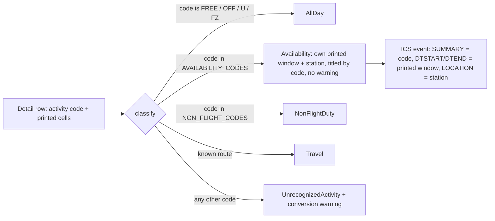

# Design: recognize-standby-shift-codes

## Scope

Technical design for the change that recognizes the three printed standby shift codes as standby availability windows in [export a duty-plan calendar](specs/export-duty-plan-calendar/usecase.md). The observable WHAT is fixed by the [proposal](proposal.md) and the spec delta; this document is the HOW.

The mechanism is a recognition-data widening: the three exact code strings join the literal set of availability codes the converter already keeps, so they take the existing `DutyEntry::Availability` path — own printed UTC window, printed station, printed code as title, no diagnostic. No new variant, kind, branch, title rule, severity or diagnostic is introduced.

## Technology decisions

No technology decision changes in this change.

| Area | Decision | Rationale / source |
|---|---|---|
| Language | Rust, edition 2021; toolchain `stable` via `rust-toolchain.toml`. | Unchanged. |
| PDF extraction | `pdfplumber = "=0.4.1"`, only in `duty2cal-pdf`. | Unchanged; no extraction change. |
| Calendar writing | Hand-written RFC 5545 serializer in `duty2cal-core/src/adapters/ics`. | Unchanged; the summary text of an availability activity already renders the entry's `code`. |
| Gherkin runner | `cucumber` 0.23 as a `harness = false` test target, driven by `./run-tests.sh`. | Unchanged. |
| Test runner | `./run-tests.sh` → assembles the feature root, then `cargo test -p duty2cal --test features_runner`. | Unchanged. |
| New dependencies / version changes | none. | The change is data plus documentation; no crate, tool, framework or image version moves, so no version resolution is required. |

## Architecture impact

No module, crate, port or dependency direction changes. The only production-code edit is the literal availability-code set and its domain doc comment; everything downstream of the classification branch is reused unchanged.

The three codes enter through the `AVAILABILITY_CODES` edge; the `UnrecognizedActivity` edge and its warning are untouched.

### Exact edits

| # | File | Edit |
|---|---|---|
| 1 | `crates/duty2cal-core/src/application/mod.rs` (`AVAILABILITY_CODES`, line 220) | `const AVAILABILITY_CODES: [&str; 6] = ["SB", "RE", "SBX", "SB_F_CF", "SB_M_CF", "SB_S_CF"];` — the literal set, exactly three new strings, no prefix or family predicate. Its doc comment ("The activity codes that denote a timed availability window") still holds. |
| 2 | `crates/duty2cal-core/src/domain/mod.rs` (`DutyEntry::Availability` doc comment, line 142) | "Timed availability window: SB, RE or SBX." becomes "Timed availability window: SB, RE, SBX, SB_F_CF, SB_M_CF or SB_S_CF." |
| 3 | `docs/evidence/supported-duty-plan.md` (`## What the fixture prints`, lines 31-33) | The printed-code sentence keeps exactly the codes the generated fixture prints — `FREE`, `OFF`, `U`, `FZ`, `SB`, `SBX`, `RE`, `TK`, `DTUSA`, `EM` and the travel leg `LU742`. A separate sentence states that the conversion also accepts `SB_F_CF`, `SB_M_CF` and `SB_S_CF` as operator-confirmed codes, exercised by the capability scenarios, and that the generated fixture does not print them. The fixture itself is unchanged. |
| 4 | `givn/specs/export-duty-plan-calendar/usecase.md` | Already updated by this change: the rule bullet for the three codes, the "only an unexpected code warns" bullet, the rule that a shift row without a positive printed interval is a conversion error, and six examples. |
| 5 | `docs/arc42/12-glossary.md` | Already updated: Availability duty code list, new **Standby shift** row, timing invariant row, and the provenance paragraph naming the new term. |
| 6 | `docs/arc42/11-risks-and-technical-debt.md` | Already updated: TD-029 narrowed to the remaining codes (reusing the shared printed-window rule), R-004 split into the shift meaning validated by the operator's real dated rows and the semantics still awaiting their own dated-row validation. |

The only other site that names the activity-code vocabulary is `scripts/support-statement-check.sh`, which enumerates `FREE OFF U FZ SB SBX RE TK DTUSA EM` and asserts the evidence record names each of them. It needs **no** change: the generated fixture prints exactly those codes, the record keeps naming them, and the check asserts the record's printed-code coverage — it does not assert that the record lists every accepted code, so a separate operator-confirmed sentence neither breaks it nor belongs in its list. `classify` in `application/mod.rs` reads the constants, `DutyEntry::Availability` is the single value variant, and the ICS adapter and report builders are code-agnostic. Grepping the tree for `SBX` confirms the enumeration sites above plus archived change artifacts and the ideation record, neither of which is edited.

### Unchanged paths (deliberately)

- **Title**: `DutyEntry::Availability` is rendered with `SUMMARY:<code>`; the shift rows therefore read `SB_F_CF`, `SB_M_CF`, `SB_S_CF`. No German or English shift name enters the calendar.
- **Interval**: `row_interval(row)` still builds the window from the row's printed UTC start/end through the shared qualifier and narrow-overnight rules. The three codes get no special interval handling.
- **Station**: `station(row)` is unchanged, so the printed station becomes `LOCATION`.
- **Diagnostics**: the warning arm (`UnrecognizedActivity` plus its warning) is reached only by codes outside the widened set. The warning report and failure-report builders, their sections and wording are untouched.
- **Error path**: a shift row with no printed times, one printed endpoint or a non-positive interval reaches the same `incomplete(...)` conversion-error branch as `SB`/`RE`/`SBX`; no new message is written. The messages are the existing ones (`a required timing could not be resolved: …`, `a timed interval must end after it starts`).
- **Consecutive dates**: each row stays one activity with its own window; FREE interruptions keep their existing all-day handling.

## Step Definitions

One file per capability; the delta reuses the permanent file, so no delta step copy exists and no archive rebinding is required.

| Step definition file | Capability | Permanent merge target |
|---|---|---|
| `apps/cli/tests/steps/export_duty_plan_calendar.rs` | export-duty-plan-calendar | `apps/cli/tests/steps/export_duty_plan_calendar.rs` (already permanent) |
| `apps/cli/tests/steps/e2e/export_duty_plan_calendar.rs` | export-duty-plan-calendar (e2e) | unchanged, not touched by this change |

Reused phrases (already bound, no edits):

| Scenario step | Bound definition |
|---|---|
| `Given a supported duty plan dated <date> with activity code <code> and source station FRA and resolved UTC start <start> and end <end>` | `a_plan_with_a_stationed_timed_code` |
| `When the crew member converts it` | `the_crew_member_converts_it` |
| `Then the calendar contains one timed activity titled "<title>" from <start> to <end> UTC on <date> at <station>` | `one_stationed_timed_activity` |
| `And the converter reports no conversion warning` | `no_conversion_warning` |
| `And no warning report is published` | `no_warning_report` |
| `And the calendar contains one all-day day-off activity on <date>` | `one_all_day_day_off` |
| `And the converter reports one conversion warning naming detail row <n> and the date <date>` | `one_warning_naming_row_and_date` |
| `And the warning names the activity code "<code>"` | `the_warning_names_the_code` |
| `Then no calendar is published` | `no_calendar_is_published` |
| `And the converter reports a conversion failure naming "<needle>"` | `failure_names` |
| `And the failure report lists that row under "<section>"` | `failure_report_lists_the_row_under` |
| `And the invocation reports failure through a non-zero process exit status` | existing exit-status step (permanent feature) |

New phrases, added to `apps/cli/tests/steps/export_duty_plan_calendar.rs`:

| New step | Body |
|---|---|
| `Given a supported duty plan dated <date> with activity code <code> at station <station> and no printed UTC times` | `plan_with_row(w, &[(DATE_X, &date), (ACTIVITY_X, &code), (FROM_X, &station)])` — a detail row with both UTC cells blank and a printed station, so the code is the only classifier. |
| `Given a supported duty plan with SB_F_CF <start> to <end> on <date>, SB_M_CF <start> to <end> on <date>, and SB_S_CF <start> to <end> on <date> at station <station>` | Builds one generated detail table (`support::detail_header_row(600.0)` plus three `support::at(...)` rows at 585.0/570.0/555.0), one row per named code with its own date, window and `FROM_X` station; writes it with `write_fixture`. |
| `Given a supported duty plan with SB_F_CF windows <start> to <end> on <date> and <date> and a FREE row on <date>` | Builds one generated detail table as above: `SB_F_CF` on the first date with the given window and `FROM_X` `FRA`, `FREE` on the middle date, `SB_F_CF` on the second date (the shape of `consecutive_standby_days`). |
| `Then the calendar contains three timed activities titled SB_F_CF, SB_M_CF and SB_S_CF on <dates> from <windows> UTC at <station>` | `assert_event_count(&calendar, 3)`; for each code asserts `SUMMARY:<code>`, `LOCATION:<station>`, and `DTSTART`/`DTEND` from that row's own printed window. |
| `Then the calendar contains two timed SB_F_CF activities from <start> to <end> UTC on <date> and <date> at <station>` | `assert_event_count(&calendar, 3)`, then for each date asserts `SUMMARY:SB_F_CF`, `DTSTART:<instant(date, start)>`, `DTEND:<instant(date, end)>` and `LOCATION:<station>`. |
| `And the warning states that the row was converted as a timed activity using its printed UTC window <start>-<end>` | Asserts one `warning_lines(w)` entry contains `converted as a timed activity using its printed UTC window <start>-<end>`, pinning the fallback path for `SB_X_CF`. |

## Test runner, strict mode, and single-scenario command

- Unit/integration: `./run-tests.sh` → assembles the feature root (every `.feature` from `givn/specs/**` and `givn/changes/*/specs/**`) into a temporary directory passed through `GIVN_FEATURES`, then `cargo test -p duty2cal --test features_runner`. This executes the delta feature; no parallel hand-maintained test file exists.
- E2E: `./run-tests.sh --e2e` (`--tags "@e2e"`), unchanged. The change adds no `@e2e` scenario.
- Strict mode: `cucumber-rs` with `.fail_on_skipped()` on the builder plus `run_and_exit(root)`, and step bodies that start as `unimplemented!(...)`. An undefined or skipped step therefore fails the run; the tasks setup task proves it against this exact configuration before the first GREEN.
- Single-scenario run: `./run-tests.sh --name "<exact scenario title>"`, valid for every delta scenario.
- Quality gates (unchanged): `cargo fmt --check`, `cargo clippy --workspace -- -D warnings`, `cargo test --workspace`.

## Golden oracle

The whole-file oracle stays the Gherkin scenario "The reference roster converts to the expected calendar". Its `reference_plan` builder lives in `apps/cli/tests/steps/export_duty_plan_calendar.rs` (`:1966`), not in `support.rs`; it assembles the generated reference plan, and the matching step compares the produced calendar with the committed fixture `apps/cli/tests/fixtures/expected/2098-06.ics` after CRLF→LF and folding normalisation. That plan prints `FREE`, `OFF`, `EM`, three `Layover` markers and the travel legs `LU742`, `LU743`, `LU402`, `LU401`, `LU302`, `LU301`, `LU502`, `LU501`, `LU304` and `LU303` — no availability code at all.

The second committed oracle `apps/cli/tests/fixtures/expected/2026-06.ics` is the browser/executable byte-equivalence fixture: `support::equivalence_plan` generates the `2026-06.pdf` plan (`LU742` and `U`), and the browser scenario asserts that the page's offered calendar and the executable's calendar both equal it. Neither generated plan prints `SB_F_CF`, `SB_M_CF` or `SB_S_CF`, so widening the constant cannot change either committed calendar's bytes; no fixture builder change and no golden regeneration are needed.

## Decisions

Resolves the proposal's open questions.

- **Decides D1:** `SB_F_CF`, `SB_M_CF` and `SB_S_CF` are recognized standby availability windows, represented as `DutyEntry::Availability` from their own printed UTC window and station. Realized in `AVAILABILITY_CODES` (`crates/duty2cal-core/src/application/mod.rs`) and the delta scenarios "Standby shift codes keep their own printed windows" and "Consecutive standby shift days interrupted by a day off stay separate".
- **Decides D2:** recognition is the exact three strings — no prefix predicate, no family rule, no reading of `CF`. Realized by the literal set, and proven by "A standby-like code outside the three shift codes still warns".
- **Decides D3:** the title is the printed code; no translation layer is added. Realized by the unchanged ICS summary of an availability entry, asserted by "Standby shift codes keep their own printed windows".
- **Decides D4:** a representable shift row produces no finding; an unusable one is a conversion error, not a fallback. Because the three codes now classify as `Availability`, `row_interval` runs for them, so a shift row with no printed times, with exactly one printed endpoint, or with a non-positive window fails `resolve`/`UtcInterval::new` and reaches the same `incomplete(...)` conversion-error branch as `SB`, `RE` and `SBX`: no calendar is published and the failure report lists the row under `Errors:`. This is the contract choice because the severity rule defines a conversion warning as "the row was represented by a documented fallback"; an all-day availability window invented for a recognized timed code, or a warning for a row whose meaning is confirmed, would both misstate the source. The outcome is **not** identical before and after recognition, and the change is deliberate:
  - the **blank-times** shape changes from the fallback's all-day arm (`Classified::Warning` with `UnrecognizedActivity` and no interval, plus a warning report) to a conversion error — the plan that used to publish no longer publishes until the source is fixed;
  - the **one-endpoint** and **non-positive** shapes already failed, but their failure sentence changes from the unrecognized-code wording to `a required timing could not be resolved: …` or `a timed interval must end after it starts`.
  
  The blank-times shape is proven by the delta scenario "A standby shift row without printed times rejects the conversion" (no calendar, no warning line, row under `Errors:`, the timing sentence, non-zero exit). The one-endpoint shape has no separate delta scenario: its observable — a conversion error with no calendar and the row under `Errors:` — is the same class the new scenario proves, and the permanent single-endpoint scenario uses an unrecognized code, so it does not pin the shift sentence. The rule is recorded in the use case.

No proposal question is carried or unresolved.

## Use-case traceability

| Use-case element | Technical decision | Evidence |
|---|---|---|
| Rule: the three codes are SB standby windows for Standby Früh/Mittel/Spät, recognized by exact code only, represented exactly like SB | `AVAILABILITY_CODES` literal set | "Standby shift codes keep their own printed windows"; "Consecutive standby shift days interrupted by a day off stay separate" |
| Rule: titles stay the printed code, never the shift name | unchanged ICS summary of `DutyEntry::Availability` | "Standby shift codes keep their own printed windows" — the three-activity Then asserts each code's summary, window and station |
| Rule: only an unexpected code warns; the three are recognized and do not | unchanged `UnrecognizedActivity` + warning branch; widened set bypasses it | the shift scenario's `no conversion warning` / `no warning report is published`; "A standby-like code outside the three shift codes still warns" |
| Rule: an unusable shift row is a conversion error, not an all-day fallback | unchanged `row_interval` / `incomplete(...)` error path and report builders; the row now reaches it instead of the fallback arm | "A standby shift row without printed times rejects the conversion" (no calendar, row under `Errors:`, `a required timing could not be resolved`, non-zero exit) |
| Example: Standby Früh / Mittel / Spät rows; Standby-like code; shift without printed times or with one endpoint | the six examples added to `usecase.md`; the one-endpoint example is proven by the same conversion-error path (D4), with no separate delta scenario | "Standby shift codes keep their own printed windows", "A standby-like code outside the three shift codes still warns" and "A standby shift row without printed times rejects the conversion" |
| Minimal guarantee: every row reported with one severity; prior outputs unchanged | unchanged diagnostic model and publication | the existing warning/error scenarios remain green |
| Capability ownership | `export-duty-plan-calendar` only | Interaction Coverage Matrix |

Actors in Gherkin are domain actors (the Crew member); Personas remain review lenses.

## Persona impact

User-visible surface: the terminal interface (CLI text output) changes for these rows — the six `Warning:` lines of a plan like the November 2026 one disappear, and the calendar's events are titled by the shift code. Confirmed Persona: **`crew-member--personal-calendar-owner`** — accuracy/privacy lens: the calendar shows the availability windows the plan prints, and a finding now means a real fallback. `project-maintainer--release-owner` is not materially affected (no release-evidence change). `contributor--web-reviewer` is not affected: the page adds no code, copy, state or interaction; its warning list is rendered from the same conversion outcome, so for a plan containing the three codes the page simply inherits the shrunk list — it offers the same calendar and the same ready state.

## Visual Design Contract

- Interface: terminal
- Viewports: n/a (no rendered screen)
- Design system: none
- Screens covered: none new. The change removes warning lines from the converter's terminal transcript for three codes; it introduces no new screen, control, wording or state.
- Evidence kind: the existing `@e2e` scenario's captured transcript (see E2E infrastructure). This change adds no `@e2e` scenario and therefore commits no new visual evidence; the delta's non-e2e assertions are the terminal evidence for the changed lines (a shift row prints no `Warning:` line, and the calendar carries the expected events), not a committed transcript. The committed transcript still covers the unchanged ready/ready-with-warnings states of a plan without these codes.
- Baseline: unchanged — the transcript still names the actual new calendar path and the process exit status, and no internal identifier appears in visible text.
- Interface classification tested the opposite way: the browser conversion page is HTML/CSS/JS running in a browser, so that surface is a Web UI. The opposite classification does not hold for this change: no page source, script, style, copy, CSP, bundle or interaction is edited, the page's warning content is derived data from the same conversion outcome (it only shrinks for these inputs), and the browser action is already covered by its permanent `@e2e` scenario. The changed surface is therefore the terminal transcript and the calendar bytes, and no browser driver is added.

## E2E smoke test infrastructure

Unchanged by this change; recorded here for completeness.

- **E2E runner command:** `./run-tests.sh --e2e` (assembled root, `--tags "@e2e"`), distinct from `verify.command`.
- **E2E step location:** `apps/cli/tests/steps/e2e/export_duty_plan_calendar.rs`; browser scenarios drive `web/e2e/driver.mjs` through `apps/cli/tests/steps/browser.rs`.
- **Real interface:** the built `duty2cal` binary invoked as a subprocess with the plan path; the browser route drives the page served from the built Site output in a Playwright-managed Chromium.
- **Local infrastructure:** none external — no server, database, container or network dependency beyond the local filesystem and the input file; per-scenario temp directories hold the generated fixture and any pre-existing outputs.
- **Framework:** `cucumber-rs` plus `std::process::Command` (CLI), Playwright via the shared driver (browser).
- **Strict-mode proof:** `.fail_on_skipped()`; an undefined or skipped E2E step fails the run.

This change adds no interaction and no `@e2e` scenario: the inventory action (converting a plan) is unchanged, and a shift row is an input variant of it, not a new action. Adding a second `@e2e` for the same action would over-cover the inventory.

## Interaction Coverage Matrix

| Inventory entry | @e2e scenario title | Real interface | Driving mechanism |
|---|---|---|---|
| supply a duty plan for conversion through the executable | Crew member converts a supported duty plan and receives a calendar file | CLI | `std::process::Command` runs the built `duty2cal` binary with the plan path and asserts the reported path, warnings and exit status |
| supply a duty plan through the converter page and save the offered calendar | Crew member converts a supported duty plan in the browser and saves the offered calendar | Web UI | Playwright drives `web/e2e/driver.mjs`: loads the built Site page, supplies `2026-06.pdf` through the file picker, reads the ready state and the offered file name |

Both rows are existing coverage; this change adds no inventory entry, and the shift codes are an input variant of the CLI action.

## Local runnability & digital twins

- **Local run command:** `cargo run -p duty2cal -- <duty-plan.pdf>` (also declared as `run.command` in `givn/commands.yaml`). Self-contained CLI; nothing else to start.
- **Isolated network:** not applicable — no network I/O in either conversion route.
- **Digital twins:** none; the only outside dependencies are the local filesystem and the supplied plan.
- **Anticipated interface obstacles:** none new. The existing obstacles (create-new publication names, diagnostics attempted after a failure) are unchanged; a shift row is read through the same detail-table adapter and reaches the same publication path.

## Coverage process boundaries

| Process | Started by | Instrumented artifact | Profile output | Merge step | Non-zero production probe |
|---|---|---|---|---|---|
| features_runner (unit/integration) | `./measure-coverage.sh` (`--tags "not @e2e"`) | `cargo llvm-cov --workspace --test features_runner` | `coverage/non-e2e-cobertura.xml` | `./merge-coverages.sh` | `crates/duty2cal-core/src/application/mod.rs` (`classify`, availability branch) |
| E2E runner + spawned CLI | `./measure-coverage.sh` (`--tags "@e2e"`, which spawns the built CLI) | `cargo llvm-cov --workspace --test features_runner` with the CLI built under instrumentation (`LLVM_PROFILE_FILE` for the child) | `coverage/e2e-cobertura.xml` | `./merge-coverages.sh` | `apps/cli/src/fs.rs` |

Both rows are the existing boundaries; the change adds no production process. The availability branch's newly reachable code path is covered by the delta scenarios in the non-e2e run.

## Black-Box-First policy

The behavior is proven through the Gherkin scenarios that drive the real interface: the delta scenarios convert a plan through the executable and assert the published calendar and the reported findings. No internal unit test is added. `cargo test --workspace`'s existing architecture test remains, but it asserts layer direction, not this behavior.
