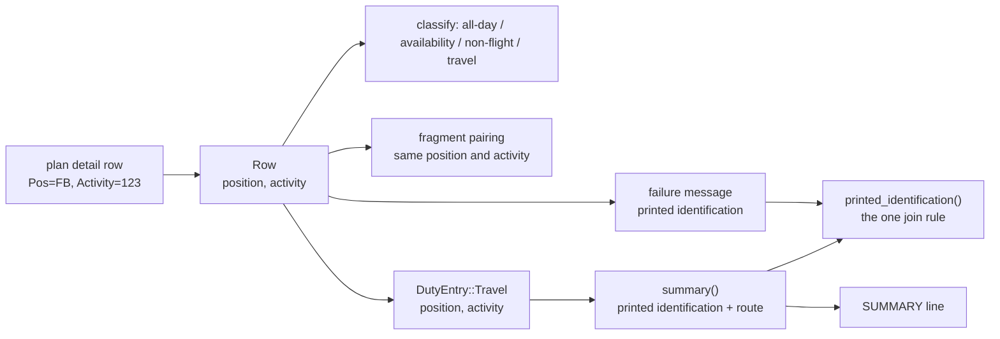

# Design: separate-position-marker-and-flight-number

## Scope

The HOW for the observable rule in [the delta](specs/export-duty-plan-calendar/export-duty-plan-calendar.feature). The converter keeps its crates, ports, runner, fixture builder and publication behaviour. What changes is how a travel leg carries the plan's two printed fields and how a title (and a failure message) reads them.

Two operator decisions taken during this change's design review shape everything below:

- **The two printed fields stay apart.** The travel value carries the plan's crew position and the plan's activity text as two fields; the title joins them. The `DH` marker is no longer added by a second mechanism, so the deadhead special case disappears.
- **No artifact keeps the retired word.** The rule in the use case document for exporting a duty-plan calendar is reworded, and the code names the two printed fields.

## Technology decisions

No new technology, no new dependency, no version change. Everything below is inherited and stays as the change that built the converter decided it (archived design: `givn/archive/export-released-roster-calendar/design.md`).

| Area | Decision | Source |
|---|---|---|
| Language and layout | Rust stable (`rust-toolchain.toml`), edition 2021 workspace `duty2cal-core` / `duty2cal-pdf` / `apps/cli` | Unchanged; the change edits the core's domain and row interpretation |
| Extraction | `pdfplumber = "=0.4.1"`, used only by `duty2cal-pdf` | Unchanged; the reader already yields `Pos` and `Activity` as separate columns |
| Runner | cucumber-rs, `./run-tests.sh` over the assembled feature root | Unchanged |
| Fixtures | Generated at test time by `apps/cli/tests/steps/support.rs`; only the expected calendar is committed | Unchanged; its titles are regenerated by this change |

## Architecture impact

The travel value stops carrying one pre-joined string and carries the two cells the plan prints. Nothing else moves: no crate, no port, no file layout, no publication path.



Changed files:

| Path | Kind | Purpose |
|---|---|---|
| `crates/duty2cal-core/src/domain/mod.rs` | changed | `DutyEntry::Travel` carries `position` and `activity`; `summary()` builds the title from them; the new `printed_identification()` is the single join rule; `Position` is deleted (its only consumer was the title). |
| `crates/duty2cal-core/src/application/mod.rs` | changed | `Row` carries the two printed cells; the pairing key is the pair; the failure message names the printed identification; the `designator()` helper is deleted. |
| `apps/cli/tests/steps/export_duty_plan_calendar.rs` | changed | Five `Given` steps for the delta's scenarios (`Then` steps are reused). |
| `apps/cli/tests/fixtures/expected/2098-06.ics` | changed | Regenerated: the reference plan's travel titles read `LU 742 Tychon-Mareum`. |
| `givn/specs/export-duty-plan-calendar/usecase.md` | changed | The "preserve printed designators" rule names the two printed fields, and the deadhead rule says the title carries the plan's printed position. |
| `docs/arc42/05-building-block-view.md`, `10-quality-requirements.md`, `11-risks-and-technical-debt.md`, `12-glossary.md` | changed | The row-interpretation responsibility, the new quality scenario, the pairing consequence, and the two printed-field terms with their code symbols. |

## The two printed fields and the one join rule

A plan prints a travel row's crew position in its `Pos` column and the flight's activity in its `Activity` column. The row keeps both, and exactly one place decides how they read together:

```
position Some("FB"), activity "123"  ->  "FB 123"
position Some("DH"), activity "124"  ->  "DH 124"
position None,       activity "123"  ->  "123"
```

`domain::printed_identification(position: Option<&str>, activity: &str) -> String` is that rule. `DutyEntry::summary()` uses it for the title, and the application uses it to name a travel fragment in a failure message, so the message and the title cannot drift apart.

Field naming. The two fields are named for the plan's own columns: `position` (the `Pos` cell) and `activity` (the `Activity` cell). `activity` rather than `flight_number` because the cell's text is not always a flight number: the existing corpus pins a travel leg whose activity cell reads `LU742` and is titled `LU742 ABC-DEF`, and a hand-written fixture feeds an unknown code into the same cell. The confirmed domain term **Flight number** stays what it is — the digits of that cell for a flight leg — and the glossary maps it to this field.

### Classification reads the activity cell

The all-day, availability and non-flight code sets are matched against `activity`. The join could previously only fire for an all-digit activity, so no code set was reachable by a joined value, and matching the raw cell is equivalent for every input the corpus pins. The `EM` row of the operator's plans prints `Pos=AK` beside `Activity=EM`; it classifies as non-flight duty, carries no position into its title, and still reads `EM`.

### Pairing compares the two printed fields

A departure row and an arrival row of one leg are the same printed leg, so they pair when both printed fields are equal:

```rust
rows[departure].activity == arrival.activity && rows[departure].position == arrival.position
```

Comparing only the flight number is not enough — the ideation frame already records that matching by flight number alone fails when a designator repeats — and requiring the printed position makes the rule the same for every row, deadhead included.

Consequence, accepted by the operator: the previous code suppressed the position for a positioning leg, so a departure row printing `DH` paired with an arrival row printing no position at all. Under this rule those two rows print different identifications and the conversion rejects the fragment instead of guessing, which is why the delta pins that outcome. The operator's plans never show it: every `DH` row carries both stations in one row, and every split leg prints the same position on both rows (verified against the five local plans; those plans are never committed).

### The deadhead special case is deleted

`Position` (and its `Deadhead` variant) existed only to suppress the marker inside the joined string and to re-add it when the title was built. With the position kept as the plan prints it, `Pos=DH` reaches the title through the same rule as `Pos=FB`, so `DutyEntry::Travel.position` replaces `DutyEntry::Travel.designator` and `Position` has no consumer left. The deadhead title is unchanged: `DH 007 ABC-DEF`.

## Step definition locations

One file per capability, as before:

- Non-e2e steps: `apps/cli/tests/steps/export_duty_plan_calendar.rs` — five new `Given` steps; the delta reuses the existing `that activity's title is "..."`, `no calendar is published` and `the conversion failure names "..."` steps.
- E2E steps: `apps/cli/tests/steps/e2e/export_duty_plan_calendar.rs` — unchanged; the change adds no `@e2e` scenario.

## Test runner, strict mode, and single-scenario command

- Unit/integration: `./run-tests.sh` → assembles the feature root from `givn/specs/**` and `givn/changes/*/specs/**` into a temporary directory, then `cargo test -p duty2cal --test features_runner`.
- E2E: `./run-tests.sh --e2e` (`--tags "@e2e"`); distinct from `verify.command`.
- Strict mode: `apps/cli/tests/features_runner.rs` — `.fail_on_skipped()` with `.run_and_exit(root)`, so an undefined or skipped step fails the run (proven for the converter change: an undefined step exits 101). Step bodies are never empty.
- Single-scenario run: `./run-tests.sh --name "<scenario title>"`.
- Quality gates: `cargo fmt --all --check`, `cargo clippy --workspace --all-targets -- -D warnings`, `cargo test --workspace`.
- Environment: the change-log scenarios of the release capability drive `scripts/render-changelog.sh` as a subprocess and need `git-cliff 2.14.2` on `PATH` (CI installs it); without it those five scenarios fail for a reason unrelated to this change.

## Golden oracle

`Scenario: The reference roster converts to the expected calendar` compares the converted reference plan with `apps/cli/tests/fixtures/expected/2098-06.ics`. The reference builder already places the position and the activity in two columns (`support::POS_X`, `ACTIVITY_X`), so the oracle needs no new input.

Regeneration is surgical, not a blind re-render: only the travel `SUMMARY` lines change, each gaining exactly one space (`LU742 …` → `LU 742 …`). Every `UID`, `DTSTART`/`DTEND`, `LOCATION`, and the `FREE`, `OFF`, `EM` and `Layover` rows stay byte-identical, so the oracle cannot bake in an unintended title change.

## Decisions

The proposal records no open question, so there is no `D<n>` to resolve. The design review's two operator decisions are recorded at the top of this document, and the technical choices they force are recorded above: the two-field travel value, the single join rule, the pairing key, and the removed `Position`.

## Use-case traceability

| Use-case element | Technical decision | Evidence |
|---|---|---|
| Rule: preserve the printed designator, including leading zeroes | The rule now names the two printed fields; `printed_identification()` joins the printed crew position and the activity text, and neither is reformatted | "A crew position and its flight number are printed as separate words"; "A travel leg that prints no crew position keeps its flight number alone"; "A crew position printed beside a non-flight activity stays out of its title" |
| Rule: DH is a crew assignment on positioning travel that the title keeps | `DutyEntry::Travel.position` carries the printed position; the title reads it through the same join rule; `Position` is deleted | "Deadhead positioning travel keeps one event and marks the assignment in its title" (permanent); "A crew position and its flight number are printed as separate words" |
| Rule: a travel fragment pairs with its unique compatible partner | Pairing compares the two printed fields | "A crew position printed on one travel fragment only leaves it without a partner"; the permanent split-leg timing scenarios |
| Rule: every conversion failure names the reason and the source | `unmatched_fragment()` names the printed identification; the numbered diagnostic is unchanged | "An unmatched travel fragment is named with its position and flight number separate"; the permanent diagnostic scenarios |
| Success guarantee: a complete calendar beside the source under an unused name | Unchanged: `adapters/ics`, the ports and the publication path | "Crew member converts a supported duty plan and receives a calendar file" (`@e2e`, permanent) |
| Capability ownership | `export-duty-plan-calendar` only | Interaction Coverage Matrix |

Actors in Gherkin are domain actors; Personas are review lenses (below).

## Persona impact

User-visible surface: a terminal interface (CLI text output, and the calendar text a crew member reads). Confirmed Personas:

- **`crew-member--personal-calendar-owner`** — the accuracy lens: a compact title must still identify the flight, a crew position must not be indistinguishable from a flight number, and a collapsed failure message must name the leg it could not pair.
- **`project-maintainer--release-owner`** — release-evidence lens: unchanged; this change alters no release claim, archive or dependency.

## Visual Design Contract

- Interface: terminal
- Viewports: n/a (no rendered screen)
- Design system: none
- Evidence kind: a captured transcript per `@e2e` scenario under `givn/changes/separate-position-marker-and-flight-number/evidence/visual/<scenario-slug>/transcript.txt`.
- Baseline: the transcript names the actual new calendar path or the failure and diagnostic outcome; the recorded exit status accompanies it; no internal identifier appears in the text a crew member reads.
- This change adds no `@e2e` scenario, so no new transcript is owed; the rendering change is visible in the `.ics` the crew member imports, which the golden-oracle scenario pins.

## E2E smoke test infrastructure

- **E2E runner command:** `./run-tests.sh --e2e` (assembled root, `--tags "@e2e"`).
- **E2E step location:** `apps/cli/tests/steps/e2e/export_duty_plan_calendar.rs` (unchanged).
- **Real interface:** the built binary at `target/release/duty2cal`, invoked as a subprocess with the source path.
- **Local infrastructure:** none external (no server, database or digital twin); per-scenario temp directories hold the generated fixture and any pre-existing calendars or reports.
- **Framework:** cucumber-rs + `std::process::Command`.
- **Strict-mode proof:** `fail_on_skipped()` — an undefined E2E step fails the run.

## Interaction Coverage Matrix

| Inventory entry | @e2e scenario title | Real interface | Driving mechanism |
|---|---|---|---|
| supply a duty plan for conversion | Crew member converts a supported duty plan and receives a calendar file | CLI | `std::process::Command` runs the built `duty2cal` binary with the plan path; asserts the transcript reports the new path and the recorded exit status |

The inventory is unchanged: this change adds no consumer action, so its five scenarios are regular scenarios of the existing action.

## Local runnability & digital twins

- **Local run:** `cargo run -p duty2cal -- <duty-plan.pdf>` (or drag-and-drop). Self-contained CLI; no orchestrator.
- **Isolated network:** not applicable — no network I/O.
- **Digital twins:** none; the only outside dependencies are the local filesystem and the input file.
- **Real-corpus check:** `scripts/validate-local-corpus.sh` converts the operator's local plans and must report the same set of activities as before this change, with only the travel titles now carrying the space.

## Black-Box-First policy

The five new scenarios drive the real CLI over a generated fixture, like every scenario of this capability. No internal unit test is added: a test of the join alone would re-assert what the scenarios already observe through the published calendar and the failure message.
