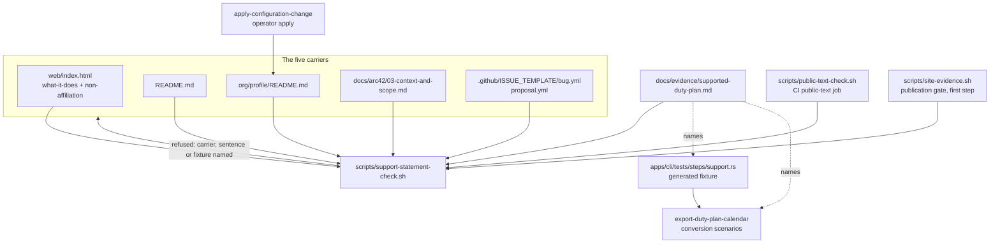

# Design: state-the-supported-duty-plan

## Scope

The HOW for the change that names the one duty plan duty2cal converts in one
checked statement. The observable WHAT is fixed by
[the proposal](proposal.md) and the delta:

- [`state-the-support-statement`](specs/state-the-converter-support-statement/state-the-support-statement.feature)
  (new capability under
  [`state-the-converter-support-statement`](specs/state-the-converter-support-statement/usecase.md)),
- the site's statements as a delta of
  [`publish-public-website`](specs/publish-public-website/publish-public-website.feature),
- the profile's carrier as a delta of
  [`apply-configuration-change`](specs/apply-configuration-change/publish-organization-profile.feature),
- the contributor-route description as a document-only delta of
  [`publish-public-release`](specs/publish-public-release/usecase.md).

Three boundaries shape what follows:

- **The statement is five carrier texts and one check.** The check owns the
  expected sentences; the carriers own their placement. No carrier is
  authoritative and no carrier is generated from another, which is the decision
  the seed recorded.
- **The claim's evidence is the generated fixture, not a real plan.** The
  fixture builder and the committed reference calendar already exist; this
  change adds the evidence record that states what they exercise and has the
  check require it.
- **The profile's carrier is published by an apply the operator runs.** The
  change verifies the reviewed source and the apply's declaration; the live
  write is an operator step, not a test step.

## Technology decisions

No new language, runtime, framework, package or container is introduced. The
carrier edits are Markdown, HTML, YAML and one architecture chapter. The check
is a POSIX-shell script with the tools the repository's checks already use
(`bash`, `grep`, `sed`, `awk`, `python3` for one HTML text extraction).

| Area | Decision | Source |
|---|---|---|
| Check implementation | Bash 5 script `scripts/support-statement-check.sh`, `set -euo pipefail`, no network, no writes, and a `--root` argument so tests can point it at a mutated copy | `scripts/public-text-check.sh` and `scripts/check-site-content.sh` use the same style and tool set |
| Shell-check tests | `bats` in `scripts/tests/support-statement.bats`, run by the existing `scripts` CI job (`run: bats scripts/tests`) | `.github/workflows/ci.yml`; `scripts/tests/publish-site.bats` is the existing pattern |
| Gherkin runner | Unchanged: cucumber-rs 0.23 in `apps/cli/tests/features_runner.rs`, strict via `.fail_on_skipped()`; the new capability's features are `@documentation` and are not executed by the runner | `apps/cli/Cargo.toml`; `run-tests.sh`; chapter 2's documentation-scope constraint |
| Browser driver | Unchanged: Playwright 1.64.1 pinned in `web/e2e/package-lock.json`, driven through `web/e2e/driver.mjs` by the existing `@browser` smoke | `web/e2e/package-lock.json`, read 2026-10-27 |
| Carrier text extraction | Markdown and YAML carriers: normalize whitespace over the file and require the three sentences. HTML carrier: extract the text of the `[data-site-statement="what-it-does"]` and `["non-affiliation"]` elements with `python3 -c` using `html.parser`, normalize, and compare for equality | `scripts/check-site-content.sh` already reads those elements; `python3` is already a gate dependency |
| Site output check | Extend `scripts/check-site-content.sh` with exact-text assertions for the two elements; keep the existing presence/one-element rules | The page-content check is the site publication's existing refusal path |
| Issue-form validation | GitHub's issue-form schema; no new tooling. The YAML is checked by the statement check for the expected sentences and the absence of `export-family` | `.github/ISSUE_TEMPLATE/*.yml` |
| Profile publication | Unchanged declaration: `infra/org_profile.tf` publishes `org/profile/README.md`; only the reviewed source changes | `infra/org_profile.tf`; ADR-0005; ADR-0006 |

### Version freshness

No version-bearing choice is new. The versions named above are read from the
repository's own pins on 2026-10-27: cucumber-rs 0.23 in `apps/cli/Cargo.toml`,
Playwright 1.64.1 in `web/e2e/package-lock.json`, the toolchain from
`rust-toolchain.toml`. The check uses the shell and Python already installed for
the repository's gates; no version is asserted for them beyond "the CI image's
POSIX shell and `python3`", which `scripts/check-site-content.sh` already
requires.

## Architecture impact

The product is untouched: no crate, conversion rule, refusal, diagnostic format
or release workflow changes. The change adds one repository check and its
bats tests, edits five public carriers and three documents that describe them,
and updates the durable architecture record.



New or changed files:

| Path | Kind | Purpose |
|---|---|---|
| `scripts/support-statement-check.sh` | new | The cross-carrier check: expected sentences, carrier locations, evidence-record requirement, named refusals. |
| `scripts/support-statement.env` | new | The expected sentences, one source sourced by the statement check and the site content check. |
| `scripts/tests/support-statement.bats` | new | Executable evidence for the check against mutated copies of the five carriers. |
| `scripts/public-text-check.sh` | changed | Runs the statement check after its README release promises; a failure is the same non-zero exit. Its optional `readme` argument is refused when it is not the repository's `README.md`. |
| `scripts/check-site-content.sh` | changed | Exact-text assertions for `what-it-does` and `non-affiliation` against `scripts/support-statement.env`. |
| `scripts/site-evidence.sh` | changed | Runs the statement check as its first evidence step, so a publication cannot replace the page while a carrier disagrees. |
| `docs/evidence/supported-duty-plan.md` | new | The evidence record: plan name, fixture builder, conversion scenario, what the sample shows, the privacy rule. |
| `web/index.html` | changed | `what-it-does`, `non-affiliation`, the lede and the footer prose. |
| `README.md` | changed | Opening paragraph, the supported-export sentence, the form-route sentence. |
| `org/profile/README.md` | changed | First paragraph and the non-affiliation sentence. |
| `docs/arc42/03-context-and-scope.md` | changed | The named plan in the partner table, the diagram labels, a statement subsection, the scope boundary. |
| `.github/ISSUE_TEMPLATE/bug.yml`, `proposal.yml` | changed | Introduction sentences; outcome questions; the export-family dropdown removed. |
| `.github/pull_request_template.md` | changed | The export-family heading becomes the plan and its outcome; the withdrawn-wording scan covers it. |
| `CONTRIBUTING.md` | changed | The privacy section names the outcome questions, not the export family; the withdrawn-wording scan covers it. |
| `docs/design/design-system.md`, `docs/design/reference/converter-reference.html` | changed | The statements panel and footer copy in the durable design system and its approved reference render. |
| `docs/arc42/01,02,05,06,08,09,10,11,12` | changed | The statement's goals, constraint, block, runtime flow, concept, decision routing, quality scenario, risk and terms. |
| `apps/cli/tests/fixtures/expected/2026-06.ics` | unchanged | The committed reference calendar the generated fixture converts to; no new plan material. |
| `cliff.toml` | changed after the archive move | The new use-case id in the capability allow-list and the per-type parser rows; landed in the same revision that carries the archive move, because the directory exists only after it. |

No `Cargo.toml`, `Cargo.lock`, `web/pkg`, `infra/` or `.github/workflows/` file
changes. The site's input path list already covers `web/**`, `scripts/**` is
not a site input, and the profile declaration already reads `org/`.

### Release note and commit scope

The change alters **no conversion behaviour**, but it is announced as a
**public-copy change**: `web/` is a user-receiving path in `cliff.toml`, so a
released revision that changes the page is rendered into the release notes.
Every revision this change records carries the proposal's release note as its
message subject, with the scenario title in the body. The commit scope is
`feat(publish-public-website)` — the capability that owns the page copy and the
carrier the release notes already know — until the archive move; the new
capability's id is added to `cliff.toml`'s allow-list in the revision that
carries the archive move, as the file table records.

## The statement: exact texts

These constants are written once (one positive and one shrunk form per subject)
in `scripts/support-statement.env`, sourced by both
`scripts/support-statement-check.sh` and `scripts/check-site-content.sh`, and
every carrier must reproduce them. The page's sentences are the same claim with
"This tool" as their subject, because the operator's decision gives both forms.

| Constant | Text |
|---|---|
| `SUPPORT_PROJECT` | `duty2cal converts a Lufthansa cabin-crew duty plan published as a Jeppesen PDF export into one calendar file.` |
| `SUPPORT_SITE` | `This tool converts a Lufthansa cabin-crew duty plan published as a Jeppesen PDF export into one calendar file.` |
| `BOUNDARY` | `One roster month of cabin crew; not cockpit duties, other Lufthansa duty plans, other Jeppesen exports or another operator.` |
| `NON_AFFILIATION` | `Not affiliated with Lufthansa, Jeppesen, or any duty-plan provider or airline.` |
| `SUPPORT_SHRUNK` (D3) | `duty2cal does not currently convert a Lufthansa cabin-crew duty plan published as a Jeppesen PDF export; the refusal names the fact or code it could not read.` |
| `SUPPORT_SITE_SHRUNK` (D3) | `This tool does not currently convert a Lufthansa cabin-crew duty plan published as a Jeppesen PDF export; the refusal names the fact or code it could not read.` |

Withdrawn wording the check refuses in a carrier: `supported export`,
`export family`, `Released Roster detail-table`, `not a supported duty plan`,
and the earlier sentences `This tool converts a crew duty plan into a calendar
file.` and `The project is not affiliated with any duty-plan provider or
airline.` Future-support wording the check also refuses in a carrier: `will
support`, `will convert`, `coming soon`, `future support`, `plans to support`
and `roadmap`. The withdrawn scan covers the README, the profile, chapter 3,
the page's text, `.github/pull_request_template.md` and `CONTRIBUTING.md`; the
forms' `export-family` prohibition is part of their own row. The converter's
own diagnostic is not a carrier and keeps its wording (see D3).

### Carrier 1 — the website's `what-it-does` statement

`web/index.html`, the statements panel above the converter (lines 31 and 35
today):

```html
<li data-site-statement="what-it-does">This tool converts a Lufthansa cabin-crew duty plan published as a Jeppesen PDF export into one calendar file. One roster month of cabin crew; not cockpit duties, other Lufthansa duty plans, other Jeppesen exports or another operator.</li>
...
<li data-site-statement="non-affiliation">Not affiliated with Lufthansa, Jeppesen, or any duty-plan provider or airline.</li>
```

The lede (line 25) repeats the claim and must not disagree:
`Turn one Lufthansa cabin-crew duty plan published as a Jeppesen PDF export into
a calendar file. The plan stays in this tab.`

The footer prose (line 72) repeats the non-affiliation sentence; it becomes
`Not affiliated with Lufthansa, Jeppesen, or any duty-plan provider or airline.
Provided as is, without warranty.` so the page never carries two different
non-affiliation statements.

### Carrier 2 — the README

`README.md` lines 16–26, replacing the opening two paragraphs:

```markdown
duty2cal converts a Lufthansa cabin-crew duty plan published as a Jeppesen PDF
export into one calendar file. It reads the PDF a crew scheduling system
publishes for one roster month and writes one RFC 5545 calendar file beside it,
so that month's flights, standbys, non-flight duties, days off and layovers
appear in the calendar the crew member already uses. One roster month of cabin
crew; not cockpit duties, other Lufthansa duty plans, other Jeppesen exports or
another operator. It is built for the crew member who holds the plan: no
account, no network, no service, one file in and one file out.

Not affiliated with Lufthansa, Jeppesen, or any duty-plan provider or airline.
A plan it cannot read is never half-converted. It publishes no calendar, writes
a numbered diagnostic naming the source and the reason, and reports the failure
through its exit status, so an unattended run can tell a failed conversion from
a converted month.
```

The Contributing section's sentence (line 255) becomes: `Issue forms and the
pull-request template ask whether the plan converted, what the refusal said, and
for a stripped sample.`

### Carrier 3 — the organization profile

`org/profile/README.md` first paragraph and its non-affiliation line:

```markdown
duty2cal converts a Lufthansa cabin-crew duty plan published as a Jeppesen PDF
export into one calendar file. It reads the PDF a crew scheduling system
publishes for one roster month and writes one iCalendar (`.ics`) file on your own
machine. One roster month of cabin crew; not cockpit duties, other Lufthansa
duty plans, other Jeppesen exports or another operator. The conversion runs
locally: no account, no network, no service, and no file leaves your device. A
plan it cannot read is reported as a failure, never as a partial calendar.
```

and the last paragraph:

```markdown
Provided "as is", without warranty; verify every generated calendar against your
official roster. Not affiliated with Lufthansa, Jeppesen, or any duty-plan
provider or airline.
```

### Carrier 4 — architecture chapter 3

`docs/arc42/03-context-and-scope.md` gains a subsection in the business
context, after the partner table and before "The browser conversion route", and
its partner-table row and diagram labels name the plan:

```markdown
### The supported duty plan and the support statement

duty2cal converts a Lufthansa cabin-crew duty plan published as a Jeppesen PDF
export into one calendar file. One roster month of cabin crew; not cockpit
duties, other Lufthansa duty plans, other Jeppesen exports or another operator.
Not affiliated with Lufthansa, Jeppesen, or any duty-plan provider or airline.

The same statement is carried by the website's `what-it-does` statement, the
README, the organization profile and the issue forms. `scripts/support-statement-check.sh`
refuses a carrier that disagrees; the profile's carrier is published by the
declared configuration's apply.
```

The partner table's input cell becomes `One Lufthansa cabin-crew duty-plan PDF
published as a Jeppesen PDF export`; the business-context edge label `supported
duty-plan PDF` becomes `Lufthansa cabin-crew duty-plan PDF (Jeppesen export)`;
the browser row's input becomes `One Lufthansa cabin-crew duty-plan PDF, at most
20 MiB`; the scope boundary's "reading one supported plan" becomes "reading one
Lufthansa cabin-crew duty plan published as a Jeppesen PDF export". The
`Supported Released Roster duty-plan PDF` phrase is removed from the chapter.

### Carrier 5 — both issue forms

`.github/ISSUE_TEMPLATE/bug.yml`: the introduction `markdown` body becomes the
statement plus the privacy warning, and the `export-family` dropdown is
replaced by the outcome questions:

```yaml
  - type: markdown
    attributes:
      value: |
        **duty2cal converts a Lufthansa cabin-crew duty plan published as a
        Jeppesen PDF export into one calendar file.** One roster month of cabin
        crew; not cockpit duties, other Lufthansa duty plans, other Jeppesen
        exports or another operator. Not affiliated with Lufthansa, Jeppesen, or
        any duty-plan provider or airline.

        **Never attach a real duty plan, a calendar converted from one, or a
        personal itinerary.** A sample has to be stripped first: the page
        structure with every real name, employee number, date, station and route
        removed or replaced. A defect that could expose private plan data does
        not belong in a public issue — see [SECURITY.md](../SECURITY.md).
  - type: dropdown
    id: converted
    attributes:
      label: Did the plan convert?
      description: A converted plan produces a calendar file; a refused plan produces a diagnostic naming what could not be read.
      options:
        - "Yes, it produced a calendar"
        - "No, it was refused"
    validations:
      required: true
  - type: textarea
    id: refusal
    attributes:
      label: What did the refusal say?
      description: The exact diagnostic text, including the activity code or fact it names. Leave empty if the plan converted.
    validations:
      required: false
  - type: textarea
    id: sample
    attributes:
      label: Stripped sample
      description: If a sample is needed, supply a stripped one. Leave empty when the report is clear without one.
    validations:
      required: false
```

The `dates`, `expected`, `actual` and `privacy` fields stay. The `dates`
placeholder becomes `the month the plan covers` instead of `a released roster
for June 2026`, so the form asks by outcome rather than by a released-roster
taxonomy. The `sample` description no longer mentions an unsupported family.

`.github/ISSUE_TEMPLATE/proposal.yml`: the same three-sentence introduction,
the `export-family` dropdown replaced by the same `converted` dropdown and
`refusal` textarea (the proposal route asks whether a plan was involved at all,
so "Yes, it produced a calendar" / "No, it was refused" / "It does not concern a
plan" is the option set there), and the existing `problem`, `outcome`, `dates`
and `sample` fields kept.

`.github/pull_request_template.md`: `## The export family and what it
exercises` becomes `## The plan and what it exercised`, with the comment naming
whether the plan converted, the refusal's wording, the station codes and the
dates, and no export family.

`CONTRIBUTING.md`'s privacy bullet becomes: `the issue forms and the
pull-request template ask whether the plan converted, what the refusal said, and
for a stripped sample: the page structure with every real name, employee number,
date, station and route removed or replaced;`

## The cross-carrier check

`scripts/support-statement-check.sh` is one command with one responsibility: it
reads the five carriers and the evidence record, and refuses once per violated
carrier or rule. It writes nothing and calls no network.

| Carrier | How its text is read | What must hold |
|---|---|---|
| Website | `python3` `html.parser` over `web/index.html`: the text of `[data-site-statement="what-it-does"]` and `[data-site-statement="non-affiliation"]`, whitespace-normalized | `what-it-does` equals exactly one of `SUPPORT_SITE` or `SUPPORT_SITE_SHRUNK`, immediately followed by `" " + BOUNDARY`; `non-affiliation` equals `NON_AFFILIATION`; the page's footer prose contains `NON_AFFILIATION`; the page's lede names the plan (`Lufthansa cabin-crew duty plan published as a Jeppesen PDF export`), so the visible claim above the picker never disagrees with the statement |
| README | whitespace-normalized whole file | contains exactly one of `SUPPORT_PROJECT` or `SUPPORT_SHRUNK`, and `BOUNDARY` and `NON_AFFILIATION` |
| Organization profile | whitespace-normalized whole file | contains exactly one of `SUPPORT_PROJECT` or `SUPPORT_SHRUNK`, and `BOUNDARY` and `NON_AFFILIATION` |
| Chapter 3 | whitespace-normalized subsection from `### The supported duty plan and the support statement` to the next `###` | contains exactly one of `SUPPORT_PROJECT` or `SUPPORT_SHRUNK`, and `BOUNDARY` and `NON_AFFILIATION` |
| Both issue forms | whitespace-normalized YAML block scalars | each contains exactly one of `SUPPORT_PROJECT` or `SUPPORT_SHRUNK`, and `BOUNDARY` and `NON_AFFILIATION`; each carries `id: converted` and `id: refusal`; neither contains `export-family`, `export family`, `Released Roster` or `(supported)` |
| Evidence record | the file | exists; names the literal `SUPPORT_PROJECT` sentence, `apps/cli/tests/steps/support.rs`, the conversion scenario `Crew member converts a supported duty plan and receives a calendar file`, the fictional month `2099-06`, the printed column labels, the activity codes and the travel leg; states the privacy rule; carries no `DTSTART` or `CREATED` property and no complete calendar date |
| Future support | whitespace-normalized whole file for every carrier, and the page's text for the page | no `will support`, `will convert`, `coming soon`, `future support`, `plans to support` or `roadmap` |
| Withdrawn wording | whitespace-normalized whole file for README, profile, chapter 3, `.github/pull_request_template.md` and `CONTRIBUTING.md`; the page's text for the page | no `supported export`, `export family`, `export-family`, `Released Roster detail-table` or the earlier sentences |

Whitespace normalization collapses every run of whitespace (including Markdown
line wraps and YAML block folding) to one space before matching, so a carrier
may wrap the sentence where it needs to; the words and punctuation are fixed.

On success the check writes one line and exits 0:

```text
support-statement: clean — 5 carriers agree; the evidence record names apps/cli/tests/steps/support.rs and Crew member converts a supported duty plan and receives a calendar file
```

Each refusal is one line naming the carrier and the rule, for example:

```text
support-statement: README.md carries no support sentence naming the plan
support-statement: web/index.html what-it-does differs from the support statement
support-statement: .github/ISSUE_TEMPLATE/bug.yml still offers an export family
support-statement: org/profile/README.md promises future support: "will support"
support-statement: docs/evidence/supported-duty-plan.md names no fixture builder
```

`--root DIR` points every path at `DIR` (default: the repository root derived
from the script's location). The bats suite copies the five carriers and the
record into a temporary root, mutates one path per test, and asserts the
non-zero exit and the named line. It carries one mutation per rule: a
disagreeing carrier, a carrier still carrying the withdrawn wording, each of
the six future-support phrases, the forms' export-family question, the
evidence record's missing fixture builder, missing conversion scenario, a real
month instead of `2099-06`, a `DTSTART` property, the page's duplicate
statement, `.github/pull_request_template.md` still naming the export family,
`CONTRIBUTING.md` still naming it, and a shrunk tree that passes with the two
`SUPPORT_*_SHRUNK` forms. The suite proves the clean tree passes and asserts
the exact clean line above with one test that calls the real repository root
read-only.

Call sites:

- `scripts/public-text-check.sh` runs `scripts/support-statement-check.sh`
  after its README release promises, with no argument; each script derives the
  repository root from its own location. The `public-text` CI job
  (`.github/workflows/ci.yml`, `run: bash scripts/public-text-check.sh`)
  therefore runs it on every push and pull request, and a developer who runs the
  documented command runs it too. When its optional `readme` argument is not
  the repository's own `README.md`, the script refuses with one named line —
  `public-text-check: the composed statement check reads the repository's
  README.md; <path> cannot be checked alone` — instead of checking another tree
  whose four remaining carriers would be the repository's.
- `scripts/site-evidence.sh` runs `scripts/support-statement-check.sh` as its
  first evidence step, inside the revision's detached worktree:
  `( cd "$repo" && scripts/support-statement-check.sh )`. The publication's own
  gate therefore refuses a revision whose carriers disagree, even though
  `.github/workflows/web.yml` publishes independently of CI. A refusal names the
  check in the publication's existing `site-evidence: …` form.
- `scripts/check-site-content.sh` keeps its assembled-output check and gains
  the exact-text assertions, sharing the constants with the statement check
  through `scripts/support-statement.env`; the two scripts fail together on any
  wording revision.
- Landing rule: the check, `scripts/support-statement.env`, the five carriers,
  the evidence record and `web/index.html` land in **one revision** before any
  push. An intermediate revision that changed the page first would publish a
  page whose other carriers still carried the old statement. The commit subject
  is `feat(publish-public-website): …` with the change's release note as its
  message subject and the scenario title in the body.

## Site content check and browser evidence

`scripts/check-site-content.sh` gains two exact-text assertions after its
presence loop:

- the `what-it-does` element's stripped text, whitespace-normalized, equals
  exactly one of `SUPPORT_SITE` or `SUPPORT_SITE_SHRUNK`, followed by
  `" " + BOUNDARY`;
- the `non-affiliation` element's stripped text equals `NON_AFFILIATION`.

The sentences live in `scripts/support-statement.env`, sourced by both
`scripts/check-site-content.sh` and `scripts/support-statement-check.sh`, so a
wording revision edits one file and the two checks fail together if it is
incomplete. A page that states the old sentence therefore fails the site
publication with `the page's what-it-does statement does not state the supported
plan`, which is the refusal the new site scenario names; a shrunk tree passes
with the shrunk pair, and the bats suite covers that tree.

Visible copy changes affect the rendered page but no token, primitive or
breakpoint. The executed evidence is the existing browser smoke:

```sh
DUTY2CAL_UPDATE_VISUAL_EVIDENCE=1 \
DUTY2CAL_VISUAL_EVIDENCE_DIR=state-the-supported-duty-plan \
./run-tests.sh --browser --name "Crew member converts a supported duty plan in the browser and saves the offered calendar"
```

It rewrites the four committed screenshots under
`givn/changes/state-the-supported-duty-plan/evidence/visual/crew-member-converts-a-supported-duty-plan-in-the-browser-and-saves-the-offered-calendar/`
(`mobile.png`, `mobile--empty.png`, `desktop.png`, `desktop--empty.png`) and
asserts the visual baseline in both states. The scenario's steps are unchanged;
the longer sentences must wrap inside the existing panel, and a wrap that
breaks the baseline is a layout defect, not a reason to shorten the statement.
These four frames are **supplementary** evidence for the permanent browser
smoke; the delta `@e2e` scenarios' own committed evidence is the matrix below,
and the site publication's two final-state frames are copied from this run.

The durable design system and its approved reference render carry the same copy:
`docs/design/design-system.md`'s "Public statements panel" and "Site footer"
rows name the support, boundary and non-affiliation sentences, and
`docs/design/reference/converter-reference.html` carries the new `what-it-does`
and `non-affiliation` text. The review compares the reference render with the
page source, as the 2026-10-19 approval directs.

## The profile carrier and the apply

The source is `org/profile/README.md`. The declaration already publishes it:

```hcl
resource "github_repository_file" "org_profile_readme" {
  repository          = github_repository.dot_github.name
  branch              = "main"
  file                = "profile/README.md"
  content             = file("${local.org_source_dir}/profile/README.md")
  commit_message      = "chore: update organization profile"
  overwrite_on_create = true
}
```

No `infra/` file changes. The carrier's change reaches GitHub only through
`apply-configuration-change`, and **the live apply is an operator step**, not a
task step and not a gate — the operator's Q4 decision, recorded in D5. This
change's apply is an **update** of an existing profile (the archived
`publish-organization-profile` change created it), so the delta modifies the
update scenario, not the creation one. The change's success is verified without
the live apply by:

1. the statement check reading the reviewed `org/profile/README.md`, which is
   the exact byte sequence the `file()` function reads at plan time;
2. the modified `A revised profile content updates only the profile file`
   scenario, which asserts that the served revised profile content states the
   support statement, its boundary and the non-affiliation sentence through the
   fake-backed apply (documentation, per the repository's operational-test
   scope); the creation-premised scenario and its steps stay unchanged;
3. the operator's recorded apply under the profile `@e2e` slug
   (`evidence/visual/a-revised-profile-content-updates-only-the-profile-file/transcript.txt`)
   after GREEN: the `tofu` preview names only
   `github_repository_file.org_profile_readme` as changed, the apply reports
   it, and the published profile is read back once. This transcript is the live
   acceptance evidence.

The apply is the release owner's act because only the operator holds the state
passphrase and the administer token; ADR-0006 and chapter 2 forbid both in CI.
The operator accepted source-level verification now and runs the apply after
GREEN, so **the live profile lags the reviewed source until that apply**. The
residual is the same as R-035. That lag is stated, not hidden: the profile's
source is the single source, the project never hand-edits the profile
repository, and the lag ends with the recorded apply.

## E2E evidence matrix

Every delta `@e2e` scenario commits its own final-state evidence under its
scenario slug in `givn/changes/state-the-supported-duty-plan/evidence/visual/`
(the directory the browser driver already writes to). A terminal-interface
scenario commits a transcript; a rendered page commits one final-state
screenshot per contract viewport.

| Delta `@e2e` scenario (slug) | Interface | Committed evidence |
|---|---|---|
| `release-owner-runs-the-support-statement-check-and-every-carrier-carries-the-statement` | CLI (POSIX shell) | `evidence/visual/release-owner-runs-the-support-statement-check-and-every-carrier-carries-the-statement/transcript.txt` — the clean run's exact line, plus one mutated-tree run per refusal family, produced by `bats scripts/tests/support-statement.bats` over a temporary root and captured with `tee`. |
| `release-maintainer-publishes-the-site-and-the-hosting-target-holds-the-built-page` | Web UI (documentation scenario) | `evidence/visual/release-maintainer-publishes-the-site-and-the-hosting-target-holds-the-built-page/mobile.png` and `desktop.png` — the browser run's ready-state frames copied after `./run-tests.sh --browser …` regenerates them, because the delta scenario is documentation and its page is the same Site output. |
| `a-revised-profile-content-updates-only-the-profile-file` (profile `@e2e` update scenario) | CLI (`tofu`) | `evidence/visual/a-revised-profile-content-updates-only-the-profile-file/transcript.txt` — the operator's preview, apply and read-back transcript (Q4/D5 below). |
| ~~`reporter-opens-an-issue-form-and-reports-the-outcome`~~ | removed | The issue-form row was removed from the capability's inventory by the operator's Q1 decision; the form stays a `@givn.added` documentation scenario whose YAML assertions are bats' job. |

The permanent browser smoke's four frames under
`evidence/visual/crew-member-converts-a-supported-duty-plan-in-the-browser-and-saves-the-offered-calendar/`
remain as supplementary evidence; they are not a delta `@e2e` scenario.

## Evidence and fixture rule

The claim rests on the generated fixture converting through the unchanged
conversion:

- **Fixture**: `apps/cli/tests/steps/support.rs` builds the detail table at test
  time (`detail_header_row`, `equivalence_plan`, `reference_plan`); no PDF is
  committed. The browser smoke and the CLI scenarios use the same builder.
- **Expected calendar**: `apps/cli/tests/fixtures/expected/2026-06.ics` is the
  committed reference for the generated June plan; it is generated data under
  the fictional-year convention, not a converted real plan.
- **Conversion**: the scenario `Crew member converts a supported duty plan and
  receives a calendar file` (permanent,
  `givn/specs/export-duty-plan-calendar/export-duty-plan-calendar.feature`) and
  the browser smoke exercise the fixture through the unchanged reading,
  interpretation and calendar writer.
- **Private plans**: they stay local and ignored (`private/`, the repository's
  ignore rules, `scripts/pii-guard.sh`); they never become a fixture, a record
  or a carrier. No new fixture or exclusion is added.
- **Evidence record**: `docs/evidence/supported-duty-plan.md` is new and
  required by the check, which is the record's single evidence authority. It
  states, in prose and without reproducing a plan: the literal `SUPPORT_PROJECT`
  sentence; the fixture builder's path and functions
  (`apps/cli/tests/steps/support.rs`: `detail_header_row`, `equivalence_plan`,
  `reference_plan`); the conversion scenario's title `Crew member converts a
  supported duty plan and receives a calendar file` and its file; the
  **fictional roster month `2099-06`** (never a real month, and never the
  fixture's `Created` footer reproduced as a calendar property); the printed
  column labels the fixture reproduces (`Date (LT)`, `Trip`, `Report (LT)`,
  `Pos`, `Activity`, `From`, `To`, `Start (UTC)`, `End (UTC)`, `A/C`,
  `Blocktime`, `Timezone Difference`, `Layover`, `Tags`); the activity codes the
  conversion accepts (`FREE`, `OFF`, `U`, `FZ`, `SB`, `SBX`, `RE`, `TK`,
  `DTUSA`, `EM`); the travel leg the equivalence fixture prints (`LU742`); and
  the rule that no real plan or identifying value is committed. The record
  carries no complete calendar date and no `DTSTART`/`CREATED` property, so it
  cannot silently state a real month; the check requires all of the above.
- **Shrink (D3)**: if a conversion scenario fails because the fixture now prints
  an unknown code, the conversion already refuses with
  `a required activity could not be resolved: <code>`; a missing column refuses
  with `the detail table carries no <label> column`. The suite is red, so no
  carrier is published as agreeing. The release owner then revises the five
  carriers to the shrunk forms (`SUPPORT_SHRUNK` for the four document carriers,
  `SUPPORT_SITE_SHRUNK` on the page), edits the two shrunk constants in
  `scripts/support-statement.env` in the same act, and the evidence record
  states the failure. The change of the converter's unsupported-document refusal
  is *not* part of this change: its wording
  (`the source is not a supported Released Roster detail-table export`) is
  conversion behaviour owned by `export-duty-plan-calendar`, and changing it
  would be a separate change with its own refusal scenarios.

## Step Definitions

No delta scenario in this change is executed by the Gherkin runner, so no
permanent step binding is required and no delta step copy exists. The new
capability's features are `@documentation` at feature level (the assembler
skips them, exactly as it skips the operational features), and the executable
evidence for the check is the bats suite. A change that later binds one of
these scenarios to cucumber needs an ADR naming the defect no other mechanism
catches (TD-025).

| File | Role |
|---|---|
| `scripts/tests/support-statement.bats` | Executable evidence for `state-the-support-statement`: the check's clean pass and each named refusal against a mutated copy. |
| `apps/cli/tests/steps/e2e/export_duty_plan_calendar.rs` | Unchanged; rerun only to regenerate the screenshots under this change's evidence directory. |
| `web/e2e/driver.mjs` | Unchanged; supplies the rendered page, its statement elements and the screenshots. |
| (no delta step definition) | The modified `publish-public-website`, `publish-organization-profile` and new support-statement scenarios are documentation; no archive-time phrase binding is created. |

## Test runner, strict mode, and single-scenario command

Unchanged for the product suite:

- **Regular suite**: `./run-tests.sh` (`verify.command`), assembling
  `givn/specs/**` and `givn/changes/*/specs/**`, running
  `cargo test -p duty2cal --test features_runner`.
- **E2E suite**: `./run-tests.sh --e2e` (`verify.e2e_command`), filtering
  `@e2e`; the delta's `@e2e` scenarios are documentation and are not run by it.
- **Browser suite**: `./run-tests.sh --browser`, which builds `web/pkg` and the
  Site output first; the smoke is the page's executed evidence.
- **Shell-check suite**: `bats scripts/tests`, the existing `scripts` CI job,
  which runs the new bats file without a cargo build or a browser.
- **Strict mode**: `apps/cli/tests/features_runner.rs` uses
  `.fail_on_skipped()`; an undefined or skipped step is non-zero. The bats file
  is strict by construction: `set -euo pipefail` in the script, `bats` fails a
  test whose command exits non-zero, and every test asserts the exact exit
  status and the named refusal line. No test body is empty.
- **Strict-mode proof**: the setup task adds one deliberately failing assertion
  to a scratch bats test and requires `bats` to exit non-zero, then removes it;
  during RED the check script exits 2 for "not implemented" on every carrier so
  no clean pass can be inferred.
- **Single-scenario command**: `./run-tests.sh --name "<scenario title>"`; for
  the browser smoke, `./run-tests.sh --browser --name "Crew member converts a
  supported duty plan in the browser and saves the offered calendar"`; for one
  shell check, `bats --filter "<test name>" scripts/tests/support-statement.bats`.

## Decisions

Resolves the proposal's `D1`–`D5`. The seed records no open design question of
its own; the naming and boundary decisions are settled and not reopened.

- **Decides D1:** the boundary travels as one sentence after the support
  sentence (`BOUNDARY` above), printed in all five carriers, and the check
  requires it verbatim after whitespace normalization. Rejected: a bulleted
  list (five carriers render lists differently, so "one wording" becomes
  fragments) and the support sentence alone (it never says cockpit duties or
  another operator are excluded). Realized in
  `scripts/support-statement-check.sh`, the five carriers, chapter 3 and the
  design system's reference render.
- **Decides D2:** a new `scripts/support-statement-check.sh` owns the rule, and
  `scripts/public-text-check.sh` calls it so the existing `public-text` CI job
  runs it; `scripts/site-evidence.sh` runs it as its first evidence step so the
  publication cannot replace the page while a carrier disagrees;
  `scripts/check-site-content.sh` keeps the assembled-output check and gains the
  exact-text assertions, sharing the constants through
  `scripts/support-statement.env`; the bats suite
  `scripts/tests/support-statement.bats` is the executable evidence. Rejected:
  extending `public-text-check.sh` in place (it would own two unrelated
  promises) and review-only comparison (the drift the decision forbids).
  Realized in the four scripts, the shared env file, the bats file, the
  `public-text` job and the site gate.
- **Decides D3:** on a fixture failure the carriers state the shrunk form —
  `SUPPORT_SHRUNK` for the four document carriers, `SUPPORT_SITE_SHRUNK` on the
  page — which keeps the named plan and states that it is currently refused;
  the release owner revises the five carriers and the two shrunk constants in
  `scripts/support-statement.env` in one act, and the refusal already names the
  unknown code or the missing column. The converter's unsupported-document
  wording is left to `export-duty-plan-calendar`. Rejected: dropping the plan
  name (the reader again cannot tell which plan is meant) and waiting for a
  release (the seed rejected the untruthful interval). Realized in the shared
  constants, the evidence record and the use case's shrink extension.
- **Decides D4:** the evidence record is the durable
  `docs/evidence/supported-duty-plan.md` and the single evidence authority: the
  check refuses when it is missing, does not name the literal support sentence,
  the fixture builder, the conversion scenario, the fictional month `2099-06`
  and the privacy rule, or carries a `DTSTART`/`CREATED` property. Rejected: the
  check's header (a reviewer would read a script to learn what the sample
  showed) and the change's `evidence/` directory (not permanent). Realized in
  the record and the check's evidence-record row.
- **Decides D5 (operator decision, Q4):** the live profile apply is an operator
  step after GREEN; the operator accepted source-level verification now. The
  change verifies the reviewed `org/profile/README.md` through the statement
  check and the modified update scenario, and records the operator's preview,
  apply and read-back transcript under the profile `@e2e` slug as the live
  acceptance evidence. Rejected: applying live inside GREEN (the passphrase and
  token are forbidden in CI) and dropping the profile as a carrier (the
  organization's front page would disagree). Realized in the record's operator
  step, the profile delta's update scenario and the statement check.

No proposal question is unresolved.

## Use-case traceability

The new capability's contract is
[`state-the-converter-support-statement`](specs/state-the-converter-support-statement/usecase.md);
the extended capabilities keep their permanent contracts. Actors in Gherkin are
domain roles; Personas are review lenses (below).

| Use-case element | Technical decision | Scenario / evidence |
|---|---|---|
| Precondition: the named plan's generated fixture converts | `apps/cli/tests/steps/support.rs`; the reference calendar fixture; the conversion scenario | `Crew member converts a supported duty plan and receives a calendar file`; the browser smoke; the bats clean test |
| Precondition: the five carriers exist | The carrier map above | The bats clean test reads all five |
| Main flow 1: the statement is due | The check runs on every push, as the site gate's first evidence step, and the page's content check runs in the publication | `public-text` CI job; `scripts/site-evidence.sh`; the site publication's content check |
| Main flow 2: state the plan, boundary and non-affiliation | The constants; the carrier texts | `Release owner runs the support-statement check and every carrier carries the statement` |
| Main flow 3: name only the evidenced plan | The statement names one plan; the evidence record names its fixture | The same scenario; `A statement whose evidence record names no fixture is refused` |
| Main flow 4: the check | `scripts/support-statement-check.sh`; the site exact-text assertions | The delta `@e2e` scenarios; the refusal scenarios |
| Main flow 5: one statement in every carrier | The five carrier edits; the profile apply; the site delta | The clean and disagreement scenarios; the site scenario; the profile scenario |
| Main flow 6: stop | — | Success guarantee of the use case |
| Extension: a fixture failure shrinks the statement | `SUPPORT_SHRUNK`; the existing refusals | `A fixture failure shrinks the statement and the refusal names what could not be read` |
| Extension: a carrier disagrees or carries withdrawn wording | Named refusals per carrier | `A carrier whose statement differs ...`; `A carrier that still carries the export-family wording ...` |
| Extension: a plan is named without evidence | The evidence-record requirement; the check's plan name | `A statement whose evidence record names no fixture is refused` |
| Extension: future support | The future-support phrase list in `scripts/support-statement.env` and the carrier sentence equality | `A statement that promises a plan's future support is refused` |
| Extension: the profile is not applied | The operator step; the source check | The profile scenario; the record's apply note |
| Rule: name the plan, not a format family | The constants; the withdrawn-wording list; the forms | The clean scenario; the export-family refusal |
| Rule: the boundary travels | `BOUNDARY` | The clean scenario; the site scenario |
| Rule: non-affiliation | `NON_AFFILIATION` | The clean scenario; the site scenario; the profile scenario |
| Rule: evidence or silence | The evidence record; the fixture rule | `The evidence record states what the sample showed ...`; the no-evidence refusal |
| Rule: one statement | The five carriers; the check | The clean and disagreement scenarios |
| Rule: copy ownership | The site delta; the profile delta | The site and profile scenarios |
| Rule: shrinks honestly | `SUPPORT_SHRUNK` | The fixture-failure scenario |
| Minimal guarantee | No carrier claims more than the evidence; a refusal leaves the previous statement | The refusal scenarios |
| Success guarantee | Every carrier carries the same statement; it names the one plan and states whether its fixture converts, and no carrier states more than the exercised evidence | The clean, shrink, site and profile scenarios |
| Capability ownership | `state-the-support-statement`; the two extended capabilities; the release use case's document-only correction | Interaction Coverage Matrix |
| Confirmed Personas | release owner (evidence), crew member (in scope?), web reviewer (page check), publication reader (record) | Persona impact below |

The seed's events map as follows: **Statement is due** → the check run;
**Support statement published** → the five carrier edits land together;
**Publication evidence failed** → the fixture-failure shrink; **Evidence for a
plan supplied** → the evidence record.

## Persona impact

User-visible surfaces: a Web UI (the converter page's statements panel), CLI
text (the README, the profile and the check's refusals) and the GitHub-rendered
issue forms. Confirmed Personas:

- **`project-maintainer--release-owner`** — the primary lens: every carrier is
  compared with the evidence the repository can show, a fixture failure is a
  red scenario and a named refusal, and the claim never outlives its evidence.
- **`crew-member--personal-calendar-owner`** — the page, README and profile
  name the plan before the crew member chooses a file, so "will my plan work?"
  is answered; the non-affiliation sentence names the operator and the export
  without implying endorsement.
- **`contributor--web-reviewer`** — the page's exact sentence and its
  content-check refusal, the one-element rule, the request log and the two
  viewport screenshots are reviewable in one change.
- **`contributor--publication-reader`** — the evidence record states what the
  sample showed (month, labels, codes, travel leg) without supplying the plan,
  so a reviewer judges the evidence and the privacy rule together.

## Visual Design Contract

- Interface: web
- Viewports: mobile (360x780), desktop (1920x1080)
- Design system: `docs/design/design-system.md`

**Screens covered:** the converter page's statements panel (the `what-it-does`
and `non-affiliation` statements), the lede below the page heading and the
footer's non-affiliation prose. The change alters copy inside existing
elements; it introduces no screen, primitive, token, breakpoint or state. The
"Public statements panel" and "Site footer" rows of the design system and the
approved reference render are updated with the same copy.

**Excluded from this contract:** the two issue forms. They are rendered by
GitHub, which the project does not own or drive. The project owns only their
YAML, and that change is reviewed as YAML and asserted by the statement check
(the introduction sentences, the `converted`/`refusal` fields and the absence
of an export-family question). No viewport evidence is produced for the form,
and the capability keeps no `@e2e` scenario for it. The form is therefore not a
Web UI of this project; the opposite classification would require a renderer
the project can drive, which it does not have.

**Design tokens:** unchanged from `docs/design/design-system.md` — the color
roles (page, surface, text, muted, border, accent, success, danger, focus), the
0–64 px spacing scale, the system-stack typography scale (14/16/20/28/36 px),
4/8 px radii, flat elevation and the single 120 ms motion. The longer sentences
wrap inside the existing single-column list and panel padding; they add no
token.

**Component primitives:** unchanged — page shell, public statements panel,
source-and-licence panel, footer, offer link, failure panel, status region. The
statements panel keeps one list item per `data-site-statement` name, no
disabled/loading/error state, and every link keyboard reachable with visible
focus.

**Breakpoints:** unchanged from the design system (mobile-first single column;
16 px padding below 480 px, 24 px from 480 px, 32 px and a 36 px `h1` from
720 px, a 720 px centered maximum, 44 px minimum touch targets below 720 px).

**Accessibility:** unchanged and re-asserted — landmarks, one `h1`, visible
labels, `role="status"`/`role="alert"` where the design system states them,
`lang="en"`, visible keyboard focus, the token contrast ratios, and
`prefers-reduced-motion` honored. Playwright asserts the visual baseline and
`@axe-core/playwright` runs after each rendered state; longer copy must not
create a contrast, overlap or label regression.

**Screens covered by evidence:** the empty and ready states the browser smoke
traverses; the failure and cannot-run states are unchanged and are asserted by
their existing scenarios.

**Rendered reference:** `docs/design/reference/converter-reference.html` is
updated with the new `what-it-does`, `non-affiliation` and lede copy, so the
approved reference render and the page source state the same sentences.

**Capture mechanism and evidence path:** the Playwright driver resizes to
360x780 and 1920x1080, emulates `prefers-reduced-motion: reduce` and a light
color scheme, waits for fonts and two animation frames after the final
assertion, and calls `page.screenshot({ animations: 'disabled' })`. With
`DUTY2CAL_UPDATE_VISUAL_EVIDENCE=1` and
`DUTY2CAL_VISUAL_EVIDENCE_DIR=state-the-supported-duty-plan`, the four final
PNGs are written to
`givn/changes/state-the-supported-duty-plan/evidence/visual/crew-member-converts-a-supported-duty-plan-in-the-browser-and-saves-the-offered-calendar/`
(`mobile.png`, `mobile--empty.png`, `desktop.png`, `desktop--empty.png`).
Intermediate captures go to `reports/visual/` and are not review evidence.
These four frames are the permanent browser smoke's supplementary evidence; the
delta `@e2e` scenarios commit the files named in the "E2E evidence matrix", and
the site publication's two frames are copies of the ready-state pair here.

**Motion:** unchanged; the single 120 ms opacity/translate transition is
disabled under `prefers-reduced-motion: reduce`, which the smoke asserts.

## E2E smoke test infrastructure

- **E2E runner command:** `./run-tests.sh --e2e` (`verify.e2e_command`), which
  filters `@e2e and not @browser`; the delta's `@e2e` scenarios are
  `@documentation` and are excluded by the assembler, so this command's
  selection is unchanged.
- **Browser runner:** `./run-tests.sh --browser --name "Crew member converts a
  supported duty plan in the browser and saves the offered calendar"`; it
  builds the Site output and drives Chromium.
- **Shell-check runner:** `bats scripts/tests` (and the new file for a single
  check), the existing `scripts` CI job.
- **E2E step definition location:** unchanged —
  `apps/cli/tests/steps/e2e/export_duty_plan_calendar.rs` for the browser smoke
  and `apps/cli/tests/steps/browser.rs` for the shared driver; the new
  capability's evidence lives in `scripts/tests/support-statement.bats`, which
  is a shell test, not a Gherkin binding.
- **Local test infrastructure:** the pinned Node, `web/e2e/node_modules`,
  Chromium from the Playwright package, and `scripts/build-web.sh`, all as the
  design system records; the bats suite needs only `bash`, `python3`, `grep`
  and a temporary directory. No database, container, port or credential.
- **Framework choice and justification:** `bats` is the repository's existing
  shell-test framework (`scripts/tests/publish-site.bats`); the check is a
  shell command whose real interface is its exit status and its named lines, so
  a shell test drives exactly that interface. Playwright remains the browser
  driver because the page is a Web UI.
- **E2E strict-mode proof:** the cucumber runner uses `.fail_on_skipped()`; the
  bats file uses `set -euo pipefail`, asserts exact exit statuses and named
  lines, and fails on a missing assertion target. The setup task proves the
  bats runner fails on a deliberately broken assertion.
- **Single-scenario command:** `./run-tests.sh --browser --name "<title>"` and
  `bats --filter "<test name>" scripts/tests/support-statement.bats`.

## Interaction Coverage Matrix

The new use case's inventory has one normalized entry after the operator's Q1
decision removed the issue-form row; the extended capabilities' touched entries
are listed for completeness and keep their existing evidence. No entry gains a
second `@e2e` scenario.

| Inventory entry | @e2e scenario title | Real interface | Driving mechanism |
|---|---|---|---|
| `state-the-support-statement`: run the support-statement check before publication and read the named refusal | Release owner runs the support-statement check and every carrier carries the statement | CLI (POSIX shell) | `bats scripts/tests/support-statement.bats` runs `bash scripts/support-statement-check.sh --root <temp>` as a real subprocess over a copied carrier tree and asserts the exit status and the named lines; `scripts/public-text-check.sh` and `scripts/site-evidence.sh` invoke the same command. |
| `publish-public-website`: publish the site from a source revision | Release maintainer publishes the site and the hosting target holds the built page | CLI (the publication command) | The publication scenario is documentation. The page's statement text is asserted by `scripts/check-site-content.sh` over the assembled output, run by `scripts/site-evidence.sh`; the Playwright `@browser` smoke asserts the empty→ready states and the visual baseline and supplies the frames copied under the scenario's evidence slug. No driver asserts the statement text. |
| `publish-organization-profile`: preview the declared configuration and read the named differences | Organization owner previews the profile declaration and only the three creations are named | CLI (`tofu`) | Unchanged; the profile text change alters `github_repository_file.org_profile_readme`'s content, which the preview reports as a change of that file. |
| `publish-organization-profile`: apply the previewed revision and read the outcome | `A revised profile content updates only the profile file` (modified; creation scenario unchanged) | CLI (`tofu`) | Unchanged fake-backed apply; the operator's real apply transcript under the scenario's evidence slug is the live acceptance evidence (D5). |
| `publish-public-release`: prepare the release for a version | Maintainer prepares a Windows release and inspects the archived executable | CLI (`scripts/prepare-release.sh`) | Unchanged, document-only delta: the release delta corrects the contributor-route description and the public-text rule; the capability's scenarios, its `@e2e` evidence and the release text are unchanged. |
| `publish-public-release`: generate the change log for a version | Maintainer generates the change log for a version and reads its newest section | CLI (`scripts/render-changelog.sh`) | Unchanged, document-only delta: the same reason; the statement revision adds no user-receiving capability path of its own. |

## Local runnability & digital twins

- **Local run command:** `bash scripts/public-text-check.sh` runs the README
  promises and the statement check against the working tree; the site's page is
  served locally with `./scripts/run-web.sh` at `http://127.0.0.1:8000/`.
- **Isolated network:** the check and the bats suite use no network; the page's
  server is loopback only. No dependency runs outside the checkout.
- **Digital twins:** none new. The profile's fake GitHub API is the existing
  twin for the apply; this change adds no call to it beyond the profile file's
  content.
- **Anticipated interface obstacles and fixes:** the only obstacle is reading
  the page's statement text the way the assembled page carries it, which the
  site check already solves with its `data-site-statement` extraction; the
  statement check reads the source with the same attributes, and its HTML
  extraction uses `html.parser` rather than a regex so a wrapped sentence or an
  entity does not change the comparison.

## Coverage process boundaries

No production process is started by these tests, so the two product rows are
unchanged. The bats row is recorded for completeness: it starts no production
process, runs no instrumented product code and adds no Cobertura input. The new
shell script is gate tooling, outside the product's denominator, like the other
`scripts/` checks.

| Process | Started by | Instrumented artifact | Profile output | Merge step | Non-zero production probe |
|---|---|---|---|---|---|
| `features_runner` (non-e2e) | `./measure-coverage.sh` (`--tags "not @e2e"`) | `cargo llvm-cov --package duty2cal-core --package duty2cal-pdf --package duty2cal --test features_runner` | `coverage/non-e2e-cobertura.xml` | `./merge-coverages.sh` | `crates/duty2cal-core/src/domain/timing.rs` |
| `features_runner` + spawned CLI + browser driver + Chromium (e2e) | `./measure-coverage.sh` (`--tags "@e2e"`) | the same `cargo llvm-cov` run, with the CLI built under instrumentation; the wasm bundle is not instrumented | `coverage/e2e-cobertura.xml` | `./merge-coverages.sh` | `apps/cli/src/fs.rs` from the existing CLI `@e2e` scenario |
| `bats scripts/tests` (unchanged job) | the `scripts` CI job | none — shell tests over the repository scripts | none | none | not applicable; the check's own exit status and named lines are its evidence |

## Black-Box-First policy

The check is driven as a real subprocess and asserts its exit status and its
visible lines, never an internal function. The bats tests mutate copies of the
five carriers and the evidence record and re-run the real command; no test
imports the script or reimplements its comparison. The browser evidence drives
the rendered page. No internal test is retained for this change.

## Risks recorded here for the arc42 artifact

- The check proves that a carrier carries the expected sentences and no
  withdrawn wording; it cannot prove that the sentences are true. The truth
  rests on the generated fixture and the review; the claim's wording is
  reviewed whenever it changes (extends TD-024's limit to the statement).
- The evidence is a generated fixture, not an observed producer plan
  (TD-001/TD-003); a real plan variation can still refuse, and the shrink path
  is the recorded response.
- The profile's published carrier lags the reviewed source until the operator
  applies (R-035); the change records the apply as the operator step.
- A carrier could add an unforeseen contradicting sentence beside the required
  ones that neither the withdrawn-wording list nor the future-support phrase
  list names — the narrowed residual recorded in R-072; the release-owner and
  crew-member lenses review the carriers whenever they change.
- The page's longer statements wrap differently at both viewports; the browser
  smoke's visual baseline and axe run are the check, and a baseline break is a
  layout defect.
