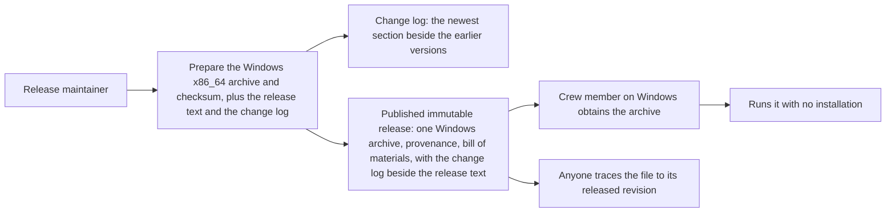

<!-- givn:base-sha256: 579cac31535395f6ebfdc5e988eeb3fe4cefc1734e177c4a109f50dfdc63cb2e -->
# Use case: publish-public-release

## Level

!

## Actors

- Release maintainer — primary Actor; decides that a version is ready, prepares and publishes its release, and answers for the evidence behind the promises made about it.
- Supporting: none inside this flow. The Crew member is the recipient of the published archive — their machines bound the platform set below — but obtaining a file from the public host is the host's concern, and running the tool is the conversion use case (`export-duty-plan-calendar`), not a step here.

## Goal

Publish one version of the tool as a public release that a crew member on Windows x86_64 can obtain for their own machine and trace to the revision and the automation that built it.

## Trigger

The maintainer decides a version is ready and prepares its release.

## Preconditions

- A version number is decided, and the revision it names is the revision being released.
- The change log committed in the repository is current for the revision being released.
- The Windows x86_64 executable has been built by the project's own automation and started on a Windows machine.
- The public home exists and its owner-applied settings are in place: the gate on landing, secret scanning with push protection, the dependency alerts, code scanning, and release immutability.

## Main flow

1. Maintainer decides the version; System prepares one archive holding the Windows executable together with a checksum covering that archive, and renders the release text for the version as the newest section of the change log the repository keeps.
2. Maintainer inspects what was prepared before anything is public; System stages the complete set and publishes nothing from an incomplete preparation.
3. Maintainer publishes the version; System waits for every check on the tagged revision to conclude, refuses when the concluded set is not green, and otherwise makes the release public with the Windows archive attached at once, and the release cannot change from that moment.
4. Crew member on Windows obtains the archive; System offers the Windows archive at a stable address, named for the platform it serves. Nothing is offered for any other platform.
5. Crew member extracts and runs the executable; System's published executable runs on Windows with no runtime installation and no companion library beyond the platform's own.
6. Crew member, or anyone else, checks what they received; System publishes the archive's checksum, its build provenance and the bill of materials for it, so the file in hand can be traced to the revision and automation that produced it.
7. Maintainer's release states what changed; System's release text is the newest section of the change log — the changes a user receives, grouped by kind, with dependency updates named beside them — rather than a flat list of revision subjects.

## Extensions

- 1: the Windows executable has not been built → preparation fails and nothing is staged; an archive set missing the supported platform would promise a download that does not exist.
- 1: an executable is supplied for a platform outside the supported set, including a platform earlier releases offered → preparation fails and nothing is staged; no invented or withdrawn platform is published.
- 1: a version's release was already prepared → preparation refuses rather than replacing the prepared set.
- 1: an executable cannot be read → preparation fails and nothing is staged.
- 1–2: the prepared set is incomplete or was not inspected → nothing is published.
- 3: the version being published was already published → refuse; a published release's tag can never be reused, so a correction is a new version.
- 5: the Windows executable does not start on Windows → the archive is not published for that version.
- 1: a version's notes would name nothing at all — no change a user receives and no dependency update → preparation fails and nothing is published; a version whose notes name nothing at all is not releasable.
- 1: the committed change log does not match the revision being released → preparation fails and nothing is published, naming the version whose section differs.
- 3: a check on the tagged revision concludes without success → publication refuses and names the check; nothing becomes public.
- 3: the tagged revision reports no check outside the release workflow's own suite → publication refuses; a revision without check evidence is not published.
- 3: a check on the tagged revision is still queued or running when the bounded wait ends → publication refuses and names every check still running; nothing becomes public.
- 3: the check runs on the tagged revision cannot be read → publication refuses and states that the check runs could not be read; nothing becomes public.
- 3: every check outside the release workflow's own suites concluded skipped or neutral → publication refuses because no check concluded successfully; nothing becomes public.

## Rules

- **The supported platform set**
  - The supported platform is Windows x86_64. Nothing else is supported, tested, distributed or offered for download. A platform may be added back only by a later change when users request it.
  - A release of a version offers exactly one archive — the Windows x86_64 archive — and never offers a promising platform that has no archive.
  - The archive's name states the tool, the version and the platform it serves, so a downloader selects by machine rather than by trial.
  - The archive holds the Windows executable under the name the platform uses — `duty2cal.exe` — and holds nothing else.
  - The archive uses the same `.tar.gz` format the project already publishes, so one documented extraction path serves it.
- **What a published archive guarantees**
  - The executable in a published archive runs on Windows with no runtime installation and no companion library beyond the platform's own.
  - The archive is published with a checksum covering that archive, so a downloader verifies what they received before extracting it, and the checksum names the file it covers.
  - The archive is published only after the Windows executable was built by the project's automation, as the confirmed distribution constraint requires, and started on a Windows machine. The start, not the build, happens on Windows.
  - The archive carries build provenance and a bill of materials naming what went into the build, and a published release carries a release attestation, so the file in hand can be traced to the revision and the automation that produced it.
  - A version's release stays reachable after later versions are published, so a link to the latest release does not rot as versions change.
- **Publication**
  - A release is prepared as a draft, inspected, and only then published; the Windows archive is attached before the release becomes public, and no asset is attached by hand.
  - A published release is immutable: its archive cannot be replaced or deleted and its version tag cannot be moved, so a correction is the next version rather than a repair in place.
  - A version tag that has been published cannot be reused, not even after the release is deleted.
  - For a version that is the first one published, the revisions being released are all those reachable from the tagged revision, so a first release announces everything it contains.
  - A revision whose subject carries neither a release-note type nor a housekeeping type is omitted, and a commit message never makes a preparation fail.
  - Publishing a version states the version once, in the archive name, the release text and the tag, so no two places disagree about what was released.
  - A version is published only after every check run on the tagged revision — other than the check runs of the release workflow's own check suites, including an earlier release run's suite on the same revision — has concluded. The wait is bounded, and a check still queued or running at the bound refuses publication, naming it.
  - A concluded check that is not a success refuses publication, except a skipped or neutral check, which is allowed; at least one concluded success is required, and a revision whose only check runs belong to the release workflow's own suites is refused as carrying no check evidence.
  - When the check runs on the tagged revision cannot be read, publication refuses rather than treating the failure as an absence of checks or as a green set.
  - The default branch and the version tag may be pushed together: publication waits for the checks the branch push starts, instead of refusing them as not yet concluded.
- **What a release states**
  - A version's notes name the changes a user receives, grouped by kind — new capabilities first, then fixes, then performance, then reversals, then dependency updates — with the group a reader looks for first at the top.
  - A revision whose subject names a capability is a released change; so is a dependency update that changed a path a user receives. A revision whose subject names a tool, the project's own automation workflow, a check, a test, a document, or the machinery of building, packaging and publishing is not, and it is never listed — and a subject that merely borrows one of those words for a crew member's own work is still a released change. A released revision must also have changed something a user receives: a revision whose change touched none of the configured user-receiving paths — the converter, its build inputs, and the packaging and the release workflow that decide what an archive holds — is never listed, whatever its subject says.
  - A dependency update is a revision whose subject names a dependency bump, such as `chore(deps): …`; it is the one housekeeping-typed revision that can be announced. It is announced only when it changed a path a user receives and its words do not name the project's own tooling, as for every released change: the dependency graph is such a path, so a Cargo dependency bump is announced; a dependency update that changed only the project's own checks or automation is not, while one that changed the release workflow is, because that workflow decides what an archive holds.
  - Announced dependency updates are grouped as **Dependencies**, after Reversals, in the order their revisions occur in history, each stating the update in the words its revision carries.
  - A version whose only announced changes are dependency updates is releasable: its notes name those updates and no other change, and preparation stages the version as usual.
  - A dependency update whose subject also names a capability is announced once, in that capability's group; the **Dependencies** group names only updates that carry no capability scope. Identical update subjects collapse to one entry, as every released change does.
  - Each entry states the change in the release-note words the revision carries, so the notes and the history agree, and the notes never claim work that the released revision does not contain.
  - A version whose notes would name nothing at all — no change a user receives and no dependency update — is refused rather than published.
  - The notes are the newest section of the change log the repository keeps, and every earlier version stays unchanged beside it.
  - Each section states its own date and, where an earlier version exists, the comparison against the immediately preceding version.
  - The section is rendered from the repository's history by the project's own generator, whose version is recorded beside its configuration; a committed change log that differs from a fresh render of the released revision is refused.
  - The configuration that decides which subjects are released names every capability the repository holds; a capability present under `givn/specs/` and absent from it is refused rather than left out of every release.
  - The version being released already has its section in the committed change log, because the change log is committed before the version's tag; a committed change log that lacks that version's section is refused.
  - A version's section is rendered before its tag exists — the section is rendered, the change log committed, and only then the tag created — and its date is the released revision's own committer date, which is the date the tagged revision will carry, so the tag and the section can never state different dates.
  - Writing a version's section replaces that version's section where it already exists and places it above the earlier versions where it does not, so a version prepared twice has one section rather than two.
- **The public home and its gate**
  - A change reaches the default branch only after the project's checks pass: formatting, lint, tests, dependency licences, licence compliance of the whole tree, per-file licence headers, third-party notices drift, the private-data guard over both the tree and the published history, coverage, the check of the project's own automation definitions, and the Windows cross-build with its smoke run. The revision a reader is looking at shows the result, and the checks the branch requires are the ones that report on a pushed revision.
  - A leaked credential cannot be pushed into the public history, and any secret that still lands raises an alert.
  - A dependency that becomes known-vulnerable or malicious raises an alert, and dependency updates arrive as reviewable proposals; the deliberately pinned extraction and architecture-test crates are excluded from automatic bumps, and nothing is merged automatically.
  - Someone who finds a defect that could expose private plan data has a confidential reporting route, and the project states that route publicly.
  - A contributor finds the contribution route, the behaviour-before-implementation rule, the sign-off requirement, a code of conduct, an issue form that asks for the export family and a stripped sample rather than a real plan, and a pull-request template that asks for the same.
  - The project's code and its own automation are scanned for vulnerabilities on the way in, and findings appear as reviewable alerts.
- **The public text a reader lands on**
  - The project's README states the repository's own clone address, so the first command a reader runs works.
  - It names the Windows x86_64 archive, states that other platforms are not supported or distributed and that their source can be built with a Rust toolchain, states that a platform may be added back when users request it, and gives the command that verifies the archive's checksum and the command that verifies its build provenance, so a downloader can act on a release without asking anyone.
  - It states that an already-published release keeps its original assets and links, so only future releases are Windows-only.
  - It states the project's licence and links the licence text, and it keeps the third-party Unicode data file's own licence attributed rather than presenting two competing project licences.
  - The repository's description and topics, and its page's statement of the checks' state, are the host's rendering of that same text.
  - This text is checked by the project's own machinery before it is published, not merely written once.
- **Privacy and evidence**
  - Private duty plans and real identifying values never enter the public history or a public asset; committed examples and fixtures are generated or anonymised.
  - No platform, gate or provenance promise is made before the evidence for it exists; the owner-applied settings are confirmed by the operator who applied them, and the remaining promises are exercised by the project's automation and recorded as the change's evidence.
- **Where this interface ends**
  - This capability's own interface is the release preparation the maintainer runs, which the `@e2e` scenario drives through the real command and observes through its terminal output.
  - Obtaining a file from the public host is the host's interface, and running the published tool is the interface of the use case to export a duty-plan calendar; neither is invented here as a second interaction.
  - The host-side promises above are exercised by the project's own publication automation and recorded as this change's evidence, and the settings only the repository owner can apply are confirmed by the operator who applied them.

## Examples

- Complete preparation: the Windows x86_64 executable and version 0.1.0 produce one archive, its checksum and the release text; nothing is published until the maintainer publishes.
- Missing platform build: no Windows executable makes the preparation fail naming Windows x86_64 and stage nothing.
- Unrecognised platform: an executable labelled `freebsd-x86_64` makes the preparation fail naming `freebsd-x86_64`, with no archive for it and nothing staged.
- Previously offered platform: an executable labelled `linux-x86_64` makes the preparation fail naming `linux-x86_64`, with no archive for it and nothing staged, even though earlier releases offered that platform.
- Checksum: the prepared Windows x86_64 archive is accompanied by a checksum that matches that archive and names it.
- Same release prepared twice: the same executable and version produce an archive that is byte-for-byte identical, so a third party can reproduce it.
- Version already prepared: preparing version 0.1.0 where it is already staged refuses, and the existing archive stays untouched.
- Unreadable executable: a Windows executable path that cannot be read stages nothing, and the failure names the cause.
- Release text: revisions carrying two `feat(…): <release note>` subjects plus `chore(…)` and `docs(…)` revisions produce a text that names the version and lists the two release notes in release order, omitting the housekeeping revisions.
- First release: a tagged revision with no earlier release tag produces a text that lists the release notes of every revision it contains, housekeeping revisions omitted.
- Subject carrying no release-note type: a revision whose subject carries neither a release-note type nor a housekeeping type is omitted from the text, and the preparation still succeeds.
- Published release: a version published from an inspected set cannot have its archive or tag changed, so a correction appears as the next version.
- Checks still running: a tagged revision whose checks are queued or running -> publication waits, then publishes only once every check has concluded and the concluded set is green.
- A failed check: a tagged revision with one concluded failure and one check still running -> publication refuses naming the failure and does not wait for the other check; nothing is published.
- Checks that never conclude: a tagged revision whose checks stay queued past the bound -> publication refuses naming every check still running, and nothing is published.
- Skipped and neutral checks: a tagged revision whose concluded checks are one success, one skipped and one neutral -> publication proceeds; neither skipped nor neutral is a refusal.
- No successful check: a tagged revision whose completed checks are one skipped and one neutral -> publication refuses because no check concluded successfully.
- Unreadable check runs: the check-run query fails -> publication refuses, stating that the check runs could not be read, and nothing becomes public.
- Retagged unpublished version: a tag re-pushed to the same revision after an earlier release run failed -> the earlier release run's check suite is excluded along with the current one, so its failed publish check cannot block the new publication.
- No check evidence: a tagged revision whose only check runs belong to the release workflow -> publication refuses, because the revision carries no check evidence outside that workflow.
- Branch and tag pushed together: the default branch and the version tag pushed together while the checks are running -> publication waits for those checks and publishes only after they conclude green, so the atomic push no longer races the gate.
- Downloading for a machine: a Windows x86_64 machine selects the Windows x86_64 archive, the one whose name matches that machine; nothing is offered for any other machine, and the source can be built with a Rust toolchain.
- Missing platform archive on the page: a Windows executable that failed to build stops the version from being published at all, rather than publishing it without Windows.
- Notes grouped by kind: a history whose released revisions name a new capability, a fix, and work no user can see -> the notes for the version name the new capability before the fix, name no revision whose work no user can see, and form the newest section of the change log.
- A change a user does not receive: a released revision that changed only the project's automation definitions, beside a released revision that changed the converter -> the notes name the converter change and no revision that changed only the automation, whatever the automation revision's subject says.
- A version that changes nothing a user can see: released revisions naming only work no user can see -> the generation fails and states that the version changes nothing a user can see, so nothing is published.
- A second version above the first: a change log whose newest section is version 0.1.0 and a history releasing version 0.2.0 -> version 0.2.0 becomes the newest section, with its own date and its comparison against version 0.1.0, and the section for version 0.1.0 is unchanged.
- A change log edited by hand: a committed change log whose newest section differs from what the history states -> the check fails and names the version whose section differs.
- The first version of all: a history releasing version 0.1.0 with no change log yet -> the change log holds one section, for version 0.1.0, naming the released change a user can see and stating no comparison against an earlier version.
- Dependency-only release: released revisions carrying `chore(deps): bump serde …` and `chore(deps): bump clap …`, both changing the dependency graph -> the notes for version 0.2.0 list both updates under Dependencies, and preparation succeeds.
- Repeated dependency update: two revisions carrying the same `chore(deps): bump serde …` subject -> the notes name that update once.
- Checks-only dependency update leaves no group: a `chore(deps): bump actions/checkout …` revision that changed only the project's CI workflow, beside a converter fix -> the notes name the fix and carry no Dependencies heading at all.
- Check-only dependency update: a `chore(deps): bump actions/checkout …` revision that changed only the project's CI workflow -> the notes name no dependency update, because a user receives nothing from that change.
- Release-workflow dependency update: a `chore(deps): bump a release action …` revision that changed the release workflow -> the notes name the dependency update, because that workflow decides what an archive holds.
- Capability-scoped dependency update: a `fix(export-duty-plan-calendar): Upgrade the PDF parser` revision that also changed the dependency graph -> the notes name it once under Fixes, and the Dependencies group does not repeat it.
- Nothing at all: released revisions that changed only paths no user receives -> the generation fails and states that the version changes nothing a user can see, so nothing is published.

## Minimal guarantee

Nothing is published that the evidence does not support: an incomplete preparation publishes nothing and never replaces an existing prepared set, and a credential or private value is blocked before it can enter the public history. A version is never published while a check on its tagged revision is still outstanding, and a concluded check that is not successful refuses it. A published release cannot be altered afterwards.

## Success guarantee

The release of a version is obtainable and traceable for the supported platform: a crew member on Windows x86_64 obtains an archive whose executable runs without installation and whose build can be traced to the released revision and the automation that produced it, and nothing published contradicts the evidence recorded for it.

This is a changing use case: it issues a release, rather than observing one.

## Personas

- project-maintainer--release-owner
- crew-member--personal-calendar-owner

## Capabilities

- publish-public-release

## Interactions

| Capability | Consumer action | E2E scenario |
|---|---|---|
| publish-public-release | prepare the release for a version | Maintainer prepares a Windows release and inspects the archived executable |
| publish-public-release | generate the change log for a version | Maintainer generates the change log for a version and reads its newest section |

## Includes

- none

## Extends

- none

## Out of scope

- Changing the converter: no conversion rule, support boundary or diagnostic changes here.
- Publishing packages: no container image, no registry publication, and no other package channel beyond the release archive.
- Publishing Linux, macOS or any other platform: those platforms are not supported, tested or distributed, and their users may attempt a source build with a Rust toolchain; a platform returns only when users request it and a later change records it.
- Platforms beyond Windows x86_64: Windows on ARM, 32-bit Windows, other Unixes and further Linux architectures are not supported or distributed; their users may attempt a source build with a Rust toolchain.
- Hosted documentation, discussions, a wiki, a development container, funding metadata and AI code review.
- Repairing a published release in place, or removing or replacing an already-published Linux or macOS archive.
- Merging dependency updates automatically, and bumping the deliberately pinned crates automatically.
- The parked ideation questions (source-derived publication rights, FZ provenance, descriptive-fragment conflicts).

## Diagram

The flow this use case delivers:

