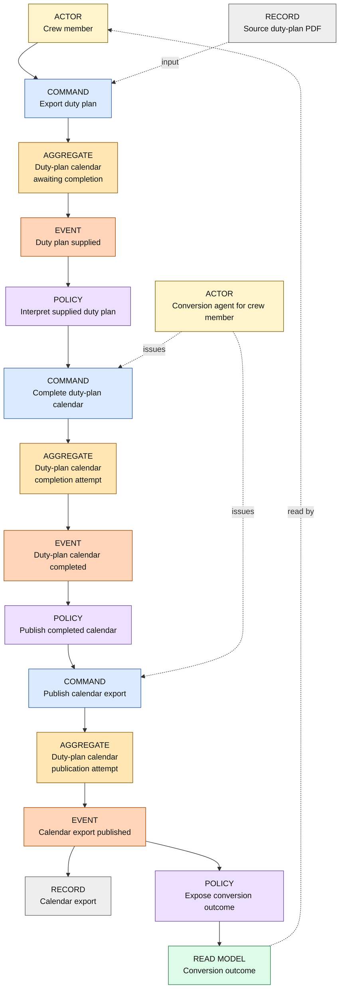
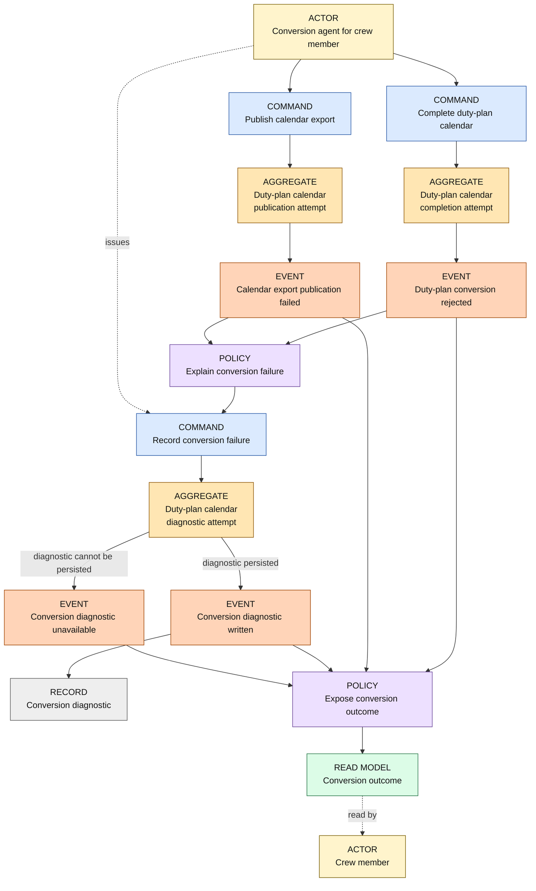
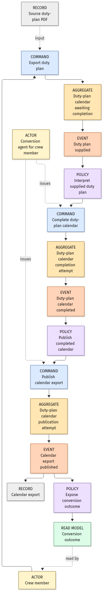
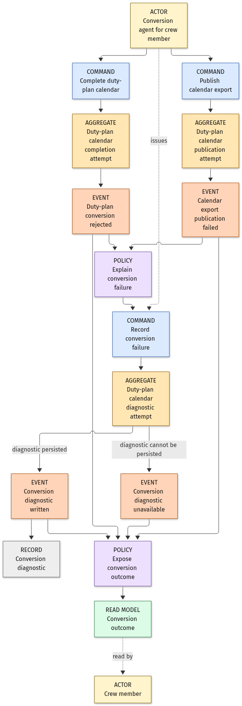

# Duty-plan calendar conversion — Event Storming

Status: draft domain flow, based on the confirmed Frame and whole-plan boundary. Unknown output-recovery and activity-mapping rules are not presented as settled.

## Actors, boundaries, and records

- **Crew member** is the primary interaction role: supplies a duty plan to obtain its calendar export. This is an Actor, not a Persona biography or an approval to write Gherkin.
- **Conversion agent for crew member** is the system's automation acting for that primary actor. Completion, publication, and diagnostic commands are internal subfunctions of the one conversion goal, not independently valuable user goals or additional Personas.
- **Duty-plan calendar** is the only aggregate. Its confirmed invariant is that successful export requires all required source activities to be accounted for and their calendar dates/fields resolved. The definition, contrast, example, and search-before-coin record are in `domain-terms.md`.
- **Source duty-plan PDF** is an input document record; it is not an aggregate.
- **Calendar export** is the resulting `.ics` file record; it is not the calendar-composition aggregate.
- **Conversion diagnostic** is an output error record; its existence is conditional on successful diagnostic publication, not assumed on an unwritable filesystem.
- **Conversion outcome** is the read model describing the final result, including whether the requested calendar was published or the diagnostic is unavailable. Rejection and publication failure make failure visible independently of any attempted diagnostic persistence. Intermediate progress display and the presentation details are not decided here.
- The maintainer Persona reviews this flow's claims; the maintainer is not an Actor invoking a new product command or an additional release-workflow use case.

## Event chain — one past-tense event per line

| Event | Actor and command | Aggregate | Reacting policy | Actor's read model |
|---|---|---|---|---|
| Duty plan supplied | Crew member: Export duty plan | Duty-plan calendar | Interpret supplied duty plan | Conversion outcome remains pending; no exported result exists yet |
| Duty-plan calendar completed | Conversion agent for crew member: Complete duty-plan calendar | Duty-plan calendar | Publish completed calendar | Conversion outcome remains pending; completion does not imply publication |
| Duty-plan conversion rejected | Conversion agent for crew member: Complete duty-plan calendar | Duty-plan calendar | Expose conversion outcome; Explain conversion failure | Conversion outcome: rejected, regardless of whether a diagnostic can be persisted |
| Calendar export published | Conversion agent for crew member: Publish calendar export | Duty-plan calendar | Expose conversion outcome | Conversion outcome: successful publication and output location |
| Calendar export publication failed | Conversion agent for crew member: Publish calendar export | Duty-plan calendar | Expose conversion outcome; Explain conversion failure | Conversion outcome: publication failed independently of diagnostic persistence; existing calendars unchanged |
| Conversion diagnostic written | Conversion agent for crew member: Record conversion failure | Duty-plan calendar | Expose conversion outcome | Conversion outcome: failure and diagnostic location |
| Conversion diagnostic unavailable | Conversion agent for crew member: Record conversion failure | Duty-plan calendar | Expose conversion outcome | Conversion outcome: failure with no persisted diagnostic |

## Commands and policies

| Command | Issuing actor | Responsibility and condition |
|---|---|---|
| Export duty plan | Crew member | Supply one duty-plan source for its complete calendar representation. |
| Complete duty-plan calendar | Conversion agent for crew member | Interpret the source and resolve all required activities. Reject instead of completing when a required activity, date, or fragment cannot be resolved. Exact code mappings remain open. |
| Publish calendar export | Conversion agent for crew member | Publish only a completed calendar composition under an unused name. Preserve existing calendars and add an enumerated suffix when a candidate is occupied; report the actual published path. No candidate may be clobbered by a race. |
| Record conversion failure | Conversion agent for crew member | Attempt a new numbered diagnostic after every conversion failure, including publication failure, retaining old reports and identifying the source PDF filename. An old report's existence is not evidence of a current successful write. |

| Policy | Trigger | Reaction |
|---|---|---|
| Interpret supplied duty plan | Duty plan supplied | The conversion agent issues Complete duty-plan calendar. |
| Publish completed calendar | Duty-plan calendar completed | The conversion agent issues Publish calendar export; no rejected composition follows this path. |
| Explain conversion failure | Duty-plan conversion rejected; Calendar export publication failed | The conversion agent issues Record conversion failure for either failure, independently of immediate failure visibility and whether the new report can be saved. |
| Expose conversion outcome | Duty-plan conversion rejected; Calendar export published; Calendar export publication failed; Conversion diagnostic written; Conversion diagnostic unavailable | Populate the Conversion outcome read model immediately on success or failure; diagnostic outcomes subsequently identify availability/location. Failure visibility does not depend on optional recovery or successful diagnostic persistence. The presentation channel remains for later elaboration. |

## Mermaid canvas

Kind labels and colors distinguish Actors, Commands, the Aggregate, Events, Policies, Records, and the Read model. A command is always issued by an Actor and directed at the Aggregate. Policies select the automation's next command; they do not introduce independent user goals.

The same Duty-plan calendar root is shown at several lifecycle positions for readability. These are successive views of **one aggregate instance**, not multiple consistency boundaries or persistent services. Across the two panels, every event, command, actor, policy, record, and read model in the inventories appears by the same name.

### Successful conversion

### Rejection, publication failure, and diagnostic availability

### Rendered views

The image views below were successfully generated from the Mermaid blocks above on 2026-10-10 via Kroki's documented Mermaid rendering endpoint and inspected as images. Only the generic diagram source was submitted; no private PDF, identifying value, source itinerary, or extracted duty-plan text was submitted. No local renderer or project dependency was installed.

## Reverse narrative

- A published calendar requires a completed Duty-plan calendar and successful publication; completion alone is not the actor's success outcome.
- A completed Duty-plan calendar requires a supplied source whose required activities and dates can be resolved.
- A supplied duty plan requires the crew member's Export duty plan command; statistics or overview legends do not independently create activities.
- A rejection requires an attempted completion, not silently missing rows in a successful file.
- A failed publication requires a completed calendar followed by an unsuccessful publication attempt. It must not be described as a successful export.
- Rejection or failed publication exposes a failure outcome immediately; optional diagnostic persistence cannot be the only cause of failure visibility.
- A written diagnostic requires a rejected conversion or a failed publication and a successful diagnostic attempt. A failed diagnostic attempt leaves a failure outcome, not proof that a diagnostic exists.

## Hotspots parked rather than invented

- Source-date interpretation is closed through the date-association record (Q3), narrow overnight decision (Q21), and adjacent-boundary decision (Q30). Qualified UTC endpoints use unique previous/same/next Gregorian dates around their own source local dates; unresolved/contradictory required evidence fails. Empirical boundary validation remains a later obligation, not permission for arbitrary repairs.
- The supported-export decision (Q4) is closed: the user selected the supplied Released Roster detail-table family and its explicitly validated variations for the first release on 2026-10-11. Additional-family and universal-support claims are excluded; specific behavior mappings still need evidence.
- The source-publication-rights question (Q5) governs whether source-derived test material may be published; independent generated examples remain possible.
- The observed additional-activity question (Q7) is closed through user-confirmed meanings and representation rules. The narrow overnight decision (Q21) and adjacent Gregorian-date decision (Q30) complete the date interpretation; unresolved required evidence still fails. Formal FZ provenance (Q13) remains non-blocking background rather than a new conversion goal.
- The calendar-preservation decision (Q10), failure-report decision (Q22), and publication-failure decision (Q24) are closed: old outputs stay unchanged, new outputs use unused numbered names, reports identify the source PDF, and every conversion failure attempts a report. Diagnostic inability remains an explicit outcome. No implemented file atomicity, power-loss durability, or import-update support is implied.
- The trip-description decision (Q23) confirms known Trip ID inheritance across travel legs in one unambiguous roster trip, including page/date continuations. It does not authorize propagating Report (LT), Tags, Timezone Difference, or unrelated-duty/layover metadata into every event. Roster trip is descriptive grouping within the single confirmed aggregate, not a new boundary.
- The calendar-identity decision (Q25) confirms source-snapshot component identities; numbered output files are not new source identities and client reconciliation is out of scope. The timestamp-provenance decision (Q27) confirms the Created UTC footer for this source family, with actual construction-time fallback. Optional descriptive-field association/conflicts remain qualified by their question (Q28); activity dates are not inferred from revision metadata.
- The standby/reserve definition decision (Q26) and single-day-window decision (Q29) confirm SB/SBX/RE as timed UTC availability using their own windows. The expert's FRA examples are not a global default; later supplied-source validation is expressly required. Annual statistics produce no duty events and no activation/reporting workflow is added.

## Persona reactions — advisory, not new decisions

- **Crew member exporting their own duty plan (crew-member--personal-calendar-owner):** completion is not enough; the readable outcome must say whether a new calendar was actually published. A generated unresolved arrival fragment must block apparent success. Existing calendars are now explicitly preserved; the readable outcome must identify the newly enumerated file so an older file is not mistaken for the new export. Diagnostic recovery remains open.
- **Maintainer responsible for a public release (project-maintainer--release-owner):** the flow correctly separates input records, the whole-plan invariant, output records, and publication outcomes. It does not yet establish supported-format breadth, actual RFC validation, portable executable distribution, or verified write-failure recovery. Those are evidence obligations, not events proving a release is ready.

The user remains the decision-maker. These reactions apply the confirmed Persona interests and identify open guarantees; they do not approve a new rule or a separate maintainer product goal.

## Quality review

Both Mermaid panels rendered successfully and were inspected as PNG images. The fresh-context reviewer identified a missing unconditional read-model path for publication failure and an unsupported implication of intermediate progress display. Applied the confirmed explicit-failure requirement by exposing rejection/publication failure independently of diagnostic persistence, removed the progress-display implication, and labeled mutually exclusive diagnostic outcomes. No overwrite, rollback, or recovery policy was selected. The same reviewer inspected the corrected source and re-rendered failure canvas and reported no blocking defects on 2026-10-10. Findings remain advisory; no open human decision was closed through the review.

On 2026-10-11, the user separately selected numbered-output preservation and report attempts after every failure. The publication-failure-to-diagnostic-policy edge is now unconditional; both current panels were successfully rendered again. This is a user-approved update, not a decision attributed to the earlier reviewer.
