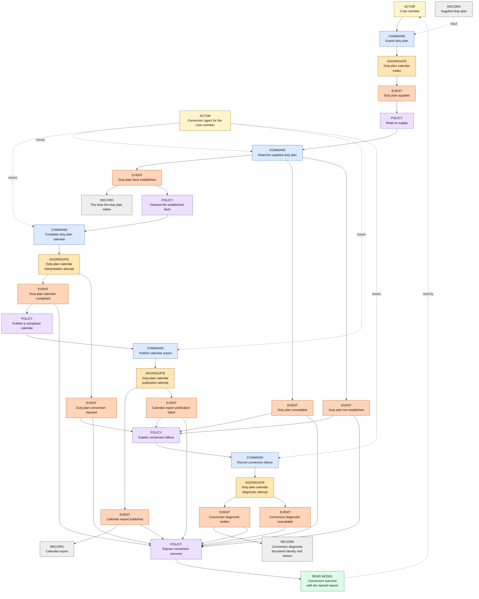
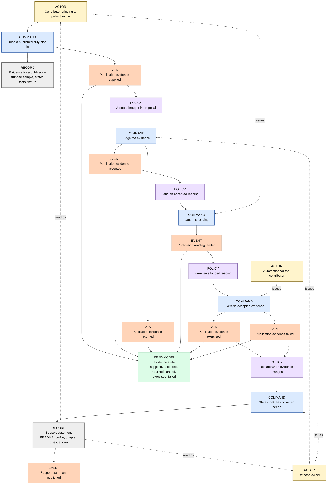

# Generalized duty-plan input — Event Storming

Status: draft for the confirmed Frame (Q6). The phase term checks are closed
(Q7, Q8): `Duty plan`, `Evidence for a publication` and `Support statement` are
confirmed. The use-case cut is recorded in `use-case-definitions.md`.

## Actors, boundaries, and records

- **Crew member** — supplies one published duty plan and obtains its calendar.
- **Conversion agent for the crew member** — the automation acting for the crew
  member; its commands are subfunctions of the one conversion goal.
- **Contributor bringing a publication in** — supplies evidence for a
  publication the converter cannot read yet, lands the reading, and adds the
  fixture.
- **Release owner** — judges the evidence and decides what the project claims.
- **Automation for the contributor** — runs the fixture of a landed reading
  through the unchanged conversion. It acts for the contributor's goal and
  serves the release owner's claim; it is not an independent actor goal.
- **Duty-plan calendar** — the only aggregate. Its confirmed invariant is
  unchanged: a successful export exists only when every required activity and
  field resolves; there is no apparently complete partial calendar.
- **Supplied duty plan** — the input document record.
- **The facts the duty plan states** — the intake record: for every entry its
  date and activity code; for travel the route and the crew position with the
  flight number as stated; the clocks and their explicit UTC day qualifiers;
  the descriptive fields the rules select; the source's own revision **where it
  states one**. The record carries what the plan states and never decides what
  is resolvable. It has no domain term.
- **Calendar export**, **Conversion diagnostic** — output records. The
  diagnostic identifies the supplied document and the reason; its label no
  longer claims a PDF.
- **Evidence for a publication** — the stripped sample, the facts it states and
  the fixture built from it; a record.
- **Support statement** — the published statement in its four carriers (README,
  organization profile, chapter 3, issue form); a record.
- **Conversion outcome** — the read model, carrying the reason a plan was
  refused.
- **Evidence state** — the read model of a brought-in publication: supplied,
  accepted, returned, landed, exercised or failed.

No new aggregate is introduced. **The second panel deliberately has no
aggregate**: the project declares exactly one consistency boundary, and the
evidence route is a repository process over records whose rules are review
rules ("evidence or silence"), not aggregate invariants. The command targets in
that panel are records; the canvas names them as such.

## Event chain — one past-tense event per line

| Event | Actor and command | Where it happens | Reacting policy | Actor's read model |
|---|---|---|---|---|
| Duty plan supplied | Crew member: Export duty plan | Duty-plan calendar, intake | Read on supply | Conversion outcome pending |
| Duty plan unreadable | Conversion agent for the crew member: Read the supplied duty plan | Duty-plan calendar, intake | Explain conversion failure | Outcome: rejected, the bytes could not be read at all |
| Duty plan not established | Conversion agent for the crew member: Read the supplied duty plan | Duty-plan calendar, intake | Explain conversion failure | Outcome: rejected, no dated activity could be established |
| Duty-plan facts established | Conversion agent for the crew member: Read the supplied duty plan | Duty-plan calendar, intake | Interpret the established facts | Outcome pending; the plan has been read, nothing is converted |
| Duty-plan calendar completed | Conversion agent for the crew member: Complete duty-plan calendar | Duty-plan calendar | Publish a completed calendar; expose conversion outcome | Outcome pending; completion does not imply publication |
| Duty-plan conversion rejected | Conversion agent for the crew member: Complete duty-plan calendar | Duty-plan calendar | Explain conversion failure | Outcome: rejected, the reason names the unknown code with its date, the absent fact with its activity, the unmatched fragment, the contradiction or the non-positive interval |
| Calendar export published | Conversion agent for the crew member: Publish calendar export | Duty-plan calendar | Expose conversion outcome | Outcome: published and its path |
| Calendar export publication failed | Conversion agent for the crew member: Publish calendar export | Duty-plan calendar | Explain conversion failure | Outcome: publication failed; existing files unchanged |
| Conversion diagnostic written | Conversion agent for the crew member: Record conversion failure | Duty-plan calendar | Expose conversion outcome | Outcome: failure, diagnostic path, and the diagnostic names the supplied document and the reason |
| Conversion diagnostic unavailable | Conversion agent for the crew member: Record conversion failure | Duty-plan calendar | Expose conversion outcome | Outcome: failure, no new report |
| Publication evidence supplied | Contributor bringing a publication in: Bring a published duty plan in | Evidence for a publication | Judge a brought-in proposal | Evidence state: supplied |
| Publication evidence accepted | Release owner: Judge the evidence | Evidence for a publication | Land an accepted reading | Evidence state: accepted; nothing is claimed yet |
| Publication evidence returned | Release owner: Judge the evidence | Evidence for a publication | — | Evidence state: returned with the fact, code or date the sample does not cover |
| Publication reading landed | Contributor bringing a publication in: Land the reading | Evidence for a publication | Exercise a landed reading | Evidence state: landed; nothing is claimed yet |
| Publication evidence exercised | Automation for the contributor: Exercise accepted evidence | Evidence for a publication | Restate when evidence changes | Evidence state: exercised; a duty plan of that publication converts in the checks |
| Publication evidence failed | Automation for the contributor: Exercise accepted evidence, or a named publication's plan refused at conversion | Evidence for a publication | Restate when evidence changes | Evidence state: failed, naming the code or fact |
| Support statement published | Release owner: State what the converter needs | Support statement | — | The carriers state the required facts and exactly the evidenced publications |

Browser realization: `Calendar export published` and `Conversion diagnostic
written` are **offered** in the page, which writes nothing and never claims a
save; a failed attempt withdraws the earlier offer. Those realizations stay as
the conversion use case defines them and are not re-drawn here.

## Commands and policies

| Command | Issuing actor | Responsibility and condition |
|---|---|---|
| Export duty plan | Crew member | Supply one published duty plan for its complete calendar representation. |
| Read the supplied duty plan | Conversion agent for the crew member | Establish what the publication states, in its own words and values, without interpretation. Refuse when the bytes cannot be read, or when no dated activity can be established. |
| Complete duty-plan calendar | Conversion agent for the crew member | Interpret the established facts under the unchanged rules. Reject — naming the reason — when a required code, fact, fragment, date or interval cannot be resolved. A plan that states no revision metadata is not rejected for it; the construction time is the documented fallback. |
| Publish calendar export | Conversion agent for the crew member | Publish only a completed calendar under an unused name: an occupied candidate is skipped, an enumerated suffix follows (`roster.ics`, `roster-1.ics`), and a concurrent claimant is never permission to overwrite. Existing calendars and reports stay unchanged. |
| Record conversion failure | Conversion agent for the crew member | Attempt a new numbered diagnostic after every failure; the diagnostic identifies the supplied document, its filename and the same named reason as the outcome. |
| Bring a published duty plan in | Contributor bringing a publication in | Supply a stripped sample, state the facts it shows, and hand the evidence over for review. |
| Judge the evidence | Release owner | Accept or return the evidence: accept only when the sample covers the facts the reading would claim and the fixture is generated or genuinely stripped. |
| Land the reading | Contributor bringing a publication in | Establish the accepted facts inside the intake boundary, changing the composition but no domain rule. |
| Exercise accepted evidence | Automation for the contributor | Run the fixture through the unchanged conversion; only a converting fixture backs a claim. |
| State what the converter needs | Release owner | Publish the required facts and the publications whose evidence is exercised; state no publication without it. |

| Policy | Trigger | Reaction |
|---|---|---|
| Read on supply | Duty plan supplied | The agent issues Read the supplied duty plan. |
| Interpret the established facts | Duty-plan facts established | The agent issues Complete duty-plan calendar. |
| Publish a completed calendar | Duty-plan calendar completed | The agent issues Publish calendar export; no rejected composition takes this path. |
| Explain conversion failure | Duty plan unreadable; Duty plan not established; Duty-plan conversion rejected; Calendar export publication failed | The agent issues Record conversion failure and populates the outcome with the same named reason. |
| Expose conversion outcome | Duty-plan calendar completed and every outcome event | Populate Conversion outcome immediately, including the pending state after completion; diagnostic outcomes subsequently identify availability and location. |
| Judge a brought-in proposal | Publication evidence supplied | The release owner issues Judge the evidence. |
| Land an accepted reading | Publication evidence accepted | The contributor issues Land the reading. |
| Exercise a landed reading | Publication reading landed | The automation issues Exercise accepted evidence. |
| Restate when evidence changes | Publication evidence exercised; Publication evidence failed; a named publication's plan refused at conversion | The release owner issues State what the converter needs, so the statement shrinks as well as grows. |

## Mermaid canvas

Kinds are distinguished by a label in each node and by colour. A command is
issued by an actor; policies select the next command. The same Duty-plan
calendar root appears at several lifecycle positions — successive views of one
aggregate instance, not several boundaries.

### One supplied duty plan

### A further publication enters

No aggregate appears in this panel, by design: the commands change records and
a published statement, and the project's single consistency boundary is the
conversion.

## Rendered views

Both blocks were rendered on 2026-10-25 through Mermaid's Kroki endpoint by the
boundary review: HTTP 200 for each, every node label present, no syntax error.
No image is committed; a later edit must re-check the render.

## Modelling decisions taken here, and their grounds

1. **No new aggregate.** The intake is a position of the one Duty-plan calendar
   boundary; evidence and the statement are records. Panel 2 has no aggregate
   because the project declares one consistency boundary and the evidence
   route's rules are review rules, not invariants over plan representations.
2. **Three intake outcomes.** `Duty plan unreadable` covers bytes that cannot be
   read at all (today's `SourceError::Unreadable`); `Duty plan not established`
   covers a readable document from which no dated activity can be established
   (today's `UnsupportedFamily`); `Duty-plan facts established` is the only path
   to interpretation. This replaces the earlier draft's single unreadable event,
   which would have let a readable-but-unmapped document reach interpretation
   with facts missing.
3. **Reading establishes; interpretation refuses.** An absent fact, an unknown
   code, an unmatched fragment or a non-positive interval is rejected where the
   permanent contract already rejects it, with the reason named.
4. **The revision is optional.** The intake records the source's own revision
   where it states one; a plan without it converts with the construction-time
   fallback. The chain never makes revision metadata a rejection condition.
5. **The source snapshot still scopes identities.** The snapshot is the fixed
   supplied document. That the glossary defines it as a PDF version is a
   consequence of one publication being a PDF; the identity rule is unchanged,
   and how a non-PDF document's fingerprint is formed is design work.
6. **The contributor's outcome is exercised evidence**, not landed code. Landing
   the reading is its own event because the review's outcome and the exercise's
   precondition depend on it.
7. **The statement shrinks as well as grows**: `Publication evidence failed` —
   a failing fixture or a named publication's plan refused at conversion —
   triggers the same restatement.
8. **Preview and released publications are the same goal.** A publication that
   states different facts is read into the same record; no second event, no
   second promise.
9. **"Printed" becomes "stated"** across the permanent rules. The Frame lists
   this among the confirmed statements this direction replaces; it changes
   wording, not meaning.

## Open qualifiers

- The intake record's shape (fragments, date blocks, day qualifiers, absent
  facts) is design work and must not weaken the confirmed timing rules.
- Whether a non-tabular publication can reach the existing interpretation, or
  needs a further domain reading, is design work. No non-PDF reading exists
  today.
- The refusal sentences and the statement's wording are drafted in their
  changes.
