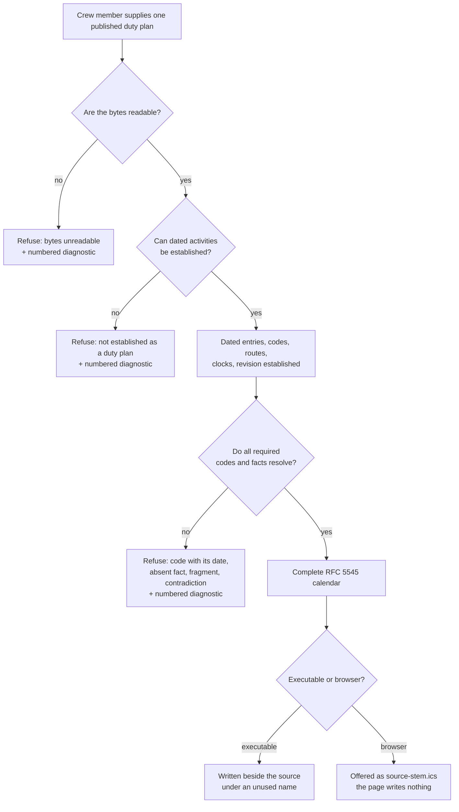

# Use case: export-duty-plan-calendar

This is the topic's view of a use case that already owns a permanent leaf
(`givn/specs/export-duty-plan-calendar/usecase.md`). It is elaborated here as a
**delta**: what the generalization changes, and what stays. The permanent leaf
is extended by the change this topic seeds; no second conversion goal is
created.

## Level

!

## Actors

- Crew member — primary Actor; supplies one published duty plan to obtain its
  personal-calendar representation through the executable or a browser page.
- Supporting: none. The conversion agent and the browser page perform internal
  responsibilities for the Crew member.

## Goal

Export one published duty plan as an importable personal calendar file.

## Trigger

The Crew member supplies one published duty plan for conversion.

## Preconditions

- The browser route requires a current browser with WebAssembly and ES
  modules, and a converter module that initializes; the plan is at most 20 MiB.
- Nothing is assumed about how the plan is represented. A plan is not required
  to be a PDF, a table, or a named format.

## Main flow

1. Actor supplies the duty plan they want represented; System receives the
   source and its filename without altering its contents and, in the browser
   realization, without sending a request.
2. Actor expects their plan to be read; System establishes what the duty plan
   states — its dated entries, the codes, routes, clocks and descriptive fields
   it carries, and its own revision metadata — without interpreting any of it.
   *Changed: this step no longer checks a format; it establishes facts.*
3. Actor expects every required activity to be accounted for; System
   interprets the established facts under the unchanged classification,
   timing and fragment rules, and rejects rather than excludes anything it
   cannot resolve.
4. Actor needs the relevant context of each activity; System retains the
   confirmed distinctions, including DH in travel titles and a known Trip ID
   within an unambiguous roster trip.
5. Actor needs an importable representation; System prepares a complete
   RFC 5545 calendar with valid dates, text representation,
   source-snapshot-scoped identities, and preferred-source revision metadata
   with construction-time fallback.
6. Actor needs a new file without losing existing outputs; System publishes the
   complete calendar beside the source under an unused name when the executable
   converts, or offers it for saving as `<source-stem>.ics` when the browser
   converts.
7. Actor can stop with the exported calendar; the executable reports the actual
   new path, the page shows the offer and claims no save.

## Extensions

- 2: the supplied bytes cannot be read, or no dated activity can be
  established, so the document is not a duty plan the converter can read →
  expose the conversion failure and attempt a new numbered diagnostic naming
  the source and what could not be read; protects explicit failure and the
  complete-representation guarantee. *(Successor of today's unsupported-family
  refusal.)*
- 3: a printed code is not understood → reject, naming the code and the date of
  the entry that carries it; protects no silent omissions and no invented
  meaning.
- 3: a required fact is absent — no route for a travel activity, no clock for a
  timed activity → reject, naming the activity and the absent fact; protects
  complete representation.
- 3: dates, required times, positive intervals or a unique adjacent UTC day
  cannot be established → reject rather than invent instants, except for the
  expressly selected unqualified-travel next-day rule.
- 3: a travel fragment lacks a unique compatible partner, or classification,
  dates, endpoints, route identity or explicit crew assignment contradict →
  reject with the named contradiction; no convenient value is chosen.
- 6: the proposed calendar name is occupied or becomes occupied → choose
  another unused enumerated name; protects existing output contents.
- 6: the complete calendar cannot be published → expose failure and attempt a
  new numbered diagnostic.
- 2–6: a diagnostic name is occupied → choose another unused numbered report
  name; the primary failure stays visible.
- 2–6: the new diagnostic cannot be saved or offered → retain the primary
  failure in the outcome and state that no new report exists.

## Rules

**Changed by this topic**

- The conversion can read any publication that states the required facts; it
  no longer requires a PDF, a table or a named format. **No reading for a
  non-PDF publication exists yet**, so the supported behaviour today remains the
  one publication; what changes is that support is no longer decided by a
  format name.
- The refusal states what was recognized and what could not be established: the
  unknown code with the date of its entry, the absent fact with the activity,
  the unmatched fragment, the contradiction. It never names a format the crew
  member has never heard of.
- The diagnostic's `Source PDF:` label becomes a label for the supplied
  document, because a non-PDF publication is admissible in principle.
- The permanent rules' wording follows the generalization: where they say
  "printed", the converter means "stated by the duty plan". The rule's meaning
  does not change, and no confirmed meaning, timing or completeness rule is
  altered.
- The statements this replaces are enumerated in the Frame's "Confirmed rules
  this direction replaces" table: the supported-family rule, main-flow step 2,
  extension 2's wording, the scenario asserting the unsupported-family
  diagnostic, the glossary's family entry as a support boundary, and chapter
  3's input sentence.

**Inherited unchanged**

- Every confirmed activity meaning, including all-day and timed codes, the
  travel-fragment pairing, the DH title, the report-time suffix, the trip-ID
  inheritance, the UTC-endpoint and overnight rules, all-day handling of source
  clocks, and the refusal of unknown codes.
- Completeness: a successful export exists only when every required activity
  and field resolves; there is no apparently complete partial calendar.
- RFC 5545 output: escaping, CRLF, UTF-8, octet-aware folding, UTC endpoints,
  all-day date ends.
- Publication: an unused name beside the source, never overwriting; the browser
  offers and writes nothing; every failure attempts a new numbered diagnostic;
  the diagnostic's unavailability never hides the failure.
- Identities and metadata: snapshot-scoped component UIDs, construction-time
  fallback for a missing source revision.
- Privacy: no real plan or identifying value is committed; the browser page
  sends no request, stores nothing and claims no save.

## Examples

- All values generated. A plan stating `U` on 12 January 2099 without clocks →
  one all-day vacation activity.
- A tabular export whose headers state date, code, route and clocks, with the
  code `SB` on 13 January 08:00–16:00 → one eight-hour availability activity;
  no PDF is involved.
- A plan stating an unknown code `S5` on 12 January 2099 → refused with the
  code and that date; no calendar and a numbered diagnostic.
- A plan whose travel entry states no route → refused naming that entry and the
  absent route; the other, resolvable activities are not exported.
- The browser page with the same unknown-code plan → the reason is shown and
  `<source-stem>.parse-error.txt` is offered.

## Minimal guarantee

True on failure: no calendar is published or offered; existing calendars and
diagnostics are unchanged; the outcome states the failure and its reason; a new
numbered diagnostic is attempted and its absence is stated rather than hidden.

## Success guarantee

A complete calendar for the supplied duty plan is published beside the source
under an unused name, or offered as `<source-stem>.ics` in the browser — and
nothing else.

## Personas

- `crew-member--personal-calendar-owner` — accuracy and privacy lens: does the
  calendar match their plan, and is a refusal actionable?
- `contributor--web-reviewer` — only for the browser page's refusal text and
  offer behaviour, whose wording this topic changes.

## Capabilities

- none — the permanent leaf owns this goal's capabilities; this topic extends
  them and creates no new one here.

## Interactions

- none

## Includes

- none

## Extends

- none

## Out of scope

- Every activity meaning, timing rule and completeness rule (inherited).
- Calendar import, synchronization with an imported calendar, or editing a
  plan.
- Reading contacts, hotel lists or crew databases.
- A hosted or server-side conversion.
- The intake model's internal shape (design work).

## Diagram

