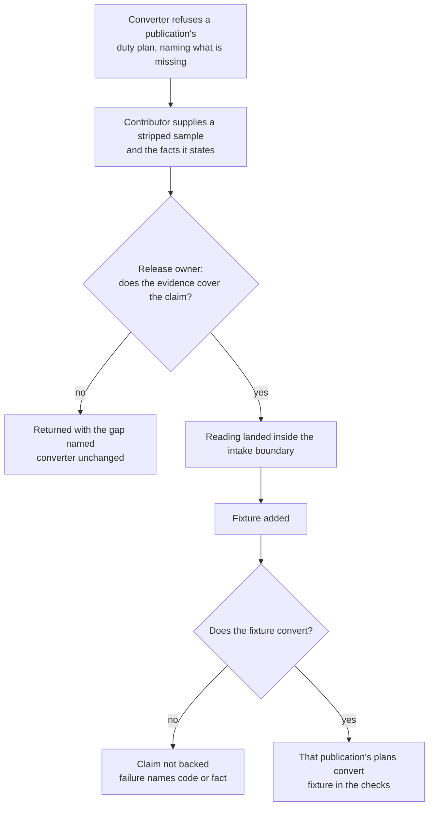

# Use case: make-a-further-published-duty-plan-convertible

## Level

!

## Actors

- Contributor bringing a publication in — primary Actor; supplies evidence for
  one publication the converter refuses and lands the reading that establishes
  its facts.
- Supporting: Release owner — accepts or returns the evidence and answers for
  the claim it supports.
- Supporting: Automation for the contributor — exercises the fixture through
  the unchanged conversion.

## Goal

Make one further published duty plan convertible.

## Trigger

The Contributor supplies evidence for a publication whose duty plan the
converter refuses.

## Preconditions

- A duty plan of that publication exists that the converter refuses, and the
  refusal names what could not be established.
- The Contributor holds a sample of that publication that can be stripped of
  identifying data, and may commit a fixture built from it.
- The confirmed activity vocabulary and rules are fixed; a code the vocabulary
  does not know is not established by this use case.

## Main flow

1. Actor takes a duty plan of the publication and strips it; System receives
   the stripped sample together with the facts the sample states — its dates,
   its printed codes, its fields, and the publication's own revision metadata.
2. Actor states which required facts the sample shows; System records the
   evidence for review.
3. Supporting: Release owner reviews the evidence against the sample; System
   records whether it is accepted or returned with the gap named. The actor can
   stop here: a returned proposal leaves the converter as it was.
4. Actor lands the reading that establishes those facts, inside the intake
   boundary and without adding or changing a domain rule.
5. Actor adds the fixture; Supporting: Automation for the contributor
   exercises it through the unchanged conversion, so the claim rests on a plan
   that converts rather than on code that looks right.
6. Actor can stop with the publication convert-ible; its duty plans convert,
   and the check suite exercises its fixture.

## Extensions

- 1: the sample still identifies a person — a name, a staff number, or a
  combination of base, dates and trip identifiers → returned before any commit;
  protects the privacy rule. Replacing a name alone is not sufficient
  stripping.
- 1: the sample is not of the publication that was refused (a different month,
  a preview rather than a released plan, a different system) → returned naming
  the mismatch; protects the claim from resting on the wrong evidence.
- 3: the evidence does not cover the facts the reading would claim — missing
  dates, an unstated required field, a code not shown by the sample → returned
  naming the gap; protects the claim.
- 4: establishing a required fact would need a rule the domain does not have (a
  new activity meaning, a new timing convention) → the reading is not landed
  here; the need is reported as a separate domain decision, and the case ends
  without success.
- 5: the fixture does not convert → the claim is not backed; the refusal names
  the code or fact that failed, and the case ends without success.
- 5: the fixture would be a real plan or an output converted from one →
  refused; the fixture is generated or stripped.

## Rules

- **Evidence**: a claim about a publication rests on evidence for a
  publication — a stripped sample, the facts it states, and a fixture that
  converts. The landed reading is not evidence.
- **Bounded change**: the reading is confined to the intake boundary, and the
  composition that wires it changes (both facades construct the reading today,
  or composition moves inward). The domain, the calendar writer, the facades'
  behaviour, the release path and the confirmed rules are unchanged. A needed
  domain rule is a separate decision, not part of this case.
- **Evidence custody**: a real duty plan is inspected locally and never
  committed; the evidence record states what the sample showed without
  reproducing it, and the committed fixture is generated or stripped. Stripping
  is judged on identifying combinations, not on names alone.
- **No registry**: the project ships no list of formats, publications or
  operators, and maintains none as configuration. The reading is code plus a
  fixture; the only place a publication is named is the **Support statement**,
  and it names only what the checks exercise.
- **Unknown codes stay unknown**: the fixture uses only confirmed activity
  codes; giving a code a meaning is a separate decision under the conversion
  contract.
- **Privacy**: a real duty plan or a calendar converted from one never enters
  the repository; the fixture is generated or stripped, and stripping is judged
  on identifying combinations, not on names alone.
- **Claim boundary**: this case does not publish anything. The support
  statement is the third use case; until it is published, the publication is
  convertible but not claimed.

## Examples

- All values generated. A tabular export with the headers
  `Date;Code;From;To;Start;End` and a `SB` on 13 January 08:00–16:00: the
  contributor supplies a stripped sample of two days, the facts it states, and
  a fixture; the fixture converts; that export now converts.
- A sample that shows only all-day codes and no timed duty → returned, because
  the reading would claim timed duty it has never seen.
- A sample that would need `S5` to mean something → the reading cannot be
  landed; the code's meaning is a separate domain decision.
- A sample still carrying a base, a trip identifier and three consecutive dates
  → returned before commit even though the crew name was replaced.

## Minimal guarantee

True whatever the outcome: the converter still converts everything it converted
before; no confirmed rule, meaning or guarantee is changed; no real plan or
identifying value is committed; no claim is published.

## Success guarantee

A duty plan of that publication converts to a complete calendar under the
unchanged rules, and the check suite exercises the fixture built from the
evidence.

## Personas

- `contributor--publication-reader` — the primary lens: does the reading
  establish exactly the required facts, and is the evidence enough?
- `project-maintainer--release-owner` — is the evidence sufficient for what
  will later be claimed?

## Capabilities

- none at ideation time; the change seeded from this topic defines them.

## Interactions

- none

## Includes

- none

## Extends

- none

## Out of scope

- Deciding what an activity code means, or any timing or completeness rule.
- The intake model's internal shape.
- Publishing a support statement (the third use case).
- A mapping language or per-publication configuration shipped with the tool.
- Reading anything that is not a duty plan.

## Diagram

