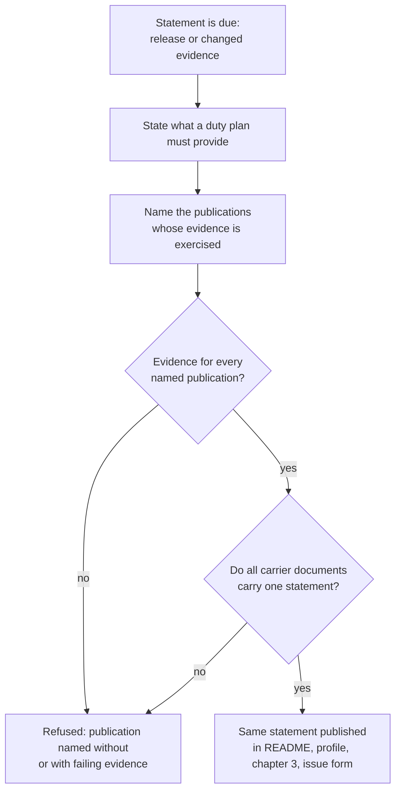

# Use case: state-the-converter-support-statement

## Level

!

## Actors

- Release owner — primary Actor; decides what the project claims about what the
  converter handles, and answers for the evidence behind every claim.
- Supporting: none. The exercised evidence exists before the trigger and is
  produced by the use case to make a further published duty plan convertible.

## Goal

Keep the public support statement true to the exercised evidence.

## Trigger

The Release owner publishes or revises the support statement — on a release, or
because the evidence behind it changed.

## Preconditions

- At least one publication's evidence has been exercised: a fixture of it
  converts through the unchanged conversion. A statement may exist with no
  publication named, but never with an unexercised one.
- The documents that carry the statement exist: the repository README, the
  organization profile, chapter 3, and the issue form's question. They are
  edited together, not separately.

## Main flow

1. Actor decides the statement is due: a release will publish it, or evidence
   changed since it was last stated.
2. Actor states what a duty plan must provide for conversion, taken from the
   confirmed conversion rules: a date and an activity code for every entry, a
   route for travel, a start and an end for timed duty, and the plan's own
   revision where it carries one. *The statement speaks of the duty plan, not
   of a format.*
3. Actor names the publications whose evidence is exercised, and only those.
4. System checks the statement before it is published: every named publication
   has a fixture that converts, the stated required facts match the confirmed
   rules, and nothing is named that the evidence does not cover.
5. Actor publishes the same statement in every document that carries it; a
   document carrying a different statement is a defect, not a variant.
6. Actor can stop; the published statement matches the exercised evidence.

## Extensions

- 4: a named publication has no exercised evidence, or its fixture no longer
  converts → publication refused, naming the publication and the missing or
  failing evidence; protects the claim and lets the crew member trust the
  statement.
- 4: the stated required facts omit one the conversion needs, or name one it
  does not use → refused naming the difference; protects the statement's second
  half — a crew member must be able to tell from it whether their plan can
  work.
- 4: the statement describes a publication's future support → refused. The
  statement reports evidence, never intent.
- 5: two documents carry statements that differ → publication refused until one
  wording serves all of them; protects a reader who meets the statement in a
  different place.

## Rules

- **Required facts, not formats**: the statement says what a duty plan must
  state. It does not name a file format, a vendor, an operator or a named
  family.
- **Evidence or silence**: a publication is named only with exercised evidence;
  the statement names no publication whose fixture does not convert.
- **One statement**: the README, the organization profile, chapter 3 and the
  issue form carry the same statement. Changing it is one act across them. The
  profile is published through the declared configuration, so its carrier is a
  configuration change, not a hand edit of the profile repository.
- **Owner of the copy**: the site's publication, its Built revision and its
  page copy belong to the use case to publish the public website. This case
  changes the support sentence about the input, which those carriers also
  carry; a change that also rewrites page copy waits for that use case to land,
  and no change edits the same sentence twice.
- **Shrinks honestly**: when a publication's evidence stops holding — its plan
  is refused at conversion, or its fixture fails — the publication leaves the
  statement, and the conversion's refusal names what could not be established.
- **Not the release text**: the release text reports one version's changes and
  is unaffected by a statement revision that changes no behaviour.
- **No promise of intent**: the statement reports what works, never what will
  be added, and never lists publications on the strength of a plan.

## Examples

- All values generated. Statement: "A duty plan must state a date and an
  activity code, a route for travel, and a start and an end for timed duty."
  It names one publication, whose fixture converts.
- A second publication is convertible but its fixture fails: the statement
  names one publication, not two.
- The README names two publications and the organization profile names one: the
  statement is refused until both carry the same one.
- A plan of a named publication is refused after a publication change → the
  statement loses that publication, and the refusal names the code or fact that
  could not be established.

## Minimal guarantee

True whatever the outcome: no document claims more than the exercised evidence;
a refused publication leaves the previously true statement in place; no
behaviour changes.

## Success guarantee

Every document that carries the support statement carries the same one, it
states the facts a duty plan must provide, and it names exactly the publications
whose evidence is exercised.

## Personas

- `project-maintainer--release-owner` — the primary lens: is every claim backed
  by evidence the repository can show?
- `crew-member--personal-calendar-owner` — can a reader tell from the statement
  whether their own plan can work?

## Capabilities

- none at ideation time; the change seeded from this topic defines them.

## Interactions

- none

## Includes

- none

## Extends

- none

## Out of scope

- Any change to conversion behaviour or to an activity meaning.
- The release archive, its platform promise and its publication path.
- Marketing, roadmaps, or a promise to support a publication later.
- Per-publication documentation of quirks; the statement is one claim, not a
  manual.

## Diagram

