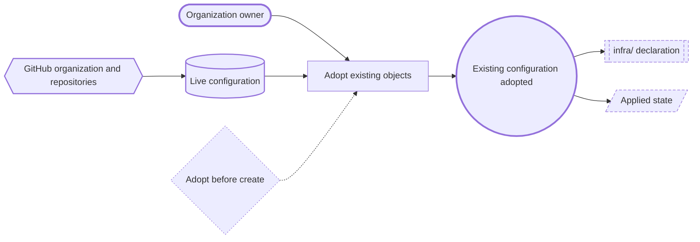
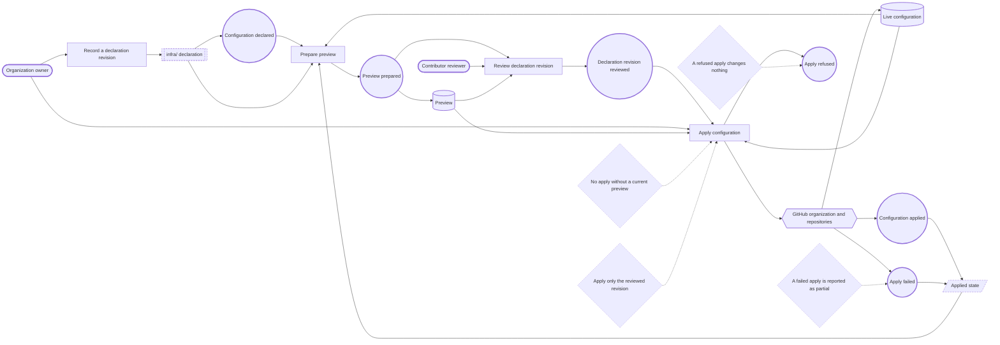
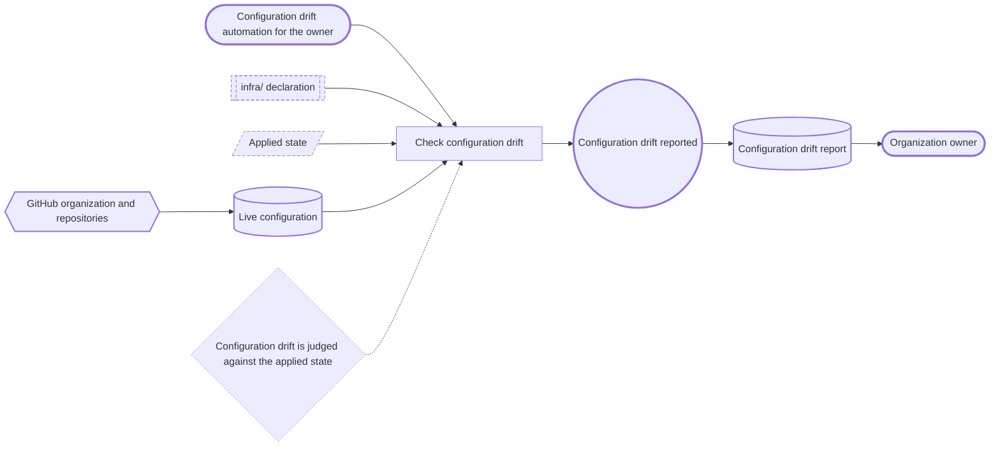

# Public-home infrastructure — Event Storming

Status: revised 2026-10-17 after the Event Storming boundary review; six
blocking and nine advisory findings applied. The event chain and the three
canvases below cover the same elements. Terms used here are the six confirmed
in `domain-terms.md`; "applied state", "preview" and "configuration drift
report" are artifact labels for a record and two read models, not domain
terms.

## Consistency boundary

This domain has **no aggregate**, and the canvases mint none. The declared
configuration is a specification; the organization and its repositories are an
external system; the applied state is a record; the preview and the
configuration drift report are read models. The project's only declared
aggregate — the Duty-plan calendar — belongs to the conversion use case and is
unrelated.

The apply boundary is one declaration revision with one preview of it. The
provider's apply is **not assumed transactional**: a refusal before the first
write leaves the live configuration unchanged (P4), and a failure after the
first write is reported as partial with the state marked stale (P6). Nothing
in this model claims an all-or-nothing apply.

## Declared objects (Frame coverage)

| Object | Properties in scope | Live state on 2026-10-17 |
|---|---|---|
| Organization `duty2cal` | Name, description, blog, email; default repository permission; members' repository-creation rights | Profile fields empty; default permission `read`; members may create public and private repositories; one member |
| `duty2cal/duty2cal` | Description, topics, features (issues, wiki, projects, discussions), merge strategies, delete-branch-on-merge, secret scanning, secret-scanning push protection, Dependabot alerts, Dependabot security updates | Projects on, wiki off, discussions off; all three merge methods allowed; delete-branch-on-merge off; secret scanning and push protection off; Dependabot security updates on |
| `duty2cal/duty2cal` protection | Protection ruleset; classic branch protection | Ruleset `main protection` active (deletion, non-fast-forward, linear history) and classic branch protection with the same rules; both undecided as declarations (Q9) |
| `duty2cal/duty2cal` secret | `PAGES_DEPLOY_KEY` | No repository secrets |
| `duty2cal/duty2cal.github.io` | Description, features, protection ruleset, Pages source, deploy key | Issues, projects and wiki on; Pages built from `main` at `/`; no deploy keys |
| Outside the declaration | Release immutability, private vulnerability reporting, attestations | Immutable releases on; private vulnerability reporting off; attestations absent |

## Actors

| Actor | Kind |
|---|---|
| Organization owner | Primary; declares, previews, applies, adopts. |
| Contributor reviewer | Supporting; reviews a declaration revision; cannot apply. |
| Configuration drift automation for the owner | Supporting; acts for the owner; checks and reports. |

## Policies

| ID | Policy | Enforced by |
|---|---|---|
| P1 | Adopt before create: an apply that would create an object already present in the live organization is refused until the object is adopted. | The apply's preconditions |
| P2 | No apply without a current preview: the apply refuses a declaration revision that differs from the previewed one. | The apply's preconditions |
| P3 | Apply only the reviewed revision: the revision applied is the one the reviewer saw. Whether review gates the apply or is advisory is open (Q10). | The apply's preconditions |
| P4 | A refused apply changes nothing: a refusal before the first write leaves the live configuration unchanged and names the object and the reason. | The apply command |
| P5 | Configuration drift is judged against the applied state: missing, unreadable or stale state is reported as unavailable, never as "no configuration drift". | The configuration drift check |
| P6 | A failed apply is reported as partial: after the first write the live configuration may differ, and the applied state is marked stale or unavailable. | The apply command |

## Event chain

| Event | Actor | Command | Changes | Produces | Consults | Policy |
|---|---|---|---|---|---|---|
| Existing configuration adopted | Organization owner | Adopt existing objects | Declaration and applied state | — | Live configuration | P1 |
| Configuration declared | Organization owner | Record a declaration revision | Declaration revision | — | — | P2 |
| Preview prepared | Organization owner | Prepare preview | — | Preview | Declaration revision, applied state, live configuration | P2 |
| Declaration revision reviewed | Contributor reviewer | Review declaration revision | The review decision | Review outcome | Preview | P3 (open: Q10) |
| Configuration applied | Organization owner | Apply configuration | Live configuration | Applied state | Declaration revision, preview, live configuration | P3, P4 |
| Apply refused | Organization owner | Apply configuration | Nothing | Refusal naming the object and reason | Declaration revision, preview | P4 |
| Apply failed | Organization owner | Apply configuration | Live configuration, partially | Applied state marked stale or unavailable | Declaration revision, live configuration | P6 |
| Configuration drift reported | Configuration drift automation for the owner | Check configuration drift | — | Configuration drift report | Declaration, applied state, live configuration | P5 (open: Q4) |

Reverse narrative: "Configuration applied" is possible only after a
"Declaration revision reviewed", which needs a "Preview prepared", which needs
"Configuration declared". The first apply additionally needs "Existing
configuration adopted", because the organization and both repositories already
exist; that adoption is possible only because the organization exists, which
is a manual precondition outside the chain. "Configuration drift reported"
needs the applied state, the declaration and the live configuration; it does
not depend on a change.

## Read models

| Read model | Contents | Used by |
|---|---|---|
| Live configuration | What GitHub currently holds for each declared object. | Adoption, preview, apply, configuration drift check |
| Preview | Every difference between the declaration revision and the live configuration, named by object and field. | Reviewer, apply preconditions |
| Configuration drift report | The same comparison at a point in time, with the state's availability and age; "unavailable" is distinct from "no differences". | Organization owner |

## Canvas conventions

Shapes distinguish the kinds; solid arrows show cause and production, dotted
arrows show a policy governing a command. The same convention holds in all
three canvases.

| Shape | Kind |
|---|---|
| Stadium | Actor |
| Rectangle | Command |
| Circle | Event |
| Double-bordered rectangle | Specification |
| Hexagon | External system |
| Rhombus | Policy |
| Cylinder | Read model |
| Parallelogram | Record |

### One-time adoption

### Every configuration change

### Configuration drift report

## What the model leaves out

- Publishing the website: the deploy key and secret are declared objects, but
  the build-and-publish chain belongs to the website topic.
- Release tagging, archive assembly and attestations: release-time facts, not
  configuration.
- Ruleset shape (Q2, Q3), review gating (Q10) and setting values (Q5) change
  what the configuration change's rules and declaration contain; state access
  (Q4) changes how the configuration drift check reads the applied state and
  remains open; team access (Q6) stays outside the confirmed Frame.
