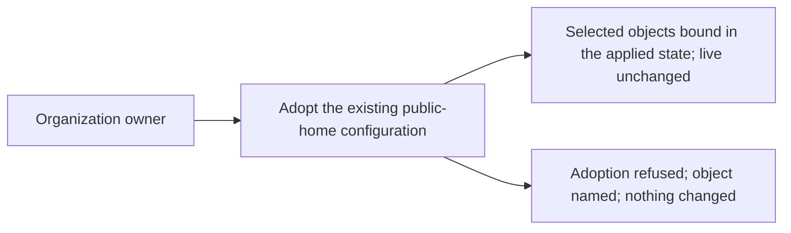

# Use case: adopt-existing-configuration

Status: elaborated and corrected 2026-10-17 after the Use Case Elaboration
boundary review (nine blocking and eleven advisory findings applied). This is
a topic-local contract, not a permanent use case, proposal, specification
delta, or implementation authorization.

Name: Adopt the existing public-home configuration

Source topic: Public-home infrastructure (`public-home-infrastructure`). Full
alternatives remain in `../questions.md`.

## Level

!

## Actors

- Organization owner — primary Actor; holds administration authority, records
  the declared configuration and adopts the objects that already exist.
- Supporting: none in this flow. The contributor reviewer reviews the adopted
  declaration as a Persona lens; adoption has no review step whose outcome
  changes its guarantee.

## Goal

Place the already-existing objects of the public home under the declared
configuration without changing them.

## Trigger

The owner begins declaring the objects that already exist in the organization
and its repositories.

## Preconditions

- The organization and both repositories exist.
- The owner can request the adoption.
- The declared configuration may not exist yet; recording its first revision is
  part of the flow.
- An applied state record may or may not exist; where it lives is open (Q4).

## Main flow

1. Actor selects the existing in-scope objects to adopt; System reads their
   live configuration and checks the applied state, refusing any object it
   cannot read or that is already bound.
2. Actor states the intended values for each object; System records them as a
   revision of the declared configuration (the first when none exists).
3. Actor asks to adopt the objects; System binds each declared object to its
   existing live counterpart and records the binding in the applied state,
   without creating, modifying or deleting any live object.
4. Actor wants to know what was adopted; System reports every object in the
   selected batch as bound.
5. Actor can stop; the live configuration is unchanged and the first
   configuration change can now be prepared against an adopted state.

## Extensions

- 1: a selected object cannot be read → refuse the whole adoption and name the
  object and the unreadable field; the live configuration is untouched and no
  binding is recorded; protects the success guarantee.
- 1: a selected object is already bound in the applied state → refuse and name
  it; protects the success guarantee and the no-duplicate-binding rule.
- 1: a selected object does not exist in the live configuration → refuse and
  name it; creating it is a configuration change, not an adoption; protects the
  minimal guarantee (P1).
- 1: a selected live object has no declared counterpart → refuse and name the
  undeclared object; protects the success guarantee and the
  declared-vs-state correspondence.
- 2: the declared configuration cannot be recorded → no binding is recorded and
  the declaration failure is named; protects the minimal guarantee.
- 3: the applied state cannot be written → no live change and no binding is
  recorded; name the object and the state failure; the declaration revision
  recorded in step 2 may remain; protects the minimal guarantee.
- 3: a live object changes between the read in step 1 and the binding in step 3
  → refuse and name the object; adoption binds an identity, and a changed
  object needs a fresh read; protects the success guarantee.

## Rules

- Adoption applies only to objects that already exist in the live
  organization. An object that already exists live but is not adopted is never
  updated or recreated by an apply; the apply refuses it and points to
  adoption (P1). A declared object absent from live is created by a
  configuration change.
- Adoption changes no live object: no create, update, delete, permission
  change, or feature toggle. Declared values may differ from live values; the
  difference is left for the first preview, not reconciled by adoption.
- The applied state binds an identity, not a copy of the live values.
- The adopted batch is the selected set; the success guarantee covers that set.
  The whole batch is adopted or none is: one unreadable, already-bound or
  unbindable object refuses the batch and names it.
- The deploy key and the `PAGES_DEPLOY_KEY` secret do not exist and are never
  adopted; the first configuration change creates them.
- The classic branch protection and the ruleset are both adopted only if Q9
  keeps both; if Q9 consolidates, adoption binds the ruleset and a later
  configuration change retires the classic protection. (open: Q9)
- Which declared values are intended versus copied from live is Q5; adoption
  itself is neutral. (open: Q5)
- Where the binding is recorded is the state-access question (Q4). (open: Q4)

## Examples

The declared values marked "illustrative" depend on Q5 and are not a decision.

| Example | Supplied facts | Observable outcome |
|---|---|---|
| Adopt the monorepo | Live: projects on, all merge methods allowed, delete-branch-on-merge off. Declared (illustrative; Q5 open): projects off, squash-only. | The repository is bound in the applied state; live stays projects on / all merges. The first preview later names the differences. |
| Adopt the organization | Live profile name, description and blog empty; default permission `read`; members may create public and private repositories. Declared description and blog supplied (illustrative; Q5 open). | The organization is bound; no profile field changes. |
| Adopt the ruleset | Live ruleset `main protection` (deletion, non-fast-forward, linear history). | The ruleset is bound by identity; no rule changes. |
| Adoption of a missing object | The declared configuration names `duty2cal/example`; no such repository exists. | Adoption refuses and names the object; nothing is created; the owner needs a configuration change to create it. |
| Adoption twice | The monorepo is already bound in the applied state. | The second adoption refuses and names the repository; no duplicate binding appears. |
| Unreadable scope | The owner's authority can read the repositories but not the organization settings. | Adoption refuses the batch and names the organization settings; nothing is bound and no live object changes. |
| Pages source | Pages is built from `main` at `/`. | The Pages source is bound; the site is not rebuilt and no deploy key or secret appears. |

## Scenario skeletons

- Given the organization and both repositories exist and the declared
  configuration names the selected objects; When the owner adopts them; Then
  every object in the batch is bound in the applied state and the live
  configuration is unchanged.
- Given a declared object that does not exist live; When the owner adopts the
  batch; Then the adoption is refused, the object is named, and nothing is
  created.
- Given an object already bound in the applied state; When adoption runs
  again; Then it is refused and no duplicate binding is recorded.
- Given a selected object cannot be read; When adoption runs; Then the batch
  is refused, the object is named, and no live object changes.
- Given the applied state cannot be written; When adoption binds; Then no
  binding is recorded, the failure is named, and the live configuration is
  unchanged.

## Minimal guarantee

No live object is created, modified or deleted; a failed adoption records no
binding and names the object; the applied state never binds an object the
declared configuration does not name; a declaration revision recorded before a
later failure may remain in the repository, but the applied state records no
binding for it.

## Success guarantee

Every already-existing object in the selected batch is named by the declared
configuration and bound in the applied state, with the live configuration
unchanged. Objects Q9 leaves for a later change are not part of the batch.
(open: Q9)

This is a changing use case: it writes the declared configuration and the
applied state, never the live configuration.

## Personas

- [Organization owner](../personas/project-maintainer--organization-owner.md)
  (`project-maintainer--organization-owner`) — confirmed administration review
  lens; not a Gherkin Actor biography.
- [Contributor reviewer](../personas/contributor--infrastructure-reviewer.md)
  (`contributor--infrastructure-reviewer`) — confirmed review lens on the
  adopted declaration; not an Actor with an approval step here.

## Capabilities

- none — ideation contract; normal proposal/spec work maps capabilities beneath
  this same stable leaf ID.

## Interactions

- none — concrete changing interactions and executable coverage are authored in
  the normal workflow, not during ideation.

## Includes

- none

## Extends

- none

## Out of scope

- Creating the organization or transferring a repository into it.
- Creating any new object, enabling a feature, or writing a live settings
  value.
- Publishing the website.
- Setting release immutability or private vulnerability reporting.
- Managing teams or membership (open: Q6).
- Repairing an already-published release.

## Diagram

The full kind-labelled command/event canvas is in `../eventstorming.md`.
