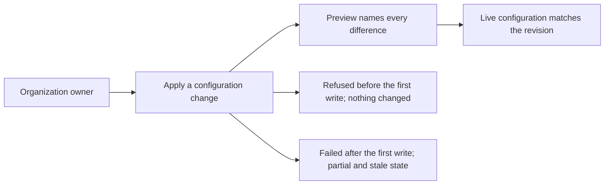

# Use case: apply-configuration-change

Status: elaborated and corrected 2026-10-17 after the Use Case Elaboration
boundary review (nine blocking and eleven advisory findings applied). This is
a topic-local contract, not a permanent use case, proposal, specification
delta, or implementation authorization.

Name: Apply a configuration change

Source topic: Public-home infrastructure (`public-home-infrastructure`). Full
alternatives remain in `../questions.md`.

## Level

!

## Actors

- Organization owner — primary Actor; records the declared configuration
  revision, previews it, applies it and answers for the outcome.
- Supporting: Contributor reviewer — reads the revision and its preview and
  records a review outcome, when review is part of the flow (open: Q10).

## Goal

Make the live configuration match the declared configuration revision the
apply accepts.

## Trigger

The owner begins a configuration change by recording a revision of the
declared configuration.

## Preconditions

- The organization and both repositories exist.
- The owner can request the configuration change.

## Main flow

1. Actor records the intended values as a revision of the declared
   configuration; System keeps that revision as the candidate for preview and
   apply.
2. Actor asks for a preview; System reads the applied state, the live
   configuration and the revision, and names every difference by object and
   field.
3. When review is part of the flow (open: Q10), the contributor reviewer reads
   the preview and the revision and records a review outcome.
4. Actor asks to apply; System checks that the revision is the previewed one,
   that the live configuration still matches what the preview saw, that no
   existing object would be created, and — if review gates — that the outcome
   allows it. Then System changes the live configuration object by object.
5. Actor wants the outcome; System reports every object it changed and records
   the applied revision in the applied state.
6. Actor can stop; the live configuration matches the revision and the applied
   state records it.

## Extensions

- 2: the live configuration or the applied state cannot be read → refuse the
  preview and name the object and field; protects the success guarantee.
- 2: the declared revision is invalid → refuse the preview and name the
  problem; protects the success guarantee.
- 2: the revision removes an object the declaration no longer names → the
  preview reports the intended removal; whether an apply may delete it is open
  (Q11); protects the success guarantee.
- 4: the revision differs from the previewed one → refuse the apply, name the
  revision mismatch, and require a new preview; protects the success guarantee
  and the current-preview rule (P2).
- 4: the live configuration changed since the preview (a manual edit) → refuse
  and require a new preview; protects the success guarantee and the
  no-silent-overwrite rule.
- 4: an object would be created that already exists live and is not adopted →
  refuse and name it; the owner adopts it first; protects the minimal
  guarantee (P1).
- 4: review gates and no approval is recorded (open: Q10) → refuse and name the
  missing approval; protects the success guarantee (P3).
- 4: the owner's authority does not cover the first object → refuse before any
  write and name the object; nothing changes; protects the minimal guarantee.
- 4: the first live change succeeds and a later object fails → report the
  applied objects, the failed object and the reason; mark the applied state
  stale; protects the minimal guarantee and the truthful-reporting rule (P6).
- 4: an apply would delete a repository, the organization, or a published
  release → refuse; protects the minimal guarantee. What may be deleted is open
  (Q11).

## Rules

- The applied revision is exactly the previewed revision (P2).
- An existing object the declaration names must be readable, or the apply
  refuses it. A declared object absent from live is created by the apply and
  is not a readability failure.
- An object that already exists live must be adopted before it is updated; a
  new object is created when it does not exist live and the declaration adds
  it.
- Review's role is open: gating or advisory (Q10).
- A refused apply makes no live change; a failed apply after the first write is
  reported as partial and its applied state is stale (P4, P6).
- The applied revision is recorded only when every object succeeded; after a
  partial failure the applied state is marked stale or unavailable.
- The apply never deletes a repository, the organization, or a published
  release; which lesser objects may be removed is open (Q11).
- Settings the owner's authority cannot read are not declared silently; the
  preview names them as unread.
- The deploy key and `PAGES_DEPLOY_KEY` secret are created by the first
  configuration change that adds them; they are not adoption content.
- Which declared values are intended versus copied from live is Q5. (open: Q5)
- The ruleset shape (pull requests, bypass actors) is Q2 and Q3. (open: Q2,
  Q3)

## Examples

The declared values marked "illustrative" depend on Q5 and are not a decision.

| Example | Supplied facts | Observable outcome |
|---|---|---|
| Enable scanning | Declared: secret scanning and push protection enabled. Live: both off. | Preview names the two fields; apply enables them; the applied state records the revision; no other object changes. |
| Change an organization default | Declared: default repository permission `write`. Live: `read`. | Preview names the organization field; apply changes it; the applied state records the revision. |
| First publish plumbing | Declared: `duty2cal/duty2cal.github.io` deploy key and the monorepo `PAGES_DEPLOY_KEY` secret. Neither exists live. | Preview names two creations; apply creates both; no existing object is touched. |
| Revision changed after preview | Preview of revision A; the declared configuration is edited to revision B before apply. | Apply refuses with a revision mismatch; no live change; a new preview is required. |
| Unadopted repository | The declared configuration names `duty2cal/duty2cal.github.io` but the applied state has no binding. | Apply refuses and names the repository; adoption runs first. |
| Authority before the first write | The owner's authority covers the repositories but not the organization settings. | Apply refuses before any write and names the organization settings; nothing changes. |
| Partial failure | The organization field applies; the ruleset update then fails on authority. | Report names the applied field, the failed ruleset and the reason; the applied state is stale; the next configuration drift check reports the state unavailable. |
| Manual edit since preview | Live `has_projects` was changed by hand after the preview that saw it on. | Apply refuses and requires a new preview; the manual change is not overwritten silently. |

## Scenario skeletons

- Given a declared configuration revision with a current preview; When the
  owner applies it; Then every named object matches the revision and the
  applied state records it.
- Given the declared configuration changed after its preview; When the owner
  applies it; Then the apply is refused, the revision mismatch is named, and
  the live configuration is unchanged.
- Given an existing object the revision updates that was never adopted; When
  the owner applies it; Then the apply is refused and the object is named.
- Given the first live change succeeds and a later object fails; When the
  owner applies; Then the outcome is reported as partial, the failed object is
  named, and the applied state is stale.
- Given review gates and no approval is recorded (open: Q10); When the owner
  applies; Then the apply is refused and the missing approval is named.
- Given a revision that would delete a repository (open: Q11); When the owner
  applies it; Then the apply is refused and the repository is named.

## Minimal guarantee

A refusal before the first live write leaves the live configuration and the
applied state unchanged; a failure after the first write is reported as
partial with the applied state marked stale or unavailable; no already-existing
object is recreated; no repository, organization or published release is
deleted; the failure names the object and the reason.

## Success guarantee

The live configuration matches the declared configuration revision the apply
accepted for every object the revision retains, and the applied state records
that revision. Removals follow Q11. (open: Q11)

This is a changing use case: it changes the live organization and
repositories.

## Personas

- [Organization owner](../personas/project-maintainer--organization-owner.md)
  (`project-maintainer--organization-owner`) — primary administration lens.
- [Contributor reviewer](../personas/contributor--infrastructure-reviewer.md)
  (`contributor--infrastructure-reviewer`) — review lens; gating is open (Q10).
- [Crew member](../personas/crew-member--personal-calendar-owner.md)
  (`crew-member--personal-calendar-owner`) — the monorepo ruleset must not
  block the release channel (open: Q3); the Pages configuration must keep the
  publish path working (open: Q2). The same lens covers the future site
  visitor for the Pages configuration.

## Capabilities

- none — ideation contract; normal proposal/spec work maps capabilities beneath
  this same stable leaf ID.

## Interactions

- none — concrete changing interactions and executable coverage are authored in
  the normal workflow, not during ideation.

## Includes

- none

## Extends

- none

## Out of scope

- Adopting an already-existing object.
- Publishing the website.
- Setting release immutability or private vulnerability reporting.
- Managing teams or membership (open: Q6).
- Creating the organization or transferring a repository into it.
- Repairing a published release.

## Diagram

The full kind-labelled command/event canvas is in `../eventstorming.md`.
