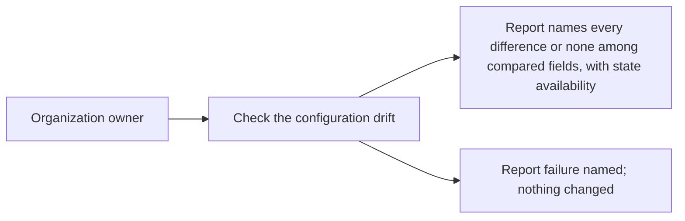

# Use case: check-configuration-drift

Status: elaborated and corrected 2026-10-17 after the Use Case Elaboration
boundary review (nine blocking and eleven advisory findings applied). This is
a topic-local contract, not a permanent use case, proposal, specification
delta, or implementation authorization.

Name: Check the configuration drift

Source topic: Public-home infrastructure (`public-home-infrastructure`). Full
alternatives remain in `../questions.md`.

## Level

!

## Actors

- Organization owner — primary Actor; asks for the check and reads the report.
- Supporting: Configuration drift automation for the owner — a non-human actor
  that performs the check on the owner's behalf; it has no independent goal.

## Goal

Obtain a report of every difference between the declared configuration and the
live configuration.

## Trigger

The owner checks the configuration drift, directly or through the automation
acting for the owner.

## Preconditions

- The owner can request the check.

## Main flow

1. Actor asks for a configuration drift check; System reads the declared
   configuration, the applied state's availability and age, and the live
   configuration.
2. System compares every declared object and field with the live
   configuration.
3. System compares the declared object set with the live object set and
   identifies live objects the declaration does not name.
4. System produces the report: every difference it found by object and field,
   or the exact statement that no differences were found among the compared
   fields; every field it could not read as unchecked; the applied state's
   availability and age when available; and the observation time.
5. Actor reads the report; the live configuration and the applied state are
   unchanged.

## Extensions

- 1: the declared configuration is missing or invalid → no report is produced;
  the failure names the declared configuration and the reason; protects the
  success guarantee.
- 1: the applied state is missing, unreadable or stale → the comparison still
  runs; the report states the state's availability and, when available, its
  age, and never concludes "no configuration drift"; protects the minimal
  guarantee.
- 2: a declared object or field cannot be read live → it is reported
  unchecked, never equal; protects the success guarantee, which counts only
  compared fields.
- 2: a declared object does not exist live → it is reported as missing, a
  difference.
- 3: a live object is not declared → it is reported as undeclared, a
  difference; it is never silently ignored.
- 4: the check runs where the applied state is unreachable (open: Q4) → the
  report states the state unavailable; differences visible from the declared
  configuration and the live configuration are still named.
- 4: the automation cannot authenticate → no report; the failure names the
  cause and no partial report is presented as complete; protects the minimal
  guarantee.

## Rules

- Configuration drift is a difference between the declared configuration and
  the live configuration. The applied state's availability and age are
  properties of the report, not a source of drift.
- The exact statement of an empty comparison is: "No differences were found
  among the compared fields." When the applied state was unavailable, the
  statement continues: "The applied state is unavailable (<reason>), so this
  is not a statement of no configuration drift."
- A field that could not be read is unchecked, never equal.
- An undeclared live object is a difference.
- The check never mutates the live configuration or the applied state.
- The report is a snapshot with an observation time; it is not continuous
  monitoring and does not raise alerts by itself.
- The automation's report is attributed to the owner's request; the owner reads
  and acts on it.
- CI execution is conditional on the state access (Q4). (open: Q4)

## Examples

| Example | Supplied facts | Observable outcome |
|---|---|---|
| Scanning switched off by hand | Declared: secret scanning enabled. Live: disabled. | One difference named for secret scanning. |
| State missing | No applied state exists; declared values match live. | Report says no differences were found among the compared fields and that the applied state is unavailable (not found), so this is not a statement of no configuration drift. |
| Manual project toggle | Declared: projects off (illustrative; Q5 open). Live: projects on. | One difference named for `has_projects`. |
| Undeclared repository | Live contains `duty2cal/scratch`; the declared configuration does not. | The repository is reported undeclared, a difference. |
| Unreadable setting | The owner's authority can read the repositories but not the organization settings. | The organization settings are reported unchecked; they are not counted as equal. |
| CI without state access | The scheduled check runs with no applied state available (open: Q4). | Report states the state unavailable and still names differences visible without it. |

## Scenario skeletons

- Given a declared configuration and a readable live configuration; When the
  owner checks the configuration drift; Then the report names every difference
  or states that none was found among the compared fields, and the live
  configuration is unchanged.
- Given no applied state exists; When the owner checks; Then the report states
  the state unavailable and does not conclude "no configuration drift".
- Given a declared field the owner's authority cannot read; When the owner
  checks; Then the field is reported unchecked and not counted as equal.
- Given a live object the declared configuration does not name; When the owner
  checks; Then the object is reported undeclared, a difference.
- Given a scheduled check without access to the applied state (open: Q4); When
  it runs; Then the report states the state unavailable and names the
  differences it could compare.

## Minimal guarantee

The live configuration and the applied state are unchanged; a missing,
unreadable or stale applied state is reported as unavailable; an unreadable
field is reported unchecked and never counted as equal; a failure to produce a
report is named and no partial report is presented as complete.

## Success guarantee

The owner receives a report that names every difference it found among the
compared objects and fields, marks every field it could not compare as
unchecked, or states that no differences were found among the compared fields;
the report states the applied state's availability and, when available, its
age; and it states the observation time.

This is an observing use case: it reads the declared configuration, the applied
state and the live configuration and changes none of them.

## Personas

- [Organization owner](../personas/project-maintainer--organization-owner.md)
  (`project-maintainer--organization-owner`) — confirmed administration review
  lens; reads and acts on the report.
- [Contributor reviewer](../personas/contributor--infrastructure-reviewer.md)
  (`contributor--infrastructure-reviewer`) — confirmed review lens on the
  evidence; cannot act on it.

## Capabilities

- none — ideation contract; normal proposal/spec work maps capabilities beneath
  this same stable leaf ID.

## Interactions

- none — concrete observing interactions and executable coverage are authored
  in the normal workflow, not during ideation.

## Includes

- none

## Extends

- none

## Out of scope

- Applying a correction for a reported difference.
- Declaring and adopting an object as part of this use case.
- Continuous monitoring, alert routing, or an on-call response.
- Publishing the website.
- Setting release immutability or private vulnerability reporting.
- Managing teams or membership (open: Q6).

## Diagram

The full kind-labelled command/event canvas is in `../eventstorming.md`.
