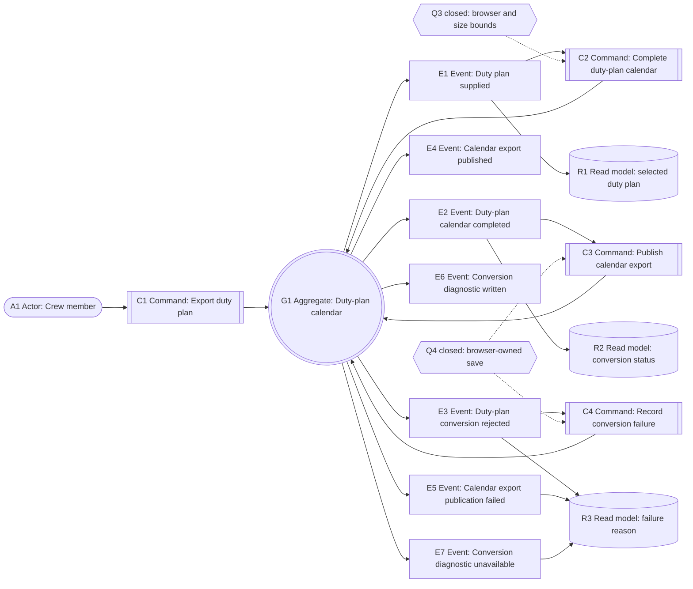
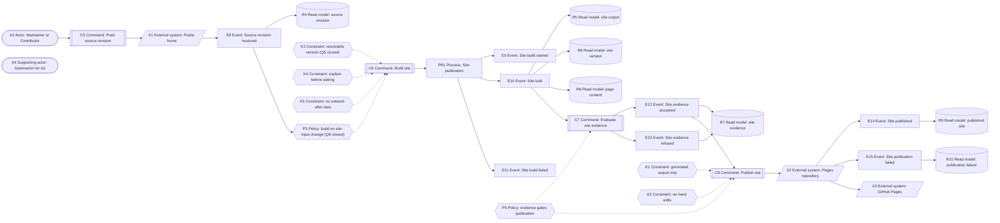
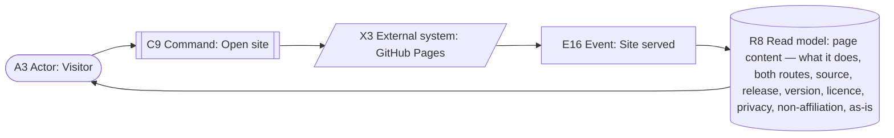

# Public website — event storming

Status: revised 2026-10-19 after the Event Storming and Use Case Definition
reviews. The chain uses the confirmed aggregate's own commands and events; the
browser's realization of publication and diagnosis is decided by Q4 and is
recorded in the use-case contract. The only aggregate
is the existing **Duty-plan calendar**. The site's build and publication are a
process; the target repository and GitHub Pages are external systems.

## Element inventory

Every element in the table and the canvases carries one of these IDs.

| Kind | Elements |
|---|---|
| Actors | A1 Crew member; A2 Maintainer or Contributor; A3 Visitor; A4 Automation for the Maintainer (supporting) |
| Aggregate | G1 Duty-plan calendar (confirmed in the glossary) |
| Commands | C1 Export duty plan; C2 Complete duty-plan calendar; C3 Publish calendar export; C4 Record conversion failure; C5 Push source revision; C6 Build site; C7 Evaluate site evidence; C8 Publish site; C9 Open site |
| Events | E1–E7 conversion; E8–E16 site |
| Policies | P3 Build on site-input change (path-filtered `main`; Q8 closed); P5 Evidence gates publication |
| Constraints | K1 Generated output only; K2 No hand edits; K3 Resolvable version (`git describe`; Q5 closed); K4 Explain before asking; K5 No network after load |
| Read models | R1 Selected duty plan; R2 Conversion status; R3 Failure reason; R4 Source revision; R5 Site output; R6 Site version; R7 Site evidence; R8 Page content; R9 Published site; R10 Publication failure |
| External systems | X1 Public home (GitHub source repository); X2 Pages repository (write target); X3 GitHub Pages (serving service) |
| Process | PR1 Site publication |

## The chain

| # | Event | Triggered by | Command | Boundary | Policy / constraint | Read model |
|---|---|---|---|---|---|---|
| E1 | Duty plan supplied | A1 Crew member | C1 Export duty plan | G1 Duty-plan calendar | None | R1 Selected duty plan |
| E2 | Duty-plan calendar completed | System for A1 | C2 Complete duty-plan calendar | G1 Duty-plan calendar | Q3 closed: capability-based evergreen support, 20 MiB | R2 Conversion status |
| E3 | Duty-plan conversion rejected | System for A1 | C2 Complete duty-plan calendar | G1 Duty-plan calendar | Q3 closed: capability-based evergreen support, 20 MiB | R3 Failure reason |
| E4 | Calendar export published | System for A1 | C3 Publish calendar export | G1 Duty-plan calendar | Q4 closed: browser-owned save; the page offers and writes nothing | R2 Conversion status |
| E5 | Calendar export publication failed | System for A1 | C3 Publish calendar export | G1 Duty-plan calendar | Q4 closed: browser-owned save | R3 Failure reason |
| E6 | Conversion diagnostic written | System for A1 | C4 Record conversion failure | G1 Duty-plan calendar | Q4 closed: diagnostic offered as text, never claimed saved | R3 Failure reason |
| E7 | Conversion diagnostic unavailable | System for A1 | C4 Record conversion failure | G1 Duty-plan calendar | Q4 closed: primary failure stays visible | R3 Failure reason |
| E8 | Source revision received | A2 Maintainer or Contributor | C5 Push source revision | X1 Public home | None | R4 Source revision |
| E9 | Site build started | A4 Automation for A2 | C6 Build site | PR1 Site publication | P3 (supplied; Q8) | R4 Source revision |
| E10 | Site built | A4 Automation for A2 | C6 Build site | PR1 Site publication | K3, K4, K5 | R5 Site output; R6 Site version; R8 Page content |
| E11 | Site build failed | A4 Automation for A2 | C6 Build site | PR1 Site publication | K3, K4, K5 | R5 Site output (absent); R7 Site evidence |
| E12 | Site evidence accepted | A4 Automation for A2 | C7 Evaluate site evidence | PR1 Site publication | P5 | R7 Site evidence |
| E13 | Site evidence refused | A4 Automation for A2 | C7 Evaluate site evidence | PR1 Site publication | P5 | R7 Site evidence |
| E14 | Site published | A4 Automation for A2 | C8 Publish site | X2 Pages repository | K1, K2 | R9 Published site |
| E15 | Site publication failed | A4 Automation for A2 | C8 Publish site | X2 Pages repository | K1, K2 | R10 Publication failure |
| E16 | Site served | X3 GitHub Pages for A3 | C9 Open site | X3 GitHub Pages | None | R8 Page content |

## Channel realizations of E4 and E6

The aggregate's events are realized differently by the two channels:

- **E4 Calendar export published** — the executable writes the calendar beside
  the source under an unused name; the browser offers the complete calendar
  for saving and the page writes nothing. The browser realization is the Q4
  decision, not a second event.
- **E6 Conversion diagnostic written** — the executable writes a numbered
  diagnostic beside the source; the browser offers a text download named for
  the source and never claims a save. A failed offer leaves the primary
  failure visible.

The glossary's lifecycle-event wording is generalized by the change seed to
name both realizations; this storm does not silently replace the executable's
event.

## Policies and constraints

Policies are reactions that govern a command; constraints are invariants a
command must preserve. Both are drawn as governance edges (dotted) to the
command they govern, never as producers of events.

| ID | Kind | Statement | Governs |
|---|---|---|---|
| P3 | Policy | A revision that changes the site's inputs requests a build; a revision that changes none of them does not. Path-filtered `main` (Q8 closed). | C6 Build site |
| P5 | Policy | Publication happens only after the conversion test, the browser check and the licensing/REUSE check pass; a failed check is named and the previous site stays in place. | C7 Evaluate site evidence; C8 Publish site |
| K1 | Constraint | The build produces the Site output (page, script and WASM bundle) and the licence file from the monorepo; the Pages repository receives only built files. | C8 Publish site |
| K2 | Constraint | The Pages repository is never edited by hand; the next build replaces its content. | C8 Publish site |
| K3 | Constraint | The footer names a source revision the repository can resolve; `git describe` output linked to the commit (Q5 closed). | C6 Build site |
| K4 | Constraint | The page states what it does, both conversion routes, the source, the release, the licence, the privacy rule, the non-affiliation statement and the as-is statement before it asks for a file. | C6 Build site |
| K5 | Constraint | After the page has loaded, no page action sends the plan or any data to another origin; the CSP declares the claim and the browser check proves it. | C6 Build site; C7 Evaluate site evidence |

## Canvas 1 — Browser conversion

## Canvas 2 — Site build and publication

## Canvas 3 — Serving and reading

## Reverse narrative

- To publish a site (E14), the evidence must have been accepted (E12), which
  requires a built site (E10) and a source revision (E8) that changed the
  site's inputs (P3, Q8). The build is bounded by the version rule (K3, Q5),
  the page's public statements (K4), and the no-network rule (K5).
- To serve a page (E16), a site must have been published (E14) into the Pages
  repository (X2), which GitHub Pages (X3) serves. The prior topic's
  `publish-site-plumbing` seed supplies the deploy key and the
  `PAGES_DEPLOY_KEY` secret; the Pages source is `main` at `/`. Neither is a
  domain event; both are prerequisites owned outside this topic.
- To complete a calendar (E2), a duty plan must have been supplied (E1) and
  the browser must be within the supported bounds (Q3). To publish it (E4),
  the aggregate's publication command must succeed; how the browser realizes
  that publication is Q4.
- A refused build (E11), refused evidence (E13), failed publication (E15) and
  rejected conversion (E3) are the failure partners of E10, E12, E14 and E2.
  No failure is silently converted into a success.
- The diagnostic events (E6/E7) are the failure partners of the publication
  failure, not of the conversion rejection alone; the browser's realization is
  Q4.

## Boundaries and non-aggregates

- **Duty-plan calendar** is the existing aggregate from the glossary. The
  browser conversion changes its driving adapter and its channel, not its
  consistency boundary. The aggregate's confirmed commands and events are used
  unchanged; the only open part is how a browser realizes publication and
  diagnosis (Q4).
- **Site publication** is a process (PR1), not an aggregate: it has no
  invariant over a set of entities. The "generated output only" and "no hand
  edits" rules are constraints K1/K2 on the publish command, not an aggregate
  invariant.
- **Public home** (X1), the **Pages repository** (X2) and **GitHub Pages**
  (X3) are external systems. The Pages repository is the write target and the
  published record; GitHub Pages serves it.
- **Site output**, **site version**, **site evidence**, **page content**,
  **published site**, **publication failure**, **source revision** and the
  conversion read models are projections, not entities.
- No new aggregate is minted by this topic. If the use-case elaboration needs
  a write boundary for the site, it must be introduced as a domain term and
  confirmed first.

## Closed decisions carried by the storm

- Q3 — capability-based evergreen support, 20 MiB plans (E2/E3, P5 evidence).
- Q4 — browser-owned save; the page offers, writes nothing, never claims a
  save; the diagnostic is offered as text (E4–E7).
- Q5 — `git describe` revision linked to the commit (K3).
- Q6 — redirect and custom domain out of scope (outside these canvases).
- Q7 — one change seed; the profile copy follows the live site; the README is
  a source revision (K4).
- Q8 — path-filtered `main` (P3, E9).
