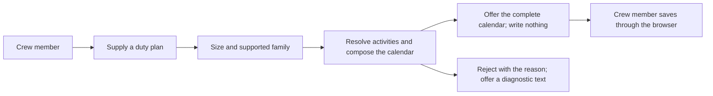

# Use case: export-duty-plan-calendar — browser capability

Status: revised 2026-10-19 after the Use Case Elaboration boundary review.
This file elaborates the browser delta of the permanent use case
`export-duty-plan-calendar`; it does not replace or re-elaborate the permanent
contract. The permanent contract remains authoritative for the conversion
rules, and the change seed maps this delta into it.

## Level

! (the permanent leaf's level; the browser capability is not a separate goal)

## Actors

- Crew member — primary Actor; supplies one duty plan through the Public
  website and saves the offered calendar.
- Supporting: none. The page and the WASM converter perform internal
  responsibilities for the Crew member, not an independent actor goal.

## Goal

Export one published duty plan as an importable personal calendar file.
(Unchanged from the permanent use case.)

## Trigger

The Crew member supplies one duty plan through the Public website.

## Preconditions

- The Public website is loaded in a current browser with WebAssembly and ES
  modules (Q3).

## Main flow

1. Actor selects or drops one duty plan; System receives the file's bytes and
   filename in the page and sends no request.
2. Actor expects the plan to be supported; System checks the size (at most
   20 MiB) and the supported source family, and refuses by name if either
   fails.
3. Actor expects every required activity to be accounted for; System resolves
   the dated activities and travel fragments under the permanent rules,
   rejecting an unresolved required activity rather than excluding it.
4. Actor needs the calendar; System composes the complete RFC 5545 calendar
   under the permanent rules.
5. Actor needs a new file without losing existing outputs; System offers the
   complete calendar under a name derived from the source, writes nothing and
   claims no save; Actor saves the offered file through their environment.
6. Actor can stop; the page shows the offered calendar.

## Extensions

- 2: the plan exceeds 20 MiB → refuse by name and attempt a diagnostic offer;
  protects the minimal guarantee's explicit-failure rule (Q3).
- 2: the source is not the supported Released Roster detail-table family →
  reject with the reason and attempt a diagnostic offer; protects the
  permanent complete-or-explicit-failure guarantee.
- 3: a required activity code, date, time, interval or travel partner cannot
  be resolved → reject with the reason and attempt a diagnostic offer;
  protects the permanent no-silent-omission guarantee.
- 3: the page runs out of memory while parsing → reject; keep the primary
  failure visible; attempt a diagnostic offer; no partial calendar; protects
  the success guarantee's completeness and the minimal guarantee's
  primary-failure rule.
- 5: the page cannot create the offered file → show the failure; do not claim
  success; attempt a diagnostic offer; protects the minimal guarantee's
  "never reports success without an offer" rule.
- 5: the Crew member cancels the save → the page does not claim a save; the
  offer remains or a new conversion is needed; protects the minimal
  guarantee's "never claims a save" rule.
- 2–5: the diagnostic cannot be produced → the primary failure stays visible
  and the page says no diagnostic was offered; protects the minimal
  guarantee's primary-failure rule.

## Rules

- The permanent conversion contract is inherited unchanged: supported source
  family, classification, timing, identities, descriptions, RFC 5545 output
  and the complete-or-explicit-failure boundary. The conversion rules are
  channel-independent; the publication and diagnostic realization is
  channel-specific and is amended by this delta.
- The browser bounds are a current browser with WebAssembly and ES modules and
  plans up to 20 MiB; a larger plan is refused by name (Q3). A browser that
  lacks the capabilities sees an explicit "cannot run" message and no file
  picker.
- The page sends no plan, derived data or other communication to another
  origin: the CSP declares `connect-src 'none'`, no third-party asset is
  loaded, and the plan is not written to persistent storage (localStorage,
  IndexedDB or a cookie) or to a navigable URL or history entry. An ephemeral
  in-memory object URL used to offer the download is allowed and is revoked
  when the page unloads.
- The page writes nothing; the save location and name-collision handling
  belong to the browser; the page never claims a save it did not observe
  (Q4).
- The calendar is offered as `<source-stem>.ics` (for example
  `2026-06.ics`); the browser may add its own suffix when the name exists. The
  page cannot promise an unused numbered name.
- On failure the page shows the reason and offers a diagnostic text as
  `<source-stem>.parse-error.txt` (for example `2026-06.parse-error.txt`); the
  text identifies the source filename and the failure reason, matching the
  permanent diagnostic contract. The browser may rename the offer.
- If the diagnostic text cannot be produced, the primary failure remains
  visible and the page says no diagnostic was offered.

## Examples

| Example | Supplied facts | Observable outcome |
|---|---|---|
| Supported plan | `2026-06.pdf`, within the size bound. | The page offers `2026-06.ics`; the Crew member saves it; the page writes nothing. |
| Existing download | `2026-06.ics` already exists in the download folder. | The browser may add its own suffix; the page never overwrites the first file and cannot control the browser's name. |
| Oversized plan | A 25 MiB PDF. | The page refuses by name and offers no calendar; a diagnostic offer is attempted. |
| Unsupported browser | No WebAssembly. | The page states that it cannot run; no file picker. |
| Unknown activity | A required code the converter cannot resolve. | No calendar; the page shows the reason and offers `2026-06.parse-error.txt` identifying the source and reason. |
| Diagnostic unavailable | The page cannot produce the text. | The primary failure stays visible; the page says no diagnostic was offered. |
| No network | A plan is converted while the browser's request log is observed. | No request to another origin after load. |
| Cancelled save | The Crew member dismisses the save dialog. | The page does not claim a save; the offer remains or a new conversion is needed. |

## Minimal guarantee

The page writes nothing and never reports a save it did not observe; no
existing file is touched by the page; a rejected conversion is never reported
as success; on failure the reason is visible and a diagnostic offer is
attempted; a failed diagnostic offer does not hide the primary failure; no
plan or derived data leaves the page.

## Success guarantee

The Crew member obtains a complete RFC 5545 calendar file representing every
required resolved activity, through the file the page offers for saving. The
conversion rules, identities, descriptions and source family are the permanent
contract's; the offer-and-save channel is the browser delta.

This is a changing use case: it offers a new calendar file.

## Personas

- [Crew member](../personas/crew-member--personal-calendar-owner.md)
  (`crew-member--personal-calendar-owner`) — primary accuracy and privacy
  lens.
- [Release owner](../personas/project-maintainer--release-owner.md)
  (`project-maintainer--release-owner`) — the public claim and the evidence.
- [Web reviewer](../personas/contributor--web-reviewer.md)
  (`contributor--web-reviewer`) — the no-network proof and the page's
  fallback behaviour.

## Capabilities

- none — ideation contract; Handoff maps this delta under the existing
  `export-duty-plan-calendar` leaf.

## Interactions

- none — concrete interactions and executable coverage are authored in the
  normal workflow.

## Includes

- none

## Extends

- none

## Out of scope

- Importing the calendar into a client or reconciling a revised plan.
- A hosted conversion, upload, account or analytics service.
- A new PDF family or a new activity meaning.
- File System Access API writes, page-side directory access, or saving on the
  Crew member's behalf.
- A numbered diagnostic name that the page cannot guarantee.
- Any change to the executable's beside-the-source behaviour.
- The page's Built revision and public statements; those are the Site
  publication's content.

## Diagram

