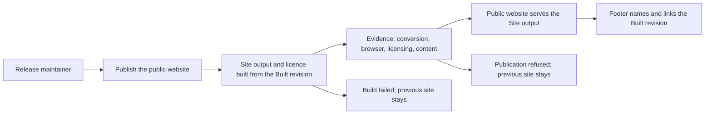

# Use case: publish-public-website

Status: revised 2026-10-19 after the Use Case Elaboration boundary review and the release-coupling decision.
This is a topic-local contract, not a change, proposal or implementation
authorization.

## Level

!

## Actors

- Release maintainer — primary Actor; owns the site's value and answers for
  the published page. The Contributor who lands the revision is supporting.
- Supporting: Contributor — lands a source revision. Automation for the
  Release maintainer — builds, evaluates and publishes; an internal
  responsibility, not an independent actor goal.

## Goal

Make the Public website at `https://duty2cal.github.io/` serve the Site output
built from a named Built revision.

## Trigger

A source revision reaches the default branch, or a release tag is pushed.

## Preconditions

- The hosting target exists; the deploy key and secret from the prior topic's
  `publish-site-plumbing` seed are in place, and its Pages source is `main` at
  `/`. That seed is now the `publish-site-plumbing` change; its proposal D1
  closes the ruleset bypass, and applying the credential is the remaining
  external prerequisite.
- The revision contains the Public website's source and the browser
  conversion capability.

## Main flow

1. Actor lands a source revision or pushes a release tag; System receives it.
   For a default-branch revision it checks whether the revision changes the
   site's inputs; a revision that changes none starts no Site publication.
   A release tag always starts a Site publication from the tagged revision,
   because the footer's tag and the release's site must match.
2. Actor expects the page to be built only from the repository; System builds
   the Site output — the page, the script and the WASM bundle — with the
   footer naming the Built revision, and produces the licence file.
3. Actor expects only a working page to become public; System evaluates the
   required evidence for publication.
4. Actor expects the previous page to be replaced as a whole; System replaces
   the hosting target's content with the complete built content, removing any
   file that is not part of it.
5. Actor expects to trace the page to its source; System records the Built
   revision and the hosting target serves the Public website.
6. Actor can stop; the Public website serves the Site output from the Built
   revision.

## Extensions

- 1: a default-branch revision changes none of the site's inputs → no Site
  publication; the current Public website stays; protects the current-site
  minimal guarantee.
- 1: a release tag is pushed → the Site publication starts from the tagged
  revision even when that revision changes no site input, because the footer's
  tag changes; protects the release-site consistency rule.
- 2: the build fails → no publication; the previous Public website stays; the
  failed step is named; protects the minimal guarantee.
- 2: the Built revision cannot be resolved → refuse; name it; the previous
  Public website stays; protects the traceability rule (K3).
- 3: a conversion test fails → refuse; name the test; the previous Public
  website stays; protects the success guarantee's complete-or-explicit-failure
  basis.
- 3: the browser check fails, either because conversion fails or because any
  request after load reaches another origin → refuse; name the check; the
  previous Public website stays; protects K5.
- 3: the licensing/REUSE check fails → refuse; name the file; the previous
  Public website stays; protects the licence rule.
- 3: the page-content check fails → refuse; name the missing statement; the
  previous Public website stays; protects K4 and the success guarantee.
- 4: the publish fails before the target's content is replaced → no new page;
  the previous Public website stays; the failure is named; protects the
  minimal guarantee.
- 4: the hosting target contains a hand edit or an extra file → the whole
  content replacement removes it; the hand edit is not a source; protects K2.
- 5: serving fails after a successful content replacement → the target holds
  the complete new page; the failure is named; the page is not reported as a
  mixed old/new page; protects the minimal guarantee.
- 2–5: the Site publication is interrupted before the content replacement →
  the previous Public website stays; after the replacement → the target holds
  the complete built content; a mixed page is never reported; protects the
  minimal guarantee.

## Rules

- The Site output is the page, the script and the WASM bundle; the licence
  file is a separate built output; the footer is part of the page.
- The footer names and links the Built revision using `git describe` output
  (Q5): the tag on a tagged revision, the `tag-N-gSHA` form otherwise.
- Before it asks for a file, the page states what it does, both conversion
  routes, the source, the stable latest-release link, the licence, the privacy
  rule, the non-affiliation statement and the as-is statement (K4). The
  evidence includes a content check for these statements.
- The page states MPL-2.0 for the code, CC0-1.0 for the non-code assets and
  the Unicode-3.0 attribution for the third-party data. The output carries
  `LICENSE.txt` copied from `LICENSES/MPL-2.0.txt`.
- The page declares `connect-src 'none'` and loads no third-party asset. The
  browser check observes every request after load and refuses any request to
  another origin (K5).
- The Site publication starts on a push to the default branch that changes
  `crates/**`, `ffi/wasm/**`, `web/**`, `Cargo.toml`, `Cargo.lock`,
  `rust-toolchain.toml`, `LICENSES/MPL-2.0.txt` or
  `.github/workflows/web.yml`, or on a push of a release tag `v*` (Q8,
  amended 2026-10-19). The path filter applies only to default-branch pushes;
  a release tag always builds from the tagged revision.
- The release workflow calls this Site publication and publishes the Windows
  release archive only after the site deploy succeeds; a site failure leaves
  the previous site and blocks the release.
- The release tag is authoritative: a tag publication builds from the tagged
  revision even when `main` is newer, so the maintainer tags the revision whose
  site should be released.
- The hosting target's Pages source stays `main` at `/`; the deploy key and
  secret are prerequisites, not this use case's output.
- The Windows x86_64 archive contract is unchanged. The platform wording in
  `publish-public-release` is adjusted by the same change seed so the browser
  route is not confused with an archive platform; it is not part of this
  use case's success.
- The organization profile copy is applied by `apply-configuration-change` in
  the same change seed, after the site is live; the root README correction is a
  source revision in that change. Neither is part of this use case's success
  (Q7; the change seed's guarantee covers them).
- The durable claims that say no browser application (chapter 1's truthful-copy
  goal, chapter 3's scope sentence, chapter 5's deferred note, chapter 7's
  consequence, QS-022 and R-032) are revised by the same change seed, not by
  this use case.
- No custom domain and no project-site redirect (Q6).

## Examples

| Example | Supplied facts | Observable outcome |
|---|---|---|
| Tagged build | The built revision is tagged `v0.5.0`. | The footer shows `v0.5.0` and links the commit. |
| Untagged build | `main` is three commits after `v0.5.0`, at `abc1234`. | The footer shows `v0.5.0-3-gabc1234` and links `abc1234`. |
| Docs-only push | The revision changes only `docs/`. | No Site publication; the current site stays. |
| Failed browser check | The page requests a third-party font. | Publication is refused, the check is named, the previous site stays. |
| Missing privacy statement | The content check finds no privacy statement. | Publication is refused, the missing statement is named, the previous site stays. |
| Failed credential | The deploy key was revoked. | Publication fails, the failure is named, the previous site stays. |
| Build failure | The WASM build fails. | No publication; the previous site stays; the build step is named. |
| Hand edit | Someone adds a file to the hosting target. | The next whole-content publication removes it. |
| Serving failure | The content replacement succeeds; serving fails. | The target holds the new complete page; the serving failure is named. |
| Page fix after a release | `web/` changes after `v0.5.0`. | The site rebuilds and the footer names the new Built revision. |
| Release tag with no site-input change | `v0.5.0` tags a revision whose site inputs did not change since the previous site build. | The site republishes from the tag and the footer shows `v0.5.0`. |
| Release site deploy fails | `v0.5.0` is tagged and the site build fails. | The previous site stays; the release workflow names the failure and does not publish the archive. |
| Profile apply fails | The site is live; the profile apply fails. | The site is live; the change seed is not complete; the failed apply is named by the profile change. |

## Minimal guarantee

A failed build, evidence check or publish before the target's content is
replaced leaves the previous Public website in place and names the failure;
after the replacement the target holds the complete built content; a serving
failure is named and never reported as a mixed page; the published page's
source is never hand-edited; no release artifact or hosting setting changes.
A release-tag failure also blocks the release, and the previous site stays.

## Success guarantee

The Public website at `https://duty2cal.github.io/` serves the Site output
built from the named Built revision; the footer names and links that revision;
the required evidence passed; and, before it asks for a file, the page states
what it does, both conversion routes, the source, the stable latest-release
link, the licence, the privacy rule, the non-affiliation statement and the
as-is statement.

This is a changing use case: it publishes a new Public website.

## Personas

- [Release owner](../personas/project-maintainer--release-owner.md)
  (`project-maintainer--release-owner`) — primary lens; judges the published
  claims and the Built revision.
- [Web reviewer](../personas/contributor--web-reviewer.md)
  (`contributor--web-reviewer`) — judges the CSP, the browser check and the
  built output.
- [Visitor](../personas/visitor--project-reader.md)
  (`visitor--project-reader`) — judges whether the page explains itself before
  asking for a file.
- [Crew member](../personas/crew-member--personal-calendar-owner.md)
  (`crew-member--personal-calendar-owner`) — the browser conversion route and
  the file it receives.
- [Organization owner](../personas/project-maintainer--organization-owner.md)
  (`project-maintainer--organization-owner`) — supporting lens for the deploy
  key/secret prerequisite and the profile-copy apply in the same change seed;
  not an Actor of this use case.

## Capabilities

- none — ideation contract; Handoff maps `publish-public-website` into the
  normal proposal/spec flow.

## Interactions

- none — concrete interactions and executable coverage are authored in the
  normal workflow.

## Includes

- none

## Extends

- none

## Out of scope

- Applying the organization profile copy (`apply-configuration-change`) and
  the root README correction (a source revision).
- The durable claims that still say no browser application; the change seed
  revises them in the same change.
- Publishing the Windows release (`publish-public-release`); the release
  workflow calls this use case and gates the release on it, but the archive
  remains that use case's success.
- Changing the conversion rules or the supported PDF family.
- A custom domain and the project-site redirect (Q6).
- A hosted conversion, upload, account or analytics service.
- Rotating or adopting the deploy key/secret (the prior `publish-site-plumbing`
  seed).
- Editing the hosting target by hand as a recovery path.

## Diagram

