# Release executable size — Event Storming

Status: Event Storming boundary review and the elaboration review applied. The
terms used here are the four confirmed in `domain-terms.md`: **distributed
executable**, **build configuration**, **size attribution** and **size lever**.

## Consistency boundary

This domain has **no aggregate**, and the canvas mints none. The project's only
declared aggregate — the Duty-plan calendar — belongs to the conversion use
case and is untouched by a build change. The objects here are of other kinds:

| Object | Kind | Why it is not an aggregate |
|---|---|---|
| Build configuration | Configuration | A committed declaration of settings; the ideation rules exclude configurations from the aggregate role. |
| Distributed executable | Artifact | It is a build output, not a noun root that receives commands under an invariant. |
| Size attribution | Read model | It reports on the executable; it changes no state. |
| Baseline size | Read model | It records the released revision's rebuilt size; it changes no state. |
| Released revision | Record | The revision the baseline is rebuilt from; it changes no state. |
| Size-lever decision record | Record | It keeps what was measured and decided; it owns no invariant. |

The boundary is one build-configuration revision for the supported platform:
one measurement of the executable's code, one baseline, one decision per
lever, and the revision those decisions produce. The release archive and
everything after the rebuild are outside it and belong to
`publish-public-release`; the chain ends at the rebuilt executable.

## Actors

| Actor | Kind |
|---|---|
| Release maintainer | Primary; measures, decides, lands, assesses. The permanent use case names the same role. |
| Contributor reviewer | Supporting; reviews a build-configuration revision; cannot land or publish. |
| Project automation for the release maintainer | Supporting; builds the baseline and the cross-target executable, and produces the measurements. |

The crew member is the recipient of the archive, not an actor in this flow.
"Release maintainer" replaces the earlier "release owner"; the durable
stakeholder type remains "Project maintainer / release owner".

## Policies

| ID | Policy | Enforced by |
|---|---|---|
| P1 | Measure before deciding: every decision consults the size attribution and the measured delta. | The decision record's preconditions |
| P2 | Cumulatively measured before accepted: each lever's delta is measured against a build carrying the previously accepted levers, so the landed difference equals their sum. | The decision record's preconditions |
| P3 | Non-levers refused: a nightly-only flag, UPX or dynamic linking is refused before a build and recorded as a rejected proposal naming the constraint. | The measurement command |
| P4 | Failure outcome preserved: the diagnosis a panic leaves and the conversion's numbered diagnostic survive, and the outcome is assessed before the lever is accepted. | The failure-outcome assessment and the decision record |
| P5 | The test suite keeps unwinding through Cargo's default; no test-profile override is added. | The build configuration |
| P6 | A measurement of the Linux host build is not evidence about the supported platform; the measurement and baseline build the supported target. | The measurement and baseline commands |
| P7 | The gate on landing: a revision lands only when the project's checks pass. | `Gate (on landing)`, chapter 12 |

## Event chain

| Event | Actor | Command | Changes | Produces | Consults | Policy |
|---|---|---|---|---|---|---|
| Executable measured | Release maintainer, with project automation | Measure the distributed executable | Nothing committed | Size attribution | Build configuration, distributed executable | P1, P6 |
| Baseline rebuilt | Project automation for the release maintainer | Rebuild the baseline | Nothing committed; a local build | Baseline size | Released revision, build configuration | P6 |
| Size lever measured | Release maintainer | Build with one size lever | Nothing committed; a local build | Cumulative delta | Build configuration, size attribution, baseline size | P2, P3 |
| Failure outcome assessed | Release maintainer | Assess the failure outcome | Nothing committed | Failure-outcome evidence | Local build with the lever | P4 |
| Build configuration revision reviewed | Contributor reviewer | Review build-configuration revision | The review outcome | Review outcome | Delta, failure-outcome evidence, the build configuration revision | P7 |
| Size lever accepted | Release maintainer | Record a size-lever decision | Size-lever decision record | Accepted decision with its delta | Delta, size attribution, failure-outcome evidence, review outcome | P1, P2, P4 |
| Size lever rejected | Release maintainer | Record a size-lever decision | Size-lever decision record | Rejection with its reason | Delta, size attribution, review outcome, constraints | P1, P3 |
| Build configuration revision landed | Release maintainer | Land build-configuration revision | Build configuration | Commit on the default branch | Decision record, review outcome | P7, P5 |
| Release executable rebuilt | Project automation for the release maintainer | Build the release executable | Distributed executable, locally | Rebuilt distributed executable | Build configuration | P6 |

The chain ends at the rebuilt executable: preparing the release archive is the
trigger and first step of `publish-public-release`, not an event of this
boundary.

## Canvas

Shapes mark the kinds: stadium = actor, rectangle = command, hexagon = event,
parallelogram = configuration, double rectangle = artifact, cylinder = read
model, flag = record.

```mermaid
flowchart LR
  RO(["Release maintainer"]):::actor
  CR(["Contributor reviewer"]):::actor
  AUT(["Project automation for the release maintainer"]):::actor

  MEASURE["Measure the distributed executable"]:::command
  BASELINE["Rebuild the baseline"]:::command
  BUILD["Build with one size lever"]:::command
  ASSESS["Assess the failure outcome"]:::command
  REVIEW["Review build-configuration revision"]:::command
  DECIDE["Record a size-lever decision"]:::command
  LAND["Land build-configuration revision"]:::command
  REBUILD["Build the release executable"]:::command

  BC[/"Build configuration"/]:::config
  RR>"Released revision"]:::record
  DE[["Distributed executable"]]:::artifact
  SA[("Size attribution")]:::readmodel
  BS[("Baseline size")]:::readmodel
  DR>"Size-lever decision record"]:::record

  E1{{"Executable measured"}}:::event
  E0{{"Baseline rebuilt"}}:::event
  E2{{"Size lever measured"}}:::event
  E8{{"Failure outcome assessed"}}:::event
  E5{{"Build configuration revision reviewed"}}:::event
  E3{{"Size lever accepted"}}:::event
  E4{{"Size lever rejected"}}:::event
  E6{{"Build configuration revision landed"}}:::event
  E7{{"Release executable rebuilt"}}:::event

  RO --> MEASURE
  AUT --> MEASURE
  BC -.-> MEASURE
  DE -.-> MEASURE
  MEASURE --> E1
  E1 --> SA
  AUT --> BASELINE
  BC -.-> BASELINE
  RR -.-> BASELINE
  BASELINE --> E0
  E0 --> BS
  SA --> BUILD
  SA -.-> DECIDE
  BS -.-> BUILD
  RO --> BUILD
  BC -.-> BUILD
  BUILD --> E2
  E2 --> ASSESS
  RO --> ASSESS
  ASSESS --> E8
  E2 --> REVIEW
  E8 --> REVIEW
  BC -.-> REVIEW
  CR --> REVIEW
  REVIEW --> E5
  E5 --> DECIDE
  E2 --> DECIDE
  E8 --> DECIDE
  RO --> DECIDE
  DECIDE --> E3
  DECIDE --> E4
  E3 --> DR
  E4 --> DR
  DR -.-> LAND
  E5 --> LAND
  RO --> LAND
  LAND --> E6
  E6 --> BC
  BC -.-> REBUILD
  AUT --> REBUILD
  REBUILD --> E7
  E7 --> DE

  classDef actor fill:none,stroke-width:2px
  classDef command fill:none,stroke-width:1px
  classDef event fill:none,stroke-width:2px
  classDef config fill:none,stroke-dasharray:4 2
  classDef artifact fill:none,stroke-width:2px
  classDef readmodel fill:none,stroke-dasharray:2 2
  classDef record fill:none,stroke-width:1px,stroke-dasharray:1 2
```

The canvas and the chain name the same nine events, eight commands and three
actors, plus one configuration, one artifact, two read models and two records.
No aggregate appears, because the domain has none at this boundary.

## Reverse narrative

A release executable rebuilt smaller (E7) requires a build configuration
revision landed (E6), which requires a size lever accepted (E3), which requires
that revision reviewed (E5) and the failure outcome assessed (E8), which require
the lever measured (E2) and the executable measured (E1). The lever
measurement also requires the baseline rebuilt (E0). Rejection (E4) is the
partner of acceptance: it ends the same decision without a revision. The chain
starts at the release maintainer deciding that an unattributed executable is a
problem — the Frame's problem statement — which is why no event precedes E1.

## Term collisions

- **Build configuration** versus the durable **Declared configuration**: the
  glossary already contrasts them at `docs/arc42/12-glossary.md:45` ("not the
  product's build configuration (`Cargo.toml`, `cliff.toml`)"). This topic uses
  the phrase in exactly that sense, narrowed to what decides the executable's
  contents.
- **Size lever** versus **size change**: the draft's "Hebel" is the only prior
  use; the confirmed term replaces it, and no other vocabulary exists.
- **Release maintainer** versus **release owner**: the permanent actor is
  "Release maintainer"; "Project maintainer / release owner" is the durable
  stakeholder-type wording for the same role. One name is used in the use
  cases, and the synonym is recorded here rather than silently alternated.
