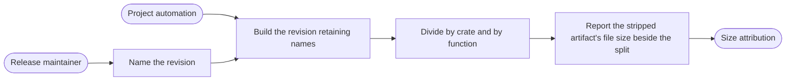

# Use case: measure-distributed-executable-size

## Level

!

## Actors

- Release maintainer — primary Actor; requests the measurement and reads the attribution.
- Supporting: Project automation for the release maintainer — builds the named revision for the supported platform and produces the measurement.

## Goal

Obtain a size attribution of the code the distributed executable is built from,
for a named revision and the supported platform.

## Trigger

The release maintainer requests a measurement of a named revision, or the
project's automation produces one for a change (open: Q6 — cadence).

## Preconditions

- The named revision exists in the repository.
- The project's automation can build the named revision for the supported
  platform.

## Main flow

1. Release maintainer names the revision; System resolves the named revision
   and the supported platform.
2. Release maintainer expects an attributable build; System builds the revision
   for the supported platform retaining the names the attribution needs, and
   records the build's identity.
3. Release maintainer expects the size split by code unit and function; System
   divides the build's size by crate and by function.
4. Release maintainer expects the executable's size beside the split; System
   reports the stripped artifact built from the same revision and build
   configuration — the size a released executable of that revision carries.
5. Release maintainer can stop with the attribution; System hands over the
   attribution naming the revision and the supported platform, with the two
   numbers kept distinct.

## Extensions

- 2: the build fails → no attribution is produced; the report names the build
  as unreadable; protects the minimal guarantee.
- 2: the build cannot retain the names the attribution needs → no attribution
  is produced; the report names the missing capability; protects the success
  guarantee from a substituted number.
- 4: the stripped artifact's file size cannot be read → the attribution is
  reported as incomplete, states that the file size is unavailable, and never
  presents the split's total as the file size; protects the minimal guarantee.

## Rules

- An attribution names the revision and the supported platform.
- It divides size by crate and by function.
- It is obtained from a build that retains the names the attribution needs; in
  the current Rust implementation that build disables `strip` for the
  attribution only.
- The stripped artifact's file size is reported beside the split; the split's
  total and the file size are never substituted for each other.
- The release archive's compressed size is not used as evidence.
- A build for the host machine is not evidence about the supported platform.

## Examples

- The maintainer requests an attribution for revision `v0.3.0`. The report
  names `v0.3.0` and Windows x86_64, reports the stripped artifact's file size
  as 2,097,152 B beside the split, and the split's total is a different number.
- The build for `v0.3.0` on Windows x86_64 fails. No attribution is produced,
  the report names the build as unreadable, and no number is inferred from the
  archive.
- The file size cannot be read. The report gives the split, states the file
  size is unavailable, and does not present the split's total as the file size.

## Minimal guarantee

A measurement that cannot be produced yields no attribution and names what
could not be read; an attribution that cannot state the file size is reported
as incomplete and never presents the split's total as the file size. No number
is inferred from the release archive or from another project's measurement.

## Success guarantee

The owner holds a size attribution that names the revision and the supported
platform, divides the code's size by crate and by function, is obtained from a
build of that revision that retains the names the attribution needs, and
reports the stripped artifact's file size beside it; when that size cannot be
read, the attribution states it is unavailable, and the two numbers are never
substituted for each other.

## Personas

- `project-maintainer--release-owner` — reads the attribution as evidence.
- `contributor--build-configuration-reviewer` — judges whether the attribution
  is reproducible and names the right artifact.
- `crew-member--personal-calendar-owner` — privacy lens: no plan-derived
  content appears in a published attribution or panic sample.

## Capabilities

- none

## Interactions

- none

## Includes

- none

## Extends

- none

## Out of scope

- Publishing a public release, including the archive, packaging and publication
  (`publish-public-release`).
- Converting a duty plan and writing its diagnostics
  (`export-duty-plan-calendar`).

## Diagram

