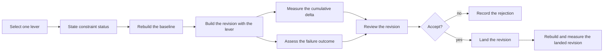

# Use case: reduce-distributed-executable-size

## Level

!

## Actors

- Release maintainer — primary Actor; selects a size lever, assesses its failure
  outcome, decides, lands and measures the result.
- Supporting: Contributor reviewer — reviews the build-configuration revision;
  cannot land or publish.
- Supporting: Project automation for the release maintainer — builds the
  baseline, the lever and the landed revision, and reports the measured sizes.

## Goal

Make the executable built for the supported platform smaller by applying only
the size levers a measurement justifies.

## Trigger

The release maintainer selects one size lever the size attribution justifies.

## Preconditions

- A size attribution for the revision is available (open: Q6 — whether an
  attribution exists for the current revision before a lever is selected).
- The stable-toolchain, single-file and static-linking constraints hold.

## Main flow

1. Release maintainer selects one lever the size attribution justifies; System
   states the lever's constraint status before any build.
2. Project automation rebuilds the released revision as the baseline with the
   current stable toolchain and the unchanged build configuration; System
   records the baseline's file size and reports the published binary's size
   separately.
3. Project automation builds the revision with the lever; System reports the
   measured delta against a rebuild of the same revision carrying the
   previously accepted levers but not this one, and the artifact's file size.
4. Release maintainer assesses the failure outcome; System reports whether a
   panic that ends the process still leaves a diagnosis, and whether a failed
   conversion still attempts a numbered diagnostic naming the source PDF and
   the failure reason.
5. Release maintainer prepares the build-configuration revision; Contributor
   reviewer reviews it; System reports the review outcome.
6. Release maintainer accepts or rejects the lever; System records the decision
   with its delta, the failure-outcome evidence, the review outcome and the
   reason.
7. Release maintainer lands the accepted revision; System rebuilds the landed
   revision and reports its size against the same-revision rebuild with the
   unchanged build configuration.

Steps 1–6 repeat for each candidate lever; one landing may carry several
accepted levers, each with its cumulative delta.

## Extensions

- 3: the build fails → no delta is recorded; the rejection is recorded with the
  build failure as its reason; protects the minimal guarantee.
- 3: the lever measures larger or equal → rejected with the measured
  comparison; protects the success guarantee from an unfounded change.
- 4: the diagnosis is no longer preserved → the lever is refused and the
  refusal recorded with its reason; protects the minimal guarantee.
- 5: the review rejects the revision → it is not accepted, does not land, and
  the rejection is recorded; protects the minimal guarantee.
- 7: the landed rebuild is not smaller than the same-revision rebuild with the
  unchanged build configuration → the revision is corrected or reverted, and
  the discrepancy and the revert are recorded; protects the success guarantee.

## Rules

- Every proposed lever has one recorded decision. A refusal before a build
  names the violated constraint and records no measurement; otherwise the
  record states the measured delta, the failure-outcome evidence where the
  lever changes failure behavior, the review outcome where a revision was
  reviewed, and the reason. A lever is recorded as applied only after its
  landed revision was rebuilt and measured as smaller.
- A nightly-only flag, UPX or dynamic linking is not a size lever: it is
  refused before a build and recorded as a rejected proposal naming the
  violated constraint, never as a lever decision.
- Every delta is cumulative against the build configuration as it stood before
  that lever, carrying the previously accepted levers, so the landed
  difference equals the sum of the recorded deltas.
- The baseline is the released revision rebuilt by the project's automation
  with the current stable toolchain and the unchanged build configuration; the
  published binary's size is reported separately.
- Every delta is measured from a build that retains the names the split needs,
  and the stripped artifact's file size is reported separately.
- The diagnosis a panic leaves — the panic message or a numbered diagnostic —
  is recorded before the lever lands.
- A source build from the landed revision retains the conversion's failure
  diagnosis.

## Examples

- A revision adds `panic = "abort"` without failure-outcome evidence. The
  reviewer rejects it; the decision is recorded as rejected, the revision does
  not land, and the executable is unchanged.
- The success example requires the first measured lever's delta and is parked
  in Q8: no number is invented here.

## Minimal guarantee

No failure outcome becomes less visible than before: a panic that ends the
process leaves a diagnosis, and a failed conversion still attempts a new
numbered diagnostic naming the source PDF and the failure reason, and when no
report can be saved the primary failure remains visible
(`export-duty-plan-calendar`, `usecase.md:94-95,135`). Every refusal, build
failure, rejection or revert is recorded with its reason. An accepted lever
whose revision does not land is recorded as not landed, never as applied. When
no lever yields a reduction, the build configuration is unchanged.

## Success guarantee

The executable built for the supported platform from the landed build
configuration is smaller than a rebuild of the same revision with the unchanged
build configuration, by the recorded cumulative deltas.

## Personas

- `project-maintainer--release-owner` — decides and answers for the result.
- `contributor--build-configuration-reviewer` — judges whether the delta is
  measured and the consequence stated.
- `crew-member--personal-calendar-owner` — judges the download and the failure
  diagnosis; also the privacy lens for published panic evidence.

## Capabilities

- none

## Interactions

- none

## Includes

- none

## Extends

- none

## Out of scope

- Publishing a public release, including the archive, packaging, publication
  and the supported platform set (`publish-public-release`).
- Converting a duty plan and writing its diagnostics
  (`export-duty-plan-calendar`).

## Diagram

