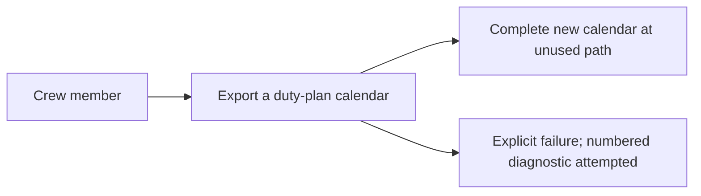

# Use case: export-duty-plan-calendar

## Level

!

## Actors

- Crew member — primary Actor; supplies one published duty plan to obtain its personal-calendar representation.
- Supporting: none. The conversion agent performs internal responsibilities for the Crew member, not an independently valuable actor goal.

## Goal

Export one published duty plan as an importable personal calendar file.

## Trigger

The Crew member supplies one duty-plan PDF for conversion.

## Preconditions

- None beyond the Actor making the request. Source readability, supported format, date/activity completeness, and output availability are checked during the flow rather than assumed beforehand.

## Main flow

1. Actor supplies the duty plan they want represented; System receives the source and its filename without altering its contents.
2. Actor expects their published activities to be recognized; System checks the supplied source against the supported Released Roster detail-table family and establishes its month/year and detailed activity content.
3. Actor expects every required activity to be accounted for; System resolves the dated activities and travel fragments according to the timing/classification rules, rejecting an unresolved required activity rather than excluding it.
4. Actor needs the relevant context of each activity; System retains confirmed distinctions, including DH in travel titles and known Trip ID within an unambiguous roster trip.
5. Actor needs an importable representation; System prepares a complete RFC 5545 calendar with valid dates, text representation, source-snapshot-scoped identities, and preferred-source revision metadata with construction-time fallback.
6. Actor needs a new file without losing existing outputs; System publishes the complete calendar beside the source under an unused name, adding an enumerated suffix when required and never overwriting an occupied calendar path.
7. Actor can stop with the exported calendar; System reports successful publication and the actual new calendar path.

## Extensions

- 2: source cannot be read, identified, or interpreted as a supported duty-plan export → expose conversion failure and attempt a new numbered diagnostic naming the source PDF; protects complete representation and explicit failure.
- 3: a required activity code or required timing cannot be resolved → reject the conversion and attempt a diagnostic; protects no silent omissions. SB/SBX/RE are confirmed timed availability assignments; missing required endpoints are not an all-day fallback.
- 3: dates, required times, positive intervals, or a unique adjacent UTC day cannot be established → reject rather than invent instants, except for the expressly selected unqualified-travel next-day rule.
- 3: a travel fragment lacks a unique compatible partner in the supplied source → reject the conversion with contextual failure information.
- 4: activity classification, dates/endpoints, travel-route identity, or explicit crew assignment have contradictory required values that cannot be resolved faithfully → reject rather than choose a convenient value.
- 6: the proposed calendar name is occupied or becomes occupied before publication → choose another unused enumerated name without replacing that entry; protects existing output contents and resumes step 6.
- 6: the complete calendar cannot be published → expose failure and attempt a new numbered diagnostic.
- 2–6: a diagnostic name is occupied → choose another unused numbered report name; protects existing diagnostics while retaining the primary failure.
- 2–6: the new diagnostic cannot be saved → retain the primary failure in the error message/non-success outcome and state that no new report was saved.

## Rules

- **Provenance and contract status**: change-side contract for the change to export released roster calendars, named **Export a duty-plan calendar**. Created from the approved ideation contract [the use case to export a duty-plan calendar](../../../ideation/duty-plan-calendar-conversion/use-cases/export-duty-plan-calendar.md) and the proposal's decisions; the source topic is duty-plan calendar conversion (`duty-plan-calendar-conversion`). This is the permanent leaf of the corpus.
- **Confirmed source and activity rules**

- The first release targets the Released Roster detail-table family represented by the supplied private examples and explicitly validated variations, not every PDF producer layout.
- Overview diagrams, statistics, and footer records are not independent sources of dated activities. A date-only row does not imply FREE, OFF, or layover.
- Every required source activity must be accounted for before a calendar is successfully published. Unknown activity codes, unsupported variants, unresolved required dates, and unmatched fragments produce failure rather than an apparently complete partial calendar.
- FREE, OFF, U, and FZ are all-day activities on their duty-plan dates. Source times do not decide their kind or event clock timing and do not trigger overnight repairs.
- U means Urlaub/vacation. FZ means additional vacation-related days off; no eligibility, age, annual-quota, or labor-agreement validation is performed.
- TK is timed office/seminar duty using its printed UTC Start/End interval. DTUSA is timed consulate duty to obtain a USA visa; DT expands to Duty Time, not a rule for other unknown DT suffixes.
- SB is standby/Stby, RE is reserve, and SBX is single-day/replacement standby. Each supplies its own UTC start/end availability window and is represented as timed duty. Consecutive dates retain their individual windows and FREE interruptions, not one continuous or all-day interval.
- SBX's window is its own source data, not the cancelled flight's interval. Its replacement meaning does not add the former flight as another current activity or reconcile an older imported snapshot.
- FRA is the domain expert's stated station for the current standby examples, not a universal default. These accepted semantic rules require later validation against a supplied dated duty-plan row.
- The SB/RE difference in activation-to-reporting notice time does not create a notification/reporting workflow or alter printed calendar endpoints.
- DH is a crew assignment on positioning travel, still duty time. It produces one event for the underlying travel, whose title carries the printed position, for example `DH 007 ABC-DEF`.
- Missing optional aircraft information or zero accounting Blocktime does not erase a resolvable travel event or make it all-day.
- A known Trip ID carries across travel legs within one unambiguous roster trip, including blank cells and page/date continuations. It must not leak into unrelated duties or a later trip. This rule does not propagate report times, offsets, or layover/non-flight metadata.

- **Timing and context**

- Timed event instants come from the printed UTC time evidence and independently resolved endpoint dates, not Report (LT), Timezone Difference, Blocktime, or duty/rest accounting values.
- Explicit UTC day qualifiers remain attached to their own cells. Resolve the marker to the uniquely matching previous, same, or next Gregorian date around that endpoint's local-date block, carrying month/year correctly; reject if there is no unique match.
- An unqualified endpoint uses its own source row/date-block context. Resolve start and end independently before applying the narrow unqualified-travel overnight rule. Revision/footer dates, Report (LT), offsets, and accounting durations never supply an activity date.
- If both travel endpoints are unqualified UTC clocks in one local-date block, there is no separate arrival-date block, and End clock precedes Start, interpret End as the following UTC day. This applies neither to equal clocks nor as a ground-duty or duration-based fallback.
- Each timed event must have an end strictly after its start. A local-date change alone does not add a UTC day.
- Preserve the printed crew position and flight number as the plan prints them, including leading zeroes, with one space between the two printed fields in a title; identifying text is not converted into a numeric quantity merely for formatting.

- **Approved inherited mappings**

- An explicit dated station-bearing Layover row produces an all-day layover activity; its printed duration on a travel row remains descriptive and does not create an invented interval.
- EM is a timed non-flight activity using its printed UTC interval and source station when supplied. No unprovided expansion of EM is asserted.

- **Descriptive-field selection**: the DESCRIPTION fields, in this order, are Trip ID, Report (LT), A/C, Blocktime, Timezone Difference, Layover duration, and Tags.

- Omit an optional field that the source does not supply; do not manufacture a report time, aircraft, offset, duration, or tag.
- Ordinary compatible fragments combine complementary supplied fields; the same selected value repeated on both fragments is represented once.
- Where otherwise compatible fragments supply genuinely differing selected optional values, the event is published once and the description retains both values, each labelled with the fragment that supplied it (`Report (LT) 07:30 (departure fragment); Report (LT) 08:00 (arrival fragment)`). Neither value computes an instant. This rule never merges conflicting required values (classification, endpoints, route, or explicit crew assignment), which still fail.
- Source association for non-trip fields must identify the represented activity or contributing fragment; a page/date change or last-read value is not by itself proof of association.

- **Calendar representation and publication**

- The calendar must comply with RFC 5545. Timed events use UTC endpoints; all-day events use date values and a non-inclusive following-day end. Text escaping, CRLF, UTF-8, and octet-aware folding are part of the output contract; UTF-8 characters are not split across folds.
- Component UIDs must be persistent and globally unique, scoped to the source snapshot and distinct represented activity. Identical-snapshot conversion is deterministic even when an output counter differs; a revised source snapshot has separate component identities, including activities unchanged from its predecessor. Output filename enumeration or DH title formatting is not component identity. No cross-revision activity matching, calendar-client import update, or duplicate-suppression guarantee is provided.
- DTSTAMP uses UTC source revision metadata where available. For the selected family, the Created footer is source-snapshot revision evidence. When usable source metadata is unavailable, use the constructed representation's actual UTC revision/construction timestamp. Revision metadata never determines activity dates or scheduled instants.
- Successful calendar files use an unused name beside the source. Occupied candidates are preserved; enumerated suffixes are illustrated as `roster.ics`, `roster-1.ics`, and `roster-2.ics`. A concurrent claimant is not permission to overwrite a candidate.
- Existing calendar and report contents remain unchanged by this conversion.
- Every conversion failure attempts a new numbered diagnostic identifying the source PDF filename and failure reason. The new report path is exposed only after an actual successful write; older reports are retained, not claimed as updated.
- Failure to save the diagnostic does not hide the original failure or turn it into success. No guarantee of writable storage, power-loss recovery, automatic backup/cleanup, or calendar-client import reconciliation is invented.
- Private PDFs and real identifying values are never committed. Public examples, fixtures, and golden calendars contain generated or anonymized material.

- **Delivery constraints, separate from the Actor goal**: retain the supplied Rust stable/edition-2021 application, exact pdfplumber pin, the single self-contained executable without companion-runtime installation, the Windows GNU cross-build on Linux/CI, no native C/C++ PDF extraction dependency, hand-written calendar writer, permitted licenses, and public-repository privacy requirements. The platforms a release offers are the concern of the use case to publish a public release; these remain implementation/release constraints, not extra use cases.
- **Review lenses**: the confirmed accuracy and privacy lens is crew-member--personal-calendar-owner, and the confirmed release-evidence lens is project-maintainer--release-owner, who is the Actor of the use case to publish a public release rather than an Actor of this one.

## Examples

- All values here are generated.
- Vacation without times: 12 January 2099, U, blank UTC cells → one all-day vacation activity on the duty-plan date.
- Source clocks ignored for a day off: 13 January 2099, OFF, 23:00 and 01:00 → one all-day OFF activity; no overnight timed interval.
- Additional vacation day: 14 January 2099, FZ, 09:00 and 17:00 → one all-day FZ activity; its source code remains distinct.
- Office/seminar duty: TK, station ABC, resolved 15 January 2099 UTC 08:00–12:00 → one four-hour non-flight duty.
- Consulate duty: DTUSA, station ABC, resolved 16 January 2099 UTC 09:00–15:00 → one six-hour non-flight visa duty.
- Printed crew position with its flight number: Pos FB, flight number 123, ABC–DEF, resolved UTC 08:00–09:00 → one one-hour travel event titled `FB 123 ABC-DEF`.
- Deadhead with zero accounting time: Pos DH, flight number 007, ABC–DEF, resolved UTC 06:00–07:00, blank aircraft, Blocktime 00:00 → one one-hour travel event titled `DH 007 ABC-DEF`.
- Sparse trip context: legs 007 and 008 belong to T42 and only the first row prints Trip ID → both descriptions contain `Trip T42`, and a later trip T43 does not inherit T42.
- Explicit next-day departure: local block 12 contains Start (13) 00:20 and arrival block 13 ends 08:10 UTC → one travel event on UTC day 13, lasting 7:50.
- Split local dates, same UTC day: local block 12 starts 19:15 and block 13 ends (12) 21:05 UTC → one 1:50 travel event on UTC day 12.
- Selected unqualified overnight convention: one local block 12, Start 23:10, End 01:05, no day qualifiers or separate arrival block → End is UTC day 13 at 01:05, one 1:55 travel event.
- Differing optional fragment values: compatible departure and arrival fragments with Report (LT) 07:30 and 08:00 → one event described with both values labelled by fragment role.
- Name collision: source roster.pdf, with roster.ics and roster-1.ics already existing → complete new output at roster-2.ics; existing files unchanged.
- Interpretation failure with old report: an unknown required code and an existing roster.parse-error.txt → no successful new calendar, and a new numbered report identifies roster.pdf and the current reason.
- Publication failure: activities resolve but the new calendar cannot be published → failure exposed, a new report attempted, existing calendars unchanged.
- Diagnostic unavailable: the primary failure occurs and no new report can be saved → the original failure remains visible; no claim that an older report is new.
- Same snapshot, another output name: the identical source converted again with an older calendar name occupied → the new unused output contains the same component identifiers.
- Revised source snapshot: flight 007 changes from 09:00 to 10:00 UTC in a revised PDF → separate component identifiers; no reconciliation with an imported calendar.
- Source timestamp available: the footer states Created 10Jan2099 12:34 (UTC) → that source timestamp supplies UTC DTSTAMP.
- Source timestamp unavailable: no usable source revision metadata with a controlled construction clock → that construction moment supplies DTSTAMP; activity dates and identifiers are unaffected.
- Dated standby: SB with resolved source UTC endpoints 08:00–16:00 → one eight-hour standby event.
- Dated reserve: RE with resolved source UTC endpoints 09:00–17:00 → one eight-hour reserve event.
- Standby interrupted by a day off: SB, SB, FREE, SB rows, each SB with its own source window → separate timed availability events and an all-day FREE activity.
- Single-day standby: SBX at example station FRA with resolved UTC endpoints 08:00–16:00 → one eight-hour SBX event using its own window.
- Previous-year UTC qualifier: local date 1 January 2099 with UTC cell (31) 23:10 → endpoint 31 December 2098 23:10 UTC.
- Next-month UTC qualifier: local date 31 January 2099 with UTC cell (1) 00:20 → endpoint 1 February 2099 00:20 UTC.
- Inconsistent explicit qualifier: an explicit day number matching none of the adjacent dates → explicit date-resolution failure.

## Minimal guarantee

The source contents and prior calendar/report contents remain unchanged. Unresolved activities and failed publication are never reported as successful complete conversion. Every conversion failure attempts a new diagnostic, while the original failure remains explicit if that diagnostic cannot be saved. No old report is represented as a new successful write.

## Success guarantee

The Crew member obtains a complete RFC 5545 calendar file beside the supplied duty plan under an unused name, representing its required resolved activities with source-snapshot identities and the preferred-source/fallback revision timestamp.

This is a changing use case: it creates a new calendar export, not a read-only observation or an update to an imported calendar.

## Personas

- crew-member--personal-calendar-owner
- project-maintainer--release-owner

## Capabilities

- export-duty-plan-calendar

## Interactions

| Capability | Consumer action | E2E scenario |
|---|---|---|
| export-duty-plan-calendar | supply a duty plan for conversion | Crew member converts a supported duty plan and receives a calendar file |

## Includes

- none

## Extends

- none

## Out of scope

- Import the result into a calendar application.
- Reconcile imported calendars automatically after duty-plan revisions.
- Compare revisions as a separate user-facing outcome.
- Edit or authorize the official duty plan.
- Grant leave, check entitlement quotas, calculate pay, or decide duty/rest legality.
- Obtain a visa, book positioning travel, or contact external scheduling institutions.
- Activate standby/reserve crew, calculate call-to-report notice, or perform check-in/reporting.
- Publish/approve a converter release as a product command.

## Diagram

The actor-goal summary this use case delivers:

