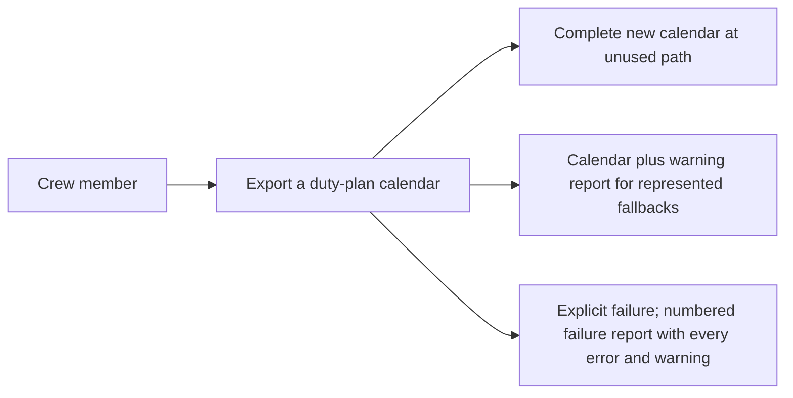

# Use case: export-duty-plan-calendar

## Level

!

## Actors

- Crew member — primary Actor; supplies one published duty plan to obtain its personal-calendar representation through the executable or a browser conversion page.
- Supporting: none. The conversion agent and the browser page perform internal responsibilities for the Crew member, not an independently valuable actor goal.

## Goal

Export one published duty plan as an importable personal calendar file.

## Trigger

The Crew member supplies one duty-plan PDF for conversion.

## Preconditions

- The browser conversion route requires a current browser with WebAssembly and ES modules, and a converter module that initializes. Source readability, supported format, the 20 MiB input bound, row representability, and output availability are checked during the flow rather than assumed beforehand.

## Main flow

1. Actor supplies the duty plan they want represented; System receives the source and its filename without altering its contents and, in the browser realization, without sending a request. Before reading a browser-supplied plan, the page refuses a plan larger than 20 MiB by name.
2. Actor expects their published activities to be recognized; System checks the supplied source against the supported Released Roster detail-table family and establishes its month/year and detailed activity content.
3. Actor expects every row to be accounted for; System resolves every dated activity and travel fragment according to the timing/classification rules, converts an unrecognized activity code from its printed evidence with a conversion warning, and rejects only a row it cannot represent at all. All rows are processed and every error and warning is collected before the outcome is decided.
4. Actor needs the relevant context of each activity; System retains confirmed distinctions, including DH in travel titles and known Trip ID within an unambiguous roster trip.
5. Actor needs an importable representation; System prepares a complete RFC 5545 calendar with valid dates, text representation, source-snapshot-scoped identities, and preferred-source revision metadata with construction-time fallback.
6. Actor needs a new file without losing existing outputs; System publishes the complete calendar beside the source under an unused name when the executable performs the conversion, or offers it for saving as `<source-stem>.ics` when the browser realization performs it. When the conversion reported warnings, System also publishes or offers the warning report described below. The executable adds an enumerated suffix when required and never overwrites an occupied calendar, warning-report, or failure-report path; the page writes nothing, and the browser owns the save location and name collisions. Each browser attempt clears the prior offer and state before reading the new plan, so a failed attempt withdraws the calendar an earlier attempt offered.
7. Actor can stop with the exported calendar; the executable reports successful publication, the actual new calendar path, every warning line, and the warning-report path when one was written, while the page shows the offered calendar, the warnings when there are any, and never claims a save it did not observe.

## Extensions

- 2: source cannot be read, identified, or interpreted as a supported duty-plan export → expose conversion failure and attempt a new numbered failure report naming the source PDF; protects complete representation and explicit failure. These are not row-level failures and keep the two-line report.
- 3: a detail row carries an activity code the converter does not recognize, with both printed UTC endpoints and no route → represent it as a timed activity titled by the printed code, located at the printed station, using the printed UTC window; report a conversion warning and resume at step 3. Protects the printed evidence and makes the fallback visible.
- 3: such a row supplies neither endpoint → represent an all-day activity titled by the printed code; report a conversion warning and resume at step 3. No interval is invented.
- 3: such a row supplies exactly one endpoint → record a conversion error for that row. The interval cannot be resolved, and the row cannot be claimed as all-day while the source prints a time.
- 3: an unrecognized code's printed window is equal or qualified-backwards → record a conversion error rather than invent a next day; its unqualified window across midnight follows the narrow overnight rule above.
- 3: a row carries a route but its printed interval is incomplete, or a recognized timed code cannot build a positive interval from what it prints → record a conversion error for that row; a route alone never makes an interval resolvable.
- 3: a row cannot be represented — an unresolvable date, an unmatched travel fragment, a non-positive interval, or neither an activity code nor a route — → record a conversion error for that row and continue with the remaining rows. Any recorded error rejects the conversion, and every error and warning of the run is reported together.
- 3: required times, positive intervals, or a unique adjacent UTC day cannot be established → record a conversion error rather than invent instants, except for the expressly selected unqualified-travel next-day rule.
- 3: a travel fragment lacks a unique compatible partner in the supplied source → record a conversion error naming the fragment, and continue with the remaining rows. A mis-paired leg reports two errors in plan order — the arrival row's missing partner and the orphan departure — so neither row is silently dropped.
- 4: activity classification, dates/endpoints, travel-route identity, or explicit crew assignment have contradictory required values that cannot be resolved faithfully → record a conversion error rather than choose a convenient value.
- 6: the proposed calendar name is occupied or becomes occupied before publication → choose another unused enumerated name without replacing that entry; protects existing output contents and resumes step 6.
- 6: the proposed warning-report name is occupied or becomes occupied before publication → choose another unused enumerated warning-report name without replacing that entry.
- 6: a conversion with warnings cannot save its warning report → keep the published calendar, report every warning in the output or on the page, and state that no new warning report was saved; a warning is not an error and does not withdraw the calendar.
- 6: the complete calendar cannot be published → expose failure and attempt a new numbered failure report.
- 2–6: a failure-report name is occupied → choose another unused numbered report name; protects existing reports while retaining the primary failure.
- 2–6: the new failure report cannot be saved → retain the primary failure in the error message/non-success outcome and state that no new report was saved.

## Rules

- **Provenance and contract status**: change-side contract for the change to export released roster calendars, named **Export a duty-plan calendar**. Created from the approved ideation contract [the use case to export a duty-plan calendar](../../../ideation/duty-plan-calendar-conversion/use-cases/export-duty-plan-calendar.md) and the proposal's decisions; the source topic is duty-plan calendar conversion (`duty-plan-calendar-conversion`). This is the permanent leaf of the corpus.
- **Confirmed source and activity rules**

- The first release targets the Released Roster detail-table family represented by the supplied private examples and explicitly validated variations, not every PDF producer layout.
- Overview diagrams, statistics, and footer records are not independent sources of dated activities. A silent layout row — a row with no activity code and no route, of which a date-only row is the common shape — does not imply FREE, OFF, or layover, and produces no activity and no conversion warning.
- Every detail row must be accounted for before a calendar is successfully published, and every row is processed in one run. **This rule replaces the earlier rule that an unknown activity code produced failure rather than an apparently complete partial calendar.** An unrecognized activity code is now represented from its printed evidence and reported as a conversion warning: with both printed UTC endpoints and no route it becomes a timed activity titled by the printed code, located at the printed station, using the printed UTC window; with neither endpoint it becomes an all-day activity titled by the printed code. A row that cannot be represented at all — an unrecognized code with exactly one printed endpoint, an unresolvable date, a travel fragment without a unique compatible partner, a non-positive interval, a row carrying neither an activity code nor a route, or a row carrying a route without a complete printed interval — is a conversion error. Any conversion error rejects the conversion and no calendar is published; a conversion warning does not.
- **Severity** distinguishes the two outcomes for a reader. A conversion error means the row cannot be represented, so the conversion fails and no calendar is published. A conversion warning means the row was represented by a documented fallback, so the calendar is published and the warning is reported. Every error and every warning of a run is reported, never only the first.
- Only an unexpected activity code warns. A code the converter does not recognize that carries a route remains travel, including a flight number. Known codes win over the route: a known code keeps exactly the semantics stated below, so a TK or SB row that also prints a route stays its printed kind and does not become travel. A row that prints a station but neither an activity code nor a route remains a conversion error, and a row that carries a route but cannot build its printed interval is a conversion error rather than travel.
- FREE, OFF, U, and FZ are all-day activities on their duty-plan dates. Source times do not decide their kind or event clock timing and do not trigger overnight repairs.
- U means Urlaub/vacation. FZ means additional vacation-related days off; no eligibility, age, annual-quota, or labor-agreement validation is performed.
- TK is timed office/seminar duty using its printed UTC Start/End interval. DTUSA is timed consulate duty to obtain a USA visa; DT expands to Duty Time, not a rule for other unknown DT suffixes.
- SB is standby/Stby, RE is reserve, and SBX is single-day/replacement standby. Each supplies its own UTC start/end availability window and is represented as timed duty. Consecutive dates retain their individual windows and FREE interruptions, not one continuous or all-day interval.
- SBX's window is its own source data, not the cancelled flight's interval. Its replacement meaning does not add the former flight as another current activity or reconcile an older imported snapshot.
- FRA is the domain expert's stated station for the current standby examples, not a universal default. These accepted semantic rules require later validation against a supplied dated duty-plan row.
- The SB/RE difference in activation-to-reporting notice time does not create a notification/reporting workflow or alter printed calendar endpoints.
- DH is a crew assignment on positioning travel, still duty time. It produces one event for the underlying travel, whose title carries the printed position, for example `DH 007 ABC-DEF`.
- Missing optional aircraft information or zero accounting Blocktime does not erase a resolvable travel event or make it all-day.
- A known Trip ID carries across travel legs within one unambiguous roster trip, including blank cells and page/date continuations. It must not leak into unrelated duties or a later trip. This rule does not propagate report times, offsets, or layover/non-flight metadata.

- **Timing and context**

- Timed event instants come from the printed UTC time evidence and independently resolved endpoint dates, not Report (LT), Timezone Difference, Blocktime, or duty/rest accounting values.
- Explicit UTC day qualifiers remain attached to their own cells. Resolve the marker to the uniquely matching previous, same, or next Gregorian date around that endpoint's local-date block, carrying month/year correctly; reject if there is no unique match.
- An unqualified endpoint uses its own source row/date-block context. Resolve start and end independently before applying the narrow unqualified-travel overnight rule. Revision/footer dates, Report (LT), offsets, and accounting durations never supply an activity date.
- If both endpoints of one timed activity — a travel leg, a known timed duty or availability window, or an unrecognized code's printed window — are unqualified UTC clocks in one local-date block, there is no separate arrival-date block, and the End clock precedes the Start clock, interpret End as the following UTC day. This applies neither to equal clocks nor to backwards clocks that carry a day qualifier, and never as a duration-based fallback; an equal or qualified-backwards window is a conversion error.
- Each timed event must have an end strictly after its start. A local-date change alone does not add a UTC day.
- Preserve the printed crew position and flight number as the plan prints them, including leading zeroes, with one space between the two printed fields in a title; identifying text is not converted into a numeric quantity merely for formatting.
- A travel activity's title ends with the plan's report time in local time, written ` Report <value> LT`, when the source supplies one report time (a single fragment, or equal values on both fragments). The description keeps the fully labelled Report (LT) value. No report time supplies no suffix; differing report values on the two fragments also supply no suffix because there is no single briefing time, while the description retains both labelled values.

- **Approved inherited mappings**

- An explicit dated station-bearing Layover row produces an all-day layover activity; its printed duration on a travel row remains descriptive and does not create an invented interval.
- EM is a timed non-flight activity using its printed UTC interval and source station when supplied. No unprovided expansion of EM is asserted.

- **Descriptive-field selection**: the DESCRIPTION fields, in this order, are Trip ID, Report (LT), A/C, Blocktime, Timezone Difference, Layover duration, and Tags. One stated exception applies to the unrecognized-code fallback: it publishes only the printed activity code, station and interval, and does not represent other optional context the row happens to print, so its activity carries no description.

- Omit an optional field that the source does not supply; do not manufacture a report time, aircraft, offset, duration, or tag.
- Ordinary compatible fragments combine complementary supplied fields; the same selected value repeated on both fragments is represented once.
- Where otherwise compatible fragments supply genuinely differing selected optional values, the event is published once and the description retains both values, each labelled with the fragment that supplied it (`Report (LT) 07:30 (departure fragment); Report (LT) 08:00 (arrival fragment)`). Neither value computes an instant. This rule never merges conflicting required values (classification, endpoints, route, or explicit crew assignment), which still fail.
- Source association for non-trip fields must identify the represented activity or contributing fragment; a page/date change or last-read value is not by itself proof of association.

- **Calendar representation and publication**

- The calendar must comply with RFC 5545. Timed events use UTC endpoints; all-day events use date values and a non-inclusive following-day end. Text escaping, CRLF, UTF-8, and octet-aware folding are part of the output contract; UTF-8 characters are not split across folds.
- Component UIDs must be persistent and globally unique, scoped to the source snapshot and distinct represented activity. Identical-snapshot conversion is deterministic even when an output counter differs; a revised source snapshot has separate component identities, including activities unchanged from its predecessor. Output filename enumeration or DH title formatting is not component identity. No cross-revision activity matching, calendar-client import update, or duplicate-suppression guarantee is provided.
- DTSTAMP uses UTC source revision metadata where available. For the selected family, the Created footer is source-snapshot revision evidence. When usable source metadata is unavailable, use the constructed representation's actual UTC revision/construction timestamp. Revision metadata never determines activity dates or scheduled instants.
- Successful executable calendar files use an unused name beside the source. Occupied candidates are preserved; enumerated suffixes are illustrated as `roster.ics`, `roster-1.ics`, and `roster-2.ics`. A concurrent claimant is not permission to overwrite a candidate. The browser realization offers `<source-stem>.ics` and writes nothing; the browser owns the save location and any name collision, and the page cannot promise an unused numbered name.
- Existing calendar and report contents remain unchanged by this conversion. A plan whose dated activities are all recognized publishes exactly the calendar it publishes today and no report.
- A conversion with warnings publishes the complete calendar and a warning report beside the source. The warning report is named `<stem>.parse-warnings.txt`, and `<stem>.parse-warnings-1.txt`, `<stem>.parse-warnings-2.txt`, … when the earlier names are occupied. It begins with `Source PDF: <name>` and carries a `Warnings:` section with one entry per line; each entry names the detail row it came from and its date when the row states one, and states the fallback that was applied.
- A conversion with errors publishes no calendar and a numbered failure report named `<stem>.parse-error.txt`, `<stem>.parse-error-1.txt`, …. It begins with `Source PDF: <name>` and the existing `Reason:` line — the primary reason, which is the first conversion error — and then carries the `Errors:` and `Warnings:` sections that have entries, each with one entry per line, so a reader can tell the severities apart and sees every error and warning of the run.
- The report path is exposed only after an actual successful write; older reports are retained, not claimed as updated. A failure report that is not about a detail row — an unreadable source, an unsupported plan, a publication failure, an unnameable source — keeps today's two-line `Source PDF:`/`Reason:` form. A warning report that cannot be saved does not withdraw the published calendar and does not hide the warnings, which the executable prints and the page lists.
- The executable prints every conversion error and warning line, the primary failure when there is one, and the report path it actually wrote. A run that published a calendar with warnings reports success through its process exit status; a run with any conversion error reports failure through a non-zero process exit status.
- The browser realization lists the warnings in its ready state and lists the errors and the warnings in its failure state, so a crew member reads them without opening a file. It shows the reason and offers `<source-stem>.parse-error.txt` on failure, and offers `<source-stem>.parse-warnings.txt` when the calendar is ready with warnings. If an offer cannot be created, the calendar or primary failure remains as it is and the page states what was not offered. The page writes nothing and never claims a report or calendar save it did not observe.
- Failure to save or offer a report does not hide the original failure or turn it into success. No guarantee of writable storage, power-loss recovery, automatic backup/cleanup, or calendar-client import reconciliation is invented.
- Private PDFs and real identifying values are never committed. Public examples, fixtures, and golden calendars contain generated or anonymized material.

- **Browser realization**

- The browser realization performs the same conversion inside the browser tab on a page served from the built Site output. It checks that the browser has WebAssembly and ES modules, that the converter module initializes, and that the plan is at most 20 MiB before reading it; a missing capability, a startup failure or an oversized plan is refused by name, and a startup failure never falls back to a server or an upload.
- A supported plan is offered as `<source-stem>.ics`; the page writes nothing, never claims a save it did not observe, and the browser owns the save location and name collisions. A failed attempt withdraws any calendar an earlier attempt offered.
- The page's ready, ready-with-warnings and failure states are drawn as the approved reference draws them: the ready state is headed `Calendar ready` with the copy `Your complete calendar is ready. The browser chooses where the file is saved.`, the status `Calendar ready for <source>.` and a `Choose another duty plan` control; the ready-with-warnings state uses the same heading and the plural copy, the status `Your calendar is ready to save. <n> rows were converted with warnings.` (singular for one row) and the same control; the failure state is headed `Conversion failed`, states a count-based sentence naming the source and how many rows could not be represented and how many were converted with warnings, and keeps the `Choose another plan` way back. The count-based sentence is the page's reason; the first error sentence appears once, as the first `Errors:` entry, and never also as the reason.
- When the conversion reports warnings, the page shows them in the ready state and offers the warning report as `<source-stem>.parse-warnings.txt` beside the calendar. If the warning-report offer cannot be created, the calendar and the visible warnings remain and the page says no warning report was offered. Each new attempt clears the previous attempt's lists, so a later attempt never shows an earlier attempt's warnings.
- On failure the page shows the reason, lists the errors and the warnings, and offers a failure report as `<source-stem>.parse-error.txt`, identifying the source filename, the primary reason and both sections. If the failure-report offer cannot be created, the primary failure and the lists remain visible and the page says no report was offered.
- A browser memory failure or trap is rejected, never reported as a partial success, and attempts the failure-report offer. The browser realization's events are **Calendar export offered** and **Conversion diagnostic offered**; the executable's realization keeps **Calendar export published** and **Conversion diagnostic written**. The page offers; the browser saves or writes.
- The page sends no request to another origin after it loads, loads no third-party asset, and stores no plan or derived data in persistent storage (localStorage, IndexedDB or a cookie) or in a navigable URL or history entry. An ephemeral in-memory object URL used to offer the download is allowed and is revoked when the page unloads.

- **Delivery constraints, separate from the Actor goal**: retain the supplied Rust stable/edition-2021 application, exact pdfplumber pin, the single self-contained executable without companion-runtime installation, the Windows GNU cross-build on Linux/CI, no native C/C++ PDF extraction dependency, hand-written calendar writer, permitted licenses, and public-repository privacy requirements. The platforms a release offers are the concern of the use case to publish a public release; these remain implementation/release constraints, not extra use cases. **Supported platform** means a platform the project offers as a downloadable archive; the browser realization is a supported conversion route and offers no archive.
- **Review lenses**: the confirmed accuracy and privacy lens is crew-member--personal-calendar-owner; the confirmed release-evidence lens is project-maintainer--release-owner, who is the Actor of the use case to publish a public release rather than an Actor of this one; and the browser realization's confirmed lens is contributor--web-reviewer for the CSP, the no-network proof, the browser fallback and the WASM bundle.

## Examples

- All values here are generated.
- Vacation without times: 12 January 2099, U, blank UTC cells → one all-day vacation activity on the duty-plan date.
- Source clocks ignored for a day off: 13 January 2099, OFF, 23:00 and 01:00 → one all-day OFF activity; no overnight timed interval.
- Additional vacation day: 14 January 2099, FZ, 09:00 and 17:00 → one all-day FZ activity; its source code remains distinct.
- Office/seminar duty: TK, station ABC, resolved 15 January 2099 UTC 08:00–12:00 → one four-hour non-flight duty.
- Consulate duty: DTUSA, station ABC, resolved 16 January 2099 UTC 09:00–15:00 → one six-hour non-flight visa duty.
- Printed crew position with its flight number: Pos FB, flight number 123, ABC–DEF, resolved UTC 08:00–09:00 → one one-hour travel event titled `FB 123 ABC-DEF`.
- Deadhead with zero accounting time: Pos DH, flight number 007, ABC–DEF, resolved UTC 06:00–07:00, blank aircraft, Blocktime 00:00 → one one-hour travel event titled `DH 007 ABC-DEF`.
- Report time in the title: a travel leg with Report (LT) 07:30 → the title ends with the suffix `Report 07:30 LT`; the value stays descriptive and does not move the UTC interval.
- Sparse trip context: legs 007 and 008 belong to T42 and only the first row prints Trip ID → both descriptions contain `Trip T42`, and a later trip T43 does not inherit T42.
- Explicit next-day departure: local block 12 contains Start (13) 00:20 and arrival block 13 ends 08:10 UTC → one travel event on UTC day 13, lasting 7:50.
- Split local dates, same UTC day: local block 12 starts 19:15 and block 13 ends (12) 21:05 UTC → one 1:50 travel event on UTC day 12.
- Selected unqualified overnight convention: one local block 12, Start 23:10, End 01:05, no day qualifiers or separate arrival block → End is UTC day 13 at 01:05, one 1:55 travel event.
- Differing optional fragment values: compatible departure and arrival fragments with Report (LT) 07:30 and 08:00 → one event described with both values labelled by fragment role.
- Name collision: source roster.pdf, with roster.ics and roster-1.ics already existing → complete new output at roster-2.ics; existing files unchanged.
- Unrecognized code with a printed window: 7 June 2099, code `ZZ_M_CF`, station ABC, printed UTC 08:00–15:30 → one timed activity titled `ZZ_M_CF` at ABC and one conversion warning naming that detail row and its date; the calendar is published with the warning report.
- Unrecognized code without printed times: 7 June 2099, code `ZZ_M_CF`, blank time cells → one all-day activity titled `ZZ_M_CF` and one conversion warning; no interval is invented.
- Unrecognized code with one printed endpoint: 7 June 2099, code `ZZ_M_CF`, printed start 08:00 and no end → one conversion error; no calendar is published and the failure report lists that row under `Errors:`.
- Several warnings in one run: three dated rows with unrecognized codes and printed windows → one activity per row, three warnings in the warning report, and no conversion error.
- Several errors with warnings in one run: two rows that cannot be represented and one unrecognized row with a printed window → no calendar; the failure report lists both errors and the warning under their sections.
- All rows reported: a plan whose first row cannot be represented and whose later rows include one unrecognized row with a printed window → every row is still processed, so the failure report names both the error and the warning rather than only the first error.
- Warning-report collision: source roster.pdf with roster.parse-warnings.txt and roster.parse-warnings-1.txt already existing → the new warnings are written to roster.parse-warnings-2.txt; the earlier reports are unchanged.
- Unsaveable warning report: the calendar is published and the warning report cannot be saved → the calendar stays published, the warnings remain in the executable output or on the page, and the output states that no new warning report was saved.
- Known-only plan: every dated activity carries a recognized code → the complete calendar is published and no warning report is written.
- Interpretation failure with old report: a row that cannot be represented and an existing roster.parse-error.txt → no successful new calendar, and a new numbered failure report identifies roster.pdf, the primary reason, and the error entry.
- Publication failure: activities resolve but the new calendar cannot be published → failure exposed, a new two-line report attempted, existing calendars unchanged.
- Failure report unavailable: the primary failure occurs and no new report can be saved → the original failure remains visible; no claim that an older report is new.
- Same snapshot, another output name: the identical source converted again with an older calendar name occupied → the new unused output contains the same component identifiers.
- Revised source snapshot: flight 007 changes from 09:00 to 10:00 UTC in a revised PDF → separate component identifiers; no reconciliation with an imported calendar.
- Source timestamp available: the footer states Created 10Jan2099 12:34 (UTC) → that source timestamp supplies UTC DTSTAMP.
- Source timestamp unavailable: no usable source revision metadata with a controlled construction clock → that construction moment supplies DTSTAMP; activity dates and identifiers are unaffected.
- Dated standby: SB with resolved source UTC endpoints 08:00–16:00 → one eight-hour standby event.
- Dated reserve: RE with resolved source UTC endpoints 09:00–17:00 → one eight-hour reserve event.
- Standby interrupted by a day off: SB, SB, FREE, SB rows, each SB with its own source window → separate timed availability events and an all-day FREE activity.
- Single-day standby: SBX at example station FRA with resolved UTC endpoints 08:00–16:00 → one eight-hour SBX event using its own window.
- Previous-year UTC qualifier: local date 1 January 2099 with UTC cell (31) 23:10 → endpoint 31 December 2098 23:10 UTC.
- Next-month UTC qualifier: local date 31 January 2099 with UTC cell (1) 00:20 → endpoint 1 February 2099 00:20 UTC.
- Inconsistent explicit qualifier: an explicit day number matching none of the adjacent dates → explicit date-resolution failure.
- Browser success: `2026-06.pdf`, within the size bound → the page offers `2026-06.ics`; the browser saves it; the page writes nothing and claims no save.
- Browser conversion with warnings: `2026-06.pdf` containing an unrecognized code with a printed window → the page lists the warning, offers `2026-06.ics` and offers `2026-06.parse-warnings.txt`.
- Browser failure with errors and warnings: `2026-06.pdf` with one unrepresentable row and one warned row → the page lists both, offers no calendar, and offers `2026-06.parse-error.txt` carrying both sections.
- Browser oversized plan: a 25 MiB PDF → the page refuses by name and offers no calendar; a `2026-06.parse-error.txt` failure-report offer is attempted.
- Browser unsupported source: a file outside the supported family → no calendar; the page shows the reason and offers `notes.parse-error.txt` identifying the source and reason.
- Browser unsupported capability: no WebAssembly → the page states that it cannot run; no file picker and no calendar.
- Browser no network: a plan is converted while the browser's request log is observed → no request to another origin after load; the page stores nothing in persistent storage.

## Minimal guarantee

The source contents and prior calendar/report contents remain unchanged. Unresolved activities and failed publication are never reported as successful complete conversion. An unrecognized activity code is never silently dropped: it is either represented from its printed evidence with a conversion warning, or reported as a conversion error. Every error and every warning of a run is reported. Every executable conversion failure attempts a new numbered failure report, while the original failure remains explicit if that report cannot be saved. A warning report that cannot be saved does not withdraw the published calendar and does not hide its warnings. No old report is represented as a new successful write.

The browser realization writes nothing and never reports a save it did not observe; no existing file is touched by the page; a rejected browser conversion is never reported as success; a failed attempt withdraws the calendar an earlier attempt offered; on a browser failure the reason and the error and warning lists are visible and a failure-report offer is attempted; a warning conversion shows its warnings and attempts a warning-report offer; a failed report offer does not hide the primary outcome; no plan or derived data leaves the page.

## Success guarantee

The Crew member obtains a complete RFC 5545 calendar file representing its required resolved activities with source-snapshot identities and the preferred-source/fallback revision timestamp; when any activity was represented by a fallback, the same export also yields the warning report for it. Realization: the executable publishes the calendar and, when there are warnings, the warning report beside the supplied duty plan under unused names; the browser realization offers both for saving under names derived from the source and writes nothing. This is one export outcome with two artifacts, not two actor goals: the warning report cannot be obtained without performing the same conversion, no actor triggers it separately, and the use case keeps one Goal and one capability.

This is a changing use case: it creates a new calendar export, not a read-only observation or an update to an imported calendar.

## Personas

- crew-member--personal-calendar-owner
- project-maintainer--release-owner
- contributor--web-reviewer

## Capabilities

- export-duty-plan-calendar

## Interactions

| Capability | Consumer action | E2E scenario |
|---|---|---|
| export-duty-plan-calendar | supply a duty plan for conversion through the executable | Crew member converts a supported duty plan and receives a calendar file |
| export-duty-plan-calendar | supply a duty plan through the converter page and save the offered calendar | Crew member converts a supported duty plan in the browser and saves the offered calendar |

## Includes

- none

## Extends

- none

## Out of scope

- Import the result into a calendar application.
- Reconcile imported calendars automatically after duty-plan revisions.
- Compare revisions as a separate user-facing outcome.
- Edit or authorize the official duty plan.
- Grant leave, check entitlement quotas, calculate pay, or decide duty/rest legality.
- Obtain a visa, book positioning travel, or contact external scheduling institutions.
- Activate standby/reserve crew, calculate call-to-report notice, or perform check-in/reporting.
- Publish/approve a converter release as a product command.
- File System Access API writes, page-side directory access, saving on the Crew member's behalf, or a numbered report name the page cannot guarantee.
- A hosted conversion, upload, account, analytics or telemetry service; a custom domain or project-site redirect; the Site publication, its Built revision and its public copy.

## Diagram

The actor-goal summary this use case delivers:

The inventory in `## Interactions` names the two actions a consumer performs
against this use case's real interfaces. Dropping a plan onto the drop zone is
the same supply action as the picker and adds no inventory entry: the size,
family, unresolved-activity, row-diagnostic, stale-offer, drop, capability,
startup, offer-failure, cancelled-save, naming and persistence scenarios are
regular coverage of those two actions, each of which has exactly one `@e2e`
scenario.
