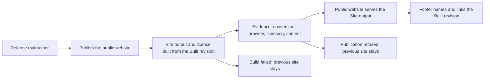

# Use case: publish-public-website

## Level

!

## Actors

- Release maintainer — primary Actor; owns the site's value and answers for the published page. The Contributor who lands the revision is supporting.
- Supporting: Contributor — lands a source revision. Automation for the Release maintainer — builds, evaluates and publishes; an internal responsibility, not an independent actor goal.

## Goal

Make the Public website at `https://duty2cal.github.io/` serve the Site output built from a named Built revision.

## Trigger

The Release maintainer publishes from a source revision that reaches the default branch, or from a release tag that is pushed.

## Preconditions

- The hosting target exists; the deploy key and secret from the prior topic's `publish-site-plumbing` seed are in place, and its Pages source is `main` at `/`. That seed is now the archived `publish-site-plumbing` change: its proposal D1 closes the ruleset bypass, the credential is applied live, and consuming it is this use case's prerequisite rather than its output.
- The revision contains the Public website's source and the browser conversion capability.

## Main flow

1. Actor lands a source revision or pushes a release tag; System receives it. For a default-branch revision it checks whether the revision changes the site's inputs; a revision that changes none starts no Site publication. A release tag always starts a Site publication from the tagged revision, because the footer's tag and the release's site must match.
2. Actor expects the page to be built only from the repository; System builds the Site output — the page, the script and the WASM bundle — with the footer naming the Built revision, and produces the licence file.
3. Actor expects only a working page to become public; System evaluates the required evidence for publication.
4. Actor expects the previous page to be replaced as a whole; System replaces the hosting target's content with the complete built content, removing any file that is not part of it.
5. Actor expects to trace the page to its source and to read the page it published; System records the Built revision, the hosting target holds the content, and System reads the published address until the served page carries the same Built revision the output carries.
6. Actor can stop; the Public website serves the Site output from the Built revision.

## Extensions

- 1: a default-branch revision changes none of the site's inputs → no Site publication; the current Public website stays; protects the current-site minimal guarantee.
- 1: a release tag is pushed → the Site publication starts from the tagged revision even when that revision changes no site input, because the footer's tag changes; protects the release-site consistency rule.
- 2: the build fails → no publication; the previous Public website stays; the failed step is named; protects the minimal guarantee.
- 2: the Built revision cannot be resolved → refuse; name it; the previous Public website stays; protects the traceability rule (K3).
- 3: a conversion test fails → refuse; name the test; the previous Public website stays; protects the success guarantee's complete-or-explicit-failure basis.
- 3: the browser check fails, either because conversion fails or because any request after load reaches another origin → refuse; name the check; the previous Public website stays; protects K5.
- 3: the licensing/REUSE check fails → refuse; name the file; the previous Public website stays; protects the licence rule.
- 3: the page-content check fails → refuse; name the missing statement; the previous Public website stays; protects K4 and the success guarantee.
- 4: the publish fails before the target's content is replaced → no new page; the previous Public website stays; the failure is named; protects the minimal guarantee.
- 4: the hosting target contains a hand edit or an extra file → the whole content replacement removes it; the hand edit is not a source; protects K2.
- 5: after a successful content replacement the published address does not serve the Built revision within the bounded reads, because it still serves the page built from another revision → refuse; name the address and the revision the served page carries; the replacement has already happened, so the previous page is not restored and the mismatch is stated instead of being reported as a served page; protects the success guarantee and the minimal guarantee.
- 5: the published address cannot be read at all → refuse; name the address and the cause; the target holds the complete built content and the failure is stated rather than the page being reported as served.
- 4–5: the Site publication is interrupted before the content replacement → the previous Public website stays; after the replacement → the target holds the complete built content; a mixed page is never reported; protects the minimal guarantee.

## Rules

- The Site output is the page, the script and the WASM bundle; the licence file is a separate built output; the footer is part of the page.
- The footer names and links the Built revision using `git describe` output (Q5): the tag on a tagged revision, the `tag-N-gSHA` form otherwise.
- Before it asks for a file, a panel above the converter panel states what it does, the browser route, the archive route, the privacy rule, the non-affiliation statement and the as-is statement (K4). The archive route makes no imperative aimed at one platform: it says that downloads for various operating systems are available on request and that the release page carries the published builds, linking the repository's releases page; the site therefore claims no single downloadable platform.
- Below the converter panels and above the footer, a separate panel states the source and the licence, with the licence statement and its licence-text link.
- The footer names and links the Built revision, states the page's local-processing note and links the two notices; the what-it-does, browser-route, archive-route, privacy, non-affiliation, as-is, source and licence sentences live in the two panels, so no sentence is stated twice on the page. The evidence includes a content check that refuses a missing statement, a duplicated one, a missing revision link or licence file, and an asset named off the page's own origin.
- The page states MPL-2.0 for the code, CC0-1.0 for the non-code assets and the Unicode-3.0 attribution for the third-party data. The output carries `LICENSE.txt` copied from `LICENSES/MPL-2.0.txt`.
- The page declares `connect-src 'none'` and loads no third-party asset. The browser check observes every request after load and refuses any request to another origin (K5).
- After the content replacement the Site publication verifies the served page: it reads the published address with bounded reads and refuses unless the served page carries the same Built revision text as the output. A refusal names the address and the revision the served page carries; because it follows the replacement, the previous page is not restored and the publication never reports a page it did not read.
- The page shows the project icon at 48×48 to the left of the heading and its subheadline in a flex row, with the alternative text "duty2cal", and as its tab icon. The Site output carries the icon, copied from the project's own non-code asset under CC0-1.0; no icon, font or badge is fetched from another origin, so a foreign icon is caught by the content check as well as the browser check.
- The Site publication starts on a push to the default branch that changes `crates/**`, `ffi/wasm/**`, `web/**`, `docs/assets/**`, `Cargo.toml`, `Cargo.lock`, `rust-toolchain.toml`, `LICENSES/MPL-2.0.txt`, `.github/workflows/web.yml` or `.github/workflows/site.yml`, or on a push of a release tag `v*` (Q8, amended 2026-10-19; the shared workflow and the icon source join the list on 2026-10-25). The path filter applies only to default-branch pushes; a release tag always builds from the tagged revision.
- The release workflow calls this Site publication for the tag and publishes the Windows release archive only after the site deploy succeeded and the hosting target's branch tip carries the tagged Built revision; a site failure, or a target holding another revision, leaves the previous site and blocks the release.
- The release tag is authoritative: a tag publication builds from the tagged revision even when `main` is newer, so the maintainer tags the revision whose site should be released.
- The hosting target's Pages source stays `main` at `/`; the deploy key and secret are prerequisites, not this use case's output.
- The Windows x86_64 archive contract is unchanged. The platform wording in `publish-public-release` is adjusted by the same change seed so the browser route is not confused with an archive platform; it is not part of this use case's success.
- The organization profile copy is applied by `apply-configuration-change` in the same change seed, after the site is live; the root README correction is a source revision in that change. Neither is part of this use case's success (Q7; the change seed's guarantee covers them).
- The durable claims that say no browser application (chapter 1's truthful-copy goal, chapter 3's scope sentence, chapter 5's deferred note, chapter 7's consequence, QS-022 and R-032) are revised by the same change seed, not by this use case.
- No custom domain and no project-site redirect (Q6).

## Examples

- Tagged build: the built revision is tagged `v0.5.0` → the footer shows `v0.5.0` and links the commit.
- Untagged build: `main` is three commits after `v0.5.0`, at `abc1234` → the footer shows `v0.5.0-3-gabc1234` and links `abc1234`.
- Docs-only push: the revision changes only `docs/` → no Site publication, and the current site stays.
- Failed browser check: the page requests a third-party font → publication is refused, the check is named, and the previous site stays.
- Missing privacy statement: the content check finds no privacy statement → publication is refused, the missing statement is named, and the previous site stays.
- Failed credential: the deploy key was revoked → publication fails, the failure is named, and the previous site stays.
- Build failure: the WASM build fails → no publication, the previous site stays, and the build step is named.
- Hand edit: someone adds a file to the hosting target → the next whole-content publication removes it.
- Serving failure: the content replacement succeeds and the address still serves the previous page within the bounded reads → the publication is refused, the address and the revision it serves are named, and the target holds the new complete page.
- Serving success: the content replacement succeeds and the address serves the page whose footer names the Built revision → the publication reports the Built revision.
- Republished revision: the same revision is published again into a target that already holds it → the publication reports the target is current and writes no commit.
- Page fix after a release: `web/` changes after `v0.5.0` → the site rebuilds and the footer names the new Built revision.
- Release tag with no site-input change: `v0.5.0` tags a revision whose site inputs did not change since the previous site build → the site republishes from the tag and the footer shows `v0.5.0`.
- Release site deploy fails: `v0.5.0` is tagged and the site build fails → the previous site stays, the release workflow names the failure, and it publishes no archive.
- Profile apply fails: the site is live and the profile apply fails → the site is live, the change seed is not complete, and the failed apply is named by the profile change.

## Minimal guarantee

A failed build, evidence check or publish before the target's content is replaced leaves the previous Public website in place and names the failure; after the replacement the target holds the complete built content, and the served page must carry the same Built revision, so a substitution that serves another page is refused and named with the address and the revision the address serves — the replacement has already happened, so the previous page is not restored and the mismatch is never reported as a working page; the published page's source is never hand-edited; no release artifact or hosting setting changes. A release-tag failure also blocks the release, and the previous site stays.

## Success guarantee

The Public website at `https://duty2cal.github.io/` serves the Site output built from the named Built revision, and the publication read the address and found that revision there; the footer names and links that revision; the page shows the project icon at 48×48 to the left of its heading and as its tab icon; the required evidence passed; and, before it asks for a file, the panel above the converter panel states what the tool does, the browser route, the archive route, the privacy rule, the non-affiliation statement and the as-is statement, while a panel below the converter panels states the source and the licence.

This is a changing use case: it publishes a new Public website.

## Personas

- [Release owner](../../personas/project-maintainer--release-owner.md) (project-maintainer--release-owner) — primary lens; judges the published claims, the Built revision and the release coupling.
- [Web reviewer](../../personas/contributor--web-reviewer.md) (contributor--web-reviewer) — judges the CSP, the browser check and the built output; holds no publishing authority and cannot weaken the no-network claim.
- [Visitor](../../personas/visitor--project-reader.md) (visitor--project-reader) — judges whether the page explains itself and reaches the source and the release before it asks for a file.
- [Crew member](../../personas/crew-member--personal-calendar-owner.md) (crew-member--personal-calendar-owner) — the browser conversion route and the file it receives through the published page.
- [Organization owner](../../personas/project-maintainer--organization-owner.md) (project-maintainer--organization-owner) — supporting lens for the deploy key and secret prerequisite and for the profile-copy apply in the same change seed; not an Actor of this use case.

## Capabilities

- publish-public-website

## Interactions

| Capability | Consumer action | E2E scenario |
|---|---|---|
| publish-public-website | publish the site from a source revision | Release maintainer publishes the site and the hosting target holds the built page |

## Includes

- none

## Extends

- none

## Out of scope

- Applying the organization profile copy (`apply-configuration-change`) and the root README correction (a source revision).
- The durable claims that still say no browser application; the change seed revises them in the same change.
- Publishing the Windows release (`publish-public-release`); the release workflow calls this use case and gates the release on it, but the archive remains that use case's success.
- Changing the conversion rules or the supported PDF family.
- A custom domain and the project-site redirect (Q6).
- A hosted conversion, upload, account or analytics service.
- Rotating or adopting the deploy key/secret (the prior `publish-site-plumbing` change).
- Editing the hosting target by hand as a recovery path.

## Diagram

This document is the change's copy of the ideation contract `givn/ideation/public-website/use-cases/publish-public-website.md` (revised 2026-10-19 after the Use Case Elaboration boundary review and the release-coupling decision, and confirmed by the topic's Handoff in Q9 on 2026-10-19), and it becomes the permanent leaf's home on archive. It preserves the contract's goal, guarantees, rules, Actors, Personas and examples.

The inventory in `## Interactions` names the one action a consumer performs against this use case's real interface: the command the Release maintainer runs, which builds the Site output, evaluates the evidence and publishes into the hosting target. Landing a source revision and pushing a release tag are the trigger, and a release-tag build is a variant of the same action rather than a second one. Reading the served page is a read model of this publication — the page content is produced here — so it has no inventory row of its own.

The Personas above are review lenses, not Actors. The release owner is the primary lens and judges the published claims and the Built revision. The web reviewer judges the CSP, the browser check and the built output. The visitor judges whether the page explains itself before it asks for a file. The crew member judges the browser conversion route and the file it receives. The organization owner is a supporting lens for the deploy key and secret prerequisite and for the profile-copy apply in the same change seed, and is not an Actor of this use case.
