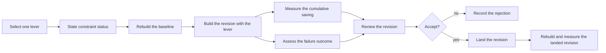

# Use case: reduce-distributed-executable-size

## Level

!

## Actors

- Release maintainer — primary Actor; selects a size lever, assesses its failure outcome, decides, lands and measures the result.
- Supporting: Contributor reviewer — reviews the build-configuration revision; cannot land or publish.
- Supporting: Project automation for the release maintainer — builds the baseline, the lever and the landed revision, and reports the measured sizes.

## Goal

Make the executable built for the supported platform smaller by applying only the size levers a measurement justifies.

## Trigger

The release maintainer selects one size lever the size attribution justifies.

## Preconditions

- A size attribution for the revision is available.
- The stable-toolchain, single-file and static-linking constraints hold.

## Main flow

1. Release maintainer selects one lever the size attribution justifies; System states the lever's constraint status before any build.
2. Project automation rebuilds the released revision as the baseline with the toolchain pinned in `rust-toolchain.toml` and the unchanged build configuration; System records the baseline's file size and reports the published binary's size separately.
3. Project automation builds the revision with the lever; System reports the measured saving against a rebuild of the same revision carrying the previously accepted levers but not this one, and the artifact's file size.
4. Release maintainer assesses the failure outcome; System reports whether a panic that ends the process still leaves a diagnosis, and whether a failed conversion still attempts a numbered diagnostic naming the source PDF and the failure reason.
5. Release maintainer prepares the build-configuration revision; Contributor reviewer reviews it; System reports the review outcome.
6. Release maintainer accepts or rejects the lever; System records the decision with its saving, the failure-outcome evidence, the review outcome and the reason.
7. Release maintainer lands the accepted revision; System rebuilds the landed revision and reports its size against the same-revision rebuild with the unchanged build configuration.

Steps 1–6 repeat for each candidate lever; one landing may carry several accepted levers, each with its cumulative saving.

## Extensions

- 3: the build fails → no saving is recorded; the rejection is recorded with the build failure as its reason; protects the minimal guarantee.
- 3: the lever measures larger or equal → rejected with the measured comparison; protects the success guarantee from an unfounded change.
- 4: the diagnosis is no longer preserved → the lever is refused and the refusal recorded with its reason; protects the minimal guarantee.
- 5: the review rejects the revision → it is not accepted, does not land, and the rejection is recorded; protects the minimal guarantee.
- 7: the landed rebuild is not smaller than the same-revision rebuild with the unchanged build configuration → the revision is corrected or reverted, and the discrepancy and the revert are recorded; protects the success guarantee.

## Rules

- Every proposed lever has one recorded decision. A refusal before a build names the violated constraint and records no measurement; otherwise the record states the measured saving, the failure-outcome evidence where the lever changes failure behavior, the review outcome where a revision was reviewed, and the reason. A lever is recorded as applied only after its landed revision was rebuilt and measured as smaller.
- A nightly-only flag, UPX or dynamic linking is not a size lever: it is refused before a build and recorded as a rejected proposal naming the violated constraint, never as a lever decision.
- Every saving is cumulative against the build configuration as it stood before that lever, carrying the previously accepted levers, so the landed difference equals the sum of the recorded savings.
- The baseline is the released revision rebuilt by the project's automation with the toolchain pinned in `rust-toolchain.toml` and the unchanged build configuration; the published binary's size is reported separately.
- Every saving is measured from the stripped executable built for the supported platform; the file size is the quantity.
- The diagnosis a panic leaves — the panic message or a numbered diagnostic — is recorded before the lever lands.
- A source build from the landed revision retains the conversion's failure diagnosis.

## Examples

- `panic = "abort"` measures 2,014,208 B against a 2,098,176 B rebuild of the same revision with the unchanged configuration: saves 83,968 B; the lever is applied.
- `opt-level = "s"` measures 2,084,864 B against the panic build's 2,014,208 B, 70,656 B larger; it is rejected and the configuration is unchanged.
- A nightly-only flag, UPX or dynamic linking is refused before a build, naming the violated constraint, and no baseline or saving is recorded.
- An unknown lever is refused before a build, naming the unsupported lever, and no baseline is recorded.
- A build that fails records no saving, and the build configuration is unchanged.
- The landed profile's executable is run on an unsupported source; it still writes a numbered diagnostic naming the source and reason.
- The published binary's size is reported separately from the rebuilt baseline and is never used as the baseline.

## Minimal guarantee

No failure outcome becomes less visible than before: a panic that ends the process leaves a diagnosis, and a failed conversion still attempts a new numbered diagnostic naming the source PDF and the failure reason, and when no report can be saved the primary failure remains visible. Every refusal, build failure, rejection or revert is recorded with its reason. An accepted lever whose revision does not land is recorded as not landed, never as applied. When no lever yields a reduction, the build configuration is unchanged.

## Success guarantee

The executable built for the supported platform from the landed build configuration is smaller than a rebuild of the same revision with the unchanged build configuration, by the recorded cumulative savings.

## Personas

- project-maintainer--release-owner
- contributor--build-configuration-reviewer
- crew-member--personal-calendar-owner

## Capabilities

- reduce-distributed-executable-size

## Interactions

| Capability | Consumer action | E2E scenario |
|---|---|---|
| reduce-distributed-executable-size | measure one size lever and read the landed saving and failure outcome | Maintainer measures the panic-abort lever and the landed executable is smaller |

## Includes

- none

## Extends

- none

## Out of scope

- Publishing a public release, including the archive, packaging, publication and the supported platform set (`publish-public-release`).
- A size ceiling or a refusal of a release on size.
- Nightly-only compiler flags, UPX and dynamic linking.
- Dependency feature selection and source-level dead-code pruning without a measured target.
- The WASM facade's load time and replacing the PDF extraction backend.
- Converting a duty plan and writing its diagnostics (`export-duty-plan-calendar`).

## Diagram

